<div align="center">

# CC Switch

### Claude Code, Claude Desktop, Codex, Gemini CLI, Grok Build, OpenCode, OpenClaw, Hermes Agent, Pi, MiniMax Code, Kimi Code, Oh My Pi를 위한 올인원 관리 도구

**API 공급자를 한 번의 클릭으로 전환하고 MCP, Skills, 프롬프트를 한곳에서 관리하세요. 더 이상 JSON / TOML / YAML 설정 파일을 손으로 편집하지 않아도 됩니다.**

[](https://github.com/farion1231/cc-switch/releases)
[](https://github.com/farion1231/cc-switch/releases)
[](https://tauri.app/)
[](https://github.com/farion1231/cc-switch/releases/latest)

<a href="https://trendshift.io/repositories/15372" target="_blank"></a>
<a href="https://www.star-history.com/#farion1231/cc-switch&Date"><picture><source media="(prefers-color-scheme: dark)" srcset="https://api.star-history.com/badge?repo=farion1231/cc-switch&theme=dark" /></picture></a>

<a href="https://trendshift.io/repositories/15372?utm_source=trendshift-badge&amp;utm_medium=badge&amp;utm_campaign=badge-trendshift-15372" target="_blank" rel="noopener noreferrer"></a>
<a href="https://trendshift.io/repositories/15372?utm_source=trendshift-badge&amp;utm_medium=badge&amp;utm_campaign=badge-trendshift-15372" target="_blank" rel="noopener noreferrer"></a>
<a href="https://trendshift.io/repositories/15372?utm_source=trendshift-badge&amp;utm_medium=badge&amp;utm_campaign=badge-trendshift-15372" target="_blank" rel="noopener noreferrer"></a>

### 🌐 유일한 공식 웹사이트: **[ccswitch.io](https://ccswitch.io)**

[English](README.md) | [简体中文](README_ZH.md) | [繁體中文](README_ZH-TW.md) | [日本語](README_JA.md) | 한국어 | [Türkçe](README_TR.md) | [Русский](README_RU.md) | [Deutsch](README_DE.md) | [변경 이력](CHANGELOG.md)

**[다운로드](#다운로드-및-설치) · [빠른 시작](#빠른-시작) · [기능](#기능) · [자주 묻는 질문](#자주-묻는-질문) · [사용자 매뉴얼](docs/user-manual/en/README.md)**

</div>

## ❤️후원

> [여기에 소개되고 싶으신가요?](mailto:support@ccswitch.io)

<details open>
<summary>클릭하여 접기</summary>

[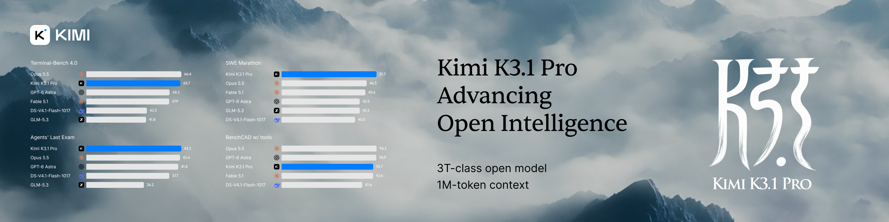](https://platform.kimi.ai?track_id=track-674ed6e2af924a5682a87421f7cf753a&aff=cc-switch)

Kimi K3.1 Pro는 Moonshot AI가 지금까지 선보인 가장 강력한 3T급 오픈 웨이트 모델로, 100만 토큰 컨텍스트 윈도우를 지원합니다. Kimi K3를 기반으로 훨씬 큰 규모의 후속 학습 연산을 투입해 코딩, 에이전트 워크플로, 3D 제작, 추론 전반에서 꾸준한 성능 향상을 이뤘습니다. CC Switch를 사용하면 여러 에이전트 도구에서 Kimi K3.1 Pro를 손쉽게 설정하고 전환할 수 있습니다.

**Kimi Code 요금제**([중문 사이트](https://www.kimi.com/code?aff=cc-switch) | [글로벌](https://www.kimi.ai/code?aff=cc-switch))를 체험해 보시거나, Kimi 오픈 플랫폼([중문 사이트](https://platform.kimi.com?track_id=track-7cf2b91dcde043eda6ef9a95951a042c&aff=cc-switch) | [글로벌](https://platform.kimi.ai?track_id=track-674ed6e2af924a5682a87421f7cf753a&aff=cc-switch))을 통해 **API**를 사용해 보세요.

**신규 사용자 충전 보너스**: 위의 API 링크로 가입하고 첫 충전을 완료하면 충전 금액의 10%를 API 크레딧으로 보너스 지급받습니다(최대 CNY ¥1,000).

---

<table>
<tr>
<td width="180"><a href="https://www.aicodemirror.ai/register?invitecode=9915W3">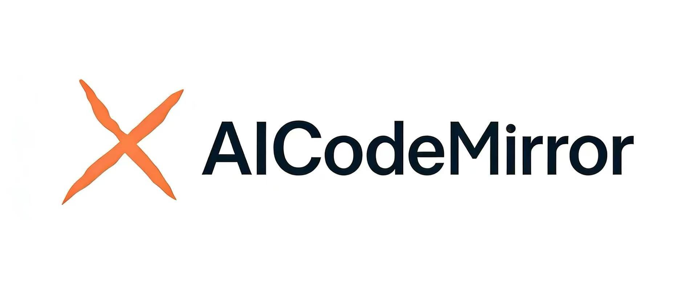</a></td>
<td>이 프로젝트를 후원해 주신 AICodeMirror에 감사드립니다! AICodeMirror는 Claude Code / Codex / Gemini CLI를 위한 공식 고안정성 릴레이 서비스를 제공하며, 엔터프라이즈급 동시성, 빠른 세금계산서 발행, 연중무휴 전담 기술 지원을 갖추고 있습니다.
Claude Code / Codex / Gemini 공식 채널을 정가의 38% / 2% / 9%에 제공하며, 충전 시 추가 할인도 있습니다! AICodeMirror는 CC Switch 사용자에게 특별 혜택을 드립니다. <a href="https://www.aicodemirror.ai/register?invitecode=9915W3">이 링크</a>로 가입하면 첫 충전 시 20% 할인을 받을 수 있고, 기업 고객은 최대 25% 할인을 받을 수 있습니다!</td>
</tr>

<tr>
<td width="180"><a href="https://www.packyapi.ai/register?aff=cc-switch"></a></td>
<td>이 프로젝트를 후원해 주신 PackyCode에 감사드립니다! PackyCode는 안정적이고 효율적인 API 릴레이 서비스 제공업체로, Claude Code, Codex, Gemini 등의 릴레이 서비스를 제공합니다. PackyCode는 저희 소프트웨어 사용자에게 특별 할인을 제공합니다. <a href="https://www.packyapi.ai/register?aff=cc-switch">이 링크</a>로 가입하고 첫 충전 시 "cc-switch" 프로모션 코드를 입력하면 10% 할인을 받을 수 있습니다.</td>
</tr>

<tr>
<td width="180"><a href="https://apinebula.ai/VjM74M">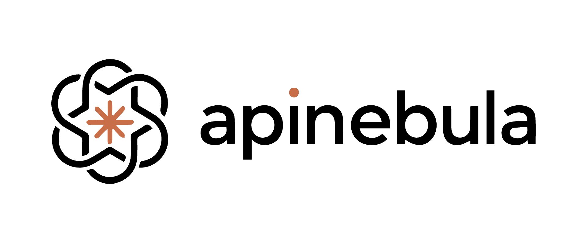</a></td>
<td>이 프로젝트를 후원해 주신 APINEBULA에 감사드립니다! APINEBULA는 Galaxy Video Bureau 산하의 엔터프라이즈급 AI 통합 플랫폼으로, 풍부한 플랫폼 자원을 바탕으로 개발자, 팀, 기업에 안정적이고 가성비 높은 대규모 언어 모델 API 접속을 제공합니다. 이 플랫폼은 Claude, GPT, Gemini 등 최상위 풀 스펙 모델을 통합하여 하나의 API로 세계 최고 수준의 AI 모델에 연결할 수 있게 하며, 가격은 정가의 10%부터 시작합니다. AI 프로그래밍, 에이전트 개발, 업무 시스템 연동을 위해 설계되었으며, 엔터프라이즈급 고동시성, 정식 계약, 법인 계좌 이체, 세금계산서 발행 서비스를 지원합니다. APINEBULA는 저희 소프트웨어 사용자에게 특별 할인을 제공합니다. <a href="https://apinebula.ai/VjM74M">이 링크</a>로 가입하고 첫 충전 시 <strong>"ccswitch"</strong> 프로모션 코드를 입력하면 <strong>10% 할인</strong>을 받을 수 있습니다.</td>
</tr>

<tr>
<td width="180"><a href="https://pateway.ai/?ch=etzpm8&aff=WB6M6F67#/">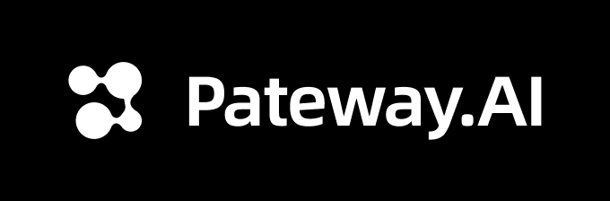</a></td>
<td>이 프로젝트를 후원해 주신 PatewayAI에 감사드립니다! PatewayAI는 숙련된 AI 개발자를 위한 API 릴레이 서비스 제공업체로, Claude, GPT 시리즈, 다양한 주요 중국 모델을 완벽하게 지원합니다. 모든 모델은 공식 고품질 채널에서 제공되며 희석하거나 위조하지 않고, 투명하고 검증 가능한 과금 내역을 제공합니다.
이코노미 모드는 정가의 5%까지 내려갑니다. <a href="https://pateway.ai/?ch=etzpm8&aff=WB6M6F67#/">이 링크</a>로 가입하면 $1 무료 체험 크레딧을 받을 수 있으며, 수시로 열리는 프로모션에 참여해 무료 크레딧을 더 받을 수도 있습니다.
또한 엔터프라이즈급 동시성, 전용 관리 콘솔, 정식 계약 및 세금계산서를 지원하며, 최대 $150까지 받을 수 있는 양방향 추천 충전 보너스도 제공합니다.</td>
</tr>

<tr>
<td width="180"><a href="https://hao.ai/invite/DTBZS3OR">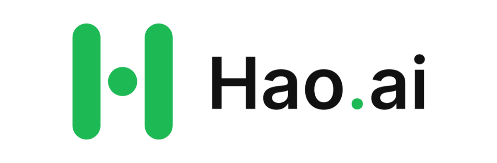</a></td>
<td>이 프로젝트를 후원해 주신 hao.ai에 감사드립니다! hao.ai는 개발자와 팀을 위한 빠르고 안정적인 통합 LLM API 게이트웨이입니다. 하나의 API 키와 통합 인터페이스로 GPT, Claude, xAI Grok 등 주요 모델에 접근할 수 있으며, OpenAI, Anthropic 등 일반적인 프로토콜과 SDK와 호환됩니다. 모델 라우팅, 장애 조치, 팀 관리, 전체 요청 로그를 제공하고, 모델 가격은 공식 참고 가격의 15%까지 낮아져 AI 애플리케이션을 더 간단하고 안정적이며 저렴하게 만들 수 있습니다. hao.ai는 CC Switch 사용자에게 특별 혜택을 제공합니다. <a href="https://hao.ai/invite/DTBZS3OR">이 링크</a>로 가입하면 첫 주문 시 5% 보너스 크레딧을 받을 수 있습니다!</td>
</tr>

<tr>
<td width="180"><a href="https://api.fenno.ai/register?redirect=/purchase?tab=subscription%26group=16&aff=P9MR3D3PLCNL">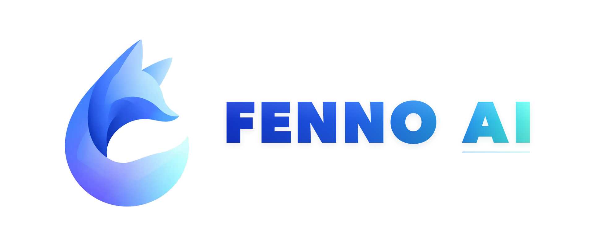</a></td>
<td>이 프로젝트를 후원해 주신 Fenno.ai에 감사드립니다! Fenno.ai는 안정적이고 효율적인 API 릴레이 서비스 제공업체로, 현재 Codex 릴레이에 집중하고 있습니다. OpenAI 및 Anthropic 프로토콜과 호환되어 Codex, Claude Code, OpenCode 등 주요 코딩 도구에서 유연하게 사용할 수 있습니다. 하루 수천억 토큰 규모의 엔터프라이즈급 워크로드를 안정적으로 지원하며, 국내외 법인을 위한 기업(B2B) 정산 및 세금계산서 발행을 제공합니다. Fenno.ai는 CC Switch 사용자에게 전용 혜택을 드립니다. <a href="https://api.fenno.ai/register?redirect=/purchase?tab=subscription%26group=16&aff=P9MR3D3PLCNL">이 링크</a>로 $50 상당의 크레딧(7일간 유효)이 제공되는 $1.99 체험 요금제에 가입하세요. 또한 최대 20%의 추천 보상을 받을 수 있으니, 더 많이 초대할수록 더 많이 받습니다!</td>
</tr>

<tr>
<td width="180"><a href="https://www.openmodel.ai?ref=cc-switch">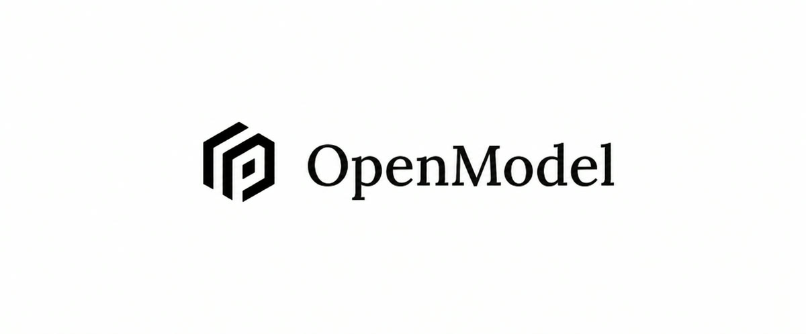</a></td>
<td>이 프로젝트를 후원해 주신 OpenModel에 감사드립니다! OpenModel은 지원되는 모델에서 Codex는 최대 90%, Claude Code는 최대 60%의 클라이언트별 할인을 제공하여, 개발자가 작업 방식을 바꾸지 않고도 API 비용을 줄일 수 있도록 돕습니다. OpenModel API 키만 연결하고 평소처럼 Codex나 Claude Code를 계속 사용하면 됩니다. 지원되는 클라이언트는 자동으로 감지되고 할인 경로가 적용되므로 추가 매개변수나 수동 라우팅이 필요 없습니다. API 키별로 폴백 동작을 설정하여, 할인 경로를 일시적으로 사용할 수 없을 때 정상 가격으로 계속할지 중단할지도 선택할 수 있습니다. CC Switch 사용자는 <a href="https://www.openmodel.ai?ref=cc-switch">이 링크</a>로 가입하고 프로모션 코드 <strong>"cc-switch"</strong>를 사용하면 첫 충전 시 10% 할인을 받을 수 있습니다.</td>
</tr>

<tr>
<td width="180"><a href="https://grooroute.pro/sign-up?aff=qqm9">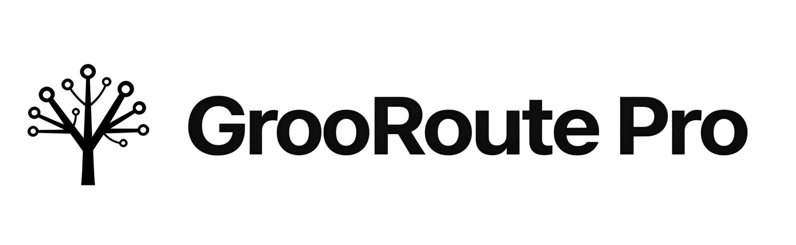</a></td>
<td>이 프로젝트를 후원해 주신 GrooRoute Pro에 감사드립니다! GrooRoute Pro는 OpenAI, Claude, DeepSeek 등 주요 모델에 접속할 수 있는 안정적이고 원활한 AI API 릴레이 플랫폼입니다. 해외 서버에 배포되어 있으며, 가격 배율 등급을 직접 선택할 수 있고 종량제 과금과 구독 요금제를 모두 제공하므로 가장 편한 방식으로 사용할 수 있습니다. 안정적인 경로와 빠른 응답으로 다양한 AI 기능을 더 쉽게 호출할 수 있습니다. CC Switch 사용자 전용 혜택: <a href="https://grooroute.pro/sign-up?aff=qqm9">이 링크</a>로 가입하면 ¥5의 무료 체험 크레딧을 받을 수 있습니다!</td>
</tr>

<tr>
<td width="180"><a href="https://buytoken.work/sign-up?aff=cc-switch">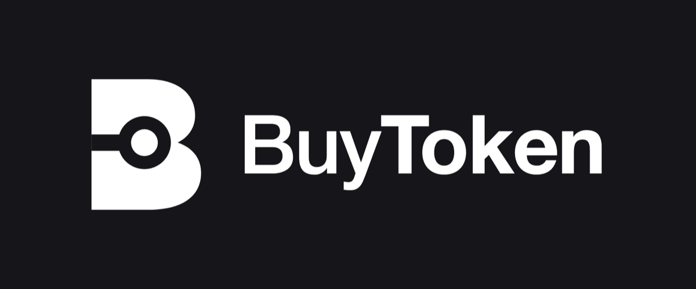</a></td>
<td>이 프로젝트를 후원해 주신 BuyToken에 감사드립니다! BuyToken은 Claude Code, Codex, DeepSeek 등의 릴레이 서비스를 제공하며, 엔터프라이즈급 동시성과 빠른 세금계산서 발행을 갖추고 안정적인 장기 운영 서비스를 목표로 합니다. BuyToken은 CC Switch 사용자에게도 특별 혜택을 제공합니다. <a href="https://buytoken.work/sign-up?aff=cc-switch">이 링크</a>로 가입하면 ¥3의 체험 크레딧과 첫 충전 10% 할인을 받을 수 있습니다!</td>
</tr>

<tr>
<td width="180"><a href="https://gpt.ge/signup?aff=URNP">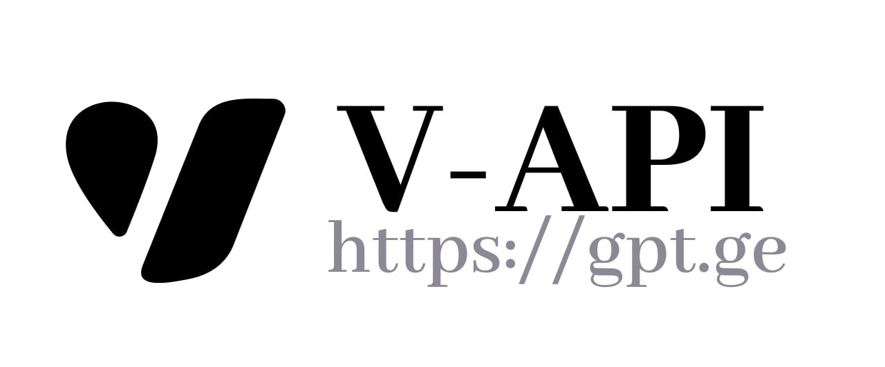</a></td>
<td>이 프로젝트를 후원해 주신 V-API에 감사드립니다! V-API는 개인, 개발자, 기업에 고품질 LLM API 서비스를 위한 안정적이고 빠르며 안전한 플랫폼을 제공하는 데 전념해 온 3년 차 브랜드로, 정식 계약과 공식 세금계산서(일반 / 특별 부가가치세)를 지원합니다. V-API는 CC Switch 사용자에게 특별 혜택을 제공합니다. <a href="https://gpt.ge/signup?aff=URNP">이 링크</a>로 가입하면 ¥2 할인과 첫 주문 10% 할인을 받을 수 있습니다!</td>
</tr>

<tr>
<td width="180"><a href="https://agentmarket.fluxapay.xyz/marketplace/tokenplans">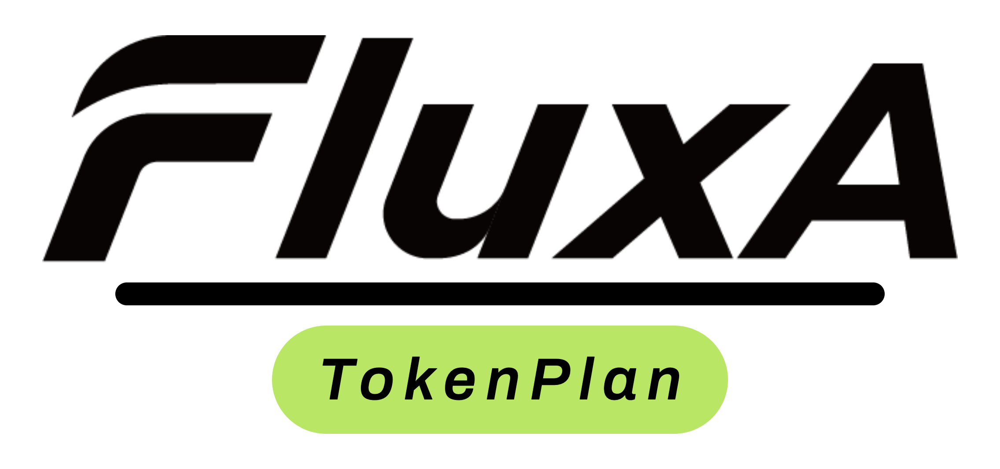</a></td>
<td>이 프로젝트를 후원해 주신 FluxA &amp; Baidu AI Cloud에 감사드립니다! FluxA와 Baidu AI Cloud는 AI 에이전트가 모델, API, 도구를 스스로 구매하고 관리하며 사용할 수 있게 하는 AgenticPlan을 공동으로 출시했습니다. 최대 40% 할인된 Baidu Qianfan TokenPlan이 포함되어 있으며, DeepSeek V4, GLM 5.2, Kimi 등 주력 모델을 이용할 수 있습니다. 또한 FluxA AgentMarket API 보너스 크레딧으로 검색, 데이터 수집, 소셜 미디어, 금융, 암호화폐, 이미지 생성, 동영상 등 13,000개 이상의 유료 API를 사용할 수 있습니다.<br>사용자의 승인이 있으면 AI 에이전트가 공식 Visa 카드로 직접 결제하여 자원을 조달하고, API 키를 관리하며, 사용량을 모니터링하고 갱신을 계획할 수도 있습니다. 에이전트가 "스스로 작업을 완수하는 단계"에서 진정으로 "스스로 예산을 계획하고 작업을 완수하는 단계"로 나아가게 합니다. <a href="https://agentmarket.fluxapay.xyz/marketplace/tokenplans">이 링크</a>로 구매하세요!</td>
</tr>

<tr>
<td width="180"><a href="https://aigocode.net/invite/CC-SWITCH"><picture><source media="(prefers-color-scheme: dark)" srcset="assets/partners/logos/aigocode-dark.png">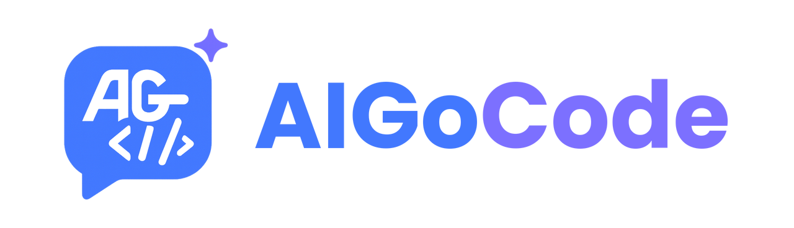</picture></a></td>
<td>이 프로젝트를 후원해 주신 AIGoCode에 감사드립니다! AIGoCode는 토큰 종량제에 그치지 않는 구독형 AI 코딩 플랫폼입니다. 계정 하나와 월 요금제 하나로 Claude Code, Codex, Gemini를 사용할 수 있으며, 중국 본토에서 직접 연결되고 응답이 빠릅니다. <a href="https://aigocode.net/invite/CC-SWITCH">이 링크</a>로 구독하면 크레딧 10%를 추가로 받을 수 있습니다!</td>
</tr>

<tr>
<td width="180"><a href="https://teamorouter.com/?utm_source=cc_switch&utm_medium=referral&utm_campaign=ai_directory">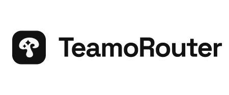</a></td>
<td>이 프로젝트를 후원해 주신 TeamoRouter에 감사드립니다! TeamoRouter는 개발자, AI 팀, 기업을 위해 만들어진 엔터프라이즈급 Agentic LLM 게이트웨이입니다. 구독 없이도 하나의 통합 API로 Claude Code, Codex, Gemini CLI, OpenAI Codex 등 인기 AI 에이전트에 접속할 수 있으며, 최대 90% 할인된 API 가격을 제공합니다.
일반적인 API 릴레이 서비스와 달리 TeamoRouter는 OpenAI, Anthropic, Vertex, Azure, AWS bedrock을 포함한 수백 곳의 공식 모델 제공업체와 신뢰할 수 있는 인프라 파트너를 통합합니다. 모든 제공업체는 에이전트 프로토콜 100% 호환성, 캐시 성능, 요청 추적성을 검증받아, 역공학이나 희석된 엔드포인트가 아닌 안정적인 품질을 보장합니다. 이 플랫폼은 공식에 가까운 TTFT, 99.6% SLA, 최대 5,000 QPM의 엔터프라이즈급 처리량, 업계 최고 수준의 캐시 적중률을 제공하여 장시간 실행되는 에이전트 워크플로의 토큰 비용을 크게 줄여 줍니다.
TeamoRouter는 통합 청구, 팀 관리, BYOK, 스마트 라우팅, 사용량 분석, 동적 제공업체 최적화, 전담 지원 등 엔터프라이즈 기능도 제공합니다. 더 간편한 경험을 원하신다면 Teamo Desktop으로 API 키 관리나 수동 게이트웨이 설정 없이 한 번의 설정으로 Claude Code, Codex, Gemini CLI 등 인기 AI 에이전트를 사용할 수 있습니다. 신규 사용자는 <a href="https://teamorouter.com/?utm_source=cc_switch&utm_medium=referral&utm_campaign=ai_directory">이 링크</a>로 가입하면 첫 충전 시 10% 할인을 받을 수 있습니다.</td>
</tr>

<tr>
<td width="180"><a href="https://aicoding.inc/i/CCSWITCH">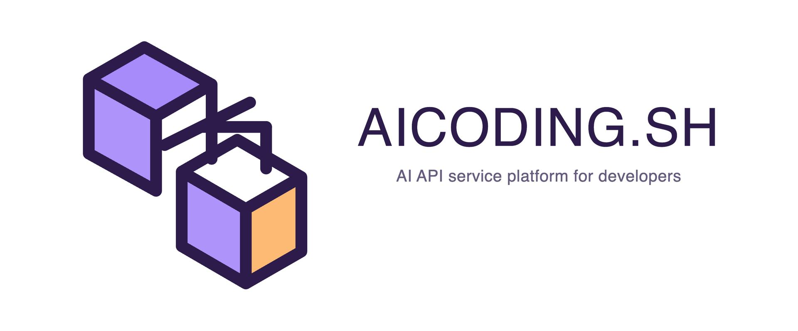</a></td>
<td>이 프로젝트를 후원해 주신 AICoding에 감사드립니다! AICoding은 최고의 가격을 자랑하는 글로벌 AI 모델 API 릴레이 서비스입니다! Claude Code는 정가의 19%, GPT는 단 1%! 수백 개 기업이 신뢰하는 가성비 높은 AI 서비스입니다. Claude Code, GPT, Gemini 및 주요 중국 모델을 지원하며, 엔터프라이즈급 고동시성, 빠른 세금계산서 발행, 연중무휴 전담 기술 지원을 갖추고 있습니다. <a href="https://aicoding.inc/i/CCSWITCH">이 링크</a>로 가입한 CC Switch 사용자는 첫 충전 시 10% 할인을 받습니다!</td>
</tr>

<tr>
<td width="180"><a href="https://subrouter.ai/register?aff=l3ri">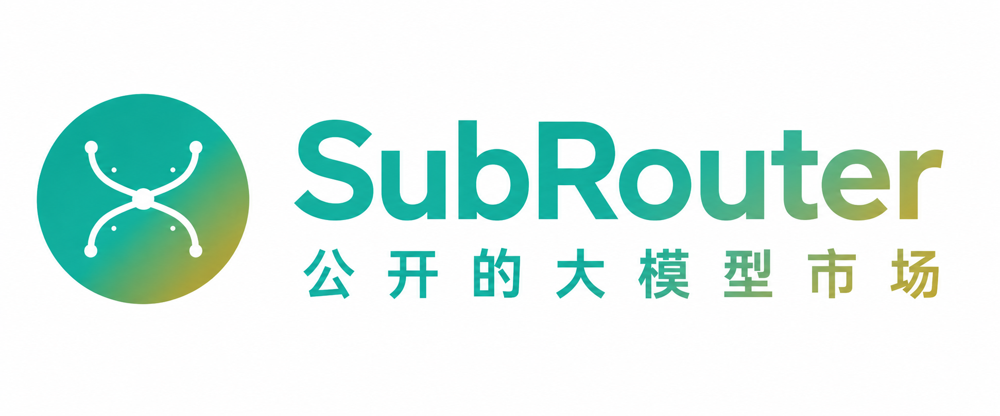</a></td>
<td>이 프로젝트를 후원해 주신 SubRouter에 감사드립니다! SubRouter는 AI 서비스 운영자를 위한 마켓플레이스 겸 스마트 라우팅 플랫폼입니다. 판매자는 운영 사이트를 열고 패키지를 게시하며 사용자, 모델, 가격을 관리할 수 있고, 사용자는 서비스를 찾아 하나의 통합 API로 신뢰할 수 있는 AI 모델에 접속할 수 있습니다. <a href="https://subrouter.ai/register?aff=l3ri">이 링크</a>로 가입하세요!</td>
</tr>

<tr>
<td width="180"><a href="https://runapi.host/register?aff=iOKB">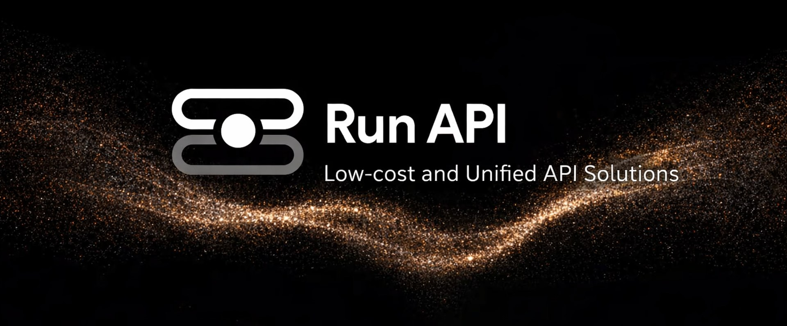</a></td>
<td>이 프로젝트를 후원해 주신 RunAPI에 감사드립니다! RunAPI는 고성능의 신뢰할 수 있는 AI 모델 API 게이트웨이로, API 키 하나로 OpenAI, Claude, Gemini, DeepSeek, Grok 등 150개 이상의 주요 모델에 접속할 수 있으며, 가격은 공식 요금의 10%까지 낮고 안정성도 뛰어납니다. Claude Code, OpenClaw 등의 도구와 매끄럽게 연동됩니다. CC Switch 사용자 전용 혜택: <a href="https://runapi.host/register?aff=iOKB">이 링크</a>로 가입하면 첫 충전 시 10% 할인을 받을 수 있습니다!</td>
</tr>

<tr>
<td width="180"><a href="https://open.ospreyai.cn">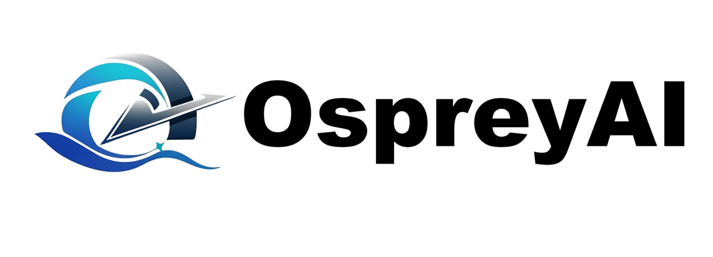</a></td>
<td>이 프로젝트를 후원해 주신 OspreyAI에 감사드립니다! ACS OspreyAI는 개발자와 기업을 위한 원스톱 멀티 모델 API 플랫폼입니다. API 키 하나로 Claude, Gemini, GPT, GLM, Kimi, Qwen, DeepSeek, Tencent Hunyuan 등 국내외 선도 모델에 접속할 수 있습니다. OpenAI, Anthropic 등 주요 API 프로토콜과 호환되며 Claude Code, Codex, OpenCode, Pi, Hermes 같은 인기 AI 도구와 함께 사용할 수 있습니다. 해외 모델은 공식 가격보다 20~40%, 중국 모델은 30~50% 저렴합니다. 통합 충전, 통합 청구, 사용량 추적, 유연한 모델 전환을 제공하여 AI 앱 개발, 콘텐츠 제작, 자동화 워크플로에 적합합니다. <a href="https://open.ospreyai.cn">이 링크</a>로 계정을 만들면 할인을 받고 국내외 선도 모델에 빠르게 연결할 수 있습니다.</td>
</tr>

<tr>
<td width="180"><a href="https://www.shengsuanyun.com/?from=CH_4HHXMRYF">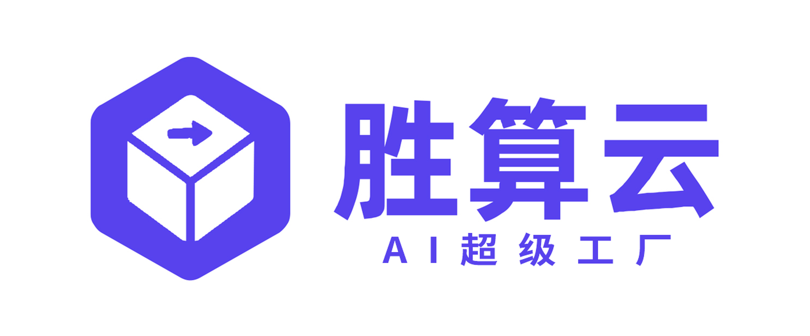</a></td>
<td>이 프로젝트를 후원해 주신 Shengsuanyun에 감사드립니다! Shengsuanyun은 AI Native 팀을 위한 슈퍼 팩토리로, 산업 수준의 AI 작업 병렬 실행 플랫폼입니다. 모델 마켓플레이스는 Claude, ChatGPT, Gemini 등 국내외 LLM 및 멀티미디어 모델 기능을 직접 공급으로 통합합니다. 역공학이나 희석은 일절 없으며, 플랫폼 전체 모델 SLA 가용성은 99.7%에 달하고 <a href="https://watch.shengsuanyun.com/status/shengsuanyun">모니터링 대시보드</a>는 전 항목이 정상으로 표시됩니다. 또한 세밀한 팀 비용 및 권한 관리, 스마트 라우팅, 보안 보호, BYOK(Bring Your Own Key) 호스팅을 위한 엔터프라이즈급 맞춤형 게이트웨이도 제공합니다. 플랫폼은 종량제와 토큰 요금제(출시 예정) 방식으로 과금하며 세금계산서 발행이 가능합니다. 신규 사용자는 <a href="https://www.shengsuanyun.com/?from=CH_4HHXMRYF">이 링크</a>로 가입하면 ¥10 크레딧과 첫 충전 10% 보너스를 받을 수 있습니다.</td>
</tr>

<tr>
<td width="180"><a href="https://88api.ai/sign-up?aff=HSGY">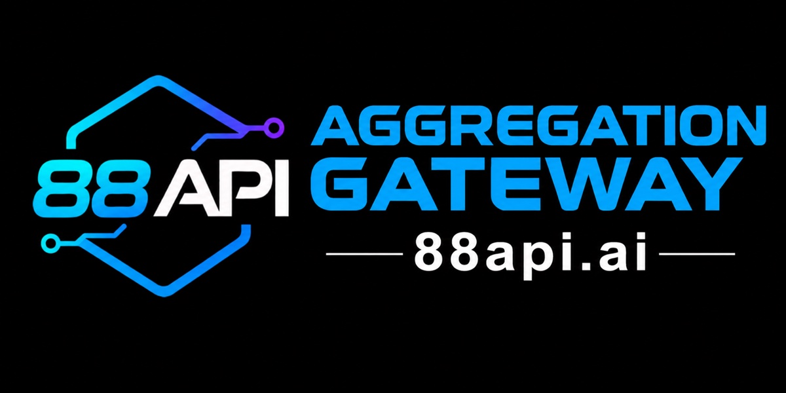</a></td>
<td>이 프로젝트를 후원해 주신 88API 토큰 통합 플랫폼에 감사드립니다! 88API는 홍콩 법인이 운영하는 원스톱 멀티 모델 API 플랫폼으로, 주로 개발자, 크리에이터, AI 애플리케이션 사용자를 위해 만들어졌습니다. 통합 인터페이스로 텍스트, 이미지, 음성, 동영상 모델에 접근할 수 있으며 AI 코딩, 스마트 번역, 콘텐츠 제작, 음성 해설, 이미지 생성, 동영상 생성 등 일반적인 워크플로를 모두 아우릅니다. CC Switch 안에서 공급자로 추가하고 바로 전환할 수 있습니다. 88API는 주요 국제 결제 수단을 지원하고, 세금계산서를 발행할 수 있으며, 엔터프라이즈급 안정적인 서비스를 제공합니다. <a href="https://88api.ai/sign-up?aff=HSGY">이 링크</a>로 가입하면 전용 보너스 크레딧을 받을 수 있습니다!</td>
</tr>

<tr>
<td width="180"><a href="https://apikey.fan/register?aff=CCSwitch">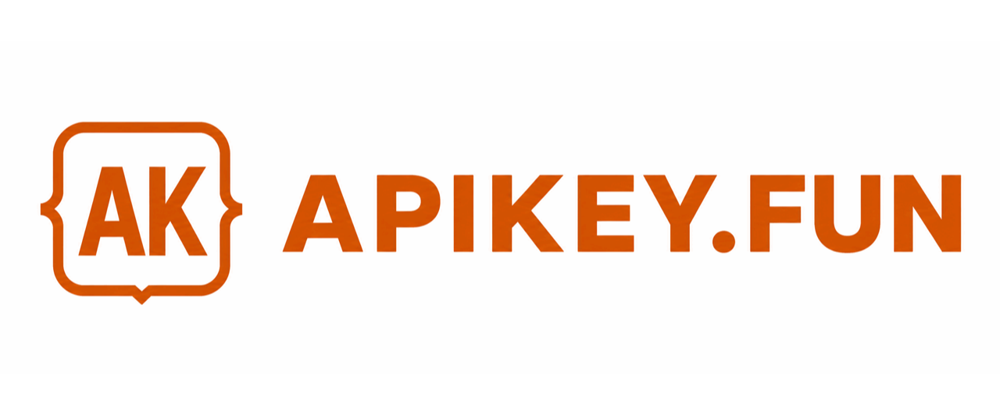</a></td>
<td>이 프로젝트를 후원해 주신 APIKEY.FUN에 감사드립니다! APIKEY.FUN은 기업과 개인 개발자에게 안정적이고 효율적이며 저렴한 AI 모델 API 접속을 제공하는 데 전념하는 전문 엔터프라이즈급 AI 릴레이 플랫폼입니다. Claude, OpenAI, Gemini 등 인기 주요 모델을 지원하며, 가격은 공식 요금의 7%까지 낮습니다. 이 프로젝트의 <a href="https://apikey.fan/register?aff=CCSwitch">전용 링크</a>로 가입하면 최대 <strong>충전 시 영구 5% 할인</strong>이라는 전용 혜택을 누릴 수 있습니다.</td>
</tr>

<tr>
<td width="180"><a href="https://9527.codes/register?channel=ccs">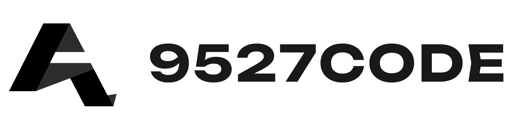</a></td>
<td>이 프로젝트를 후원해 주신 9527CODE에 감사드립니다! 9527 CODE는 안정성과 서비스 품질에 집중하는 엔터프라이즈급 풀 기능 AI 릴레이 플랫폼으로, Claude Code, Codex 등 주요 AI 모델에 빠르고 안정적이며 품질 높은 릴레이 서비스를 제공합니다. 장기적인 안정성, 경로 품질, 지속적인 가용성을 더욱 중시하며, 기업과 헤비 AI 사용자에게 안정적이고 효율적인 원스톱 모델 접속 솔루션을 제공합니다. 1년간의 무중단 운영, 99.9% 서비스 안정성, 연중무휴 7×24 전문 상담원 기술 지원을 갖추고 있습니다. 이 프로젝트의 <a href="https://9527.codes/register?channel=ccs">전용 링크</a>로 가입하세요. 신규 사용자는 고객센터에 문의해 체험 크레딧을 받을 수 있으며, 추천 캐시백은 무제한입니다!</td>
</tr>

<tr>
<td width="180"><a href="https://ppio.com/activity/ccswitch">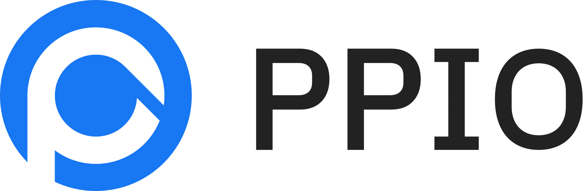</a></td>
<td>이 프로젝트를 후원해 주신 PPIO에 감사드립니다! PPIO는 중국을 대표하는 독립 Agentic Cloud 제공업체로, 2018년 PPTV 창업자 Yao Xin과 전 PPTV 수석 아키텍트 Wang Wenyu가 공동 설립했습니다. API 키 하나로 DeepSeek-V4-Flash, Kimi-K3, GLM-5.2, MiniMax-M3 등 모든 주력 오픈소스 모델에 접속할 수 있습니다. 엔터프라이즈 Token Plan은 최대 40% 할인으로 제공되며 200석을 지원하고, Fusion 혼합 모델은 Fable5와 동등한 성능을 10분의 1 가격으로 제공합니다. <a href="https://ppio.com/activity/ccswitch">이 링크</a>로 가입하고 본인 인증을 완료하면 ¥10 크레딧 바우처를 받을 수 있으며, 친구를 초대해 충전하게 하면 그 지출액의 최대 15%를 캐시백으로 받습니다.</td>
</tr>

<tr>
<td width="180"><a href="https://www.newapi.ai/">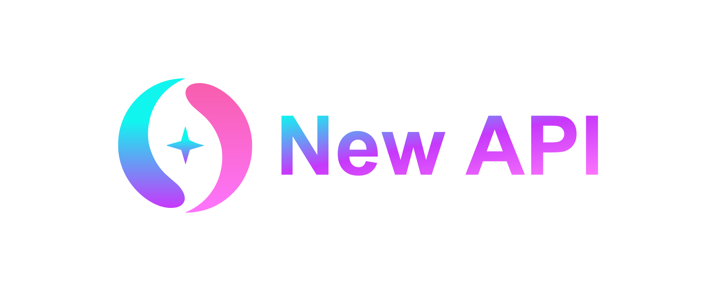</a></td>
<td>오픈소스 AI 인프라 프로젝트 <a href="https://www.newapi.ai/">new-api</a>가 이 프로젝트를 강력하게 지원해 주신 것에 감사드립니다! new-api는 QuantumNous의 오픈소스 AI 인프라 프로젝트로, 활성도와 도입률 면에서 선도적인 통합 LLM 접속 및 배포 프로젝트 중 하나이며, 개발자, 팀, 기업이 더 낮은 비용으로 관리 가능하고 확장 가능한 AI 서비스 플랫폼을 구축할 수 있도록 돕는 데 집중합니다. 오픈소스 생태계에 뿌리를 둔 동료 프로젝트로서, new-api는 더 많은 훌륭한 오픈소스 프로젝트의 지속적인 성장을 후원하고 지원하기를 바랍니다. 🌟 new-api에 Star를 눌러 응원해 주세요: <a href="https://github.com/QuantumNous/new-api">https://github.com/QuantumNous/new-api</a>. 웹사이트: <a href="https://www.newapi.ai/">https://www.newapi.ai/</a>.</td>
</tr>

<tr>
<td width="180"><a href="https://claudecn.ai/register?aff=HEL9">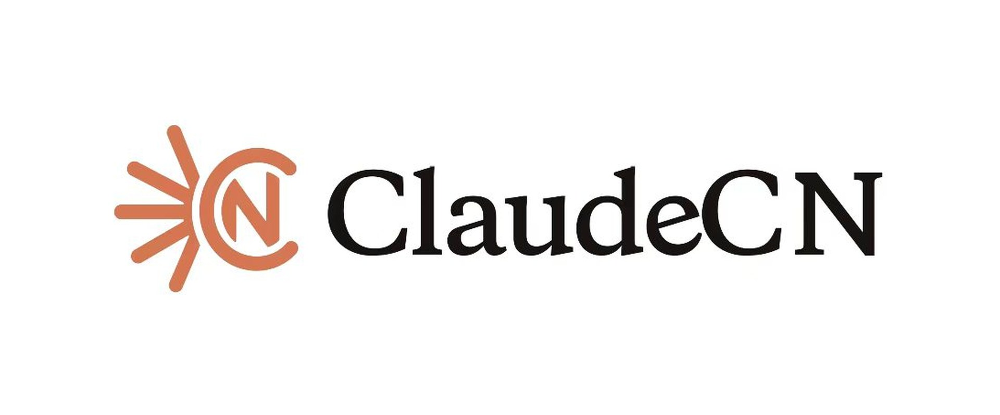</a></td>
<td>이 프로젝트를 후원해 주신 ClaudeCN에 감사드립니다! ClaudeCN은 등록된 법인이 운영하는 엔터프라이즈급 AI 게이트웨이 플랫폼입니다. Claude, GPT, DeepSeek 등 인기 모델에 대한 고가용성 상용 API 접속을 제공하며, 법인 계좌 이체, 서명된 계약, 완전한 규정 준수 등 정식 기업 구매 절차를 중심으로 설계되었습니다. <a href="https://claudecn.ai/register?aff=HEL9">이 링크</a>로 가입하세요!</td>
</tr>

<tr>
<td width="180"><a href="https://www.byteplus.com/en/product/modelark?utm_campaign=hw&utm_content=ccswitch&utm_medium=devrel_tool_web&utm_source=OWO&utm_term=ccswitch">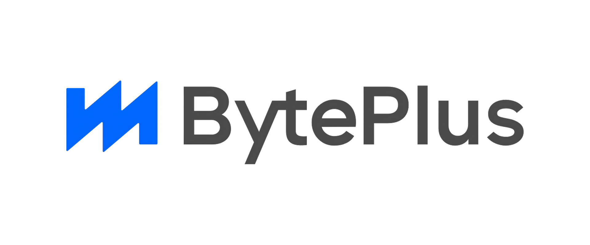</a></td>
<td>이 프로젝트를 후원해 주신 Dola seed에 감사드립니다! Dola Seed 2.0은 ByteDance가 글로벌 시장을 위해 자체 개발한 전 모달리티 범용 대형 모델입니다. 통합 멀티모달 아키텍처를 기반으로 텍스트, 이미지, 오디오, 동영상의 통합 이해와 생성을 지원합니다. 에이전트 협업을 네이티브로 지원하며 강력한 추론, 장기 작업 수행, 도구 연동, 코딩 능력을 갖추고 있습니다. 스마트 콕핏, 개인 비서, 교육, 고객 지원, 마케팅, 리테일 등 다양한 시나리오에 폭넓게 적용할 수 있습니다. 멀티모달 인지, 엔드투엔드 복합 작업 수행, 안정적인 상호작용, 데이터 보안에서 뛰어난 성능을 보이며, ModelArk 플랫폼에서 손쉽게 접속하고 배포할 수 있습니다. <a href="https://www.byteplus.com/en/product/modelark?utm_campaign=hw&utm_content=ccswitch&utm_medium=devrel_tool_web&utm_source=OWO&utm_term=ccswitch">이 링크</a>로 가입하면 모델당 500,000 토큰의 무료 추론 할당량을 받을 수 있습니다.<a href="https://www.volcengine.com/activity/ai618?utm_campaign=hw&utm_content=hw&utm_medium=devrel_tool_web&utm_source=OWO&utm_term=ccswitch"> >>中国大陆地区的开发者请点击这里</a></td>
</tr>

<tr>
<td width="180"><a href="https://cloud.siliconflow.cn/i/YflgU2Ve">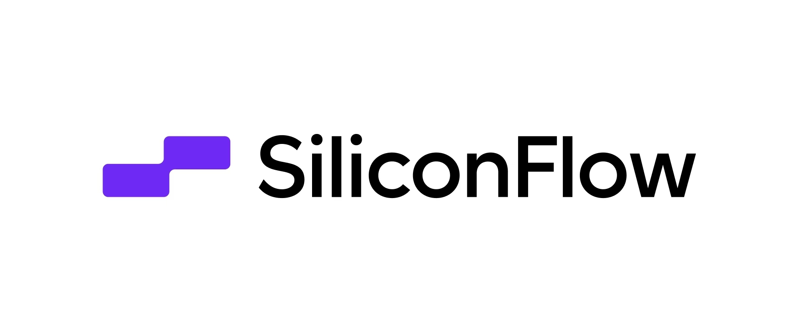</a></td>
<td>이 프로젝트를 후원해 주신 SiliconFlow에 감사드립니다! SiliconFlow는 언어, 음성, 이미지, 동영상 모델에 빠르고 안정적으로 한곳에서 접속할 수 있는 고성능 AI 인프라 및 모델 API 플랫폼입니다. 종량제 과금, 폭넓은 멀티모달 모델 지원, 고속 추론, 엔터프라이즈급 안정성으로 개발자와 팀이 AI 애플리케이션을 더 효율적으로 구축하고 확장하도록 돕습니다. <a href="https://cloud.siliconflow.cn/i/YflgU2Ve">이 링크</a>로 가입하고 실명 인증을 완료하면 플랫폼의 여러 모델에서 사용할 수 있는 ¥16 보너스 크레딧을 받을 수 있습니다. SiliconFlow는 이제 OpenClaw와도 호환되어, 사용자가 SiliconFlow API 키를 연결하고 주요 AI 모델을 무료로 호출할 수 있습니다.</td>
</tr>

<tr>
<td width="180"><a href="https://a6api.vip/register?aff=AqNr">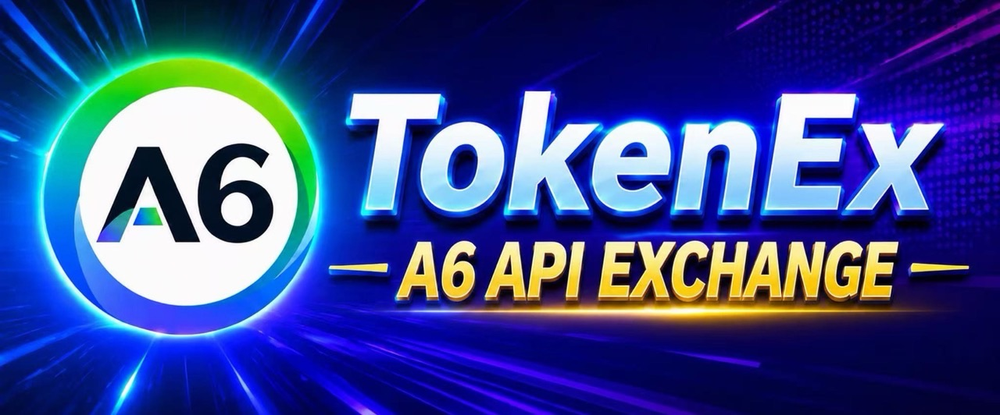</a></td>
<td><a href="https://a6api.vip/register?aff=AqNr">A6API</a>가 이 프로젝트를 후원해 주신 것에 감사드립니다! A6API는 Claude, GPT, Gemini, Codex 등 주요 모델을 아우르는 원스톱 AI 모델 API 통합 플랫폼입니다. 여러 공급업체가 플랫폼에 공급 물량을 등록할 수 있어 같은 모델도 여러 업스트림 제공업체가 경쟁적으로 가격을 제시합니다. 스마트 라우팅이 더 안정적이고 저렴한 경로를 자동으로 선택하고 자동으로 장애 조치를 수행하여 요청 실패를 줄이고 비용을 절감하며 안정성을 높여 줍니다. 개인 개발자, AI 제품 팀, 스튜디오 누구나 통합 인터페이스로 빠르게 연동할 수 있으며, 모든 형식과 호환되어 마이그레이션 비용이 낮습니다. <a href="https://a6api.vip/register?aff=AqNr">이 링크</a>로 가입한 신규 사용자는 무료 체험 크레딧을 받습니다. 먼저 써 보고, 저렴하게 이용하세요.</td>
</tr>

<tr>
<td width="180"><a href="https://www.compshare.cn/coding-plan?ytag=GPU_YY_YX_git_cc-switch">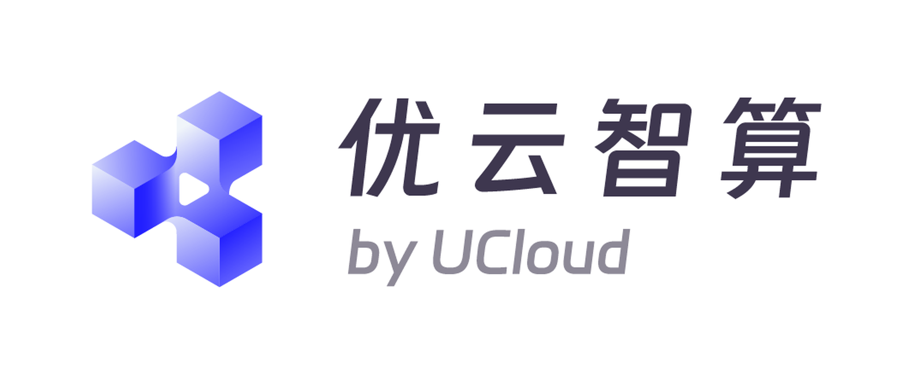</a></td>
<td>이 프로젝트를 후원해 주신 Compshare에 감사드립니다! Compshare는 UCloud의 AI 클라우드 플랫폼으로, 키 하나만으로 안정적이고 포괄적인 국내외 모델 API를 제공합니다. 가성비 좋은 월정액 및 종량제 중국 모델 Coding Plan 패키지와, 안정적으로 공식 릴레이되는 해외 모델을 함께 제공합니다. Claude Code, Codex, API 접속을 지원합니다. 엔터프라이즈급 고동시성, 연중무휴 기술 지원, 셀프서비스 세금계산서 발행을 제공합니다. <a href="https://www.compshare.cn/coding-plan?ytag=GPU_YY_YX_git_cc-switch">이 링크</a>로 가입한 사용자는 5 CNY의 플랫폼 체험 크레딧을 무료로 받습니다!</td>
</tr>

<tr>
<td width="180"><a href="https://sssaicodeapi.com/register?ref=DCP0SM">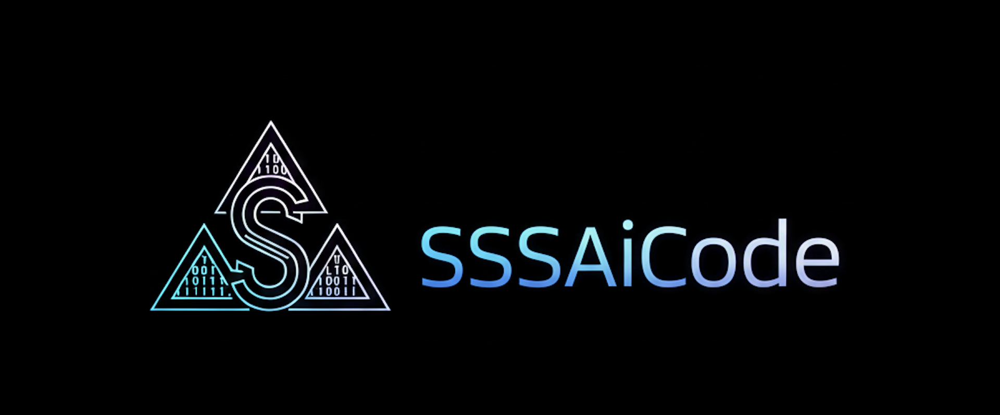</a></td>
<td>이 프로젝트를 후원해 주신 SSSAiCode에 감사드립니다! SSSAiCode는 안정적이고 신뢰할 수 있는 API 릴레이 서비스로, 안정적이고 믿을 수 있으며 저렴한 Claude 및 Codex 모델 서비스를 제공하는 데 전념하고 있으며 당일 빠른 세금계산서 발행을 지원합니다. SSSAiCode는 CC Switch 사용자에게 특별 혜택을 제공합니다. <a href="https://sssaicodeapi.com/register?ref=DCP0SM">이 링크</a>로 가입하면 충전할 때마다 $10 추가 크레딧을 받을 수 있습니다!</td>
</tr>

<tr>
<td width="180"><a href="https://soleapi.com/r/ccswitch">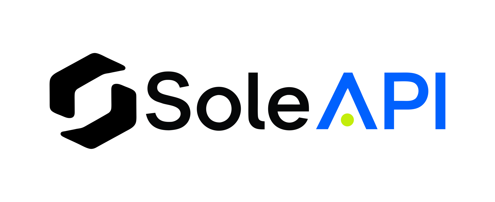</a></td>
<td>이 프로젝트를 지원해 주신 SoleAPI에 감사드립니다! SoleAPI는 개발자와 기업을 위한 AI 모델 게이트웨이로, API 키 하나로 Claude, GPT, Gemini 등 30개 이상의 선도 모델에 접속할 수 있습니다. OpenAI 및 Anthropic 프로토콜과 네이티브로 호환되므로 Claude Code, Codex, Cursor와 기존 SDK도 Base URL만 바꾸면 그대로 동작합니다. 지연 시간과 업스트림 상태에 따라 실시간으로 요청을 라우팅하고, 밀리초 단위로 예비 채널로 자동 장애 조치하며, 99.99% 서비스 가용성과 연중무휴 기술 지원을 제공합니다. 모든 호출은 하나의 청구서에 모이고, 요청별 토큰 및 비용 내역을 언제든 확인할 수 있습니다. 이 프로젝트의 <a href="https://soleapi.com/r/ccswitch">추천 링크</a>로 가입하면 무료 체험 크레딧을 받고, 친구를 초대해 충전하게 하면 지속적인 캐시백을 받을 수 있습니다!</td>
</tr>

<tr>
<td width="180"><a href="https://www.micuapi.ai/register?aff=aOYQ">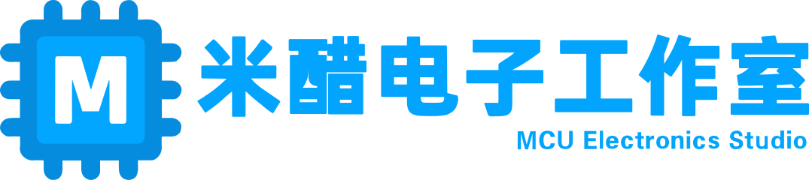</a></td>
<td>이 프로젝트를 후원해 주신 Micu API에 감사드립니다! Micu API는 최고의 가성비와 높은 안정성을 제공하는 데 전념하는 글로벌 LLM 릴레이 서비스 제공업체입니다. 등록된 법인이 핵심을 보증하므로 서비스 중단 위험이 없으며, 공식 세금계산서도 빠르게 지원합니다! "체험 비용 제로"를 지향하여 최소 금액 제한 없이 ¥1부터 충전할 수 있고, 언제든 수수료 없이 환불받을 수 있습니다! Micu API는 CC Switch 사용자에게 전용 혜택을 제공합니다. <a href="https://www.micuapi.ai/register?aff=aOYQ">이 링크</a>로 가입하고 충전할 때 프로모션 코드 "ccswitch"를 입력하면 <strong>10% 할인</strong>을 받을 수 있습니다!</td>
</tr>

<tr>
<td width="180"><a href="https://www.rightapi.ai/register?aff=CCSWITCH">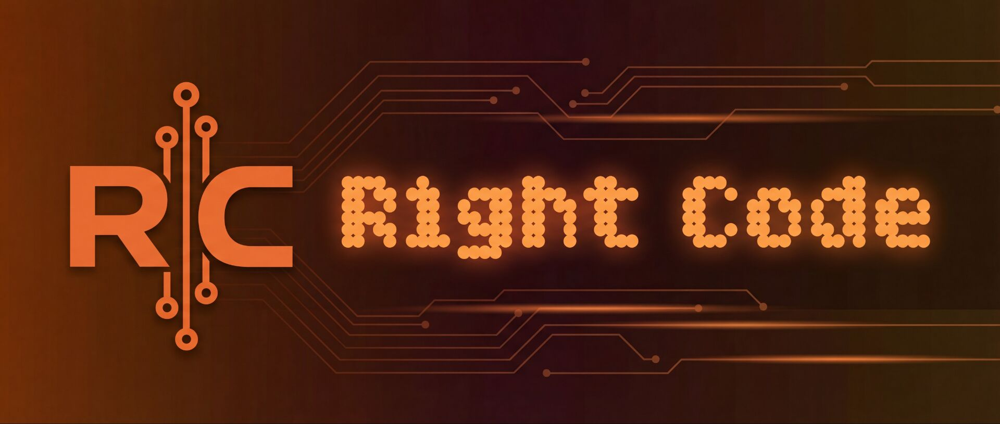</a></td>
<td>이 프로젝트를 후원해 주신 Right Code에 감사드립니다! Right Code는 Claude Code, Codex, Gemini 등 모델의 라우팅 서비스를 안정적으로 제공하며, 종량제와 월 구독 과금 옵션을 모두 이용할 수 있습니다. 충전 시 세금계산서를 발행할 수 있고, 기업 및 팀 사용자는 전담 1:1 지원을 받을 수 있습니다. Right Code는 CC Switch 사용자를 위한 전용 할인도 제공합니다. <a href="https://www.rightapi.ai/register?aff=CCSWITCH">이 링크</a>로 가입하면 충전할 때마다 결제 금액의 5%에 해당하는 종량제 크레딧을 받습니다.</td>
</tr>

<tr>
<td width="180"><a href="https://cubence.com/signup?code=CCSWITCH&source=ccs">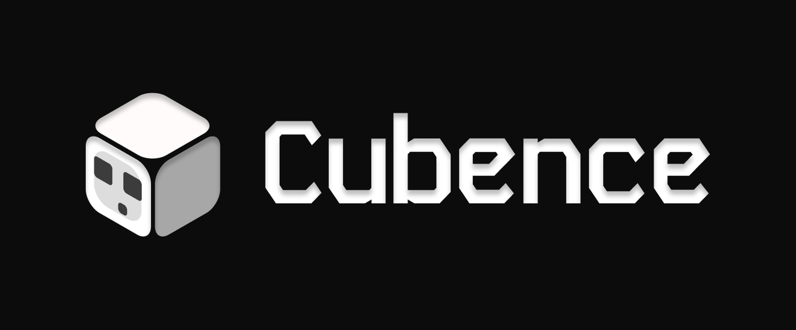</a></td>
<td>이 프로젝트를 후원해 주신 Cubence에 감사드립니다! Cubence는 안정적이고 효율적인 API 릴레이 서비스 제공업체로, Claude Code, Codex, Gemini 등의 릴레이 서비스를 종량제와 월 요금제 등 유연한 과금 옵션과 함께 제공합니다. Cubence는 CC Switch 사용자에게 특별 할인을 제공합니다. <a href="https://cubence.com/signup?code=CCSWITCH&source=ccs">이 링크</a>로 가입하고 충전할 때 "CCSWITCH" 프로모션 코드를 입력하면 모든 충전에서 10% 할인을 받을 수 있습니다!</td>
</tr>

<tr>
<td width="180"><a href="https://crazyrouter.com/register?aff=OZcm&ref=cc-switch">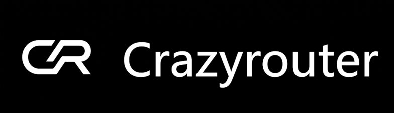</a></td>
<td>이 프로젝트를 후원해 주신 Crazyrouter에 감사드립니다! Crazyrouter는 고성능 AI API 통합 플랫폼으로, API 키 하나로 Claude Code, Codex, Gemini CLI 등을 포함한 300개 이상의 모델을 사용할 수 있습니다. 모든 모델이 공식 가격의 55%이며 자동 장애 조치, 스마트 라우팅, 무제한 동시성을 제공합니다. Crazyrouter는 CC Switch 사용자에게 전용 혜택을 제공합니다. <a href="https://crazyrouter.com/register?aff=OZcm&ref=cc-switch">이 링크</a>로 가입한 뒤 고객 지원에 문의하여 <strong>$2 무료 크레딧</strong>을 받고, 첫 충전 시 프로모션 코드 `CCSWITCH`를 입력하면 추가로 <strong>30% 보너스 크레딧</strong>을 받을 수 있습니다! </td>
</tr>

<tr>
<td width="180"><a href="https://www.dmxapi.cn/register?aff=bUHu">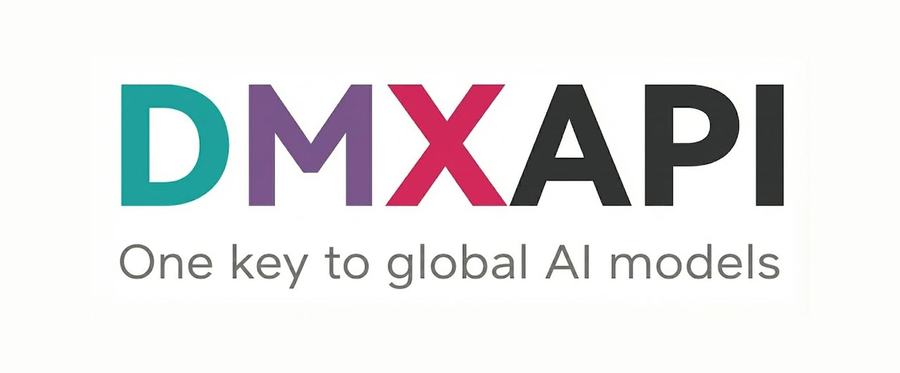</a></td>
<td>이 프로젝트를 후원해 주신 DMXAPI에 감사드립니다! DMXAPI는 200곳 이상의 기업 사용자에게 글로벌 대형 모델 API 서비스를 제공합니다. API 키 하나로 전 세계 모든 모델을 사용할 수 있습니다. 즉시 세금계산서 발행, 무제한 동시성, $0.15부터 시작, 연중무휴 기술 지원 등의 기능을 제공합니다. GPT/Claude/Gemini는 모두 32% 할인, 중국 모델은 20~50% 할인, Claude Code 전용 모델은 66% 할인! <a href="https://www.dmxapi.cn/register?aff=bUHu">여기에서 가입하세요</a></td>
</tr>

</table>

</details>

## CC Switch를 써야 하는 이유

Claude Code, Codex, Gemini CLI 같은 AI 코딩 도구는 저마다 설정 형식이 다릅니다. API 공급자를 바꾸려면 JSON, TOML, YAML, `.env` 파일을 손으로 편집해야 하고, MCP, Skills, 프롬프트도 도구마다 따로 관리해야 합니다.

**CC Switch**는 이 모든 것을 하나의 데스크톱 앱으로 모았습니다. 프리셋을 고르고 키를 입력한 뒤 한 번의 클릭으로 전환하세요. 전환 시에는 엔드포인트, 키, 모델 같은 연결 정보만 교체하므로 직접 추가한 플러그인, 훅, MCP, 주석은 그대로 유지됩니다.

- **하나의 앱, 열두 가지 도구** — Claude Code, Claude Desktop, Codex, Gemini CLI, Grok Build, OpenCode, OpenClaw, Hermes, Pi, MiniMax Code, Kimi Code, Oh My Pi
- **더 이상 수동 편집 불필요** — AWS Bedrock, NVIDIA NIM, 커뮤니티 릴레이를 포함한 90개 이상의 공급자 프리셋
- **직접 연결, 라우팅, 통합 중 원하는 대로** — 직접 연결은 도구를 공급자에 곧바로 연결합니다. 라우팅은 요청을 내 컴퓨터를 거쳐 전달하면서 API 형식을 변환하고 자동으로 장애 조치하므로 Claude Code에서 GPT를, Codex에서 Claude를 사용할 수 있습니다. 통합은 여러 공급자의 모델을 Claude Code나 Codex의 하나의 모델 목록에 모으고, 각 요청은 선택한 모델의 공급자로 전달됩니다
- **MCP, Skills, 프롬프트 중앙 관리** — MCP 서버와 Skills를 한 번만 추가하고 어떤 도구에 동기화할지 선택하세요. 프롬프트는 도구별로 따로 관리됩니다
- **읽기 쉬운 세션** — 각 도구의 세션 로그를 읽기 뷰로 바꿔 줍니다. 각 턴이 무엇을 했고, 어떤 파일이 바뀌었으며, 어느 단계가 실패했는지 한눈에 볼 수 있습니다
- **사용량과 할당량을 한눈에** — 로컬 라우팅 없이도 토큰 사용량과 지출을 추적합니다. 남은 구독 할당량과 계정 잔액은 공급자 카드와 트레이에 바로 표시됩니다
- **크로스 플랫폼** — Tauri 2로 만든 Windows, macOS, Linux용 네이티브 데스크톱 앱

## 스크린샷

<table>
<tr>
<td align="center" width="50%">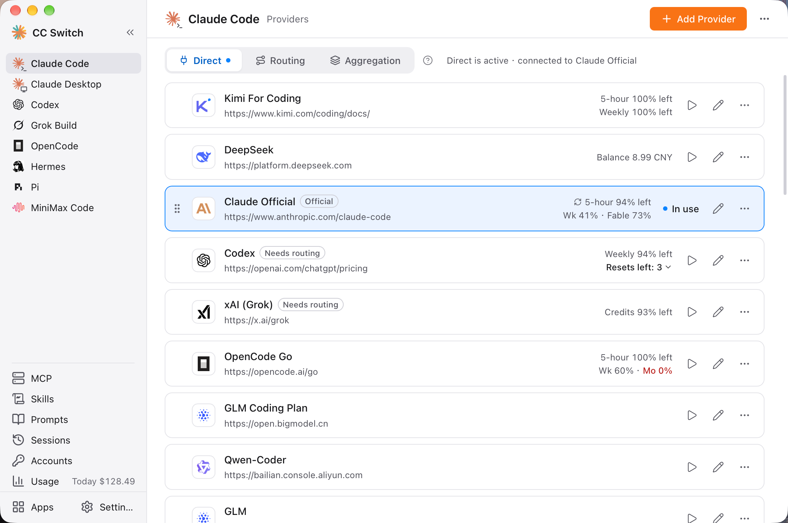<br>메인 화면</td>
<td align="center" width="50%">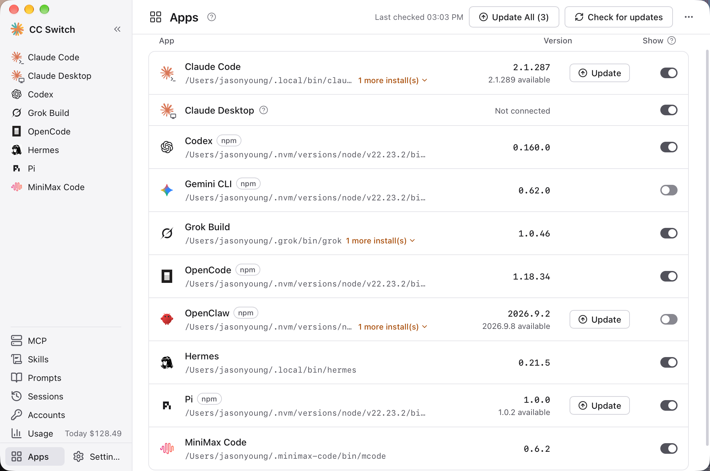<br>앱 페이지</td>
</tr>
<tr>
<td align="center">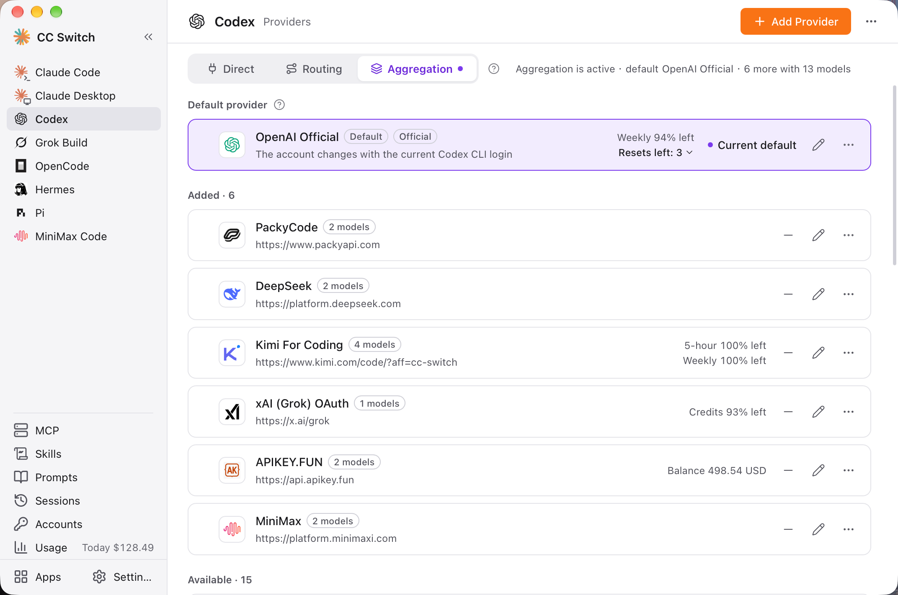<br>통합 모드</td>
<td align="center">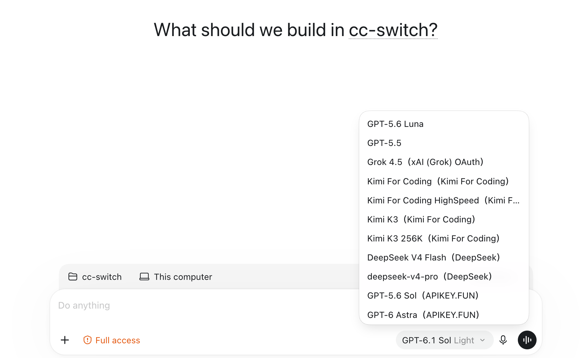<br>Codex의 통합 모델 목록</td>
</tr>
<tr>
<td align="center">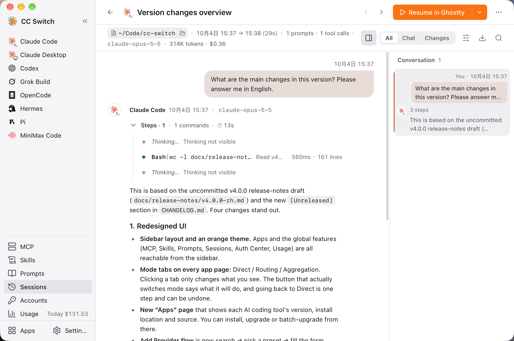<br>세션 읽기 뷰</td>
<td align="center">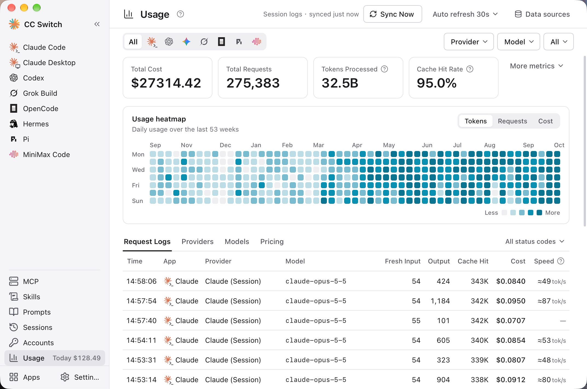<br>사용량</td>
</tr>
</table>

## 다운로드 및 설치

### 시스템 요구 사항

- **Windows**: Windows 10 이상
- **macOS**: macOS 12 (Monterey) 이상
- **Linux**: glibc 2.35 이상과 WebKitGTK 4.1이 있는 x86_64 또는 ARM64 — 예: Ubuntu 22.04 이상, Debian 12 이상, 최신 Fedora 릴리스. RHEL / Rocky / Alma 8–9는 아직 지원되지 않습니다

### Windows 사용자

[Releases](../../releases) 페이지에서 최신 `CC-Switch-v{version}-Windows.msi` 설치 프로그램 또는 `CC-Switch-v{version}-Windows-Portable.zip` 포터블 버전을 다운로드하세요. Windows on ARM에서는 `CC-Switch-v{version}-Windows-arm64.msi` 또는 `CC-Switch-v{version}-Windows-arm64-Portable.zip`을 다운로드하세요.

### macOS 사용자

**방법 1: Homebrew로 설치 (권장)**

```bash
brew install --cask cc-switch
```

업데이트:

```bash
brew upgrade --cask cc-switch
```

**방법 2: 수동 다운로드**

[Releases](../../releases) 페이지에서 `CC-Switch-v{version}-macOS.dmg`(권장) 또는 `.zip`을 다운로드하세요. Apple Silicon과 Intel Mac 모두에서 네이티브로 실행되는 유니버설 빌드입니다.

> **참고**: macOS용 CC Switch는 코드 서명되어 있고 Apple의 공증을 받았습니다. 바로 설치하고 열 수 있습니다.

### Arch Linux 사용자

**paru로 설치 (권장)**

```bash
paru -S cc-switch-bin
```

### Linux 사용자

[Releases](../../releases) 페이지에서 최신 Linux 빌드를 다운로드하세요:

- `CC-Switch-v{version}-Linux-x86_64.deb` / `-Linux-arm64.deb` (Debian/Ubuntu)
- `CC-Switch-v{version}-Linux-x86_64.rpm` / `-Linux-arm64.rpm` (Fedora 및 WebKitGTK 4.1을 제공하는 기타 RPM 배포판)
- `CC-Switch-v{version}-Linux-x86_64.AppImage` / `-Linux-arm64.AppImage` (위 요구 사항을 충족하는 모든 배포판)

> **Flatpak**: 공식 릴리스에는 포함되지 않습니다. `.deb`로 직접 빌드할 수 있으며, 방법은 [`flatpak/README.md`](flatpak/README.md)를 참고하세요.

## 빠른 시작

### 기본 사용법

1. **공급자 추가**: 사이드바에서 관리할 도구를 선택하고, 페이지 오른쪽 위의 "+"(공급자 추가)를 클릭 → 프리셋을 고르거나 사용자 지정 설정을 만드세요
2. **공급자 전환**:
   - 메인 화면: 공급자 선택 → "활성화" 클릭 (OpenCode, OpenClaw, Hermes, MiniMax Code, Kimi Code는 버튼이 "추가", Pi와 Oh My Pi는 "활성화" / "제거"입니다. 이 일곱 가지는 공존 모드 도구이므로 여러 공급자를 동시에 추가할 수 있습니다)
   - 시스템 트레이: 도구마다 "이름 · 모드 · 공급자 · 할당량" 한 줄이 표시되며, 하위 메뉴에서 공급자 이름을 클릭해 전환합니다 (Claude Code, Claude Desktop, Codex, Gemini CLI, Grok Build)
3. **적용 방법**: Claude Code는 재시작이 필요 없습니다. Codex, Gemini CLI, Grok Build는 터미널 또는 CLI 도구를 다시 시작하세요. Claude Desktop은 앱 자체를 다시 시작하세요 (자주 묻는 질문 참고)
4. **공식 로그인으로 돌아가기**: 목록의 기본 제공 공식 공급자(예: "Claude Official")로 전환하고 도구를 다시 시작한 뒤, 해당 도구의 로그인/OAuth 절차를 따르세요
5. **라우팅 및 통합 (선택 사항)**: Claude Code, Codex, Gemini CLI, Grok Build 페이지 상단에는 "직접 연결" / "라우팅" 탭이 있고, Claude Code와 Codex에는 "통합"도 있습니다. 탭을 클릭하는 것은 보는 화면만 바꿀 뿐 설정에는 영향을 주지 않습니다. 실제로 전환하려면 페이지에서 "라우팅 시작" 또는 "통합 모드로 전환"을 클릭하고, 되돌아가려면 "직접 연결로 돌아가기"를 클릭하세요. 라우팅은 Claude Code에서 OpenAI나 Gemini 형식 공급자를, Codex에서 Claude를 사용할 때 쓰고, 통합은 여러 공급자의 모델을 하나의 모델 목록에 섞을 때 사용합니다
6. **도구 관리**: 사이드바의 "앱" 페이지에서 각 AI 코딩 도구의 버전, 설치 위치, 출처를 한곳에서 볼 수 있으며, 설치, 업그레이드, 전체 업그레이드를 하고 사이드바에 표시할 도구를 선택할 수 있습니다

### MCP, 프롬프트, Skills, 프로젝트, 세션

- **MCP**: 사이드바에서 "MCP" 클릭 → 템플릿이나 사용자 지정 설정으로(또는 "기존 가져오기"로) 서버 추가 → 도구별 동기화 켜기/끄기
- **프롬프트**: 사이드바에서 "프롬프트" 클릭 → Markdown 편집기로 프롬프트 작성 → 활성화하면 해당 도구의 프롬프트 파일에 기록됩니다
- **Skills**: 사이드바에서 "스킬" 클릭 → "스킬 살펴보기" → skills.sh를 검색하거나 GitHub 저장소 탐색 → 지원되는 도구에 원클릭 설치
- **프로젝트**: 먼저 "설정 → 일반"에서 "프로젝트 전환기 표시"를 켠 다음, Claude Code, Claude Desktop 또는 Codex 페이지 상단의 프로젝트 전환기를 열고 → "새 프로젝트"로 현재 설정을 저장하세요. 이후 전환기에서 선택하면 전체 구성을 한 번에 바꿀 수 있습니다
- **세션**: 사이드바에서 "세션" 클릭 → 대화 기록을 둘러보고 검색하거나, 읽기 뷰를 열거나, 각 도구의 세션을 복원합니다
- **계정**: 사이드바의 "인증 센터"를 클릭해 GitHub Copilot, ChatGPT, xAI (Grok), Kimi Code 계정에 로그인하고 구독을 공급자로 사용하세요. Kimi Code는 여러 공식 계정을 지원하며, 각 계정은 별도의 자격 증명과 네이티브 공급자를 가집니다. 첫 로그인은 Kimi의 네이티브 기본 자격 증명 슬롯을 사용합니다. 로그인, 재인증, 로그아웃은 여기에서 관리합니다. 네이티브 설정에 아직 남아 있는 공식 Kimi OAuth 노드는 공급자 페이지에서 보호되며, 저장된 프로필은 네이티브 노드를 제거한 뒤에 삭제할 수 있습니다.

> **참고**: 처음 실행하면 CC Switch가 기존 Claude Code, Codex, Gemini CLI, Grok Build 설정을 `default`라는 공급자로 자동 가져오고, 이 도구들과 Claude Desktop 각각에 공식 공급자를 추가하므로 기존 설정이 사라지지 않습니다.

모든 기능의 자세한 안내는 **[사용자 매뉴얼](docs/user-manual/en/README.md)**을 확인하세요. 공급자 관리, MCP/프롬프트/Skills, 로컬 라우팅 및 장애 조치 등을 다룹니다.

## 기능

[전체 변경 이력](CHANGELOG.md) | [v4.0 릴리스 노트](docs/release-notes/v4.0.4-en.md)

### 도구별 지원 기능

| 도구 | 공급자 | 로컬 라우팅 | 통합 | 트레이 전환 | MCP | Skills | 프롬프트 | 세션 | 사용량 통계 |
| --- | --- | :---: | :---: | :---: | :---: | :---: | --- | :---: | :---: |
| Claude Code | 전환 | ✓ | ✓ | ✓ | ✓ | ✓ | CLAUDE.md | ✓ | ✓ |
| Claude Desktop | 전환 | 모델 매핑만 | – | ✓ | – | – | – | – | 모델 매핑만 |
| Codex | 전환 | ✓ | ✓ | ✓ | ✓ | ✓ | AGENTS.md | ✓ | ✓ |
| Gemini CLI | 전환 | ✓ | – | ✓ | ✓ | ✓ | GEMINI.md | ✓ | ✓ |
| Grok Build | 전환 | ✓ | – | ✓ | ✓ | ✓ | AGENTS.md | ✓ | ✓ |
| OpenCode | 공존 | – | – | – | ✓ | ✓ | AGENTS.md | ✓ | ✓ |
| OpenClaw | 공존 | – | – | – | – | – | 워크스페이스 편집기 | ✓ | – |
| Hermes | 공존 | – | – | – | ✓ | ✓ | 메모리 | ✓ | – |
| Pi | 공존 | – | – | – | ✓ | ✓ | AGENTS.md, SYSTEM.md, 프롬프트 템플릿 | ✓ | ✓ |
| MiniMax Code | 공존 | – | – | – | ✓ | ✓ | AGENTS.md | ✓ | ✓ |
| Kimi Code | 공존 | – | – | – | ✓ | ✓ | AGENTS.md | ✓ | ✓ |
| Oh My Pi | 공존 | – | – | – | ✓ | ✓ | AGENTS.md | ✓ | – |

- **전환**: 한 번에 하나의 공급자만 활성화됩니다. **공존**: 여러 공급자가 동시에 도구 자체의 설정에 기록되며, 도구 안에서 하나를 선택합니다.
- **로컬 라우팅**: CC Switch가 내 컴퓨터에서 요청을 전달하고 API 형식을 변환합니다. 아래 [로컬 라우팅 및 장애 조치](#로컬-라우팅-및-장애-조치)를 참고하세요. Claude Desktop 공급자는 "직접 연결" 또는 "모델 매핑"을 사용할 수 있으며, "모델 매핑"에서는 요청이 로컬 라우팅을 거칩니다.
- **통합**: 여러 공급자의 모델을 하나의 모델 목록에 모으고, 각 요청을 선택한 모델의 공급자로 보냅니다. 아래 [통합 모드](#통합-모드)를 참고하세요.
- **세션**: 대화 기록을 둘러보고 검색하며, 읽기 뷰를 열고, 재개 명령을 복사해 대화를 이어갈 수 있습니다 (OpenClaw와 Hermes 세션 재개는 아직 지원되지 않습니다). Hermes는 최근 세션 500개만 표시합니다.
- **사용량 통계**: 로컬 라우팅을 쓰지 않을 때는 각 도구의 로컬 세션 로그에서 사용량을 수집하며, 로컬 라우팅을 거친 요청도 함께 집계됩니다.
- Claude Desktop 페이지에서 여는 MCP, Skills, 프롬프트, 세션 패널은 Claude Code에 적용됩니다.

### 공급자 관리

- **90개 이상의 공급자 프리셋** — 프리셋을 고르고 키를 입력해 공급자를 추가하거나, 사용자 지정 설정을 만드세요. 추가 패널에서는 이름(중국어 이름 포함)과 도메인으로 검색할 수 있고, 한 벤더의 서로 다른 요금제와 지역은 한 줄로 합쳐집니다
- **핵심 필드만 교체** — 전환 시 엔드포인트, 키, 모델 같은 연결 정보만 교체하며, 플러그인, 훅, MCP, 직접 추가한 설정, 주석은 그대로 유지됩니다. 편집기에는 전환 후 설정 파일이 어떤 모습이 될지 표시되며, CC Switch는 각 설정 파일을 처음 다시 쓰기 전에 자동으로 백업합니다
- **프로젝트** — Claude Code 또는 Codex의 현재 공급자, MCP, Skills, 프롬프트 파일을 프로젝트로 저장하고(Claude Desktop은 공급자만 저장), 페이지 상단의 프로젝트 전환기나 트레이에서 한 번의 클릭으로 전체 구성을 전환하세요. 다른 프로젝트로 전환하면 현재 상태가 이전 프로젝트에 자동으로 저장됩니다. 프로젝트 전환기는 기본적으로 숨겨져 있으며, "설정 → 일반"에서 "프로젝트 전환기 표시"를 켜세요
- **계정 (베타)** — 사이드바의 "인증 센터"에서 여러 GitHub Copilot, ChatGPT, xAI (Grok) 계정에 로그인하고, 그 구독을 Claude Code, Claude Desktop, Codex의 공급자로 사용하세요 (Codex의 OpenAI Official을 제외한 모든 항목은 라우팅 모드로 사용해야 합니다). 공식 클라이언트 밖에서 구독을 사용하면 벤더의 서비스 약관을 위반할 수 있으니 위험은 직접 판단하세요
- **Claude Desktop용 서드파티 공급자** — Anthropic 호환 엔드포인트에 직접 연결하세요. Claude가 아닌 모델은 "모델 매핑"을 선택해 Sonnet, Opus, Haiku 같은 등급을 로컬 라우팅을 통해 공급자의 실제 모델에 매핑합니다
- **범용 공급자** — 하나의 설정을 Claude Code, Codex, Gemini CLI에 동기화합니다
- 원클릭 전환, 시스템 트레이 빠른 전환 (Claude Code, Claude Desktop, Codex, Gemini CLI, Grok Build), 드래그 앤 드롭 정렬, 가져오기/내보내기

### 로컬 라우팅 및 장애 조치

- **API 형식 변환** — 로컬 라우팅은 Anthropic Messages, OpenAI Chat Completions, OpenAI Responses, Gemini Native 간에 요청을 변환합니다. Claude Code와 Claude Desktop은 OpenAI나 Gemini 형식 공급자를, Codex와 Grok Build는 Chat Completions나 Anthropic Messages 공급자를 사용할 수 있습니다
- **도구별 토글** — Claude Code, Codex, Gemini CLI, Grok Build는 각각 따로 라우팅 모드에 들어갈 수 있습니다. 페이지 상단의 "라우팅" 탭에서 "라우팅 시작"을 클릭하세요. 라우팅 모드에서는 공급자를 전환하면 이후 요청부터 즉시 적용됩니다 (전환으로 모델이 바뀌면 Codex, Gemini CLI, Grok Build는 재시작이 필요할 수 있습니다). CC Switch를 종료하면 먼저 직접 연결 설정을 다시 기록하고, 다음 실행 시 다시 연결합니다
- **자동 장애 조치** — 도구별로 장애 조치 큐를 설정하세요. 요청이 실패하면 CC Switch가 큐의 다음 공급자로 자동으로 넘어가며, 서킷 브레이커와 공급자 상태 모니터링이 뒷받침합니다
- **정류기** — 일부 업스트림이 처리하지 못하는 특정 요청을 자동으로 고칩니다 (예: Thinking 서명, 이미지를 지원하지 않을 때의 폴백)
- 공식 공급자(예: Claude Official)는 로컬 라우팅을 거칠 수 없습니다 (Codex의 OpenAI Official 제외)
- 라우팅 서비스의 상태, 수신 주소, 장애 조치 설정은 모두 "설정 → 로컬 라우팅"에 있습니다
- 가이드: [Claude Code에서 GPT 사용하기](docs/guides/claude-codex-routing-guide-en.md) · [Codex에서 Claude 사용하기](docs/guides/codex-claude-routing-guide-en.md)

### 통합 모드

- **하나의 모델 목록, 여러 공급자** — Claude Code 또는 Codex 페이지에서 "통합"으로 전환하고 공급자 몇 개를 추가하면, 그 모델들이 모두 클라이언트의 모델 선택기에 나타납니다. 각 요청은 선택한 모델의 공급자로 전달되므로 CC Switch에서 전환할 필요가 없습니다
- **언제든 추가하고 제거** — 공급자 카드에서 "추가" 또는 "제거"를 클릭한 다음 공급자 하나를 기본값으로 선택하세요. 통합 모델을 지정하지 않은 요청은 기본 공급자로 갑니다. Codex의 OpenAI Official은 기본 공급자로만 사용할 수 있으며, Claude 공식 구독은 현재 통합에서 지원되지 않습니다
- **참고** — 통합 모드는 장애 조치를 제공하지 않습니다. Claude Code는 버전 2.1.243 이상이 필요합니다. 통합 목록이 바뀌면 Codex는 재시작이 필요하지만 Claude Code는 필요 없습니다. 세션 중에 모델을 바꾸면 새 모델이 프롬프트 캐시를 다시 만들어야 하므로 첫 턴의 비용이 조금 더 듭니다
- 통합 모드의 설계는 상당 부분 [opencodex](https://github.com/lidge-jun/opencodex)를 참고했습니다. 작성자와 기여자 여러분께 감사드립니다
- 문서: [통합 모드 매뉴얼](docs/user-manual/en/4-proxy/4.6-aggregation.md) · [그림으로 보는 가이드 (중국어)](docs/guides/aggregation-mode-guide-zh.md)

### MCP, 프롬프트, Skills

- **통합 MCP 패널** — 모든 MCP 서버를 한곳에서 관리하고, 각각을 어떤 도구에 동기화할지 선택하며(Claude Code, Codex, Gemini CLI, Grok Build, OpenCode, Hermes, Pi, MiniMax Code, Kimi Code, Oh My Pi), 각 도구의 기존 설정을 가져오고, Deep Link로 가져올 수 있습니다
- **프롬프트** — Markdown 편집기를 갖춘 도구별 프롬프트 라이브러리입니다. 프롬프트를 활성화하면 해당 도구의 프롬프트 파일(CLAUDE.md / AGENTS.md / GEMINI.md)에 기록되며, 파일의 기존 내용은 먼저 라이브러리에 저장되므로 아무것도 사라지지 않습니다. Pi는 SYSTEM.md, APPEND_SYSTEM.md, 프롬프트 템플릿도 편집할 수 있습니다
- **Skills** — skills.sh를 검색하거나 GitHub 저장소 또는 ZIP 파일에서 원클릭으로 설치하고, 업데이트를 확인해 한 번에 모두 업데이트하세요. 각 도구에 자동으로, 심볼릭 링크로만, 또는 복사로만 동기화할 수 있으며, 원하면 `~/.agents/skills`에 저장할 수도 있습니다
- 세 패널 모두 검색을 지원하고, MCP와 Skills는 도구별로 한 번에 모두 켜거나 끌 수도 있습니다. 공급자, MCP 서버, 프롬프트는 콘텐츠 영역에서 전체 페이지로 편집하며, 저장하지 않은 변경 사항이 있으면 나가기 전에 경고합니다

### 사용량 및 비용 추적

- **사용량 대시보드** — 로컬 라우팅 없이 동작합니다. 기본적으로 각 도구의 로컬 세션 로그를 자동으로 스캔해 공급자와 모델별로 요청, 토큰, 캐시 적중률, 출력 속도, 지출을 추적하며, 추세 차트, 연간 히트맵, 요청별 로그를 제공합니다
- **할당량과 잔액** — 공급자 카드와 트레이에 "5h 94% left"처럼 남은 양과 초기화 카운트다운이 표시됩니다. 공식 구독 할당량(Claude, ChatGPT, Gemini, SuperGrok), Coding Plan 5시간 / 주간 / 월간 할당량(Kimi, Zhipu GLM, MiniMax, Volcengine Ark 등), 계정 잔액(DeepSeek, OpenRouter, SiliconFlow 등)이 해당하며, 일부는 공급자 카드의 "사용량 조회 설정"에서 먼저 켜야 하고, 그 밖의 공급자는 사용자 지정 사용량 스크립트를 작성할 수 있습니다. ChatGPT 구독은 남은 한도 초기화 횟수와 Codex Credits 잔액도 표시합니다
- **사용자 지정 가격** — 모델별 가격을 설정하거나 models.dev에서 가져오세요

### 세션 관리자 및 워크스페이스

- **세션 읽기 뷰** — 각 도구의 세션 로그를 구조화된 콘텐츠로 파싱합니다. 텍스트, 사고 과정, 도구 호출, 도구 결과, 이미지가 따로 표시되고, 각 턴의 작업은 한 줄 요약(몇 단계, 몇 개 파일 변경, 몇 번 실패)으로 접히며 실패한 단계는 빨간색으로 표시됩니다. 오른쪽에는 대화 개요가 있고, 세션 내 검색, Markdown 내보내기, 단일 턴 또는 전체 대화 복사를 지원합니다
- **목록 및 재개** — 프로젝트나 시간별로 그룹화하고, 제목, 디렉터리, 메시지, 세션 ID를 검색하며, 일괄 삭제할 수 있습니다. 재개 명령을 복사해 대화를 이어가고, macOS에서는 한 번의 클릭으로 터미널에서 재개할 수 있습니다
- **워크스페이스 편집기** (OpenClaw) — 에이전트 파일(AGENTS.md, SOUL.md 등)과 일일 메모리를 편집합니다
- **메모리** (Hermes) — Hermes의 MEMORY.md와 USER.md를 편집합니다

### 시스템 및 플랫폼

- **클라우드 동기화** — WebDAV(Jianguoyun, Nextcloud, Synology NAS 등) 또는 S3 호환 스토리지(AWS S3, Cloudflare R2, Alibaba Cloud OSS, Tencent Cloud COS 등)로 기기 간에 동기화합니다. CC Switch 설정 디렉터리를 Dropbox, OneDrive, iCloud 같은 클라우드 드라이브 폴더에 둘 수도 있습니다
- **CLI 도구 관리** — 사이드바의 "앱" 페이지에서 Claude Code, Codex 같은 명령줄 도구의 현재 버전과 최신 버전을 확인하고, 원클릭으로 설치, 업그레이드, 전체 업그레이드를 하며, 중복 설치를 진단합니다. Windows에서는 WSL 안의 도구도 관리할 수 있습니다 (자주 묻는 질문 참고)
- **Deep Link** (`ccswitch://`) — 링크 하나로 공급자, MCP 서버, 프롬프트를 가져오거나 스킬 저장소를 추가합니다. [온라인 생성기](https://ccswitch.io/deplink.html)로 링크를 만들 수 있으며, 가져오기 버튼을 넣고 싶은 사이트 운영자는 [연동 가이드](https://github.com/farion1231/cc-switch/blob/main/docs/guides/deeplink-site-integration-guide-en.md)를 따르세요
- **기본 제공 유틸리티** — Claude Code의 첫 실행 확인 건너뛰기, AI 표기 숨기기, VS Code Claude Code 확장이 CC Switch의 공급자 전환을 따르게 하기 등
- 다크 / 라이트 / 시스템 테마, 자동 실행, 자동 업데이트, 원자적 쓰기, 자동 백업("설정 → 데이터"에서 모든 백업의 위치와 차지하는 공간 확인), i18n (중국어 간체, 중국어 번체, 영어, 일본어, 한국어, 터키어, 러시아어, 독일어)

## 자주 묻는 질문

<details>
<summary><strong>CC Switch는 어떤 AI 도구를 지원하나요?</strong></summary>

CC Switch는 열두 가지 도구를 지원합니다: **Claude Code**, **Claude Desktop**, **Codex**, **Gemini CLI**, **Grok Build**, **OpenCode**, **OpenClaw**, **Hermes**, **Pi**, **MiniMax Code**, **Kimi Code**, **Oh My Pi**. 각 도구에는 전용 공급자 프리셋과 설정 관리가 있으며, 각각이 무엇을 지원하는지는 [도구별 지원 기능](#도구별-지원-기능)을 참고하세요.

</details>

<details>
<summary><strong>공급자를 전환한 뒤 터미널을 다시 시작해야 하나요?</strong></summary>

도구에 따라 다릅니다:

- **Claude Code**: 공급자 데이터의 핫 스위칭을 지원하므로 재시작이 필요 없습니다.
- **Codex, Gemini CLI, Grok Build**: 변경 사항을 적용하려면 터미널 또는 CLI 도구를 다시 시작하세요 (전환 후 CC Switch가 알려 줍니다). 라우팅 모드에서는 요청이 즉시 새 공급자로 가지만, 전환으로 모델이 바뀌면 세 도구 모두 재시작이 필요할 수 있습니다.
- **통합 모드**: Claude Code의 통합 모델 변경은 즉시 적용됩니다. Codex는 통합에 들어가거나 나올 때, 그리고 통합 모델 목록을 바꿀 때 모두 완전한 재시작이 필요합니다. 다음 항목을 참고하세요.
- **Claude Desktop**: Claude Desktop을 완전히 종료한 뒤 다시 여세요. "모델 매핑"을 사용할 때는 CC Switch도 계속 실행해 두어야 합니다.
- **OpenCode, OpenClaw, Hermes, Pi, MiniMax Code, Kimi Code, Oh My Pi**: 공존 모드 도구입니다. "추가"(Pi와 Oh My Pi는 "활성화")를 클릭하면 공급자가 다른 공급자와 함께 도구 자체의 설정에 기록되며, 원하는 모델은 도구 안에서 선택합니다. Kimi Code는 공급자의 모델을 선택하는 "전환" 버튼도 제공하며, 주 모델이나 보조 모델로 아직 참조되는 모델은 제거할 수 없습니다. 설정과 계정에 관한 자세한 내용은 [Kimi Code 연동 가이드](docs/kimi-code-integration-zh.md)(중국어)를 참고하세요.

</details>

<details>
<summary><strong>통합 모드에서 통합된 모델이 Codex의 /model에 나타나지 않는 이유는 무엇인가요?</strong></summary>

Codex는 시작할 때만 모델 목록을 읽습니다. 통합 모드에 들어가거나 나온 뒤, 통합 공급자를 추가하거나 제거한 뒤, 또는 공급자의 통합 모델을 바꾼 뒤에는 Codex를 완전히 재시작해야 새 목록이 보입니다:

- **Codex CLI**: 터미널을 닫고 `codex`를 다시 실행하는 것만으로는 충분하지 않습니다. 모든 터미널의 모든 `codex`가 하나의 백그라운드 데몬을 공유하므로, 새 목록을 반영하려면 그 데몬을 다시 시작해야 합니다. CC Switch는 Codex가 아직 이전 목록을 쓰고 있음을 감지하면 Codex 페이지 상단에 알림을 표시하며, 알림의 "Codex 데몬 다시 시작"을 클릭하세요. 재시작하면 데몬에서 실행 중인 작업이 중단됩니다.
- **Codex 데스크톱 앱**: 완전히 종료한 뒤 다시 여세요 (macOS에서는 ⌘Q를 누르세요. 창을 닫는 것만으로는 충분하지 않습니다).
- **에디터 확장**: 에디터 창을 다시 여세요.

Claude Code는 영향을 받지 않습니다. 통합 모델 변경은 즉시 적용됩니다.

</details>

<details>
<summary><strong>공급자를 전환하면 플러그인, 훅 또는 다른 설정이 바뀌나요?</strong></summary>

아니요. Claude Code, Codex, Gemini CLI, Grok Build의 공급자를 전환할 때 CC Switch는 설정 파일의 **핵심 필드**만 교체합니다. 엔드포인트, 키, 모델 이름, API 프로토콜(Codex는 추론 수준, Gemini CLI는 인증 방식 포함)과, 공급자에 속하는 몇 가지 호환성 옵션(예: Claude Code의 "Artifact Tool 비활성화"와 컨텍스트 윈도우)이 해당합니다. 플러그인, 훅, 권한, MCP, 직접 추가한 환경 변수, 주석, 서식은 모두 그대로 유지되며 모든 공급자에 적용됩니다.

이 공유 설정은 도구 자체에서 바꾸거나 설정 파일을 직접 편집해서 바꿀 수 있습니다. CC Switch에서 어떤 공급자든 편집할 수도 있습니다. 편집기에는 "이 공급자로 전환한 뒤 설정 파일이 어떤 모습이 될지"가 표시됩니다. 저장하면 핵심 필드는 그 공급자에 저장되고, 그 밖의 모든 변경은 설정 파일에 기록되어 모든 공급자에 적용됩니다.

그래서 예전의 "공통 설정 스니펫"은 더 이상 필요하지 않으며 관련 버튼도 제거되었습니다. 업그레이드 전에 스니펫에 있던 설정은 전환할 때 이미 설정 파일에 기록되었으므로 그대로 남아 있습니다. 또한 CC Switch는 각 설정 파일을 처음 다시 쓰기 전에 원본을 `~/.cc-switch/backups/live-first-write/`에 백업합니다.

</details>

<details>
<summary><strong>도구 안에서 모델을 바꿨는데, 다른 공급자로 갔다가 돌아오면 왜 원래대로 돌아가나요?</strong></summary>

모델은 핵심 필드이며 공급자에 속합니다. 도구 안에서 고른 모델(예: Claude Code의 `/model`)은 다음 전환 전까지 유효합니다. 전환하면 설정 파일의 모델이 대상 공급자에 저장된 모델로 교체되며, CC Switch는 사용자가 고른 모델을 이전 공급자에 다시 저장하지 않습니다. 모델을 오래 쓰고 싶다면 CC Switch에서 해당 공급자를 편집하세요.

이전 버전은 다른 공급자로 전환할 때 전체 설정 파일을 공급자에 다시 저장했습니다. 이제는 그렇지 않습니다. 플러그인과 기타 공유 설정이 한 공급자에 고정되어 다른 공급자로 전환하면 사라졌기 때문입니다.

</details>

<details>
<summary><strong>현재 사용 중인 공급자를 삭제할 수 없는 이유는 무엇인가요?</strong></summary>

CC Switch는 "최소 침습" 설계 원칙을 따릅니다. 앱을 삭제하더라도 도구는 계속 정상적으로 동작합니다.

그래서 한 번에 하나의 공급자를 사용하는 도구(Claude Code, Claude Desktop, Codex, Gemini CLI, Grok Build)는 항상 하나의 설정이 사용 중이어야 합니다. 모든 설정을 삭제하면 해당 도구를 쓸 수 없게 되기 때문이며, 삭제하려면 먼저 다른 공급자로 전환하세요. 마찬가지로 통합 모드의 기본 공급자는 제거할 수 없으므로 먼저 다른 공급자를 기본값으로 지정하세요. 공존 모드 도구(OpenCode, OpenClaw, Hermes, Pi, MiniMax Code)는 이 제한이 없으며 어떤 공급자든 바로 삭제할 수 있습니다. 자주 쓰지 않는 도구는 "앱" 페이지에서 사이드바에서 숨길 수 있습니다. 공식 로그인으로 돌아가는 방법은 다음 질문을 참고하세요.

</details>

<details>
<summary><strong>공식 로그인으로 어떻게 돌아가나요?</strong></summary>

CC Switch에서 Claude Code, Claude Desktop, Codex, Gemini CLI, Grok Build의 공급자 목록에는 각각 기본 제공 공식 공급자(**Claude Official**, **Claude Desktop Official**, **OpenAI Official**, **Google Official**, **Grok Official**)가 들어 있습니다. 삭제했다면 프리셋에서 다시 추가하세요. 공식 공급자로 전환한 뒤에는 도구 자체의 로그인 절차(예: Claude Code의 `/login`, Codex의 `codex login`)를 따르면 되고, 이후 공식 공급자와 서드파티 공급자 사이를 자유롭게 전환할 수 있습니다.

Codex의 경우 CC Switch 안에서 "Sign in with ChatGPT"로 여러 ChatGPT 계정에 로그인하고 각 **OpenAI Official** 카드마다 "사용할 계정"을 선택할 수 있어, 여러 Plus, Pro, Team 계정 사이를 한 번의 클릭으로 전환할 수 있습니다. "Codex에 로그인된 계정 사용"으로 설정된 카드는 계속 Codex CLI 자체의 로그인을 사용합니다.

참고: 공식 구독은 도구 자체의 로그인을 사용하며 로컬 라우팅을 거치지 않습니다. 라우팅 모드에서는 공식 공급자를 선택할 수 없으며(Codex의 OpenAI Official 카드는 예외), 먼저 직접 연결로 돌아가세요.

</details>

<details>
<summary><strong>라우팅을 시작한 뒤 설정 파일이 127.0.0.1을 가리키는 이유는 무엇인가요?</strong></summary>

라우팅 모드에서는 도구의 요청이 먼저 CC Switch의 로컬 라우팅(기본값 `http://127.0.0.1:15721`)으로 가고, CC Switch가 선택한 공급자에게 전달합니다. 그래서 도구의 설정 파일에는 로컬 주소와 자리표시자 키 `PROXY_MANAGED`만 들어 있습니다. Claude Code의 경우 모델 이름도 `claude-sonnet-5` 같은 고정 별칭으로 기록됩니다 (`/model` 메뉴에는 여전히 실제 모델 이름이 표시됩니다). 실제 공급자 주소, 키, 모델은 모두 CC Switch에 저장됩니다. 통합 모드도 같은 방식으로 동작합니다.

사이드바 "사용량"의 요청 로그에서 각 요청의 "요청한 모델 → 실제 모델"을 확인할 수 있습니다.

라우팅 모드에서 전환은 라우팅이 사용하는 공급자를 바꿉니다. 라우팅에 들어가기 전에 사용하던 공급자는 그대로 유지되며 카드에 "직접 연결"로 표시됩니다. "직접 연결로 돌아가기"를 클릭하면 설정 파일이 이 직접 연결 공급자의 구성으로 다시 기록됩니다. CC Switch를 종료할 때도 먼저 직접 연결 공급자를 다시 기록하며, 다음에 CC Switch를 시작하면 다시 연결됩니다.

</details>

<details>
<summary><strong>Claude Code에서 OpenAI 호환 API, Gemini 또는 로컬 모델을 사용할 수 있나요?</strong></summary>

네, 하지만 라우팅을 사용해야 합니다. 공급자를 편집할 때 "고급 옵션"의 "업스트림 형식"을 공급자의 API에 맞게 설정하세요. Chat Completions 엔드포인트만 제공하는 서비스(많은 로컬 모델 서버가 그렇습니다)는 "OpenAI Chat Completions", Responses 엔드포인트를 제공하는 서비스는 "OpenAI Responses API", Gemini는 "Gemini Native generateContent"를 선택합니다. 그런 다음 Claude Code 페이지의 "라우팅" 탭에서 "라우팅 시작"을 클릭하세요. 형식을 잘못 선택하거나 라우팅을 시작하지 않으면 보통 404 또는 405 오류가 발생합니다.

반대로 Codex나 Grok Build에서 "업스트림 형식"을 "Anthropic Messages"로 선택하면 Claude 형식 공급자를 사용할 수 있으며, 이 경우에도 라우팅이 필요합니다. 자세한 내용은 [Claude Code에서 GPT 사용하기](docs/guides/claude-codex-routing-guide-en.md)와 [Codex에서 Claude 사용하기](docs/guides/codex-claude-routing-guide-en.md)를 참고하세요.

</details>

<details>
<summary><strong>"연결 확인"은 통과했는데 요청은 왜 계속 실패하나요?</strong></summary>

공급자 카드의 "연결 확인"은 공급자 주소에 접속할 수 있는지만 확인할 뿐 실제 모델 요청은 보내지 않으므로, API 키와 모델 이름이 올바른지는 검증할 수 없습니다. 요청이 실패하면 키, 모델 이름, 업스트림 형식을 확인하세요. 라우팅을 거치는 요청은 사이드바 "사용량"의 요청 로그에서 정확한 오류도 확인할 수 있습니다.

</details>

<details>
<summary><strong>내 데이터는 어디에 저장되나요?</strong></summary>

기본적으로 모든 데이터는 홈 디렉터리의 `.cc-switch` 폴더에 저장됩니다 (Windows에서는 `C:\Users\<user>\.cc-switch`):

- **데이터베이스**: `cc-switch.db` (SQLite — 공급자, MCP, 프롬프트, Skills, 프로젝트, 사용량 기록 등)
- **로컬 설정**: `settings.json` (각 도구의 설정 디렉터리, 백업 정책, 클라우드 동기화 연결 정보 같은 기기 수준 설정)
- **백업**: `backups/` (기본적으로 24시간마다 자동 백업하며 최근 10개를 유지합니다. "설정 → 데이터 → 백업 및 복원"에서 조정할 수 있으며, 그 아래 "기타 백업"에는 다른 모든 백업의 위치와 크기가 나열되어 카테고리별로 정리할 수 있습니다)
- **Skills**: `skills/` (설정에서 `~/.agents/skills`로 변경할 수 있음), 기본적으로 심볼릭 링크로 각 도구에 동기화되고 실패하면 복사로 대체됩니다
- **Skill 백업**: `skill-backups/` (스킬을 제거하거나 업데이트하기 전에 자동으로 생성되며 최근 20개를 유지합니다)
- **OAuth 로그인 자격 증명**: `copilot_auth.json`, `codex_oauth_auth.json`, `xai_oauth_auth.json`
- **로그**: `logs/cc-switch.log` 및 `crash.log` — 이슈를 보고할 때 첨부해 주세요
- **기기 상태**: `live-state.json` (각 도구가 현재 직접 연결, 라우팅, 통합 중 어느 모드인지와 마지막으로 기록된 내용), `codex-login-stash.json` (서드파티 공급자로 전환할 때 따로 옮겨 둔 Codex 공식 로그인으로, 공식 공급자로 다시 전환하면 복원됩니다)
- **원본 설정 파일**: `backups/live-first-write/` (CC Switch가 처음 다시 쓰기 전의 각 도구 설정 파일)

"설정 → 데이터 → 저장 위치"에서 "CC Switch 설정 디렉터리"를 바꾸면, `settings.json`, 기기 상태, 원본 설정 파일을 제외한 위의 모든 파일이 새 디렉터리에 저장됩니다. CC Switch는 기존 파일을 자동으로 옮기지 않으므로 먼저 직접 복사하세요. `settings.json`, 기기 상태, 원본 설정 파일은 이 컴퓨터에만 속하므로 항상 기본 디렉터리에 남고 클라우드 동기화에도 포함되지 않습니다.

</details>

<details>
<summary><strong>Windows에서 WSL 안의 도구는 어떻게 관리하나요?</strong></summary>

CC Switch는 WSL을 자동으로 감지하지 않습니다. "설정 → 앱 설정"에서 해당 도구의 설정 디렉터리를 WSL 내부 경로(예: `\\wsl.localhost\Ubuntu\home\<user>\.claude`)로 바꾸세요. 저장하면 CC Switch가 WSL 내부의 설정을 읽고 씁니다 (Claude Code, Codex, Gemini CLI, Grok Build, OpenCode, OpenClaw, Hermes, Pi에서 지원). 이렇게 설정하면 사이드바의 "앱" 페이지도 해당 WSL 배포판에서 그 도구를 감지하고 업그레이드합니다.

참고: 라우팅과 통합은 설정에 주소로 `127.0.0.1`을 기록합니다. WSL2의 기본 NAT 네트워킹 모드에서는 WSL 내부의 `127.0.0.1`이 Windows의 로컬 라우팅에 닿지 못하므로, 대신 WSL을 미러드 네트워킹 모드로 전환하세요.

</details>

<details>
<summary><strong>명령줄 또는 헤드리스 버전이 있나요?</strong></summary>

CC Switch 자체는 그래픽 인터페이스가 필요한 데스크톱 앱으로만 제공됩니다 (시스템 요구 사항은 [다운로드 및 설치](#다운로드-및-설치) 참고). 서버, SSH 세션, 데스크톱 환경이 없는 컴퓨터에서는 커뮤니티에서 유지 관리하는 **[CC Switch CLI](https://github.com/SaladDay/cc-switch-cli)**를 권장합니다. 대화형 터미널 UI(TUI)와 명령줄 모드를 모두 제공하고, Claude Code, Codex, Gemini CLI, OpenCode, OpenClaw, Hermes, Pi를 지원하며, Homebrew(`brew install cc-switch-cli`) 또는 설치 스크립트로 설치할 수 있습니다.

기본적으로 CC Switch CLI는 데스크톱 앱과 `~/.cc-switch` 데이터 디렉터리를 공유하며 데스크톱 앱의 WebDAV 동기화와 호환됩니다. 두 프로젝트는 별도로 릴리스되며, CLI가 지원하는 데이터베이스 버전이 데스크톱 앱보다 뒤처질 때가 있습니다. "데이터베이스 버전이 너무 최신입니다"라는 메시지가 보이면 CLI를 업그레이드하거나 따라잡을 때까지 기다리세요.

</details>

<details>
<summary><strong>Linux (Wayland + NVIDIA): 클릭이 먹히지 않고 크기를 조절하면 창이 검게 변합니다</strong></summary>

AppImage는 과거의 네이티브 Wayland 크래시를 피하기 위해 `GDK_BACKEND=x11`(XWayland)을 강제합니다. 최신 Wayland + NVIDIA 환경에서는 이로 인해 웹 콘텐츠 영역을 클릭할 수 없게 되고(제목 표시줄 버튼은 계속 동작) 크기를 조절하면 화면이 검게 변할 수 있습니다. 옵트인 탈출구를 지정해 실행하면 네이티브 Wayland로 되돌릴 수 있습니다:

```bash
CC_SWITCH_GDK_BACKEND=wayland ./CC-Switch-*.AppImage
```

데스크톱 아이콘으로 실행한다면 `.desktop` 파일의 `Exec=` 줄에 추가하거나(예: `env CC_SWITCH_GDK_BACKEND=wayland /path/to/AppImage`) 세션 환경에 설정하세요. 이 변수는 범용입니다. 클릭이 먹히지 않는 타일링 Wayland 컴포지터(sway/Hyprland)에서는 대신 `CC_SWITCH_GDK_BACKEND=x11`을 시도해 보세요. 설정하지 않으면 기본 동작이 유지됩니다.

</details>

더 궁금한 점은 사용자 매뉴얼의 [자주 묻는 질문](docs/user-manual/en/5-faq/5.2-questions.md)을 참고하세요.

## 기여하기

이슈와 제안을 환영합니다! 새 기능을 개발하기 전에 먼저 이슈를 열어 접근 방식을 논의해 주세요. 프로젝트에 적합하지 않은 기능 PR은 닫힐 수 있습니다.

개발 환경 설정, 제출 전 점검, 아키텍처 참고 사항은 [CONTRIBUTING.md](CONTRIBUTING.md)를, 사용 관련 질문은 먼저 [SUPPORT.md](SUPPORT.md)를 확인하세요. 보안 취약점은 [SECURITY.md](SECURITY.md)에 설명된 대로 비공개로 신고해 주세요.

**기술 스택**: Tauri 2 · Rust · React 18 · TypeScript · SQLite

## Star 히스토리

[](https://www.star-history.com/#farion1231/cc-switch&Date)

## 라이선스

MIT © Jason Young
