<div align="center">

# CC Switch

### Универсальный менеджер для Claude Code, Claude Desktop, Codex, Gemini CLI, Grok Build, OpenCode, OpenClaw, Hermes Agent, Pi, MiniMax Code, Kimi Code и Oh My Pi

**Переключайте API-провайдеров в один клик и управляйте MCP, Skills и промптами в одном месте — больше никакой ручной правки конфигов JSON / TOML / YAML.**

[](https://github.com/farion1231/cc-switch/releases)
[](https://github.com/farion1231/cc-switch/releases)
[](https://tauri.app/)
[](https://github.com/farion1231/cc-switch/releases/latest)

<a href="https://trendshift.io/repositories/15372" target="_blank"></a>
<a href="https://www.star-history.com/#farion1231/cc-switch&Date"><picture><source media="(prefers-color-scheme: dark)" srcset="https://api.star-history.com/badge?repo=farion1231/cc-switch&theme=dark" /></picture></a>

<a href="https://trendshift.io/repositories/15372?utm_source=trendshift-badge&amp;utm_medium=badge&amp;utm_campaign=badge-trendshift-15372" target="_blank" rel="noopener noreferrer"></a>
<a href="https://trendshift.io/repositories/15372?utm_source=trendshift-badge&amp;utm_medium=badge&amp;utm_campaign=badge-trendshift-15372" target="_blank" rel="noopener noreferrer"></a>
<a href="https://trendshift.io/repositories/15372?utm_source=trendshift-badge&amp;utm_medium=badge&amp;utm_campaign=badge-trendshift-15372" target="_blank" rel="noopener noreferrer"></a>

### 🌐 Единственный официальный сайт: **[ccswitch.io](https://ccswitch.io)**

[English](README.md) | [简体中文](README_ZH.md) | [繁體中文](README_ZH-TW.md) | [日本語](README_JA.md) | [한국어](README_KO.md) | [Türkçe](README_TR.md) | Русский | [Deutsch](README_DE.md) | [История изменений](CHANGELOG.md)

**[Загрузка](#загрузка-и-установка) · [Быстрый старт](#быстрый-старт) · [Возможности](#возможности) · [FAQ](#faq) · [Руководство пользователя](docs/user-manual/en/README.md)**

</div>

## ❤️Спонсоры

> [Хотите оказаться здесь?](mailto:support@ccswitch.io)

<details open>
<summary>Нажмите, чтобы свернуть</summary>

[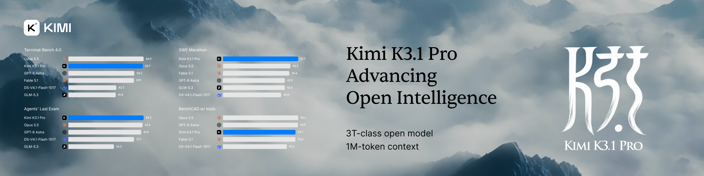](https://platform.kimi.ai?track_id=track-674ed6e2af924a5682a87421f7cf753a&aff=cc-switch)

Kimi K3.1 Pro — самая мощная на сегодня открытая модель класса 3T от Moonshot AI с контекстным окном в 1 миллион токенов. Построенная на Kimi K3 с существенно большими вычислительными ресурсами на посттренинг, она стабильно улучшает результаты в программировании, агентных сценариях, 3D-создании и рассуждениях. CC Switch позволяет легко настроить Kimi K3.1 Pro и переключаться на неё в агентных инструментах.

Попробуйте **тариф Kimi Code** ([中文站](https://www.kimi.com/code?aff=cc-switch) | [Global](https://www.kimi.ai/code?aff=cc-switch)) или используйте **API** через Kimi Open Platform ([中文站](https://platform.kimi.com?track_id=track-7cf2b91dcde043eda6ef9a95951a042c&aff=cc-switch) | [Global](https://platform.kimi.ai?track_id=track-674ed6e2af924a5682a87421f7cf753a&aff=cc-switch)).

**Бонус новым пользователям за пополнение**: зарегистрируйтесь и совершите первое пополнение по приведённым выше ссылкам на API — вы получите 10% от суммы в виде бонусных API-кредитов, до 1 000 ¥ (CNY).

---

<table>
<tr>
<td width="180"><a href="https://www.aicodemirror.ai/register?invitecode=9915W3">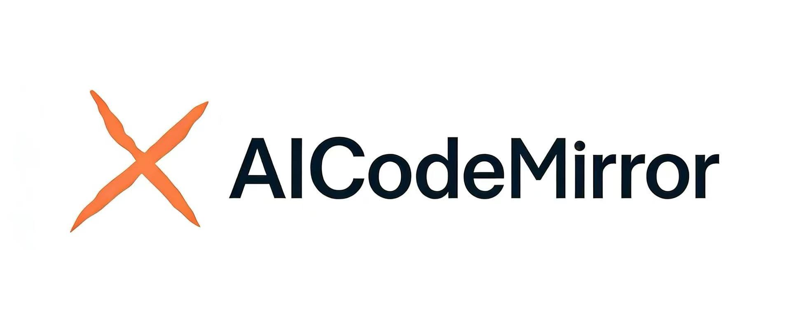</a></td>
<td>Благодарим AICodeMirror за спонсорство этого проекта! AICodeMirror предоставляет официальные высокостабильные ретрансляционные сервисы для Claude Code / Codex / Gemini CLI с корпоративным уровнем параллелизма, быстрой выпиской счетов и круглосуточной выделенной технической поддержкой.
Официальные каналы Claude Code / Codex / Gemini — по цене 38% / 2% / 9% от оригинальной, плюс дополнительные скидки при пополнении! AICodeMirror предлагает особые условия пользователям CC Switch: зарегистрируйтесь по <a href="https://www.aicodemirror.ai/register?invitecode=9915W3">этой ссылке</a> и получите скидку 20% на первое пополнение, а корпоративные клиенты — до 25%!</td>
</tr>

<tr>
<td width="180"><a href="https://www.packyapi.ai/register?aff=cc-switch"></a></td>
<td>Благодарим PackyCode за спонсорство этого проекта! PackyCode — надёжный и эффективный провайдер API-ретрансляции, предоставляющий ретрансляционные сервисы для Claude Code, Codex, Gemini и других. PackyCode предлагает особые скидки пользователям нашего ПО: зарегистрируйтесь по <a href="https://www.packyapi.ai/register?aff=cc-switch">этой ссылке</a> и введите промокод "cc-switch" при первом пополнении, чтобы получить скидку 10%.</td>
</tr>

<tr>
<td width="180"><a href="https://apinebula.ai/VjM74M">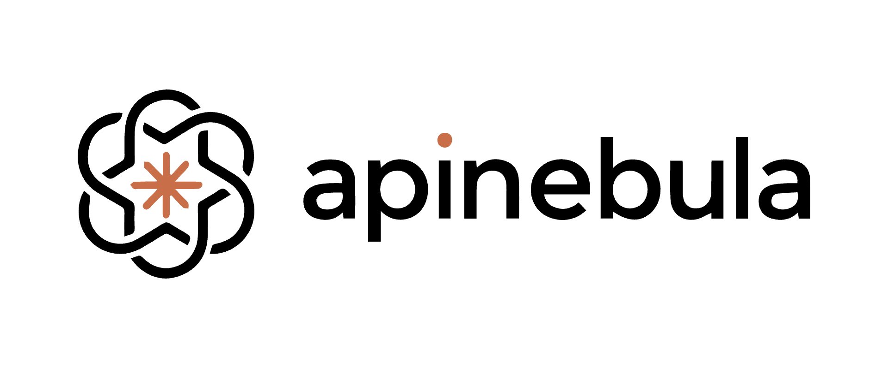</a></td>
<td>Благодарим APINEBULA за спонсорство этого проекта! APINEBULA — корпоративная платформа агрегации ИИ в составе Galaxy Video Bureau, которая опирается на обширные ресурсы платформы, чтобы предоставлять разработчикам, командам и компаниям стабильный и недорогой доступ к API больших языковых моделей. Платформа объединяет ведущие полнофункциональные модели, такие как Claude, GPT и Gemini, и позволяет подключаться к лучшим мировым ИИ-моделям через единый API по ценам от 10% от первоначальной стоимости. Платформа рассчитана на ИИ-программирование, разработку агентов и интеграцию в бизнес-системы; APINEBULA поддерживает корпоративный уровень параллелизма, официальные договоры, банковские переводы для юрлиц и выписку счетов. APINEBULA предлагает особые скидки пользователям нашего ПО: зарегистрируйтесь по <a href="https://apinebula.ai/VjM74M">этой ссылке</a> и введите промокод <strong>"ccswitch"</strong> при первом пополнении, чтобы получить <strong>скидку 10%</strong>.</td>
</tr>

<tr>
<td width="180"><a href="https://pateway.ai/?ch=etzpm8&aff=WB6M6F67#/">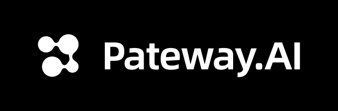</a></td>
<td>Благодарим PatewayAI за спонсорство этого проекта! PatewayAI — провайдер API-ретрансляции для опытных ИИ-разработчиков с полной поддержкой Claude, серии GPT и широкого набора популярных китайских моделей. Все модели поступают из официальных высококачественных каналов — без разбавления и подделок, а детали тарификации прозрачны и проверяемы.
Экономичный режим — от 5% от оригинальной цены. Зарегистрируйтесь по <a href="https://pateway.ai/?ch=etzpm8&aff=WB6M6F67#/">этой ссылке</a>, чтобы получить бесплатный пробный кредит $1, и участвуйте в периодических акциях за дополнительные бесплатные кредиты.
Платформа также поддерживает корпоративный уровень параллелизма, выделенную админ-консоль, официальные договоры и счета и предлагает двусторонний реферальный бонус за пополнение до $150.</td>
</tr>

<tr>
<td width="180"><a href="https://hao.ai/invite/DTBZS3OR">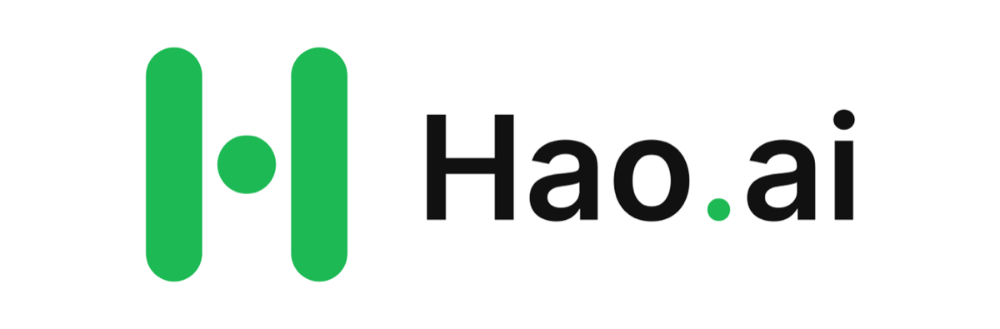</a></td>
<td>Благодарим hao.ai за спонсорство этого проекта! hao.ai — быстрый и стабильный единый шлюз LLM API для разработчиков и команд. С одним API-ключом и единым интерфейсом вы получаете доступ к GPT, Claude, xAI Grok и другим ведущим моделям, совместимым с распространёнными протоколами и SDK, такими как OpenAI и Anthropic. Платформа предлагает маршрутизацию моделей, резервное переключение, управление командой и полные журналы запросов, а цены на модели — от 15% от официальных справочных цен, что делает создание ИИ-приложений проще, стабильнее и дешевле. hao.ai предлагает пользователям CC Switch особый бонус: зарегистрируйтесь по <a href="https://hao.ai/invite/DTBZS3OR">этой ссылке</a> и получите 5% бонусных кредитов на первый заказ!</td>
</tr>

<tr>
<td width="180"><a href="https://api.fenno.ai/register?redirect=/purchase?tab=subscription%26group=16&aff=P9MR3D3PLCNL">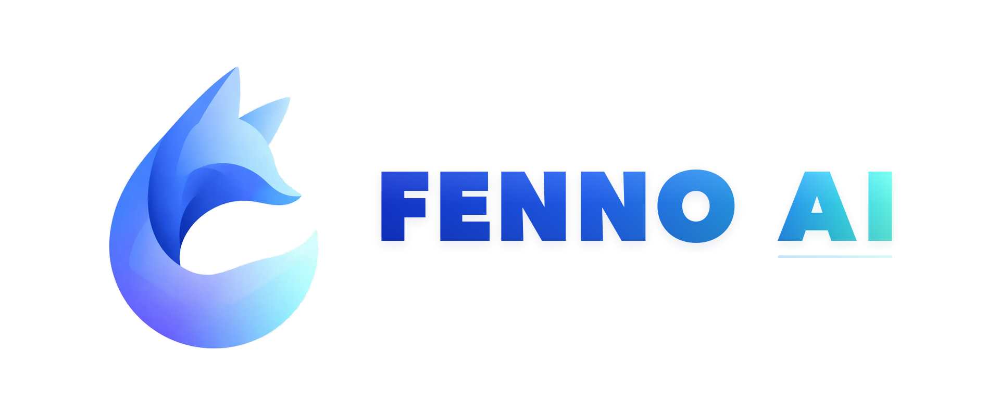</a></td>
<td>Благодарим Fenno.ai за спонсорство этого проекта! Fenno.ai — стабильный и эффективный провайдер API-ретрансляции, сейчас сфокусированный на ретрансляции Codex. Он совместим с протоколами OpenAI и Anthropic и гибко используется из Codex, Claude Code, OpenCode и других популярных инструментов для программирования. Он надёжно поддерживает корпоративные нагрузки в сотни миллиардов токенов в день, с корпоративными (B2B) расчётами и выпиской счетов для отечественных и зарубежных юрлиц. Fenno.ai предлагает эксклюзивный бонус пользователям CC Switch: подпишитесь по <a href="https://api.fenno.ai/register?redirect=/purchase?tab=subscription%26group=16&aff=P9MR3D3PLCNL">этой ссылке</a> на пробный тариф за $1,99 с кредитами на $50 (действует 7 дней) и получайте до 20% реферальных вознаграждений — приглашайте больше, зарабатывайте больше!</td>
</tr>

<tr>
<td width="180"><a href="https://www.openmodel.ai?ref=cc-switch">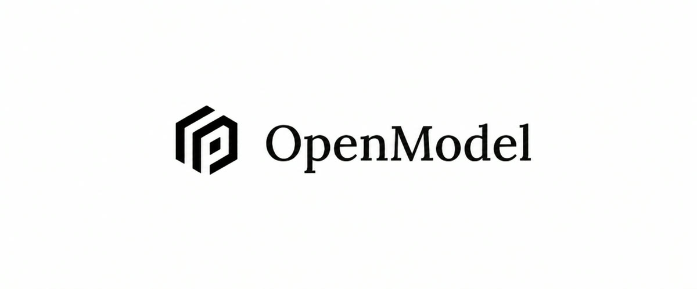</a></td>
<td>Благодарим OpenModel за спонсорство этого проекта! OpenModel предлагает скидки для конкретных клиентов — до 90% для Codex и 60% для Claude Code на поддерживаемые модели, помогая разработчикам сократить расходы на API, не меняя привычный способ работы. Просто подключите свой API-ключ OpenModel и продолжайте пользоваться Codex или Claude Code как обычно — поддерживаемые клиенты определяются автоматически, а маршруты со скидкой применяются без дополнительных параметров и ручной маршрутизации. Вы также можете настроить поведение резервного переключения для каждого API-ключа, выбрав, продолжать ли по стандартной цене или остановиться, если маршрут со скидкой временно недоступен. Пользователи CC Switch могут зарегистрироваться по <a href="https://www.openmodel.ai?ref=cc-switch">этой ссылке</a> и использовать промокод <strong>"cc-switch"</strong>, чтобы получить скидку 10% на первое пополнение.</td>
</tr>

<tr>
<td width="180"><a href="https://grooroute.pro/sign-up?aff=qqm9">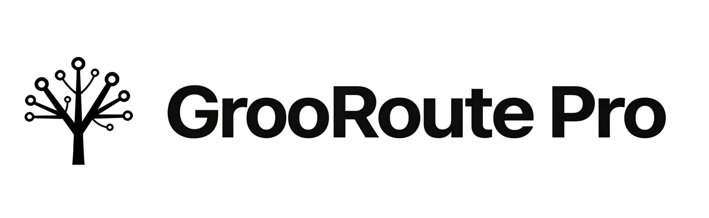</a></td>
<td>Благодарим GrooRoute Pro за спонсорство этого проекта! GrooRoute Pro — надёжная и плавно работающая платформа ИИ-API-ретрансляции с доступом к OpenAI, Claude, DeepSeek и другим популярным моделям. Развёрнутая на зарубежных серверах, она позволяет самостоятельно выбирать уровень ценового коэффициента и предлагает как оплату по факту использования, так и подписки, так что вы можете пользоваться ею так, как удобнее всего — со стабильными маршрутами и быстрым откликом, упрощающими вызов самых разных ИИ-возможностей. Эксклюзивный бонус для пользователей CC Switch: зарегистрируйтесь по <a href="https://grooroute.pro/sign-up?aff=qqm9">этой ссылке</a> и получите бесплатный пробный кредит 5 ¥!</td>
</tr>

<tr>
<td width="180"><a href="https://buytoken.work/sign-up?aff=cc-switch">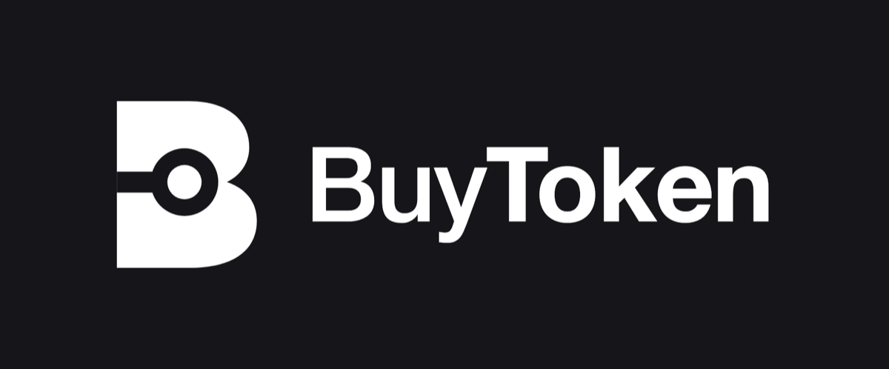</a></td>
<td>Благодарим BuyToken за спонсорство этого проекта! BuyToken предлагает ретрансляционные сервисы для Claude Code, Codex, DeepSeek и других с корпоративным уровнем параллелизма и быстрой выпиской счетов — сервис создан для стабильной долгосрочной работы. BuyToken также предлагает пользователям CC Switch особые условия: зарегистрируйтесь по <a href="https://buytoken.work/sign-up?aff=cc-switch">этой ссылке</a>, чтобы получить пробный кредит 3 ¥ и скидку 10% на первое пополнение!</td>
</tr>

<tr>
<td width="180"><a href="https://gpt.ge/signup?aff=URNP">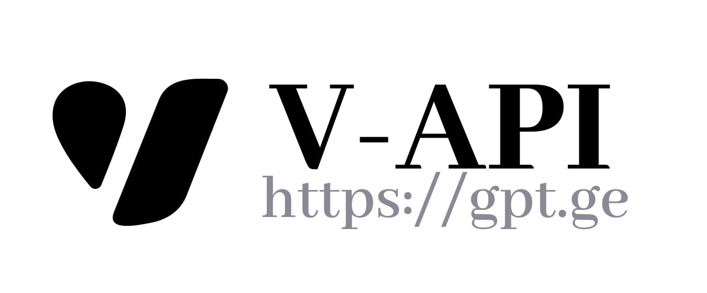</a></td>
<td>Благодарим V-API за спонсорство этого проекта! V-API — трёхлетний бренд, который предоставляет частным лицам, разработчикам и компаниям стабильную, быструю и безопасную платформу высококачественных LLM API-сервисов с поддержкой официальных договоров и счетов (обычных / специальных НДС). V-API предлагает пользователям CC Switch особые условия: зарегистрируйтесь по <a href="https://gpt.ge/signup?aff=URNP">этой ссылке</a>, чтобы получить скидку 2 ¥ и скидку 10% на первый заказ!</td>
</tr>

<tr>
<td width="180"><a href="https://agentmarket.fluxapay.xyz/marketplace/tokenplans">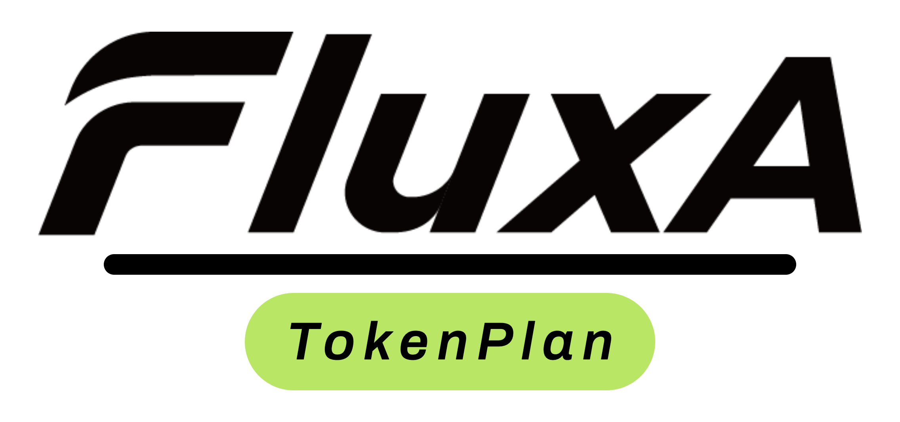</a></td>
<td>Благодарим FluxA и Baidu AI Cloud за спонсорство этого проекта! FluxA и Baidu AI Cloud совместно запустили AgenticPlan, который даёт ИИ-агентам возможность самостоятельно покупать, администрировать и использовать модели, API и инструменты. В него входит Baidu Qianfan TokenPlan со скидкой до 40% и доступом к флагманским моделям, таким как DeepSeek V4, GLM 5.2 и Kimi, а также бонусные API-кредиты FluxA AgentMarket, открывающие доступ к более чем 13 000 платных API для поиска, сбора данных, социальных сетей, финансов, криптовалют, генерации изображений, видео и многого другого.<br>С разрешения пользователя ИИ-агент также может платить официальной картой Visa, самостоятельно закупая ресурсы, управляя API-ключами, отслеживая использование и планируя продления — переводя агентов от «самостоятельного выполнения задач» к настоящему «планированию собственного бюджета и выполнению задач». Покупайте по <a href="https://agentmarket.fluxapay.xyz/marketplace/tokenplans">этой ссылке</a>!</td>
</tr>

<tr>
<td width="180"><a href="https://aigocode.net/invite/CC-SWITCH"><picture><source media="(prefers-color-scheme: dark)" srcset="assets/partners/logos/aigocode-dark.png">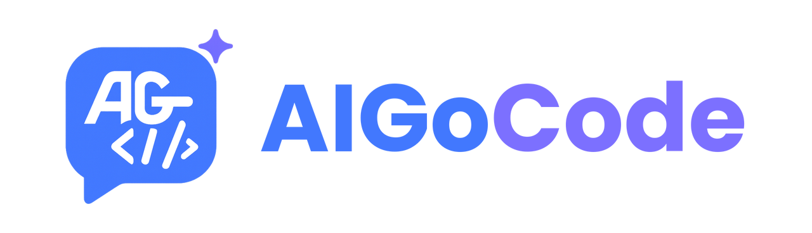</picture></a></td>
<td>Благодарим AIGoCode за спонсорство этого проекта! AIGoCode — платформа ИИ-программирования по подписке, а не просто оплата за токены. Один аккаунт, один месячный тариф на Claude Code, Codex и Gemini, прямое подключение на материковом Китае и быстрый отклик. Подпишитесь по <a href="https://aigocode.net/invite/CC-SWITCH">этой ссылке</a>, чтобы получить дополнительные 10% кредитов!</td>
</tr>

<tr>
<td width="180"><a href="https://teamorouter.com/?utm_source=cc_switch&utm_medium=referral&utm_campaign=ai_directory">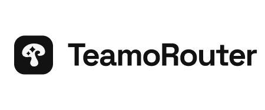</a></td>
<td>Благодарим TeamoRouter за спонсорство этого проекта! TeamoRouter — корпоративный Agentic LLM-шлюз, созданный для разработчиков, ИИ-команд и компаний. Без каких-либо подписок он позволяет получить доступ к Claude Code, Codex, Gemini CLI, OpenAI Codex и другим популярным ИИ-агентам через единый API, предлагая цены на API со скидкой до 90%.
В отличие от типичных API-ретрансляторов, TeamoRouter агрегирует сотни официальных провайдеров моделей и надёжных инфраструктурных партнёров, включая OpenAI, Anthropic, Vertex, Azure и AWS Bedrock. Каждый провайдер проверен на 100% совместимость с протоколом агентов, производительность кэша и прослеживаемость запросов, что обеспечивает стабильное качество вместо реверс-инжиниринговых или разбавленных эндпоинтов. Платформа обеспечивает TTFT, близкий к официальному, SLA 99,6%, корпоративную пропускную способность до 5 000 QPM и лучшие в отрасли показатели попаданий в кэш, которые резко снижают расходы на токены в долгих агентных рабочих процессах.
TeamoRouter также предлагает корпоративные функции: централизованную тарификацию, управление командой, BYOK, умную маршрутизацию, аналитику использования, динамическую оптимизацию провайдеров и выделенную поддержку. Для ещё более простой работы Teamo Desktop позволяет использовать Claude Code, Codex, Gemini CLI и другие популярные ИИ-агенты с настройкой в один клик — без управления API-ключами и ручной настройки шлюза. Зарегистрируйтесь по <a href="https://teamorouter.com/?utm_source=cc_switch&utm_medium=referral&utm_campaign=ai_directory">этой ссылке</a> как новый пользователь, чтобы получить скидку 10% на первое пополнение.</td>
</tr>

<tr>
<td width="180"><a href="https://aicoding.inc/i/CCSWITCH">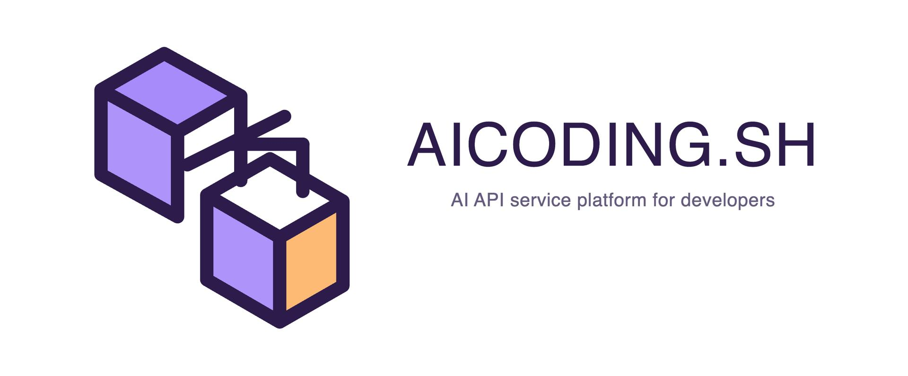</a></td>
<td>Благодарим AICoding за спонсорство этого проекта! AICoding — глобальный сервис ретрансляции API ИИ-моделей по непревзойдённым ценам! Claude Code за 19% от оригинальной цены, GPT всего за 1%! Нам доверяют сотни компаний за экономичные ИИ-сервисы. Поддерживаются Claude Code, GPT, Gemini и основные отечественные модели, с корпоративным уровнем параллелизма, быстрой выпиской счетов и круглосуточной выделенной технической поддержкой. Пользователи CC Switch, зарегистрировавшиеся по <a href="https://aicoding.inc/i/CCSWITCH">этой ссылке</a>, получают скидку 10% на первое пополнение!</td>
</tr>

<tr>
<td width="180"><a href="https://subrouter.ai/register?aff=l3ri">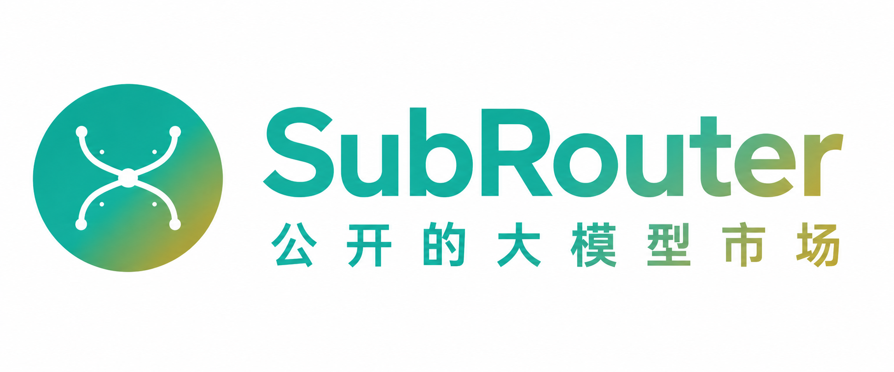</a></td>
<td>Благодарим SubRouter за спонсорство этого проекта! SubRouter — маркетплейс и платформа умной маршрутизации для операторов ИИ-сервисов. Продавцы могут запускать собственные сайты, публиковать пакеты, управлять пользователями, моделями и ценами, а пользователи находят сервисы и получают доступ к надёжным ИИ-моделям через единый API. Зарегистрируйтесь по <a href="https://subrouter.ai/register?aff=l3ri">этой ссылке</a>!</td>
</tr>

<tr>
<td width="180"><a href="https://runapi.host/register?aff=iOKB">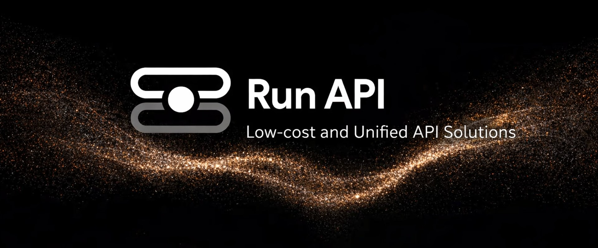</a></td>
<td>Благодарим RunAPI за спонсорство этого проекта! RunAPI — производительный и надёжный шлюз API ИИ-моделей: с одним API-ключом вы получаете доступ к более чем 150 популярным моделям, включая OpenAI, Claude, Gemini, DeepSeek и Grok, по ценам от 10% от официальных и с отличной стабильностью. Он бесшовно работает с Claude Code, OpenClaw и другими инструментами. Эксклюзивный бонус для пользователей CC Switch: зарегистрируйтесь по <a href="https://runapi.host/register?aff=iOKB">этой ссылке</a> и получите скидку 10% на первое пополнение!</td>
</tr>

<tr>
<td width="180"><a href="https://open.ospreyai.cn">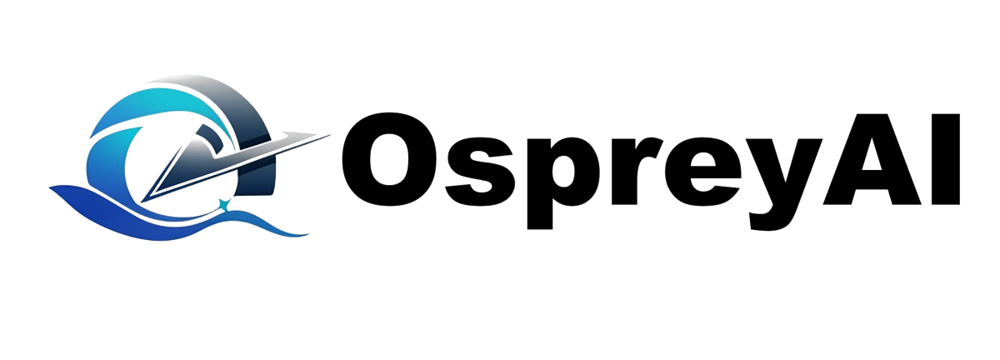</a></td>
<td>Благодарим OspreyAI за спонсорство этого проекта! ACS OspreyAI — универсальная мультимодельная API-платформа для разработчиков и компаний. Один API-ключ даёт доступ к ведущим китайским и международным моделям, включая Claude, Gemini, GPT, GLM, Kimi, Qwen, DeepSeek и Tencent Hunyuan. Платформа совместима с OpenAI, Anthropic и другими основными API-протоколами и работает с популярными ИИ-инструментами, такими как Claude Code, Codex, OpenCode, Pi и Hermes. Международные модели стоят на 20–40% дешевле официальных цен, китайские — на 30–50% дешевле. Единое пополнение, единая тарификация, учёт использования и гибкое переключение моделей делают её подходящей для разработки ИИ-приложений, производства контента и автоматизированных рабочих процессов. Создайте аккаунт по <a href="https://open.ospreyai.cn">этой ссылке</a>, чтобы получить скидку и быстро подключиться к ведущим моделям Китая и мира.</td>
</tr>

<tr>
<td width="180"><a href="https://www.shengsuanyun.com/?from=CH_4HHXMRYF">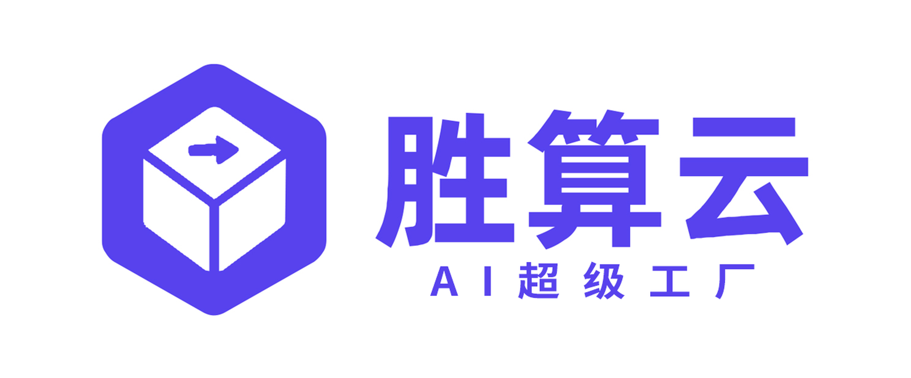</a></td>
<td>Благодарим Shengsuanyun за спонсорство этого проекта! Shengsuanyun — суперфабрика для AI Native-команд, индустриальная платформа параллельного выполнения ИИ-задач. Её маркетплейс моделей агрегирует возможности Claude, ChatGPT, Gemini и других отечественных и зарубежных LLM и мультимедийных моделей с прямыми поставками. Категорически никакого реверс-инжиниринга и разбавления — доступность моделей по SLA на всей платформе достигает 99,7%, а <a href="https://watch.shengsuanyun.com/status/shengsuanyun">панели мониторинга</a> горят зелёным по всем пунктам. Также доступны корпоративные пользовательские шлюзы для детального управления затратами и правами команды, умная маршрутизация, защита и хостинг BYOK (Bring Your Own Key). Платформа тарифицируется по факту использования и по тарифу на токены (скоро), доступна выписка счетов. Зарегистрируйтесь по <a href="https://www.shengsuanyun.com/?from=CH_4HHXMRYF">этой ссылке</a> как новый пользователь, чтобы получить 10 ¥ кредитов и бонус 10% на первое пополнение.</td>
</tr>

<tr>
<td width="180"><a href="https://88api.ai/sign-up?aff=HSGY">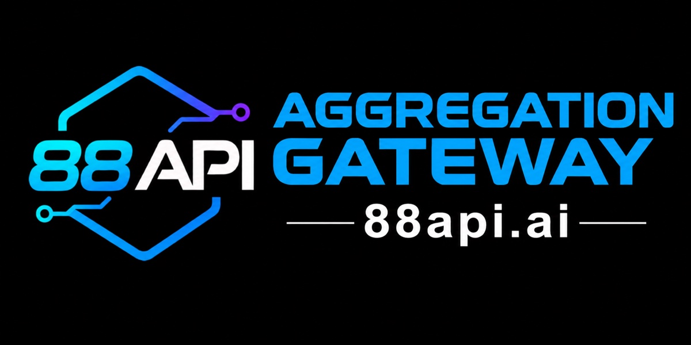</a></td>
<td>Благодарим платформу агрегации токенов 88API за спонсорство этого проекта! 88API — универсальная мультимодельная API-платформа, управляемая гонконгской компанией и ориентированная прежде всего на разработчиков, авторов контента и пользователей ИИ-приложений. Единый интерфейс даёт доступ к текстовым, графическим, речевым и видеомоделям и охватывает распространённые сценарии: ИИ-программирование, умный перевод, создание контента, озвучивание, генерацию изображений и видео. Вы можете добавить её как провайдера и переключиться на неё прямо в CC Switch. 88API поддерживает основные международные способы оплаты, может выписывать счета и обеспечивает стабильный сервис корпоративного уровня. Зарегистрируйтесь по <a href="https://88api.ai/sign-up?aff=HSGY">этой ссылке</a>, чтобы получить эксклюзивные бонусные кредиты!</td>
</tr>

<tr>
<td width="180"><a href="https://apikey.fan/register?aff=CCSwitch">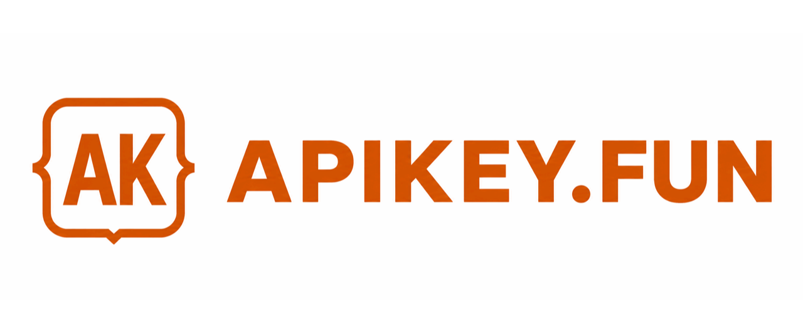</a></td>
<td>Благодарим APIKEY.FUN за спонсорство этого проекта! APIKEY.FUN — профессиональная корпоративная ИИ-ретрансляционная платформа, предоставляющая компаниям и частным разработчикам стабильный, эффективный и недорогой доступ к API ИИ-моделей. Платформа поддерживает популярные основные модели, такие как Claude, OpenAI и Gemini, по ценам от 7% от официальных. Зарегистрируйтесь по <a href="https://apikey.fan/register?aff=CCSwitch">эксклюзивной ссылке</a> этого проекта, чтобы получить эксклюзивное предложение — до <strong>постоянной скидки 5% на пополнения</strong>.</td>
</tr>

<tr>
<td width="180"><a href="https://9527.codes/register?aff=e5zI">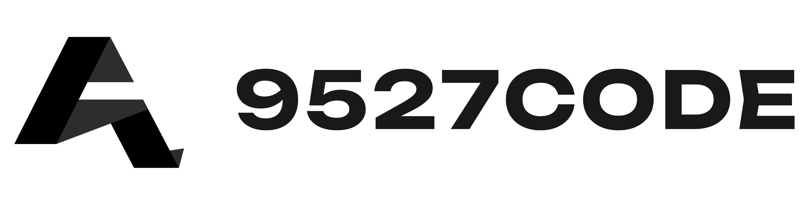</a></td>
<td>Благодарим 9527CODE за спонсорство этого проекта! 9527 CODE — корпоративная ИИ-ретрансляционная платформа с полным набором возможностей, сфокусированная на стабильности и качестве сервиса; она предоставляет быстрые, стабильные и качественные ретрансляционные сервисы для Claude Code, Codex и других основных ИИ-моделей. Больше внимания уделяется долгосрочной стабильности, качеству маршрутов и устойчивой доступности, что даёт компаниям и активным пользователям ИИ стабильное и эффективное комплексное решение для доступа к моделям. Год непрерывной работы, стабильность сервиса 99,9% и круглосуточная человеческая техподдержка 7×24. Зарегистрируйтесь по <a href="https://9527.codes/register?aff=e5zI">эксклюзивной ссылке</a> этого проекта; новые пользователи могут обратиться в службу поддержки за пробным кредитом, а реферальный кэшбэк не ограничен!</td>
</tr>

<tr>
<td width="180"><a href="https://ppio.com/activity/ccswitch">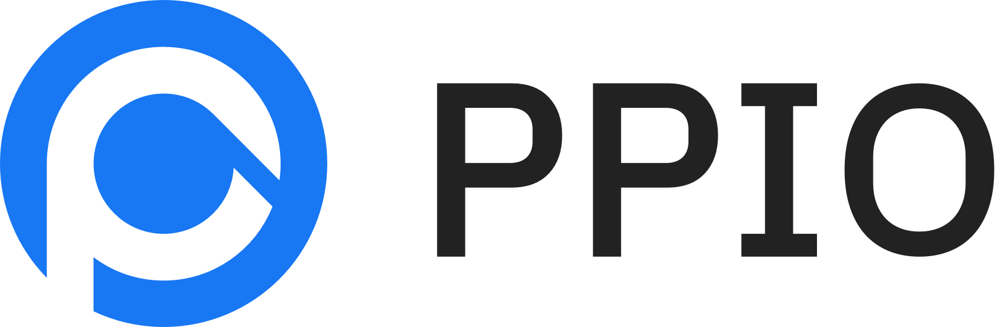</a></td>
<td>Благодарим PPIO за спонсорство этого проекта! PPIO — ведущий независимый провайдер Agentic Cloud в Китае, основанный в 2018 году основателем PPTV Яо Синем и бывшим главным архитектором PPTV Ван Вэньюем. Один API-ключ даёт доступ ко всем флагманским открытым моделям, включая DeepSeek-V4-Flash, Kimi-K3, GLM-5.2 и MiniMax-M3; корпоративный Token Plan доступен со скидкой до 40% и поддерживает 200 мест, а смешанная модель Fusion сопоставима с Fable5 по десятой части цены. Зарегистрируйтесь по <a href="https://ppio.com/activity/ccswitch">этой ссылке</a> и пройдите проверку личности, чтобы получить ваучер на 10 ¥ — приглашайте друзей пополнять баланс и получайте до 15% кэшбэка с их расходов.</td>
</tr>

<tr>
<td width="180"><a href="https://www.newapi.ai/">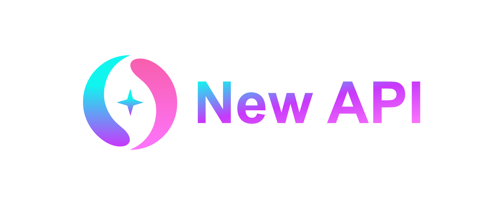</a></td>
<td>Благодарим проект открытой ИИ-инфраструктуры <a href="https://www.newapi.ai/">new-api</a> за мощную поддержку этого проекта! new-api — проект открытой ИИ-инфраструктуры от QuantumNous и один из ведущих по активности и распространённости проектов единого доступа к LLM и их распределения, нацеленный на то, чтобы помогать разработчикам, командам и компаниям создавать управляемые и масштабируемые платформы ИИ-сервисов с меньшими затратами. Как проект, выросший в экосистеме открытого ПО, new-api надеется спонсировать и поддерживать дальнейший рост других выдающихся проектов с открытым кодом. 🌟 Поставьте звезду new-api, чтобы выразить поддержку: <a href="https://github.com/QuantumNous/new-api">https://github.com/QuantumNous/new-api</a>. Сайт: <a href="https://www.newapi.ai/">https://www.newapi.ai/</a>.</td>
</tr>

<tr>
<td width="180"><a href="https://claudecn.ai/register?aff=HEL9">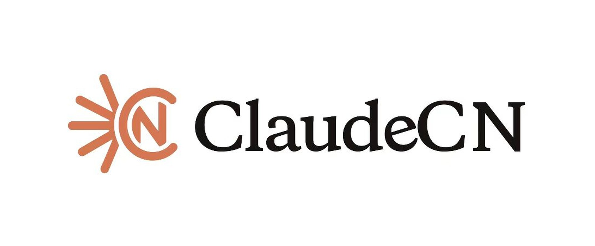</a></td>
<td>Благодарим ClaudeCN за спонсорство этого проекта! ClaudeCN — корпоративная платформа ИИ-шлюза, управляемая зарегистрированной компанией. Она обеспечивает высокодоступный коммерческий доступ к API популярных моделей, включая Claude, GPT и DeepSeek, и построена вокруг формальных корпоративных процедур закупки — банковских переводов для юрлиц, подписанных договоров и полного соответствия требованиям. Зарегистрируйтесь по <a href="https://claudecn.ai/register?aff=HEL9">этой ссылке</a>!</td>
</tr>

<tr>
<td width="180"><a href="https://www.byteplus.com/en/product/modelark?utm_campaign=hw&utm_content=ccswitch&utm_medium=devrel_tool_web&utm_source=OWO&utm_term=ccswitch">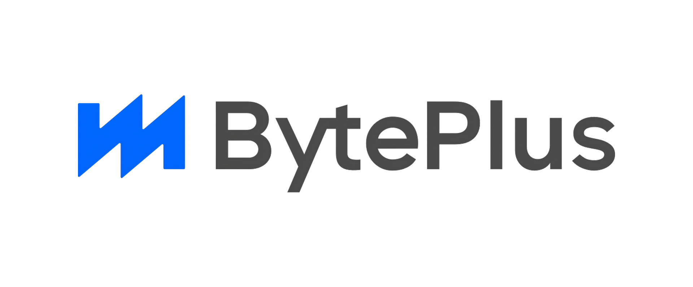</a></td>
<td>Благодарим Dola seed за спонсорство этого проекта! Dola Seed 2.0 — универсальная полномодальная большая модель, самостоятельно разработанная ByteDance для мирового рынка. Построенная на единой мультимодальной архитектуре, она поддерживает совместное понимание и генерацию текста, изображений, аудио и видео. Она изначально поддерживает взаимодействие агентов и обладает сильными возможностями рассуждения, выполнения долгих задач, интеграции инструментов и программирования. Она широко применима в умных кабинах, персональных ассистентах, образовании, поддержке клиентов, маркетинге, рознице и других сценариях. Она превосходна в мультимодальном восприятии, сквозном выполнении сложных задач, стабильном взаимодействии и безопасности данных, а также легко доступна и разворачивается через платформу ModelArk. Зарегистрируйтесь по <a href="https://www.byteplus.com/en/product/modelark?utm_campaign=hw&utm_content=ccswitch&utm_medium=devrel_tool_web&utm_source=OWO&utm_term=ccswitch">этой ссылке</a>, чтобы получить бесплатную квоту инференса в 500 000 токенов на каждую модель.<a href="https://www.volcengine.com/activity/ai618?utm_campaign=hw&utm_content=hw&utm_medium=devrel_tool_web&utm_source=OWO&utm_term=ccswitch"> >>中国大陆地区的开发者请点击这里</a></td>
</tr>

<tr>
<td width="180"><a href="https://cloud.siliconflow.cn/i/YflgU2Ve">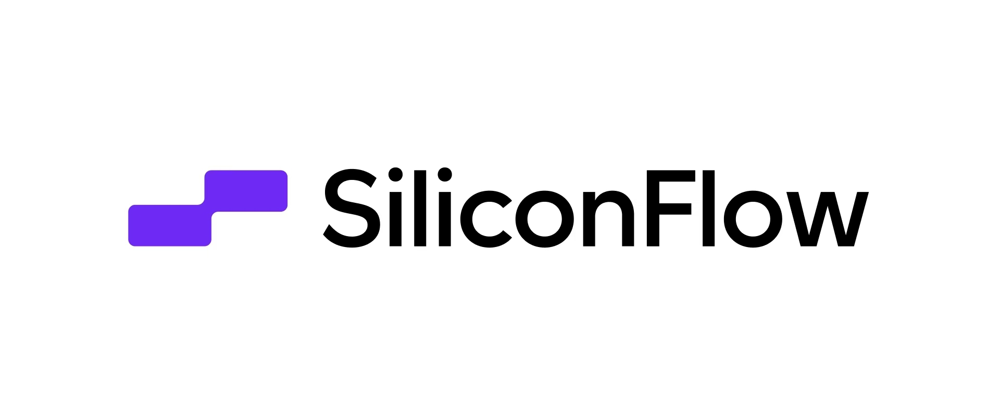</a></td>
<td>Благодарим SiliconFlow за спонсорство этого проекта! SiliconFlow — высокопроизводительная ИИ-инфраструктура и платформа API моделей, обеспечивающая быстрый и надёжный доступ к языковым, речевым, графическим и видеомоделям в одном месте. Благодаря оплате по факту использования, широкой поддержке мультимодальных моделей, быстрому инференсу и стабильности корпоративного уровня SiliconFlow помогает разработчикам и командам эффективнее создавать и масштабировать ИИ-приложения. Зарегистрируйтесь по <a href="https://cloud.siliconflow.cn/i/YflgU2Ve">этой ссылке</a> и пройдите верификацию по настоящему имени, чтобы получить бонусный кредит 16 ¥, который можно использовать для любых моделей платформы. SiliconFlow теперь также совместим с OpenClaw: пользователи могут подключить API-ключ SiliconFlow и бесплатно вызывать основные ИИ-модели.</td>
</tr>

<tr>
<td width="180"><a href="https://a6api.vip/register?aff=AqNr">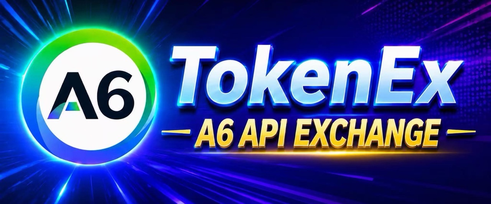</a></td>
<td>Благодарим <a href="https://a6api.vip/register?aff=AqNr">A6API</a> за спонсорство этого проекта! A6API — универсальная платформа агрегации API ИИ-моделей, охватывающая Claude, GPT, Gemini, Codex и другие популярные модели. Несколько поставщиков могут размещать на платформе своё предложение, поэтому одну и ту же модель могут конкурентно котировать несколько вышестоящих провайдеров. Умная маршрутизация автоматически выбирает более стабильный и дешёвый из доступных маршрутов и выполняет автоматическое резервное переключение, помогая сократить число неудачных запросов, снизить затраты и повысить стабильность. Будь вы частным разработчиком, командой ИИ-продукта или студией, вы можете быстро подключиться через единый интерфейс — совместимый со всеми форматами, с низкой стоимостью миграции. Новые пользователи, зарегистрировавшиеся по <a href="https://a6api.vip/register?aff=AqNr">этой ссылке</a>, получают бесплатные пробные кредиты: сначала попробуйте, затем пользуйтесь по низкой цене.</td>
</tr>

<tr>
<td width="180"><a href="https://www.compshare.cn/coding-plan?ytag=GPU_YY_YX_git_cc-switch">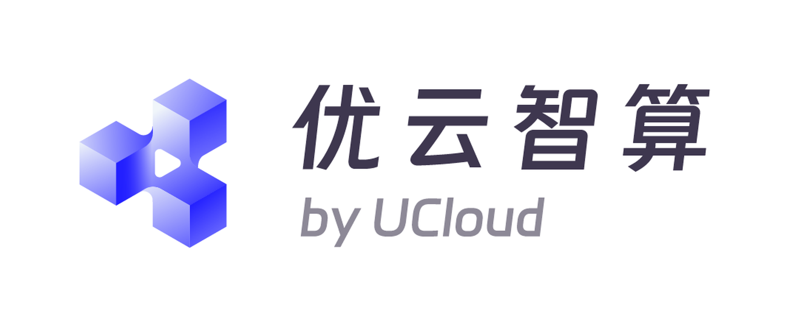</a></td>
<td>Благодарим Compshare за спонсорство этого проекта! Compshare — ИИ-облачная платформа UCloud, предоставляющая стабильные и полные API отечественных и зарубежных моделей с одним ключом. Здесь выгодные месячные и повременные пакеты Coding Plan для отечественных моделей, а также стабильные официально ретранслируемые зарубежные модели. Поддерживаются Claude Code, Codex и доступ по API. Корпоративный уровень параллелизма, круглосуточная техподдержка и самостоятельная выписка счетов. Пользователи, зарегистрировавшиеся по <a href="https://www.compshare.cn/coding-plan?ytag=GPU_YY_YX_git_cc-switch">этой ссылке</a>, получат бесплатный пробный кредит платформы 5 ¥!</td>
</tr>

<tr>
<td width="180"><a href="https://sssaicodeapi.com/register?ref=DCP0SM">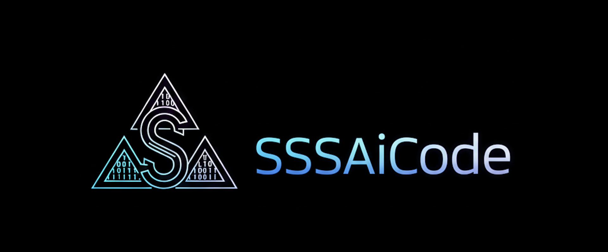</a></td>
<td>Благодарим SSSAiCode за спонсорство этого проекта! SSSAiCode — стабильный и надёжный сервис API-ретрансляции, который стремится предоставлять стабильные, надёжные и доступные сервисы моделей Claude и Codex с быстрой выпиской счетов в тот же день. SSSAiCode предлагает особые условия пользователям CC Switch: зарегистрируйтесь по <a href="https://sssaicodeapi.com/register?ref=DCP0SM">этой ссылке</a> и получайте дополнительные $10 кредитов с каждым пополнением!</td>
</tr>

<tr>
<td width="180"><a href="https://soleapi.com/r/ccswitch">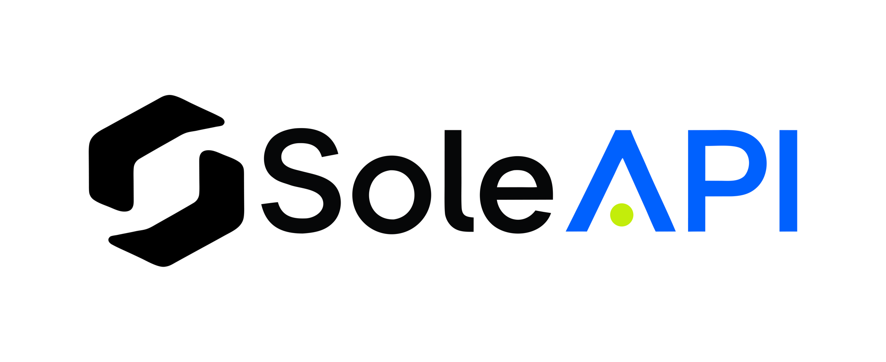</a></td>
<td>Благодарим SoleAPI за поддержку этого проекта! SoleAPI — шлюз ИИ-моделей для разработчиков и компаний: один API-ключ даёт доступ к более чем 30 ведущим моделям, включая Claude, GPT и Gemini. Он нативно совместим с протоколами OpenAI и Anthropic, поэтому Claude Code, Codex, Cursor и ваши существующие SDK работают после простой смены Base URL. Запросы маршрутизируются в реальном времени по задержке и состоянию вышестоящих узлов, с автоматическим резервным переключением на запасные каналы за миллисекунды, доступностью сервиса 99,99% и круглосуточной техподдержкой. Каждый вызов попадает в единый счёт с детализацией токенов и стоимости по каждому запросу, которую можно проверить в любой момент. Зарегистрируйтесь по <a href="https://soleapi.com/r/ccswitch">реферальной ссылке</a> этого проекта, чтобы получить бесплатные пробные кредиты, и получайте постоянный кэшбэк, приглашая друзей, которые пополняют баланс!</td>
</tr>

<tr>
<td width="180"><a href="https://www.micuapi.ai/register?aff=aOYQ">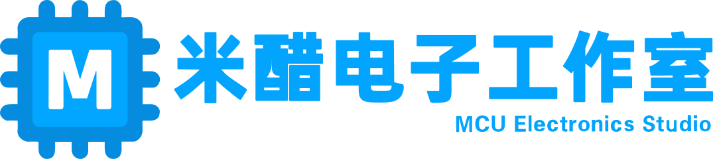</a></td>
<td>Благодарим Micu API за спонсорство этого проекта! Micu API — глобальный провайдер LLM-ретрансляции, стремящийся обеспечить наилучшее соотношение цены и качества при высокой стабильности. Основной гарантией служит зарегистрированная компания, что исключает риск прекращения сервиса, а официальные счета выписываются быстро! Мы отстаиваем принцип «нулевой стоимости попробовать»: пополняйте от 1 ¥ без минимума и в любой момент получайте возврат без комиссии! Micu API предлагает эксклюзивное предложение пользователям CC Switch: зарегистрируйтесь по <a href="https://www.micuapi.ai/register?aff=aOYQ">этой ссылке</a> и введите промокод "ccswitch" при пополнении, чтобы получить <strong>скидку 10%</strong>!</td>
</tr>

<tr>
<td width="180"><a href="https://www.rightapi.ai/register?aff=CCSWITCH">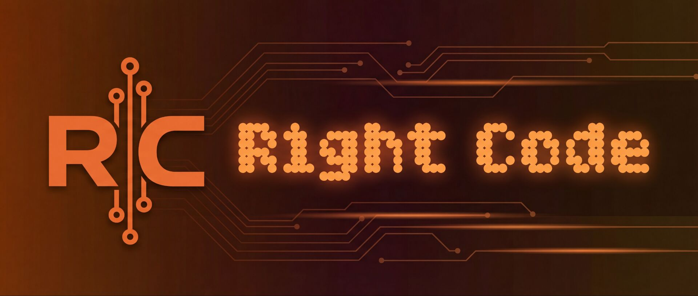</a></td>
<td>Благодарим Right Code за спонсорство этого проекта! Right Code надёжно предоставляет маршрутизационные сервисы для таких моделей, как Claude Code, Codex и Gemini, с вариантами оплаты как по факту использования, так и по месячной подписке. Счета выписываются при пополнении, а корпоративные и командные пользователи могут получить выделенную индивидуальную поддержку. Right Code также предлагает эксклюзивную скидку пользователям CC Switch: зарегистрируйтесь по <a href="https://www.rightapi.ai/register?aff=CCSWITCH">этой ссылке</a>, и с каждым пополнением вы будете получать кредит с оплатой по факту использования, эквивалентный 5% от уплаченной суммы.</td>
</tr>

<tr>
<td width="180"><a href="https://cubence.com/signup?code=CCSWITCH&source=ccs">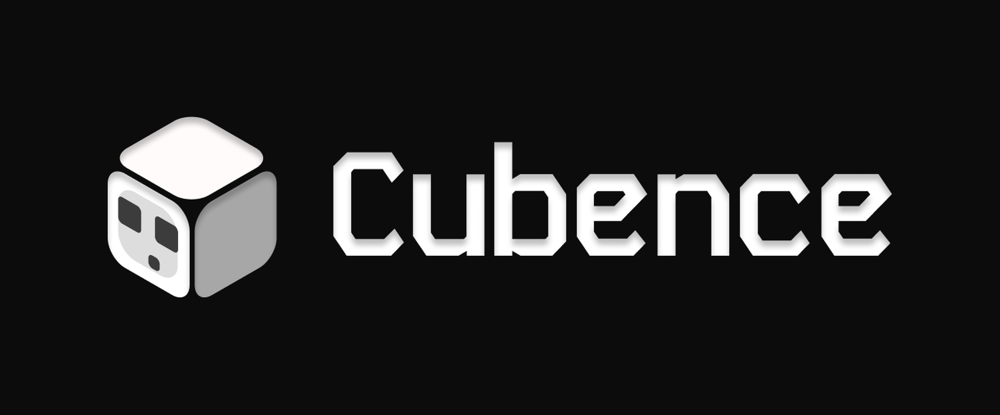</a></td>
<td>Благодарим Cubence за спонсорство этого проекта! Cubence — надёжный и эффективный провайдер API-ретрансляции, предоставляющий ретрансляционные сервисы для Claude Code, Codex, Gemini и других с гибкими вариантами оплаты, включая оплату по факту использования и месячные тарифы. Cubence предлагает особые скидки пользователям CC Switch: зарегистрируйтесь по <a href="https://cubence.com/signup?code=CCSWITCH&source=ccs">этой ссылке</a> и введите промокод "CCSWITCH" при пополнении, чтобы получать скидку 10% на каждое пополнение!</td>
</tr>

<tr>
<td width="180"><a href="https://crazyrouter.com/register?aff=OZcm&ref=cc-switch">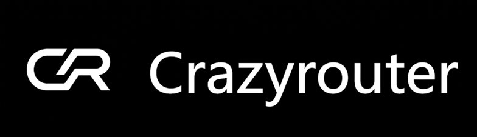</a></td>
<td>Благодарим Crazyrouter за спонсорство этого проекта! Crazyrouter — высокопроизводительная платформа агрегации ИИ-API: один API-ключ для более чем 300 моделей, включая Claude Code, Codex, Gemini CLI и другие. Все модели — по 55% от официальных цен с автоматическим резервным переключением, умной маршрутизацией и неограниченным параллелизмом. Crazyrouter предлагает эксклюзивное предложение пользователям CC Switch: зарегистрируйтесь по <a href="https://crazyrouter.com/register?aff=OZcm&ref=cc-switch">этой ссылке</a> и обратитесь в службу поддержки, чтобы получить <strong>бесплатный кредит $2</strong>, а также введите промокод `CCSWITCH` при первом пополнении и получите дополнительный <strong>бонус 30% к кредитам</strong>! </td>
</tr>

<tr>
<td width="180"><a href="https://www.dmxapi.cn/register?aff=bUHu">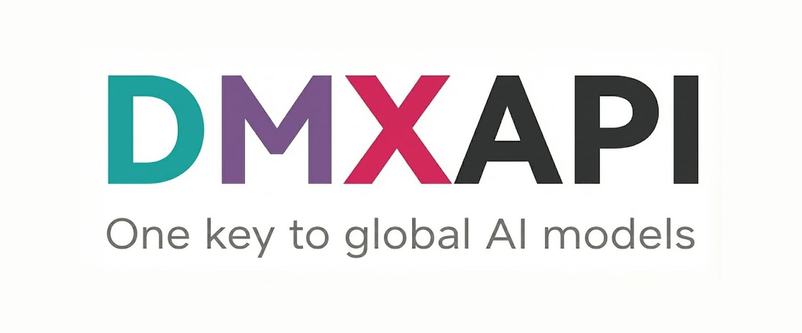</a></td>
<td>Благодарим DMXAPI за спонсорство этого проекта! DMXAPI предоставляет глобальные сервисы API больших моделей более чем 200 корпоративным пользователям. Один API-ключ для всех мировых моделей. Возможности: мгновенная выписка счетов, неограниченный параллелизм, старт от $0,15, круглосуточная техподдержка. GPT/Claude/Gemini — все со скидкой 32%, отечественные модели — со скидкой 20–50%, эксклюзивные модели для Claude Code — со скидкой 66%! <a href="https://www.dmxapi.cn/register?aff=bUHu">Зарегистрируйтесь здесь</a></td>
</tr>

</table>

</details>

## Зачем нужен CC Switch?

У каждого ИИ-инструмента для программирования, такого как Claude Code, Codex и Gemini CLI, свой формат конфигурации. Чтобы сменить API-провайдера, приходится вручную править файлы JSON, TOML, YAML или `.env`, а MCP, навыки и промпты нужно отдельно поддерживать в каждом инструменте.

**CC Switch** собирает всё это в одном десктопном приложении: выберите пресет, введите ключ и переключайтесь в один клик. При переключении заменяются только параметры подключения — адрес, ключ и модель, — поэтому плагины, хуки, MCP и добавленные вами комментарии остаются на месте.

- **Одно приложение — двенадцать инструментов** — Claude Code, Claude Desktop, Codex, Gemini CLI, Grok Build, OpenCode, OpenClaw, Hermes, Pi, MiniMax Code, Kimi Code и Oh My Pi
- **Больше никакой ручной правки** — более 90 пресетов провайдеров, включая AWS Bedrock, NVIDIA NIM и community-ретрансляторы
- **Напрямую, маршрутизация или агрегация — на ваш выбор** — «Напрямую» подключает инструмент прямо к провайдеру; «Маршрутизация» пересылает запросы через ваш компьютер, преобразуя форматы API и автоматически переключаясь на резерв, так что можно использовать GPT в Claude Code и Claude в Codex; «Агрегация» собирает модели нескольких провайдеров в один список моделей в Claude Code или Codex, и каждый запрос уходит провайдеру выбранной вами модели
- **Единые MCP, навыки и промпты** — добавьте MCP-серверы и навыки один раз, затем выберите, в какие инструменты их синхронизировать; промпты ведутся отдельно для каждого инструмента
- **Сессии, которые удобно читать** — превращает логи сессий каждого инструмента в режим чтения: что сделал каждый ход, какие файлы изменились и какой шаг завершился ошибкой — всё видно с первого взгляда
- **Статистика и квоты под рукой** — отслеживайте расход токенов и затраты даже без локальной маршрутизации; остаток квоты подписки и баланс аккаунтов отображаются прямо на карточках провайдеров и в трее
- **Кроссплатформенность** — нативное десктопное приложение для Windows, macOS и Linux, созданное на Tauri 2

## Скриншоты

<table>
<tr>
<td align="center" width="50%">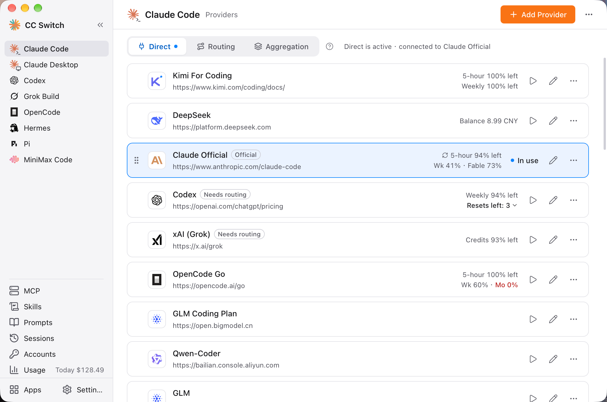<br>Главный экран</td>
<td align="center" width="50%">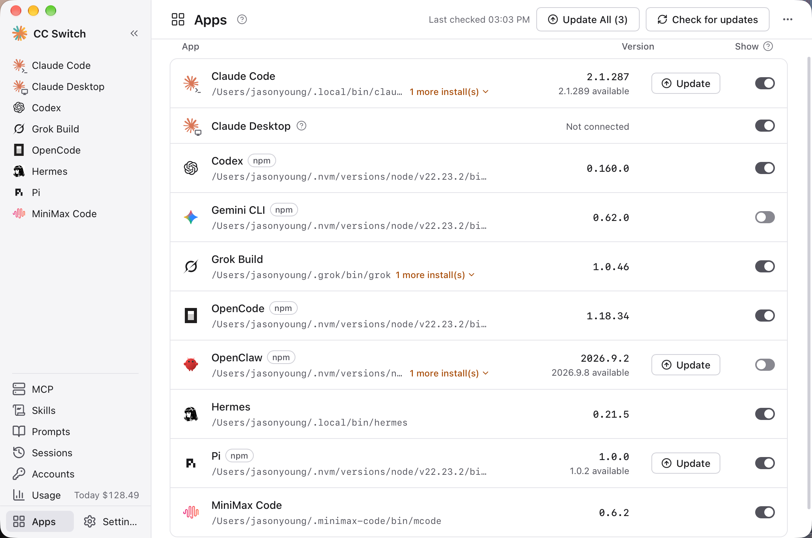<br>Страница «Приложения»</td>
</tr>
<tr>
<td align="center">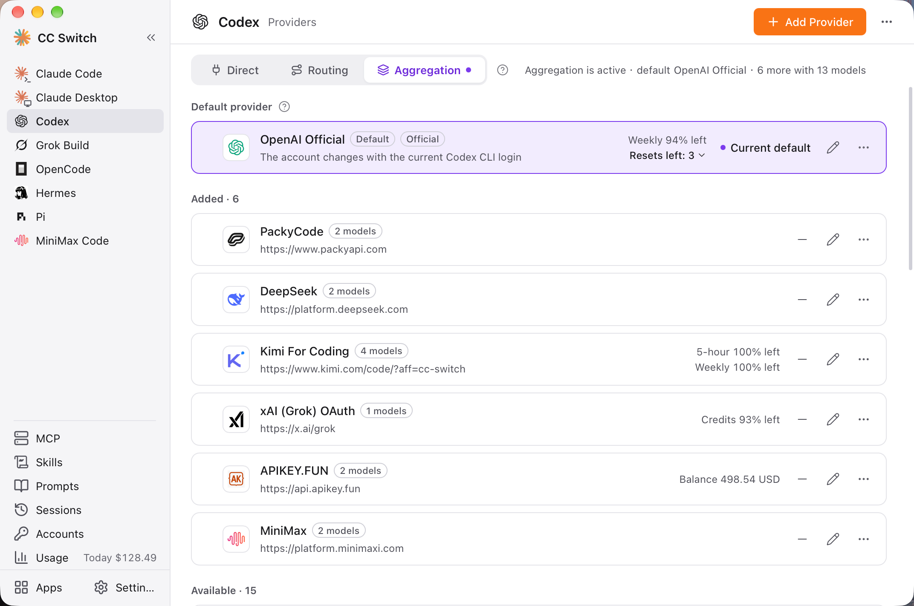<br>Режим агрегации</td>
<td align="center">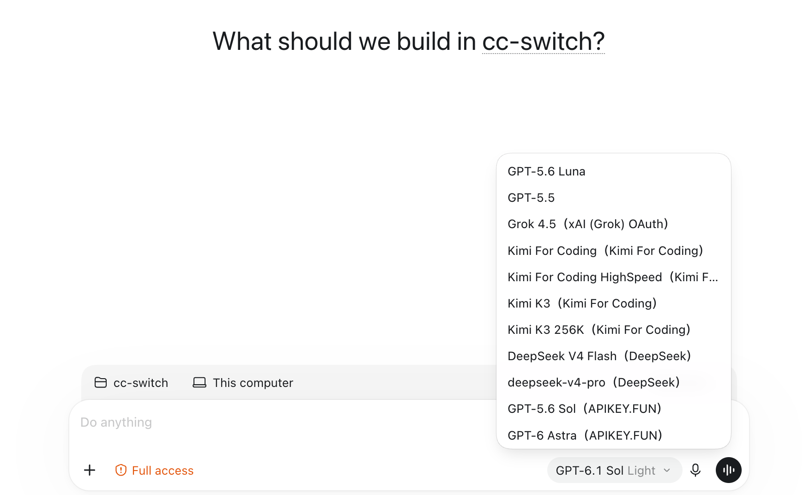<br>Агрегированный список моделей в Codex</td>
</tr>
<tr>
<td align="center">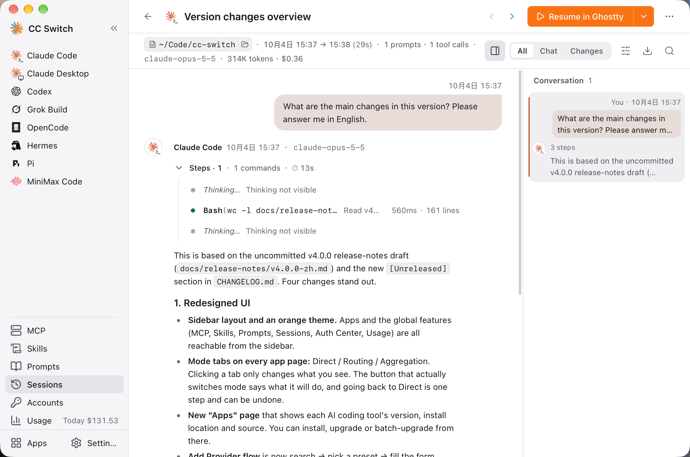<br>Режим чтения сессии</td>
<td align="center">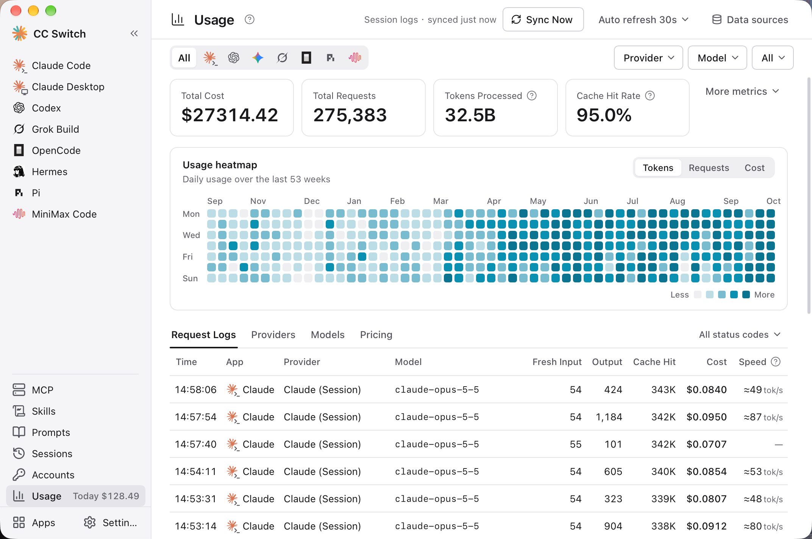<br>Статистика</td>
</tr>
</table>

## Загрузка и установка

### Системные требования

- **Windows**: Windows 10 и новее
- **macOS**: macOS 12 (Monterey) и новее
- **Linux**: x86_64 или ARM64 с glibc 2.35+ и WebKitGTK 4.1 — например, Ubuntu 22.04+, Debian 12+ и свежие выпуски Fedora; RHEL / Rocky / Alma 8–9 пока не поддерживаются

### Пользователям Windows

Скачайте со страницы [Releases](../../releases) последний установщик `CC-Switch-v{version}-Windows.msi` или портативную версию `CC-Switch-v{version}-Windows-Portable.zip`. Для Windows on ARM скачайте `CC-Switch-v{version}-Windows-arm64.msi` или `CC-Switch-v{version}-Windows-arm64-Portable.zip`.

### Пользователям macOS

**Способ 1: установка через Homebrew (рекомендуется)**

```bash
brew install --cask cc-switch
```

Обновление:

```bash
brew upgrade --cask cc-switch
```

**Способ 2: ручная загрузка**

Скачайте со страницы [Releases](../../releases) `CC-Switch-v{version}-macOS.dmg` (рекомендуется) или `.zip`. Это универсальная сборка, которая нативно работает как на Apple Silicon, так и на Mac с Intel.

> **Примечание**: CC Switch для macOS подписан кодом и нотаризован Apple. Его можно устанавливать и открывать напрямую.

### Пользователям Arch Linux

**Установка через paru (рекомендуется)**

```bash
paru -S cc-switch-bin
```

### Пользователям Linux

Скачайте последнюю сборку для Linux со страницы [Releases](../../releases):

- `CC-Switch-v{version}-Linux-x86_64.deb` / `-Linux-arm64.deb` (Debian/Ubuntu)
- `CC-Switch-v{version}-Linux-x86_64.rpm` / `-Linux-arm64.rpm` (Fedora и другие RPM-дистрибутивы с WebKitGTK 4.1)
- `CC-Switch-v{version}-Linux-x86_64.AppImage` / `-Linux-arm64.AppImage` (любой дистрибутив, удовлетворяющий требованиям выше)

> **Flatpak**: не входит в официальные релизы. Его можно собрать самостоятельно из `.deb` — инструкции см. в [`flatpak/README.md`](flatpak/README.md).

## Быстрый старт

### Основы использования

1. **Добавьте провайдера**: выберите нужный инструмент на боковой панели, затем нажмите «+» (Добавить провайдера) в правом верхнем углу страницы → выберите пресет или создайте собственную конфигурацию
2. **Переключите провайдера**:
   - Главный экран: выберите провайдера → нажмите «Включить» (для OpenCode, OpenClaw, Hermes, MiniMax Code и Kimi Code кнопка называется «Добавить», а для Pi и Oh My Pi — «Включить» / «Удалить»; эти семь инструментов работают в режиме сосуществования, поэтому можно добавить сразу нескольких провайдеров)
   - Системный трей: для каждого инструмента одна строка вида «имя · режим · провайдер · квота»; нажмите на имя провайдера в её подменю, чтобы переключиться (Claude Code, Claude Desktop, Codex, Gemini CLI и Grok Build)
3. **Применение**: Claude Code не требует перезапуска; для Codex, Gemini CLI и Grok Build перезапустите терминал или CLI-инструмент; для Claude Desktop перезапустите само приложение (см. FAQ)
4. **Возврат к официальному входу**: переключитесь на встроенного официального провайдера в списке (например, «Claude Official»), перезапустите инструмент, затем пройдите его процедуру входа / OAuth
5. **Маршрутизация и агрегация (необязательно)**: на страницах Claude Code, Codex, Gemini CLI и Grok Build вверху есть вкладки «Напрямую» / «Маршрутизация», а у Claude Code и Codex — ещё и «Агрегация». Нажатие на вкладку лишь меняет то, что вы просматриваете, и не затрагивает вашу конфигурацию; чтобы действительно переключиться, нажмите на странице «Начать маршрутизацию» или «Перейти к агрегации», а для возврата — «Вернуться к прямому подключению». Используйте маршрутизацию, чтобы применять провайдеров в формате OpenAI или Gemini в Claude Code либо Claude в Codex; используйте агрегацию, чтобы собрать модели нескольких провайдеров в одном списке моделей
6. **Управление инструментами**: страница «Приложения» на боковой панели показывает версию, расположение установки и источник каждого ИИ-инструмента для программирования в одном месте; вы можете устанавливать и обновлять инструменты по одному или все сразу, а также выбирать, какие инструменты показывать на боковой панели

### MCP, промпты, навыки, проекты и сессии

- **MCP**: нажмите «MCP» на боковой панели → добавьте серверы через шаблоны или собственную конфигурацию (либо «Импортировать существующие») → включите синхронизацию для каждого инструмента
- **Промпты**: нажмите «Промпты» на боковой панели → создавайте промпты в Markdown-редакторе → включите один из них, чтобы записать его в файл промпта этого инструмента
- **Навыки**: нажмите «Навыки» на боковой панели → «Открыть навыки» → ищите по skills.sh или просматривайте репозитории GitHub → установка в один клик в поддерживаемые инструменты
- **Проекты**: сначала включите «Показывать переключатель проектов» в «Настройки → Основные», затем на странице Claude Code, Claude Desktop или Codex откройте переключатель проектов вверху → «Новый проект», чтобы сохранить текущую конфигурацию; позже выберите проект в переключателе, чтобы разом сменить всю настройку
- **Сессии**: нажмите «Сессии» на боковой панели → просматривайте и ищите историю разговоров, открывайте режим чтения или восстанавливайте сессии каждого инструмента
- **Аккаунты**: нажмите «Аккаунты» на боковой панели, чтобы войти в аккаунты GitHub Copilot, ChatGPT, xAI (Grok) и Kimi Code и использовать свои подписки как провайдеров. Kimi Code поддерживает несколько официальных аккаунтов, у каждого из которых отдельные учётные данные и собственный нативный провайдер; первый вход использует нативный слот учётных данных Kimi по умолчанию. Здесь же управляются вход, повторная аутентификация и выход. Официальные узлы Kimi OAuth, всё ещё присутствующие в нативной конфигурации, защищены на странице провайдера; сохранённые профили можно удалить после удаления их нативных узлов.

> **Примечание**: при первом запуске CC Switch автоматически импортирует вашу существующую конфигурацию Claude Code, Codex, Gemini CLI и Grok Build как провайдера с именем `default` и добавляет официального провайдера для каждого из этих инструментов и для Claude Desktop, так что ничего из настроенного вами не потеряется.

Подробные руководства по каждой функции см. в **[Руководстве пользователя](docs/user-manual/en/README.md)** (на английском): управление провайдерами, MCP / промпты / навыки, локальная маршрутизация и резервное переключение и многое другое.

## Возможности

[Полная история изменений](CHANGELOG.md) | [Примечания к релизу v4.0](docs/release-notes/v4.0.4-en.md)

### Поддерживаемые функции по инструментам

| Инструмент | Провайдеры | Локальная маршрутизация | Агрегация | Переключение из трея | MCP | Навыки | Промпты | Сессии | Статистика |
| --- | --- | :---: | :---: | :---: | :---: | :---: | --- | :---: | :---: |
| Claude Code | Переключение | ✓ | ✓ | ✓ | ✓ | ✓ | CLAUDE.md | ✓ | ✓ |
| Claude Desktop | Переключение | Только сопоставление моделей | – | ✓ | – | – | – | – | Только сопоставление моделей |
| Codex | Переключение | ✓ | ✓ | ✓ | ✓ | ✓ | AGENTS.md | ✓ | ✓ |
| Gemini CLI | Переключение | ✓ | – | ✓ | ✓ | ✓ | GEMINI.md | ✓ | ✓ |
| Grok Build | Переключение | ✓ | – | ✓ | ✓ | ✓ | AGENTS.md | ✓ | ✓ |
| OpenCode | Сосуществование | – | – | – | ✓ | ✓ | AGENTS.md | ✓ | ✓ |
| OpenClaw | Сосуществование | – | – | – | – | – | Редактор рабочей области | ✓ | – |
| Hermes | Сосуществование | – | – | – | ✓ | ✓ | Память | ✓ | – |
| Pi | Сосуществование | – | – | – | ✓ | ✓ | AGENTS.md, SYSTEM.md, шаблоны промптов | ✓ | ✓ |
| MiniMax Code | Сосуществование | – | – | – | ✓ | ✓ | AGENTS.md | ✓ | ✓ |
| Kimi Code | Сосуществование | – | – | – | ✓ | ✓ | AGENTS.md | ✓ | ✓ |
| Oh My Pi | Сосуществование | – | – | – | ✓ | ✓ | AGENTS.md | ✓ | – |

- **Переключение**: одновременно активен только один провайдер; **Сосуществование**: несколько провайдеров одновременно записываются в собственный конфиг инструмента, а выбираете вы уже внутри инструмента.
- **Локальная маршрутизация**: CC Switch пересылает запросы на вашем компьютере и преобразует форматы API; см. [Локальная маршрутизация и резервное переключение](#локальная-маршрутизация-и-резервное-переключение) ниже. Провайдеры Claude Desktop могут работать в режиме «Напрямую» или «Сопоставление моделей»; при «Сопоставлении моделей» запросы идут через локальную маршрутизацию.
- **Агрегация**: собирает модели нескольких провайдеров в один список моделей и отправляет каждый запрос провайдеру выбранной вами модели; см. [Режим агрегации](#режим-агрегации) ниже.
- **Сессии**: просмотр и поиск по истории разговоров, режим чтения и копирование команды возобновления для продолжения разговора (возобновление сессий OpenClaw и Hermes пока не поддерживается). Hermes показывает только 500 последних сессий.
- **Статистика**: без локальной маршрутизации использование собирается из локальных логов сессий каждого инструмента; запросы, проходящие через локальную маршрутизацию, также учитываются.
- Панели MCP, навыков, промптов и сессий, открытые со страницы Claude Desktop, относятся к Claude Code.

### Управление провайдерами

- **Более 90 пресетов провайдеров** — выберите пресет и введите ключ, чтобы добавить провайдера, либо создайте собственную конфигурацию. Панель добавления позволяет искать по названию (включая китайские названия) и домену, а разные тарифы и регионы одного вендора объединены в одну строку
- **Только ключевые поля** — при переключении заменяются лишь параметры подключения: адрес, ключ и модель; плагины, хуки, MCP, добавленные вами настройки и комментарии остаются на месте. Редактор показывает, как будет выглядеть файл конфигурации после переключения, а CC Switch автоматически создаёт резервную копию каждого файла конфигурации перед его первой перезаписью
- **Проекты** — сохраняйте текущий провайдер, MCP, навыки и файлы промптов Claude Code или Codex как проект (для Claude Desktop сохраняется только провайдер), затем переключайте всю настройку в один клик через переключатель проектов вверху страницы или из трея; при переходе на другой проект текущее состояние автоматически сохраняется обратно в предыдущий. Переключатель проектов по умолчанию скрыт; включите «Показывать переключатель проектов» в «Настройки → Основные»
- **Аккаунты (бета)** — входите в несколько аккаунтов GitHub Copilot, ChatGPT и xAI (Grok) в разделе «Аккаунты» на боковой панели и используйте эти подписки как провайдеров в Claude Code, Claude Desktop и Codex (всё, кроме OpenAI Official в Codex, нужно использовать в режиме маршрутизации). Использование подписки вне официального клиента может нарушать условия использования вендора; оценивайте риск самостоятельно
- **Сторонние провайдеры для Claude Desktop** — подключайтесь напрямую к Anthropic-совместимым эндпоинтам; для не-Claude моделей выберите «Сопоставление моделей», чтобы через локальную маршрутизацию сопоставить уровни вроде Sonnet, Opus и Haiku реальным моделям провайдера
- **Универсальные провайдеры** — одна конфигурация синхронизируется с Claude Code, Codex и Gemini CLI
- Переключение в один клик, быстрое переключение из системного трея (Claude Code, Claude Desktop, Codex, Gemini CLI, Grok Build), сортировка перетаскиванием, импорт/экспорт

### Локальная маршрутизация и резервное переключение

- **Преобразование форматов API** — локальная маршрутизация преобразует запросы между Anthropic Messages, OpenAI Chat Completions, OpenAI Responses и Gemini Native: Claude Code и Claude Desktop могут использовать провайдеров в формате OpenAI или Gemini, а Codex и Grok Build — провайдеров Chat Completions или Anthropic Messages
- **Переключатель для каждого инструмента** — Claude Code, Codex, Gemini CLI и Grok Build могут входить в режим маршрутизации по отдельности: нажмите «Начать маршрутизацию» на вкладке «Маршрутизация» вверху страницы. В режиме маршрутизации смена провайдера вступает в силу сразу для последующих запросов (Codex, Gemini CLI и Grok Build всё же могут потребовать перезапуска, если переключение меняет модель). При выходе из CC Switch он сначала записывает обратно прямую конфигурацию и снова подключается при следующем запуске
- **Автоматическое резервное переключение** — настройте очередь резервного переключения для каждого инструмента; при ошибке запроса CC Switch автоматически переходит к следующему провайдеру в очереди, опираясь на размыкатель цепи (circuit breaker) и мониторинг состояния провайдеров
- **Ректификатор** — автоматически исправляет некоторые запросы, которые не могут обработать отдельные вышестоящие сервисы (например, подписи Thinking или откат, когда изображения не поддерживаются)
- Официальные провайдеры (например, Claude Official) не могут работать через локальную маршрутизацию (кроме OpenAI Official в Codex)
- Статус службы маршрутизации, адрес прослушивания и настройки резервного переключения находятся в «Настройки → Локальная маршрутизация»
- Руководства: [Использование GPT в Claude Code](docs/guides/claude-codex-routing-guide-en.md) · [Использование Claude в Codex](docs/guides/codex-claude-routing-guide-en.md)

### Режим агрегации

- **Один список моделей — много провайдеров** — на странице Claude Code или Codex переключитесь на «Агрегацию» и добавьте нескольких провайдеров; все их модели появятся в списке выбора моделей клиента. Каждый запрос уходит провайдеру выбранной вами модели, без необходимости переключаться в CC Switch
- **Добавляйте и удаляйте в любой момент** — нажмите «Добавить» или «Удалить» на карточке провайдера, затем выберите одного провайдера по умолчанию; запросы, не указывающие агрегированную модель, уходят ему. OpenAI Official в Codex может быть только провайдером по умолчанию; официальные подписки Claude в агрегации пока не поддерживаются
- **Примечания** — агрегация не обеспечивает резервного переключения; для Claude Code требуется версия 2.1.243 или новее; Codex нужно перезапускать после изменения агрегированного списка, а Claude Code — нет. При смене модели внутри сессии новой модели приходится заново строить кэш промптов, поэтому первый ход обходится чуть дороже
- Значительная часть дизайна режима агрегации опирается на [opencodex](https://github.com/lidge-jun/opencodex) — благодарим его автора и участников
- Документация: [Руководство по режиму агрегации](docs/user-manual/en/4-proxy/4.6-aggregation.md) · [Иллюстрированное руководство (на китайском)](docs/guides/aggregation-mode-guide-zh.md)

### MCP, промпты и навыки

- **Единая панель MCP** — управляйте всеми MCP-серверами в одном месте, выбирайте, в какие инструменты синхронизировать каждый из них (Claude Code, Codex, Gemini CLI, Grok Build, OpenCode, Hermes, Pi, MiniMax Code, Kimi Code, Oh My Pi), импортируйте существующие конфиги из каждого инструмента и импортируйте через Deep Link
- **Промпты** — библиотека промптов для каждого инструмента с Markdown-редактором; включение промпта записывает его в файл промпта этого инструмента (CLAUDE.md / AGENTS.md / GEMINI.md), при этом существующее содержимое файла сначала сохраняется в библиотеку, так что ничего не теряется. В Pi также можно редактировать SYSTEM.md, APPEND_SYSTEM.md и шаблоны промптов
- **Навыки** — ищите по skills.sh или устанавливайте в один клик из репозиториев GitHub или ZIP-файлов; проверяйте обновления и обновляйте всё одним кликом; синхронизируйте с каждым инструментом автоматически, только через символические ссылки или только копированием; при желании их можно хранить в `~/.agents/skills`
- Все три панели поддерживают поиск, а MCP и навыки можно также включать или отключать для инструмента разом; провайдеры, MCP-серверы и промпты редактируются на всю страницу в области содержимого, и перед уходом с несохранёнными изменениями вас предупредят

### Учёт использования и стоимости

- **Панель статистики** — работает без локальной маршрутизации: по умолчанию автоматически сканирует локальные логи сессий каждого инструмента и отслеживает запросы, токены, долю попаданий в кэш, скорость вывода и затраты по провайдерам и моделям, с графиками трендов, тепловой картой за весь год и журналами по каждому запросу
- **Квоты и балансы** — карточки провайдеров и трей показывают остаток и обратный отсчёт до сброса, например «5h 94% left»: квоты официальных подписок (Claude, ChatGPT, Gemini, SuperGrok), 5-часовые / недельные / месячные квоты Coding Plan (Kimi, Zhipu GLM, MiniMax, Volcengine Ark и др.) и балансы аккаунтов (DeepSeek, OpenRouter, SiliconFlow и др.); некоторые нужно сначала включить через «Настроить запрос использования» на карточке провайдера, а для остальных провайдеров можно написать собственный скрипт использования. Подписки ChatGPT также показывают оставшиеся сбросы лимитов и баланс Codex Credits
- **Собственные цены** — задавайте цены по моделям или импортируйте их из models.dev

### Менеджер сессий и рабочая область

- **Режим чтения сессий** — разбирает логи сессий каждого инструмента в структурированное содержимое: текст, размышления, вызовы инструментов, их результаты и изображения показываются раздельно; каждый ход работы сворачивается в однострочную сводку (сколько шагов, сколько файлов изменено, сколько ошибок), неудачные шаги отмечены красным; справа находится структура разговора, поиск внутри сессии, экспорт в Markdown и копирование отдельного хода или всего разговора
- **Список и возобновление** — группировка по проекту или времени, поиск по заголовкам, каталогам, сообщениям или ID сессий и массовое удаление; копирование команды возобновления для продолжения разговора, а в macOS — возобновление в терминале в один клик
- **Редактор рабочей области** (OpenClaw) — редактируйте файлы агента (AGENTS.md, SOUL.md и т. д.) и ежедневную память
- **Память** (Hermes) — редактируйте MEMORY.md и USER.md Hermes

### Система и платформа

- **Облачная синхронизация** — синхронизация между устройствами через WebDAV (Jianguoyun, Nextcloud, Synology NAS и др.) или S3-совместимое хранилище (AWS S3, Cloudflare R2, Alibaba Cloud OSS, Tencent Cloud COS и др.); каталог конфигурации CC Switch можно также поместить в папку облачного диска, например Dropbox, OneDrive или iCloud
- **Управление CLI-инструментами** — на странице «Приложения» на боковой панели смотрите текущие и последние версии инструментов командной строки, таких как Claude Code и Codex, устанавливайте и обновляйте их или обновляйте все сразу в один клик и диагностируйте дублирующиеся установки; в Windows можно также управлять инструментами внутри WSL (см. FAQ)
- **Deep Link** (`ccswitch://`) — импортируйте провайдеров, MCP-серверы и промпты или добавляйте репозитории навыков в один клик по ссылке; создавайте ссылки в [онлайн-генераторе](https://ccswitch.io/deplink.html); владельцам сайтов, которые хотят добавить кнопку импорта, пригодится [руководство по интеграции](https://github.com/farion1231/cc-switch/blob/main/docs/guides/deeplink-site-integration-guide-en.md)
- **Встроенные утилиты** — пропуск подтверждения при первом запуске Claude Code, скрытие ИИ-атрибуции, возможность для расширения Claude Code в VS Code следовать переключениям провайдеров CC Switch и многое другое
- Тёмная / светлая / системная тема, автозапуск, автообновление, атомарная запись, автоматические резервные копии (где лежит каждая копия и сколько места она занимает, видно в «Настройки → Данные»), i18n (упрощённый китайский, традиционный китайский, английский, японский, корейский, турецкий, русский, немецкий)

## FAQ

<details>
<summary><strong>Какие ИИ-инструменты поддерживает CC Switch?</strong></summary>

CC Switch поддерживает двенадцать инструментов: **Claude Code**, **Claude Desktop**, **Codex**, **Gemini CLI**, **Grok Build**, **OpenCode**, **OpenClaw**, **Hermes**, **Pi**, **MiniMax Code**, **Kimi Code**, **Oh My Pi**. Для каждого инструмента есть свои пресеты провайдеров и управление конфигурацией; что именно поддерживает каждый, см. в разделе [Поддерживаемые функции по инструментам](#поддерживаемые-функции-по-инструментам).

</details>

<details>
<summary><strong>Нужно ли перезапускать терминал после смены провайдера?</strong></summary>

Зависит от инструмента:

- **Claude Code**: поддерживает горячее переключение данных провайдера — перезапуск не нужен.
- **Codex, Gemini CLI, Grok Build**: перезапустите терминал или CLI-инструмент, чтобы изменения вступили в силу (CC Switch напомнит об этом после переключения). В режиме маршрутизации запросы сразу идут к новому провайдеру, но все три инструмента всё же могут потребовать перезапуска, если переключение меняет модель.
- **Режим агрегации**: изменения агрегированных моделей Claude Code вступают в силу сразу; для Codex вход в агрегацию и выход из неё, а также изменение агрегированного списка моделей требуют полного перезапуска — см. следующий вопрос.
- **Claude Desktop**: полностью закройте и снова откройте Claude Desktop; при использовании «Сопоставления моделей» также держите CC Switch запущенным.
- **OpenCode, OpenClaw, Hermes, Pi, MiniMax Code, Kimi Code, Oh My Pi**: эти инструменты работают в режиме сосуществования — нажатие «Добавить» («Включить» для Pi и Oh My Pi) записывает провайдера в собственный конфиг инструмента рядом с остальными; затем вы выбираете нужную модель внутри инструмента. В Kimi Code также есть кнопка «Переключить» для выбора модели провайдера; модели, на которые всё ещё ссылаются как на основные или вторичные, удалить нельзя. Подробности о конфигурации и аккаунтах см. в [руководстве по интеграции Kimi Code](docs/kimi-code-integration-zh.md) (на китайском).

</details>

<details>
<summary><strong>Почему в режиме агрегации агрегированные модели не отображаются в /model Codex?</strong></summary>

Codex читает список моделей только при запуске. После входа в режим агрегации или выхода из него, добавления либо удаления агрегированного провайдера или изменения агрегированных моделей провайдера полностью перезапустите Codex, чтобы увидеть новый список:

- **Codex CLI**: закрыть терминал и снова запустить `codex` недостаточно. Все `codex` во всех терминалах используют один общий фоновый демон, и его нужно перезапустить, чтобы он подхватил новый список. Когда CC Switch обнаруживает, что Codex всё ещё использует старый список, он показывает уведомление вверху страницы Codex; нажмите в нём «Перезапустить демон Codex». Перезапуск прерывает все задачи, выполняемые в демоне.
- **Десктопное приложение Codex**: полностью закройте его и откройте снова (нажмите ⌘Q в macOS; закрытия окна недостаточно).
- **Расширения для редакторов**: заново откройте окно редактора.

Claude Code это не затрагивает: изменения агрегированных моделей вступают в силу сразу.

</details>

<details>
<summary><strong>Изменит ли переключение провайдеров мои плагины, хуки или другие настройки?</strong></summary>

Нет. Когда вы переключаете провайдеров для Claude Code, Codex, Gemini CLI или Grok Build, CC Switch заменяет в файле конфигурации только **ключевые поля**: адрес, ключ, название модели и протокол API (а также уровень рассуждения для Codex и способ аутентификации для Gemini CLI), вместе с несколькими параметрами совместимости, относящимися к провайдеру (например, «Отключить Artifact Tool» и контекстное окно в Claude Code). Плагины, хуки, разрешения, MCP, добавленные вами переменные окружения, комментарии и форматирование остаются как есть и действуют для всех провайдеров.

Эти общие настройки можно менять в самом инструменте или правкой файла конфигурации вручную. Также можно редактировать любого провайдера в CC Switch: редактор показывает, «как будет выглядеть файл конфигурации после переключения на этого провайдера». При сохранении ключевые поля сохраняются в этом провайдере, а все остальные изменения записываются в файл конфигурации и действуют для всех провайдеров.

Поэтому прежний «фрагмент общей конфигурации» больше не нужен, и его кнопки удалены. Настройки, которые были в вашем фрагменте до обновления, уже были записаны в файл конфигурации при переключении, так что они сохраняются. Перед первой перезаписью каждого файла конфигурации CC Switch также делает резервную копию оригинала в `~/.cc-switch/backups/live-first-write/`.

</details>

<details>
<summary><strong>Я сменил модель внутри инструмента — почему она возвращается после переключения туда и обратно?</strong></summary>

Модель — это ключевое поле, которое принадлежит провайдеру. Модель, выбранная внутри инструмента (например, через `/model` в Claude Code), действует до следующего переключения; при переключении модель в файле конфигурации заменяется той, что сохранена в целевом провайдере, а выбранную вами модель CC Switch обратно в предыдущего провайдера не сохраняет. Чтобы пользоваться моделью постоянно, отредактируйте этого провайдера в CC Switch.

Старые версии при переключении сохраняли весь файл конфигурации обратно в провайдера. Теперь так не происходит: это закрепляло плагины и другие общие настройки в одном провайдере, и они терялись при переключении на другого.

</details>

<details>
<summary><strong>Почему нельзя удалить используемого в данный момент провайдера?</strong></summary>

CC Switch следует принципу проектирования «минимального вмешательства» — даже если удалить приложение, ваши инструменты продолжат нормально работать.

Поэтому для инструментов с одним активным провайдером (Claude Code, Claude Desktop, Codex, Gemini CLI, Grok Build) система всегда сохраняет одну используемую конфигурацию, ведь удаление всех конфигураций сделало бы соответствующий инструмент неработоспособным; чтобы удалить её, сначала переключитесь на другого провайдера. Аналогично, провайдера по умолчанию в режиме агрегации удалить нельзя; сначала сделайте провайдером по умолчанию другого. Инструменты в режиме сосуществования (OpenCode, OpenClaw, Hermes, Pi и MiniMax Code) на это ограничение не распространяются — любого провайдера можно удалить напрямую. Если вы редко пользуетесь каким-то инструментом, его можно скрыть с боковой панели на странице «Приложения». Как вернуться к официальному входу, см. следующий вопрос.

</details>

<details>
<summary><strong>Как вернуться к официальному входу?</strong></summary>

В CC Switch списки провайдеров Claude Code, Claude Desktop, Codex, Gemini CLI и Grok Build содержат по встроенному официальному провайдеру (**Claude Official**, **Claude Desktop Official**, **OpenAI Official**, **Google Official**, **Grok Official**); если вы его удалили, добавьте его снова из пресетов. После переключения на официального провайдера пройдите собственный процесс входа инструмента (например, `/login` в Claude Code, `codex login` для Codex), и затем можно свободно переключаться между официальным провайдером и сторонними.

Для Codex можно также войти в несколько аккаунтов ChatGPT прямо в CC Switch через «Войти через аккаунт ChatGPT» и выбрать «Используемый аккаунт» для каждой карточки **OpenAI Official**, так что переключение между несколькими аккаунтами Plus, Pro или Team занимает один клик; карточки, для которых выбрано «Следовать входу Codex», продолжают использовать собственный вход Codex CLI.

Примечание: официальные подписки используют собственный вход инструмента и не проходят через локальную маршрутизацию. Официальных провайдеров нельзя выбрать в режиме маршрутизации (исключение — карточки OpenAI Official в Codex); сначала вернитесь к режиму «Напрямую».

</details>

<details>
<summary><strong>Почему после запуска маршрутизации мой конфиг указывает на 127.0.0.1?</strong></summary>

В режиме маршрутизации запросы инструмента сначала идут в локальную маршрутизацию CC Switch (по умолчанию `http://127.0.0.1:15721`), а затем CC Switch пересылает их выбранному вами провайдеру. Поэтому в файле конфигурации инструмента находятся только локальный адрес и ключ-заглушка `PROXY_MANAGED`; для Claude Code название модели тоже записывается как фиксированный псевдоним, например `claude-sonnet-5` (меню `/model` по-прежнему показывает реальное название модели). Реальный адрес провайдера, ключ и модель хранятся в CC Switch. Режим агрегации работает так же.

В журналах запросов в разделе «Статистика» на боковой панели для каждого запроса видно «запрошенная модель → фактическая модель».

В режиме маршрутизации переключение меняет провайдера, которого использует маршрутизация; провайдер, которым вы пользовались до входа в маршрутизацию, остаётся прежним и помечен на своей карточке как «Напрямую». Когда вы нажимаете «Вернуться к прямому подключению», в файл конфигурации записывается обратно конфигурация этого прямого провайдера. Выход из CC Switch также сначала записывает обратно прямого провайдера, а при следующем запуске CC Switch подключается снова.

</details>

<details>
<summary><strong>Можно ли использовать в Claude Code OpenAI-совместимые API, Gemini или локальные модели?</strong></summary>

Да, но для этого нужна маршрутизация. При редактировании провайдера задайте «Формат API» в «Дополнительных параметрах» в соответствии с API провайдера: выберите «OpenAI Chat Completions» для сервисов, предлагающих только эндпоинт Chat Completions (как многие серверы локальных моделей), «OpenAI Responses API» для сервисов с эндпоинтом Responses и «Gemini Native generateContent» для Gemini. Затем нажмите «Начать маршрутизацию» на вкладке «Маршрутизация» страницы Claude Code. Выбор неверного формата или незапущенная маршрутизация обычно приводят к ошибке 404 или 405.

И наоборот, если в Codex или Grok Build выбрать «Anthropic Messages» в качестве «Формата upstream», можно использовать провайдеров в формате Claude; для этого тоже нужна маршрутизация. Подробности см. в [Использование GPT в Claude Code](docs/guides/claude-codex-routing-guide-en.md) и [Использование Claude в Codex](docs/guides/codex-claude-routing-guide-en.md).

</details>

<details>
<summary><strong>«Проверка доступности» пройдена — почему запросы всё равно не работают?</strong></summary>

«Проверка доступности» на карточке провайдера лишь проверяет, достижим ли адрес провайдера; реальный запрос к модели она не отправляет, поэтому не может подтвердить, верны ли API-ключ и название модели. Если запросы не проходят, проверьте ключ, название модели и формат upstream; для запросов, идущих через маршрутизацию, точную ошибку можно также увидеть в журналах запросов в разделе «Статистика» на боковой панели.

</details>

<details>
<summary><strong>Где хранятся мои данные?</strong></summary>

По умолчанию всё хранится в папке `.cc-switch` в вашем домашнем каталоге (`C:\Users\<user>\.cc-switch` в Windows):

- **База данных**: `cc-switch.db` (SQLite — провайдеры, MCP, промпты, навыки, проекты, записи об использовании и т. д.)
- **Локальные настройки**: `settings.json` (настройки уровня устройства, такие как каталог конфигурации каждого инструмента, политика резервного копирования и данные подключения к облачной синхронизации)
- **Резервные копии**: `backups/` (автоматически создаются каждые 24 часа по умолчанию, хранятся 10 последних; настраивается в «Настройки → Данные → Резервное копирование и восстановление»; ниже «Другие резервные копии» перечисляют расположение и размер всех прочих копий, которые можно очищать по категориям)
- **Навыки**: `skills/` (в настройках можно изменить на `~/.agents/skills`), по умолчанию синхронизируются с каждым инструментом через символические ссылки, а при неудаче — копированием
- **Резервные копии навыков**: `skill-backups/` (создаются автоматически перед удалением или обновлением навыка, хранятся 20 последних)
- **Учётные данные OAuth-входа**: `copilot_auth.json`, `codex_oauth_auth.json`, `xai_oauth_auth.json`
- **Логи**: `logs/cc-switch.log` и `crash.log` — приложите их при сообщении о проблеме
- **Состояние устройства**: `live-state.json` (в каком режиме — «Напрямую», «Маршрутизация» или «Агрегация» — сейчас находится каждый инструмент и что было записано последним), `codex-login-stash.json` (официальный вход Codex, отложенный в сторону при переключении на стороннего провайдера и возвращаемый при переключении обратно на официального)
- **Исходные файлы конфигурации**: `backups/live-first-write/` (файл конфигурации каждого инструмента в том виде, в каком он был до первой перезаписи CC Switch)

После изменения «Каталог конфигурации CC Switch» в «Настройки → Данные → Расположение» все перечисленные выше файлы, кроме `settings.json`, состояния устройства и исходных файлов конфигурации, хранятся в новом каталоге. CC Switch не переносит существующие файлы автоматически, поэтому сначала скопируйте их вручную. `settings.json`, состояние устройства и исходные файлы конфигурации принадлежат только этому компьютеру: они всегда остаются в каталоге по умолчанию и не входят в облачную синхронизацию.

</details>

<details>
<summary><strong>Как управлять инструментами внутри WSL в Windows?</strong></summary>

CC Switch не определяет WSL автоматически. В «Настройки → Конфигурация приложений» измените каталог конфигурации соответствующего инструмента на путь внутри WSL, например `\\wsl.localhost\Ubuntu\home\<user>\.claude`; после сохранения CC Switch читает и записывает конфигурацию внутри WSL (поддерживается для Claude Code, Codex, Gemini CLI, Grok Build, OpenCode, OpenClaw, Hermes и Pi). После этого страница «Приложения» на боковой панели также обнаруживает и обновляет этот инструмент в соответствующем дистрибутиве WSL.

Примечание: «Маршрутизация» и «Агрегация» записывают в конфигурацию адрес `127.0.0.1`. В сетевом режиме NAT по умолчанию в WSL2 `127.0.0.1` внутри WSL не может достучаться до локальной маршрутизации в Windows; вместо этого переключите WSL в режим зеркальной сети (mirrored).

</details>

<details>
<summary><strong>Есть ли версия для командной строки или без графического интерфейса?</strong></summary>

CC Switch сам по себе поставляется только как десктопное приложение, которому нужен графический интерфейс (системные требования см. в разделе [Загрузка и установка](#загрузка-и-установка)). Для серверов, SSH-сессий или машин без графического окружения рекомендуем поддерживаемый сообществом **[CC Switch CLI](https://github.com/SaladDay/cc-switch-cli)**: он предлагает как интерактивный терминальный интерфейс (TUI), так и режим командной строки, поддерживает Claude Code, Codex, Gemini CLI, OpenCode, OpenClaw, Hermes и Pi, а устанавливается через Homebrew (`brew install cc-switch-cli`) или установочный скрипт.

По умолчанию CC Switch CLI использует тот же каталог данных `~/.cc-switch`, что и десктопное приложение, и совместим с его синхронизацией через WebDAV. Эти два проекта выпускаются отдельно, и версия базы данных, поддерживаемая CLI, иногда отстаёт от десктопного приложения; если вы видите сообщение «версия базы данных слишком новая», обновите CLI или дождитесь, пока он догонит.

</details>

<details>
<summary><strong>Linux (Wayland + NVIDIA): клики не срабатывают, а окно чернеет при изменении размера</strong></summary>

AppImage принудительно устанавливает `GDK_BACKEND=x11` (XWayland), чтобы избежать исторического сбоя нативного Wayland. В новых конфигурациях Wayland + NVIDIA из-за этого область веб-содержимого может не реагировать на клики (кнопки заголовка окна продолжают работать) и чернеть при изменении размера. Запустите с опциональной «аварийной лазейкой», чтобы вернуться к нативному Wayland:

```bash
CC_SWITCH_GDK_BACKEND=wayland ./CC-Switch-*.AppImage
```

Если вы запускаете из значка на рабочем столе, добавьте её в строку `Exec=` файла `.desktop` (например, `env CC_SWITCH_GDK_BACKEND=wayland /path/to/AppImage`) или задайте в окружении сессии. Переменная универсальна: в тайловых композиторах Wayland (sway/Hyprland), где клики не срабатывают, попробуйте вместо этого `CC_SWITCH_GDK_BACKEND=x11`. Если оставить её незаданной, сохраняется поведение по умолчанию.

</details>

Остальные вопросы см. в [FAQ](docs/user-manual/en/5-faq/5.2-questions.md) в Руководстве пользователя.

## Участие в разработке

Мы рады вопросам и предложениям! Прежде чем разрабатывать новую функцию, пожалуйста, сначала откройте issue и обсудите подход; PR с функциями, не подходящими проекту, могут быть закрыты.

Настройку окружения разработки, проверки перед отправкой и заметки по архитектуре см. в [CONTRIBUTING.md](CONTRIBUTING.md); по вопросам использования сначала загляните в [SUPPORT.md](SUPPORT.md); об уязвимостях безопасности сообщайте приватно, как описано в [SECURITY.md](SECURITY.md).

**Технологический стек**: Tauri 2 · Rust · React 18 · TypeScript · SQLite

## История звёзд

[](https://www.star-history.com/#farion1231/cc-switch&Date)

## Лицензия

MIT © Jason Young
