<div align="center">

# CC Switch

### Claude Code, Claude Desktop, Codex, Gemini CLI, Grok Build, OpenCode, OpenClaw, Hermes Agent, Pi, MiniMax Code, Kimi Code ve Oh My Pi için Hepsi Bir Arada Yönetici

**API sağlayıcılarını tek tıkla değiştirin; MCP, Skills ve Prompts'u tek yerden yönetin — JSON / TOML / YAML yapılandırma dosyalarını elle düzenlemeye son.**

[](https://github.com/farion1231/cc-switch/releases)
[](https://github.com/farion1231/cc-switch/releases)
[](https://tauri.app/)
[](https://github.com/farion1231/cc-switch/releases/latest)

<a href="https://trendshift.io/repositories/15372" target="_blank"></a>
<a href="https://www.star-history.com/#farion1231/cc-switch&Date"><picture><source media="(prefers-color-scheme: dark)" srcset="https://api.star-history.com/badge?repo=farion1231/cc-switch&theme=dark" /></picture></a>

<a href="https://trendshift.io/repositories/15372?utm_source=trendshift-badge&amp;utm_medium=badge&amp;utm_campaign=badge-trendshift-15372" target="_blank" rel="noopener noreferrer"></a>
<a href="https://trendshift.io/repositories/15372?utm_source=trendshift-badge&amp;utm_medium=badge&amp;utm_campaign=badge-trendshift-15372" target="_blank" rel="noopener noreferrer"></a>
<a href="https://trendshift.io/repositories/15372?utm_source=trendshift-badge&amp;utm_medium=badge&amp;utm_campaign=badge-trendshift-15372" target="_blank" rel="noopener noreferrer"></a>

### 🌐 Tek Resmi Web Sitesi: **[ccswitch.io](https://ccswitch.io)**

[English](README.md) | [简体中文](README_ZH.md) | [繁體中文](README_ZH-TW.md) | [日本語](README_JA.md) | [한국어](README_KO.md) | Türkçe | [Русский](README_RU.md) | [Deutsch](README_DE.md) | [Değişiklik Günlüğü](CHANGELOG.md)

**[İndir](#kurulum) · [Hızlı Başlangıç](#hızlı-başlangıç) · [Özellikler](#özellikler) · [SSS](#sss) · [Kullanım Kılavuzu](docs/user-manual/en/README.md)**

</div>

## ❤️Sponsorlar

> [Burada yer almak ister misiniz?](mailto:support@ccswitch.io)

<details open>
<summary>Daraltmak için tıklayın</summary>

[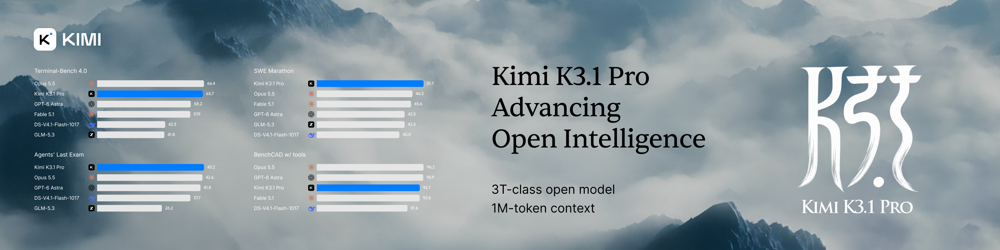](https://platform.kimi.ai?track_id=track-674ed6e2af924a5682a87421f7cf753a&aff=cc-switch)

Kimi K3.1 Pro, Moonshot AI'ın bugüne kadarki en yetenekli 3T sınıfı açık ağırlıklı modelidir ve 1 milyon token bağlam penceresine sahiptir. Kimi K3 üzerine, belirgin biçimde daha büyük bir son-eğitim hesaplama bütçesiyle inşa edilen model; kodlama, ajan iş akışları, 3D oluşturma ve akıl yürütme alanlarında tutarlı kazanımlar sunar. CC Switch ile ajan araçları genelinde Kimi K3.1 Pro'yu yapılandırmak ve ona geçmek çok kolaydır.

Bir **Kimi Code planı** deneyin ([中文站](https://www.kimi.com/code?aff=cc-switch) | [Global](https://www.kimi.ai/code?aff=cc-switch)) veya Kimi Açık Platformu üzerinden **API**'yi kullanın ([中文站](https://platform.kimi.com?track_id=track-7cf2b91dcde043eda6ef9a95951a042c&aff=cc-switch) | [Global](https://platform.kimi.ai?track_id=track-674ed6e2af924a5682a87421f7cf753a&aff=cc-switch)).

**Yeni kullanıcı yükleme bonusu**: yukarıdaki API bağlantılarından kayıt olup ilk yüklemenizi tamamlayın; yükleme tutarının %10'u kadar bonus API kredisi kazanın (en fazla CNY ¥1.000).

---

<table>
<tr>
<td width="180"><a href="https://www.aicodemirror.ai/register?invitecode=9915W3">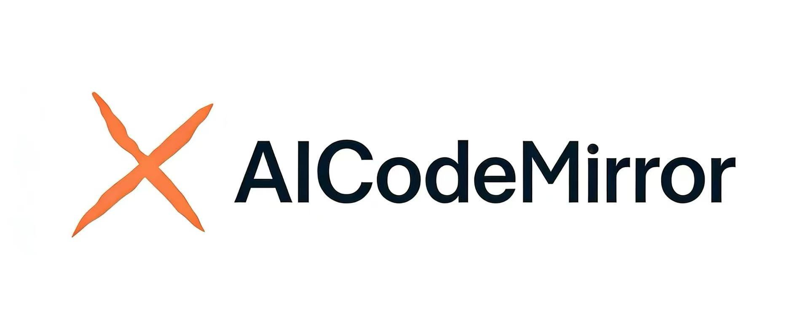</a></td>
<td>Bu projeye sponsor olduğu için AICodeMirror'a teşekkürler! AICodeMirror, Claude Code / Codex / Gemini CLI için kurumsal düzeyde eşzamanlılık, hızlı fatura kesimi ve 7/24 özel teknik destekle resmi, yüksek kararlılıkta aktarma hizmeti sunar.
Claude Code / Codex / Gemini resmi kanalları orijinal fiyatın %38 / %2 / %9'u kadar, ayrıca yüklemelerde ek indirimlerle! AICodeMirror, CC Switch kullanıcılarına özel avantajlar sunar: <a href="https://www.aicodemirror.ai/register?invitecode=9915W3">bu bağlantıdan</a> kayıt olarak ilk yüklemede %20 indirim kazanın; kurumsal müşteriler %25'e varan indirim alabilir!</td>
</tr>

<tr>
<td width="180"><a href="https://www.packyapi.ai/register?aff=cc-switch"></a></td>
<td>Bu projeye sponsor olduğu için PackyCode'a teşekkürler! PackyCode; Claude Code, Codex, Gemini ve daha fazlası için aktarma hizmeti sunan güvenilir ve verimli bir API aktarma hizmeti sağlayıcısıdır. PackyCode yazılımımızın kullanıcılarına özel indirimler sunar: <a href="https://www.packyapi.ai/register?aff=cc-switch">bu bağlantıyı</a> kullanarak kayıt olun ve ilk yüklemede "cc-switch" promosyon kodunu girerek %10 indirim kazanın.</td>
</tr>

<tr>
<td width="180"><a href="https://apinebula.ai/VjM74M">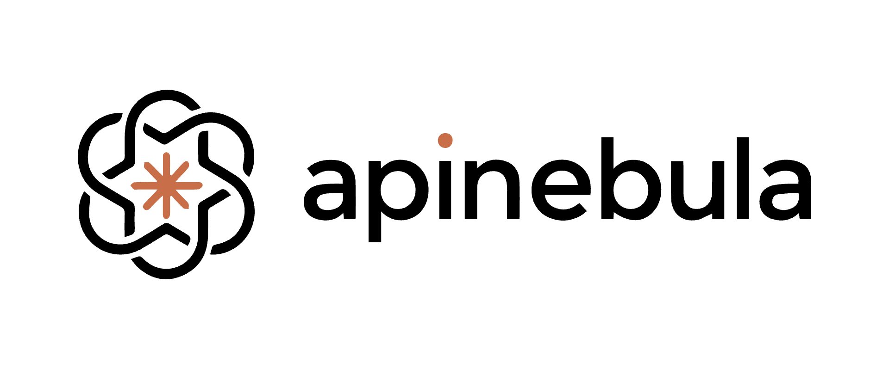</a></td>
<td>Bu projeye sponsor olduğu için APINEBULA'ya teşekkürler! Galaxy Video Bureau bünyesindeki kurumsal düzeyde bir yapay zeka toplama platformu olan APINEBULA, geniş platform kaynaklarından yararlanarak geliştiricilere, ekiplere ve işletmelere büyük dil modeli API'lerine kararlı ve uygun maliyetli erişim sağlar. Platform; Claude, GPT ve Gemini gibi önde gelen, tam güçlü modelleri bir araya getirir ve tek bir API ile dünyanın en iyi yapay zeka modellerine bağlanmanızı sağlar; fiyatlar orijinal maliyetin %10'undan başlar. Yapay zeka programlama, Agent geliştirme ve iş sistemi entegrasyonu için tasarlanan APINEBULA; kurumsal düzeyde yüksek eşzamanlılığı, resmi sözleşmeleri, kurumsal banka havalesini ve fatura hizmetlerini destekler. APINEBULA yazılımımızın kullanıcılarına özel indirimler sunar: <a href="https://apinebula.ai/VjM74M">bu bağlantıyı</a> kullanarak kayıt olun ve ilk yüklemede <strong>"ccswitch"</strong> promosyon kodunu girerek <strong>%10 indirim</strong> kazanın.</td>
</tr>

<tr>
<td width="180"><a href="https://pateway.ai/?ch=etzpm8&aff=WB6M6F67#/">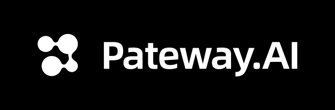</a></td>
<td>Bu projeye sponsor olduğu için PatewayAI'ye teşekkürler! PatewayAI, deneyimli yapay zeka geliştiricileri için bir API aktarma hizmeti sağlayıcısıdır; Claude, GPT serisi ve geniş bir ana akım Çin modeli yelpazesini tam olarak destekler. Tüm modeller resmi, yüksek kaliteli kanallardan gelir — asla sulandırılmaz, asla sahte değildir — ve şeffaf, doğrulanabilir faturalandırma ayrıntıları sunar.
Ekonomi modu orijinal fiyatın %5'ine kadar düşer. <a href="https://pateway.ai/?ch=etzpm8&aff=WB6M6F67#/">Bu bağlantıdan</a> kayıt olarak 1 $ değerinde ücretsiz deneme kredisi kazanın ve arada bir düzenlenen kampanyalara katılarak daha fazla ücretsiz kredi edinin.
Platform ayrıca kurumsal düzeyde eşzamanlılığı, özel bir yönetim konsolunu, resmi sözleşme ve faturaları destekler ve 150 $'a varan çift taraflı tavsiye yükleme bonusu sunar.</td>
</tr>

<tr>
<td width="180"><a href="https://hao.ai/invite/DTBZS3OR">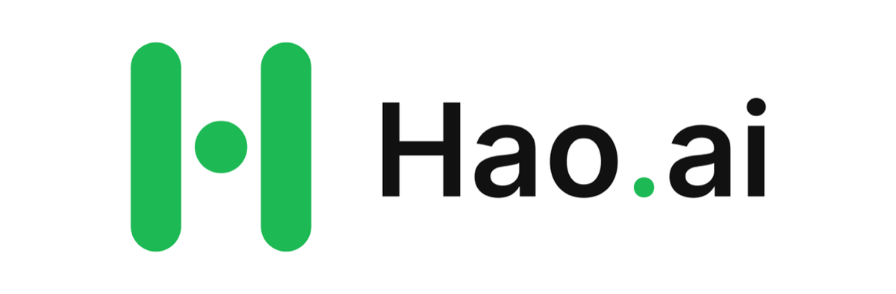</a></td>
<td>Bu projeye sponsor olduğu için hao.ai'ye teşekkürler! hao.ai, geliştiriciler ve ekipler için hızlı ve kararlı, birleşik bir LLM API ağ geçididir. Tek bir API anahtarı ve birleşik bir arayüzle GPT, Claude, xAI Grok ve diğer önde gelen modellere erişebilirsiniz; OpenAI ve Anthropic gibi yaygın protokoller ve SDK'larla uyumludur. Platform; model yönlendirme, yük devretme, ekip yönetimi ve eksiksiz istek günlükleri sunar; model fiyatları resmi referans fiyatların %15'i kadar düşük olabilir ve yapay zeka uygulamaları geliştirmeyi daha basit, kararlı ve ucuz hale getirir. hao.ai, CC Switch kullanıcılarına özel bir avantaj sunar: <a href="https://hao.ai/invite/DTBZS3OR">bu bağlantıdan</a> kayıt olarak ilk siparişinizde %5 bonus kredi kazanın!</td>
</tr>

<tr>
<td width="180"><a href="https://api.fenno.ai/register?redirect=/purchase?tab=subscription%26group=16&aff=P9MR3D3PLCNL">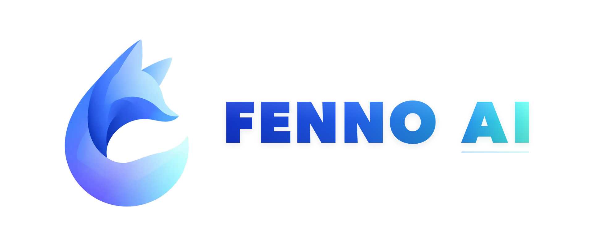</a></td>
<td>Bu projeye sponsor olduğu için Fenno.ai'ye teşekkürler! Fenno.ai, şu anda Codex aktarmasına odaklanan, kararlı ve verimli bir API aktarma hizmeti sağlayıcısıdır. OpenAI ve Anthropic protokolleriyle uyumludur ve Codex, Claude Code, OpenCode ve diğer ana akım kodlama araçlarından esnek biçimde kullanılabilir. Günde yüz milyarlarca token'lık kurumsal düzeydeki iş yüklerini güvenilir biçimde destekler; yurt içi ve yurt dışı tüzel kişiler için kurumsal (B2B) mutabakat ve fatura hizmeti sunar. Fenno.ai, CC Switch kullanıcılarına özel bir avantaj sunar: <a href="https://api.fenno.ai/register?redirect=/purchase?tab=subscription%26group=16&aff=P9MR3D3PLCNL">bu bağlantıdan</a> 50 $ kredi değerindeki 1,99 $'lık Deneme Planına (7 gün geçerli) abone olun ve %20'ye varan tavsiye ödülü kazanın — ne kadar çok davet ederseniz o kadar çok kazanırsınız!</td>
</tr>

<tr>
<td width="180"><a href="https://www.openmodel.ai?ref=cc-switch">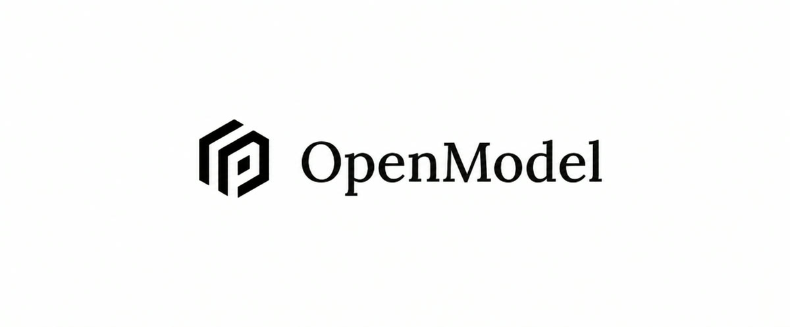</a></td>
<td>Bu projeye sponsor olduğu için OpenModel'e teşekkürler! OpenModel, desteklenen modellerde Codex için %90'a, Claude Code için %60'a varan istemciye özel indirimler sunar ve geliştiricilerin çalışma biçimlerini değiştirmeden API maliyetlerini düşürmesine yardımcı olur. OpenModel API anahtarınızı bağlayın ve Codex ya da Claude Code'u her zamanki gibi kullanmaya devam edin — desteklenen istemciler otomatik algılanır ve indirimli rotalar, ek parametre ya da elle yönlendirme gerekmeden uygulanır. Ayrıca API anahtarı başına yedek davranışı da yapılandırabilir; indirimli bir rota geçici olarak kullanılamadığında standart fiyatla devam etmeyi ya da durmayı seçebilirsiniz. CC Switch kullanıcıları <a href="https://www.openmodel.ai?ref=cc-switch">bu bağlantıdan</a> kayıt olup <strong>"cc-switch"</strong> promosyon kodunu kullanarak ilk yüklemelerinde %10 indirim kazanabilir.</td>
</tr>

<tr>
<td width="180"><a href="https://grooroute.pro/sign-up?aff=qqm9">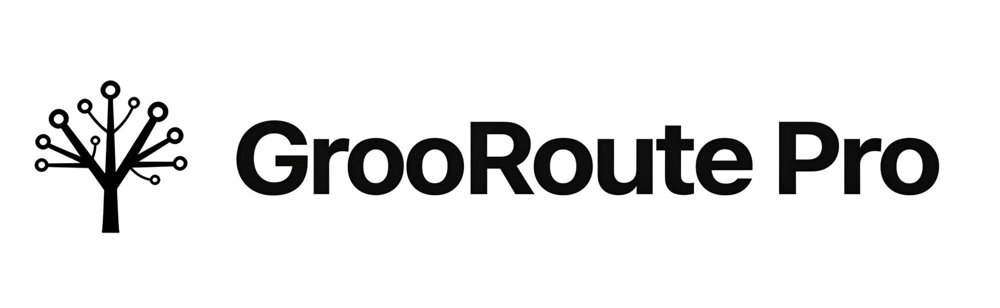</a></td>
<td>Bu projeye sponsor olduğu için GrooRoute Pro'ya teşekkürler! GrooRoute Pro; OpenAI, Claude, DeepSeek ve diğer ana akım modellere erişim sunan, güvenilir ve akıcı bir yapay zeka API aktarma platformudur. Yurt dışı sunucularda çalışır, kendi fiyat çarpanı kademenizi seçmenize olanak tanır ve kullandıkça öde ile abonelik planlarını birlikte sunar; böylece size en uygun şekilde kullanabilirsiniz — kararlı rotalar ve hızlı yanıtlar her türlü yapay zeka yeteneğini çağırmayı kolaylaştırır. CC Switch kullanıcılarına özel avantaj: <a href="https://grooroute.pro/sign-up?aff=qqm9">bu bağlantıdan</a> kayıt olarak ¥5 ücretsiz deneme kredisi kazanın!</td>
</tr>

<tr>
<td width="180"><a href="https://buytoken.work/sign-up?aff=cc-switch">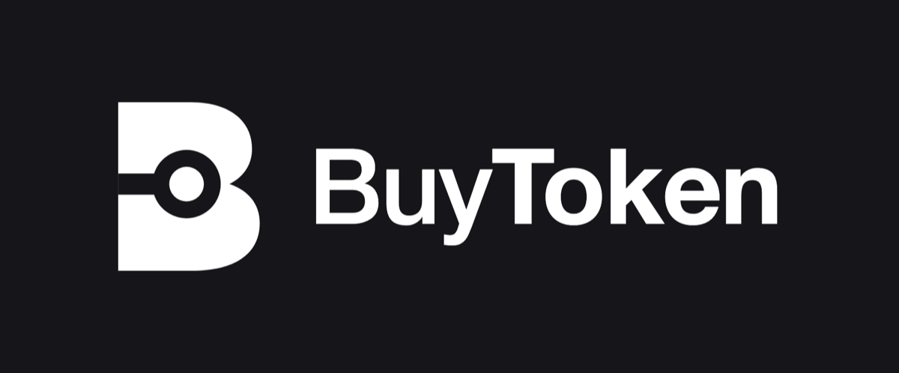</a></td>
<td>Bu projeye sponsor olduğu için BuyToken'a teşekkürler! BuyToken; Claude Code, Codex, DeepSeek ve daha fazlası için aktarma hizmeti sunar; kurumsal düzeyde eşzamanlılık ve hızlı fatura kesimi ile kararlı, uzun soluklu bir hizmet olacak şekilde tasarlanmıştır. BuyToken ayrıca CC Switch kullanıcılarına özel bir fırsat sunar: <a href="https://buytoken.work/sign-up?aff=cc-switch">bu bağlantıdan</a> kayıt olarak ¥3 deneme kredisi ve ilk yüklemenizde %10 indirim kazanın!</td>
</tr>

<tr>
<td width="180"><a href="https://gpt.ge/signup?aff=URNP">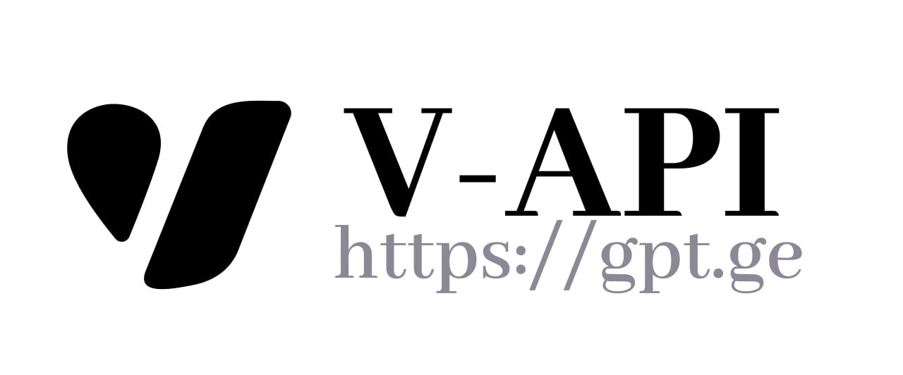</a></td>
<td>Bu projeye sponsor olduğu için V-API'ye teşekkürler! V-API, bireylere, geliştiricilere ve işletmelere yüksek kaliteli LLM API hizmetleri için kararlı, hızlı ve güvenli bir platform sunmaya adanmış üç yıllık bir markadır; resmi sözleşmeleri ve resmi faturaları (genel / özel KDV) destekler. V-API, CC Switch kullanıcılarına özel bir fırsat sunar: <a href="https://gpt.ge/signup?aff=URNP">bu bağlantıdan</a> kayıt olarak ilk siparişinizde ¥2 indirim ve ayrıca %10 indirim kazanın!</td>
</tr>

<tr>
<td width="180"><a href="https://agentmarket.fluxapay.xyz/marketplace/tokenplans">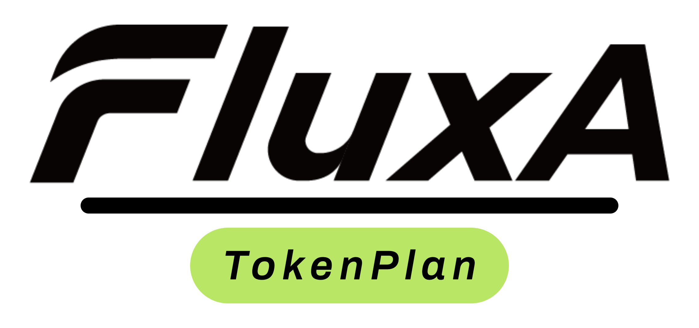</a></td>
<td>Bu projeye sponsor olduğu için FluxA &amp; Baidu AI Cloud'a teşekkürler! FluxA ve Baidu AI Cloud, yapay zeka ajanlarına modelleri, API'leri ve araçları kendi başlarına satın alma, yönetme ve kullanma yeteneği kazandıran AgenticPlan'ı birlikte duyurdu. Bu plan, DeepSeek V4, GLM 5.2 ve Kimi gibi amiral gemisi modellere erişim sağlayan, %40'a varan indirimli Baidu Qianfan TokenPlan'ı ve ayrıca arama, veri kazıma, sosyal medya, finans, kripto, görsel üretimi, video ve daha fazlası için 13.000'den fazla ücretli API'nin kilidini açan bonus FluxA AgentMarket API kredilerini içerir.<br>Kullanıcının yetkilendirmesiyle bir yapay zeka ajanı, kaynak tedarik etmek için resmi Visa kartıyla ödeme yapabilir, API anahtarlarını yönetebilir, kullanımı izleyebilir ve plan yenilemelerini takip edebilir — ajanları "görevleri özerk biçimde tamamlamaktan" gerçekten "kendi bütçesini planlayıp görevleri tamamlamaya" taşır. <a href="https://agentmarket.fluxapay.xyz/marketplace/tokenplans">Bu bağlantıdan</a> satın alın!</td>
</tr>

<tr>
<td width="180"><a href="https://aigocode.net/invite/CC-SWITCH"><picture><source media="(prefers-color-scheme: dark)" srcset="assets/partners/logos/aigocode-dark.png">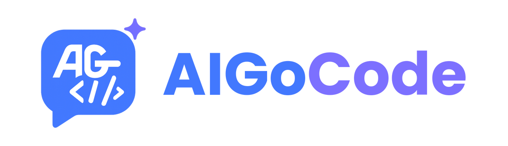</picture></a></td>
<td>Bu projeye sponsor olduğu için AIGoCode'a teşekkürler! AIGoCode yalnızca token başına ödemeli değil, abonelik tabanlı bir yapay zeka kodlama platformudur. Claude Code, Codex ve Gemini için tek hesap, tek aylık plan; anakarada doğrudan bağlantı ve hızlı yanıtlarla. <a href="https://aigocode.net/invite/CC-SWITCH">Bu bağlantıdan</a> abone olarak %10 ek kredi kazanın!</td>
</tr>

<tr>
<td width="180"><a href="https://teamorouter.com/?utm_source=cc_switch&utm_medium=referral&utm_campaign=ai_directory">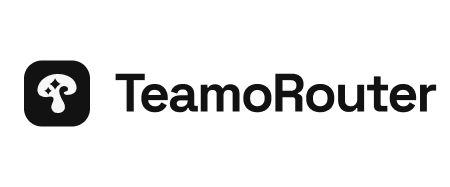</a></td>
<td>Bu projeye sponsor olduğu için TeamoRouter'a teşekkürler! TeamoRouter; geliştiriciler, yapay zeka ekipleri ve işletmeler için tasarlanmış, kurumsal düzeyde bir Agentic LLM ağ geçididir. Herhangi bir abonelik gerektirmeden Claude Code, Codex, Gemini CLI, OpenAI Codex ve diğer popüler yapay zeka ajanlarına tek bir birleşik API üzerinden erişmenizi sağlar ve %90'a varan indirimlerle API fiyatlandırması sunar.
Sıradan API aktarma hizmetlerinin aksine TeamoRouter; OpenAI, Anthropic, Vertex, Azure ve AWS bedrock dahil yüzlerce resmi model sağlayıcısını ve güvenilir altyapı ortağını bir araya getirir. Her sağlayıcı, %100 Agent protokol uyumluluğu, önbellek performansı ve istek izlenebilirliği açısından doğrulanır; böylece tersine mühendislikle elde edilmiş veya sulandırılmış uç noktalar yerine kararlı kalite sağlanır. Platform; resmiye yakın TTFT, %99,6 SLA, dakikada 5.000 QPM'ye varan kurumsal ölçekte verim ve uzun süren ajan iş akışlarında token maliyetlerini ciddi ölçüde düşüren sektör lideri önbellek isabet oranları sunar.
TeamoRouter ayrıca merkezi faturalandırma, ekip yönetimi, BYOK, akıllı yönlendirme, kullanım analitiği, dinamik sağlayıcı optimizasyonu ve özel destek gibi kurumsal özellikler de sunar. Daha da basit bir deneyim için Teamo Desktop, Claude Code, Codex, Gemini CLI ve diğer popüler yapay zeka ajanlarını tek tıkla kurulumla kullanmanızı sağlar — API anahtarı yönetimi veya elle ağ geçidi yapılandırması gerekmez. Yeni kullanıcı olarak <a href="https://teamorouter.com/?utm_source=cc_switch&utm_medium=referral&utm_campaign=ai_directory">bu bağlantıdan</a> kayıt olun ve ilk yüklemenizde %10 indirim kazanın.</td>
</tr>

<tr>
<td width="180"><a href="https://aicoding.inc/i/CCSWITCH">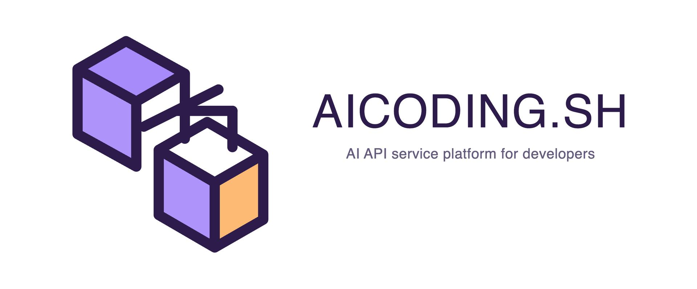</a></td>
<td>Bu projeye sponsor olduğu için AICoding'e teşekkürler! AICoding — Eşsiz Fiyatlarla Küresel Yapay Zeka Model API Aktarma Hizmeti! Claude Code orijinal fiyatın %19'u, GPT yalnızca %1! Uygun maliyetli yapay zeka hizmetleri için yüzlerce işletmenin güvendiği platform. Claude Code, GPT, Gemini ve başlıca yerel modelleri destekler; kurumsal düzeyde yüksek eşzamanlılık, hızlı fatura kesimi ve 7/24 özel teknik destek sunar. <a href="https://aicoding.inc/i/CCSWITCH">Bu bağlantıdan</a> kayıt olan CC Switch kullanıcıları ilk yüklemelerinde %10 indirim kazanır!</td>
</tr>

<tr>
<td width="180"><a href="https://subrouter.ai/register?aff=l3ri">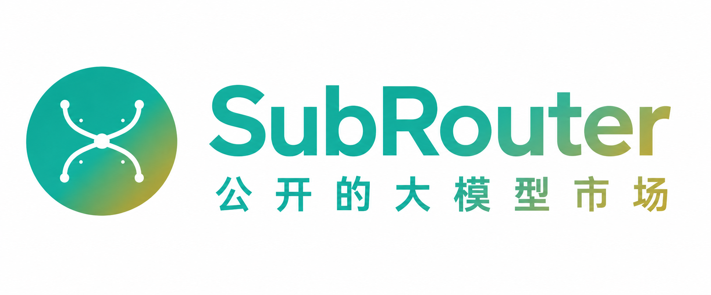</a></td>
<td>Bu projeye sponsor olduğu için SubRouter'a teşekkürler! SubRouter, yapay zeka hizmeti işletmecileri için bir pazar yeri ve akıllı yönlendirme platformudur. Satıcılar işletme siteleri kurabilir, paketler yayımlayabilir, kullanıcıları, modelleri ve fiyatlandırmayı yönetebilir; kullanıcılar ise hizmetleri keşfedip güvenilir yapay zeka modellerine tek bir birleşik API üzerinden erişir. <a href="https://subrouter.ai/register?aff=l3ri">Bu bağlantıdan</a> kayıt olun!</td>
</tr>

<tr>
<td width="180"><a href="https://runapi.host/register?aff=iOKB">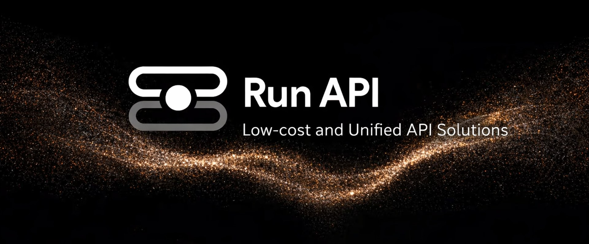</a></td>
<td>Bu projeye sponsor olduğu için RunAPI'ye teşekkürler! RunAPI, yüksek performanslı ve güvenilir bir yapay zeka model API ağ geçididir — tek bir API anahtarıyla OpenAI, Claude, Gemini, DeepSeek ve Grok dahil 150'den fazla ana akım modele erişirsiniz; fiyatlar resmi oranın %10'u kadar düşük, kararlılık ise mükemmeldir. Claude Code, OpenClaw ve diğer araçlarla sorunsuz çalışır. CC Switch kullanıcılarına özel avantaj: <a href="https://runapi.host/register?aff=iOKB">bu bağlantıdan</a> kayıt olun ve ilk yüklemenizde %10 indirimden yararlanın!</td>
</tr>

<tr>
<td width="180"><a href="https://open.ospreyai.cn">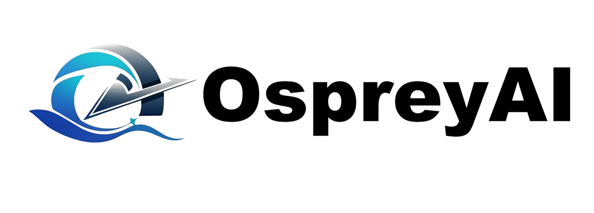</a></td>
<td>Bu projeye sponsor olduğu için OspreyAI'ye teşekkürler! ACS OspreyAI, geliştiriciler ve işletmeler için tek durak bir çoklu model API platformudur. Tek bir API anahtarı; Claude, Gemini, GPT, GLM, Kimi, Qwen, DeepSeek ve Tencent Hunyuan dahil önde gelen Çin ve uluslararası modellere erişim sağlar. Platform; OpenAI, Anthropic ve diğer ana akım API protokolleriyle uyumludur ve Claude Code, Codex, OpenCode, Pi ve Hermes gibi popüler yapay zeka araçlarıyla çalışır. Uluslararası modeller resmi fiyatlardan %20–40, Çin modelleri ise %30–50 daha ucuzdur. Birleşik yüklemeler, birleşik faturalandırma, kullanım takibi ve esnek model değiştirme, onu yapay zeka uygulaması geliştirme, içerik üretimi ve otomatik iş akışları için uygun kılar. <a href="https://open.ospreyai.cn">Bu bağlantıdan</a> hesap oluşturarak indirim kazanın ve Çin ile dünyanın önde gelen modellerine hızla bağlanın.</td>
</tr>

<tr>
<td width="180"><a href="https://www.shengsuanyun.com/?from=CH_4HHXMRYF">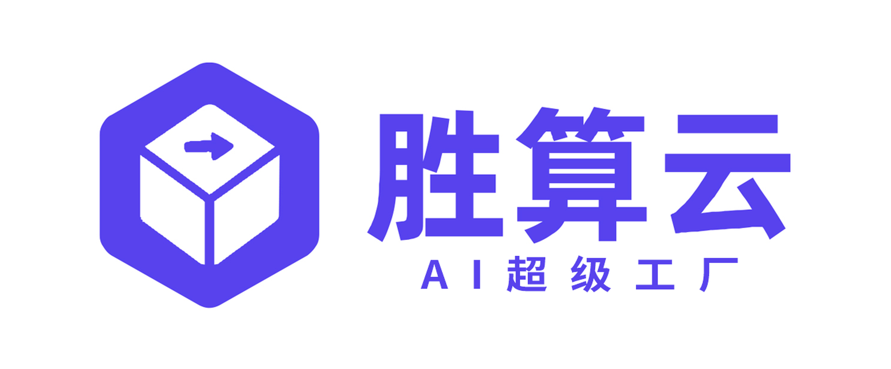</a></td>
<td>Bu projeye sponsor olduğu için Shengsuanyun'a teşekkürler! Shengsuanyun, AI Native Ekiplere hizmet veren bir süper fabrikadır — endüstriyel düzeyde bir yapay zeka görev paralel yürütme platformu. Model pazarı Claude, ChatGPT, Gemini ve diğer yerli ve yabancı LLM ile çok ortamlı model yeteneklerini doğrudan tedarikle bir araya getirir. Kesinlikle tersine mühendislik veya sulandırma yok — platform genelinde model SLA kullanılabilirliği %99,7'ye ulaşır ve <a href="https://watch.shengsuanyun.com/status/shengsuanyun">izleme panoları</a> baştan sona yeşil gösterir. Ayrıca ince ayarlı ekip maliyet ve yetki yönetimi, akıllı yönlendirme, güvenlik koruması ve BYOK (Kendi Anahtarını Getir) barındırma için kurumsal düzeyde özel ağ geçitleri sunar. Platform kullandıkça öde ve tokens planı (yakında) esasıyla ücretlendirir, fatura kesilebilir. Yeni kullanıcı olarak <a href="https://www.shengsuanyun.com/?from=CH_4HHXMRYF">bu bağlantıdan</a> kayıt olun ve ¥10 kredi ile ilk yüklemenizde %10 bonus kazanın.</td>
</tr>

<tr>
<td width="180"><a href="https://88api.ai/sign-up?aff=HSGY">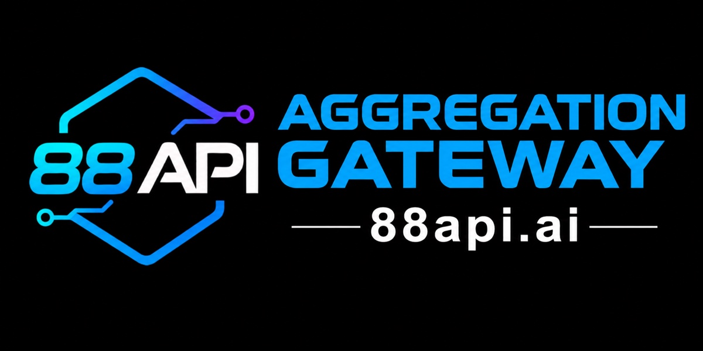</a></td>
<td>Bu projeye sponsor olduğu için 88API Token Toplama Platformu'na teşekkürler! 88API, Hong Kong merkezli bir şirket tarafından işletilen, esas olarak geliştiriciler, içerik üreticileri ve yapay zeka uygulaması kullanıcıları için tasarlanmış tek durak bir çoklu model API platformudur. Birleşik bir arayüz; metin, görsel, ses ve video modellerine erişim sağlar ve yapay zeka ile kodlama, akıllı çeviri, içerik üretimi, seslendirme, görsel üretimi ve video üretimi gibi yaygın iş akışlarını kapsar. CC Switch içinde sağlayıcı olarak ekleyip hemen ona geçebilirsiniz. 88API başlıca uluslararası ödeme yöntemlerini destekler, fatura kesebilir ve kurumsal düzeyde kararlı hizmet sunar. <a href="https://88api.ai/sign-up?aff=HSGY">Bu bağlantıdan</a> kayıt olarak özel bonus kredilerinizi alın!</td>
</tr>

<tr>
<td width="180"><a href="https://apikey.fan/register?aff=CCSwitch">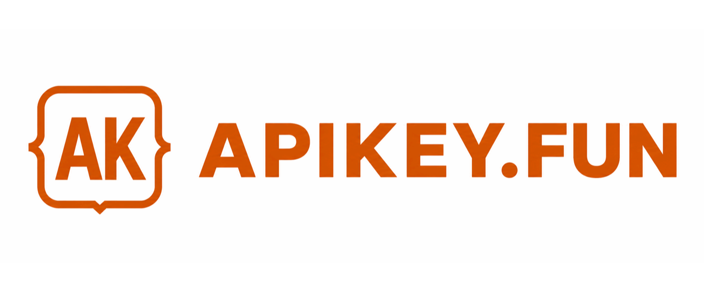</a></td>
<td>Bu projeye sponsor olduğu için APIKEY.FUN'a teşekkürler! APIKEY.FUN, işletmelere ve bireysel geliştiricilere kararlı, verimli ve düşük maliyetli yapay zeka model API erişimi sağlamaya adanmış profesyonel, kurumsal düzeyde bir yapay zeka aktarma platformudur. Platform Claude, OpenAI ve Gemini gibi popüler ana akım modelleri destekler; fiyatlar resmi oranların %7'si kadar düşüktür. Bu projeye özel <a href="https://apikey.fan/register?aff=CCSwitch">bağlantıdan</a> kayıt olarak <strong>yüklemelerde kalıcı %5 indirim</strong>e varan özel bir tekliften yararlanın.</td>
</tr>

<tr>
<td width="180"><a href="https://9527.codes/register?channel=ccs">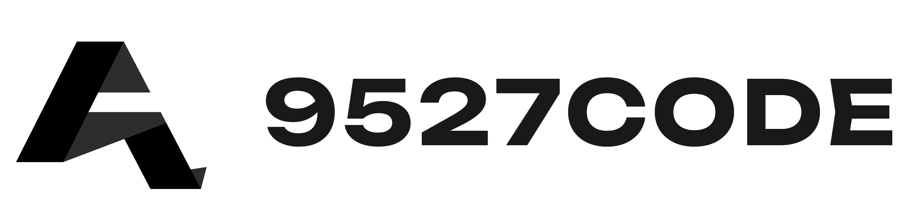</a></td>
<td>Bu projeye sponsor olduğu için 9527CODE'a teşekkürler! 9527 CODE, kararlılığa ve hizmet kalitesine odaklanan, kurumsal düzeyde, tam kapasiteli bir yapay zeka aktarma platformudur; Claude Code, Codex ve diğer ana akım yapay zeka modelleri için hızlı, kararlı ve yüksek kaliteli aktarma hizmetleri sunar. Uzun vadeli kararlılığa, rota kalitesine ve sürekli kullanılabilirliğe daha fazla önem vererek işletmelere ve yoğun yapay zeka kullanıcılarına kararlı ve verimli, tek durak bir model erişim çözümü sunar. Bir yıllık kesintisiz işletim, %99,9 hizmet kararlılığı ve 7×24 insan teknik desteğiyle. Bu projeye özel <a href="https://9527.codes/register?channel=ccs">bağlantıdan</a> kayıt olun; yeni kullanıcılar deneme kredisi almak için müşteri hizmetleriyle iletişime geçebilir ve tavsiye geri ödemesi sınırsızdır!</td>
</tr>

<tr>
<td width="180"><a href="https://ppio.com/activity/ccswitch">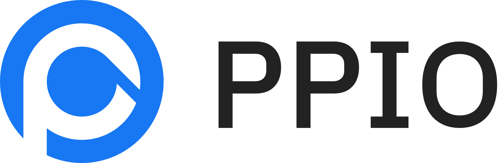</a></td>
<td>Bu projeye sponsor olduğu için PPIO'ya teşekkürler! PPIO, 2018'de PPTV kurucusu Yao Xin ve eski PPTV baş mimarı Wang Wenyu tarafından birlikte kurulan, Çin'in önde gelen bağımsız Agentic Cloud sağlayıcısıdır. Tek bir API anahtarı DeepSeek-V4-Flash, Kimi-K3, GLM-5.2 ve MiniMax-M3 dahil tüm amiral gemisi açık kaynak modellere erişim sağlar; kurumsal Token Plan %40'a varan indirimle sunulur ve 200 koltuğu destekler, Fusion karma modeli ise Fable5 ile aynı performansı onda bir fiyatla sunar. <a href="https://ppio.com/activity/ccswitch">Bu bağlantıdan</a> kayıt olun ve kimlik doğrulamasını tamamlayarak ¥10 kredi kuponu kazanın — arkadaşlarınızı yükleme yapmaya davet edin ve harcamalarının %15'ine varan geri ödeme kazanın.</td>
</tr>

<tr>
<td width="180"><a href="https://www.newapi.ai/">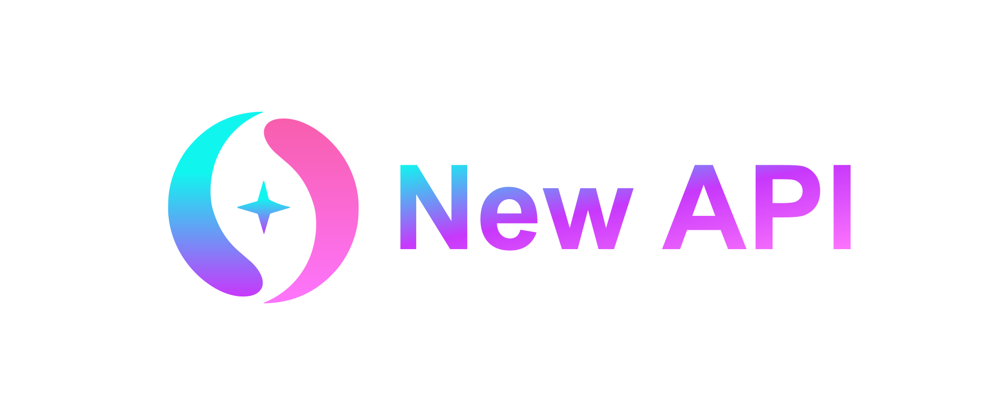</a></td>
<td>Bu projeye güçlü desteği için açık kaynaklı yapay zeka altyapı projesi <a href="https://www.newapi.ai/">new-api</a>'ye teşekkürler! new-api, QuantumNous'un açık kaynaklı bir yapay zeka altyapı projesidir ve etkinlik ile benimsenme açısından önde gelen birleşik LLM erişim ve dağıtım projelerinden biridir; geliştiricilerin, ekiplerin ve işletmelerin daha düşük maliyetle yönetilebilir, ölçeklenebilir yapay zeka hizmet platformları kurmasına yardımcı olmaya odaklanır. Açık kaynak ekosisteminde kök salmış bir proje olarak new-api, daha fazla başarılı açık kaynak projenin gelişimine sponsor olmayı ve destek vermeyi umar. 🌟 Desteğinizi göstermek için new-api'ye yıldız verin: <a href="https://github.com/QuantumNous/new-api">https://github.com/QuantumNous/new-api</a>. Web sitesi: <a href="https://www.newapi.ai/">https://www.newapi.ai/</a>.</td>
</tr>

<tr>
<td width="180"><a href="https://claudecn.ai/register?aff=HEL9">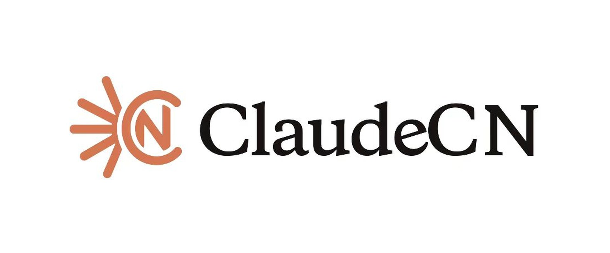</a></td>
<td>Bu projeye sponsor olduğu için ClaudeCN'e teşekkürler! ClaudeCN, kayıtlı bir şirket tarafından işletilen, kurumsal düzeyde bir yapay zeka ağ geçidi platformudur. Claude, GPT ve DeepSeek dahil popüler modellere yüksek kullanılabilirlikte ticari API erişimi sağlar ve resmi kurumsal satın alma süreçleri etrafında kurulmuştur — kurumsal banka havalesi, imzalı sözleşmeler ve tam uyumluluk. <a href="https://claudecn.ai/register?aff=HEL9">Bu bağlantıdan</a> kayıt olun!</td>
</tr>

<tr>
<td width="180"><a href="https://www.byteplus.com/en/product/modelark?utm_campaign=hw&utm_content=ccswitch&utm_medium=devrel_tool_web&utm_source=OWO&utm_term=ccswitch">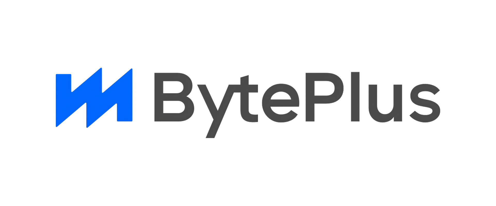</a></td>
<td>Bu projeye sponsor olduğu için Dola seed'e teşekkürler! Dola Seed 2.0, ByteDance'in küresel pazar için bağımsız geliştirdiği, tüm modalitelere yönelik genel bir büyük modeldir. Birleşik çok modlu bir mimari üzerine inşa edilen model; metin, görsel, ses ve videonun birlikte anlaşılmasını ve üretilmesini destekler. Yerleşik olarak ajan iş birliği sağlar; güçlü akıl yürütme, uzun görev yürütme, araç entegrasyonu ve kodlama yeteneklerine sahiptir. Akıllı kokpitler, kişisel asistanlar, eğitim, müşteri desteği, pazarlama, perakende ve diğer senaryolarda geniş biçimde uygulanabilir. Çok modlu algı, uçtan uca karmaşık görev teslimi, kararlı etkileşim ve veri güvenliği alanlarında üstündür ve ModelArk platformu üzerinden kolayca erişilip dağıtılabilir. <a href="https://www.byteplus.com/en/product/modelark?utm_campaign=hw&utm_content=ccswitch&utm_medium=devrel_tool_web&utm_source=OWO&utm_term=ccswitch">Bu bağlantıdan</a> kayıt olarak model başına 500.000 token'lık ücretsiz çıkarım kotası kazanın.<a href="https://www.volcengine.com/activity/ai618?utm_campaign=hw&utm_content=hw&utm_medium=devrel_tool_web&utm_source=OWO&utm_term=ccswitch"> >>Çin anakarasındaki geliştiriciler için buraya tıklayın</a></td>
</tr>

<tr>
<td width="180"><a href="https://cloud.siliconflow.cn/i/YflgU2Ve">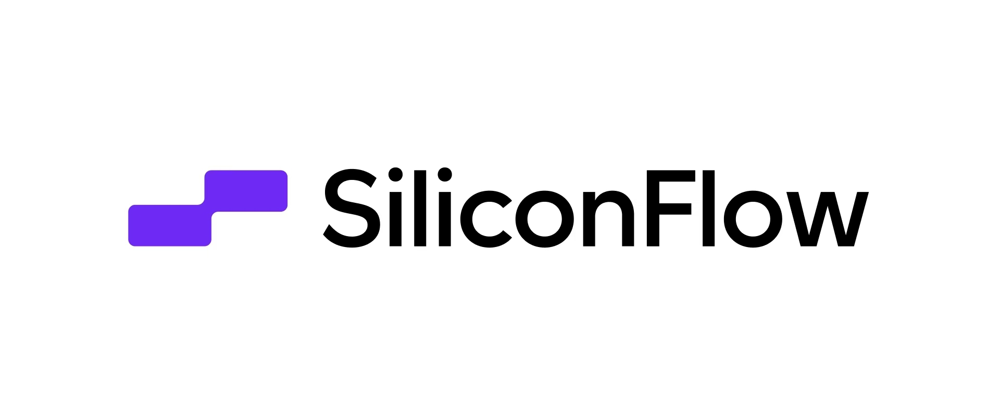</a></td>
<td>Bu projeye sponsor olduğu için SiliconFlow'a teşekkürler! SiliconFlow, dil, ses, görsel ve video modellerine tek yerden hızlı ve güvenilir erişim sağlayan, yüksek performanslı bir yapay zeka altyapısı ve model API platformudur. Kullandıkça öde faturalandırma, geniş çok modlu model desteği, yüksek hızlı çıkarım ve kurumsal düzeyde kararlılıkla SiliconFlow, geliştiricilerin ve ekiplerin yapay zeka uygulamalarını daha verimli geliştirip ölçeklendirmesine yardımcı olur. <a href="https://cloud.siliconflow.cn/i/YflgU2Ve">Bu bağlantıdan</a> kayıt olun ve gerçek ad doğrulamasını tamamlayarak platformdaki modellerde kullanabileceğiniz ¥16 bonus kredi kazanın. SiliconFlow artık OpenClaw ile de uyumludur; kullanıcılar bir SiliconFlow API anahtarı bağlayarak başlıca yapay zeka modellerini ücretsiz çağırabilir.</td>
</tr>

<tr>
<td width="180"><a href="https://a6api.vip/register?aff=AqNr">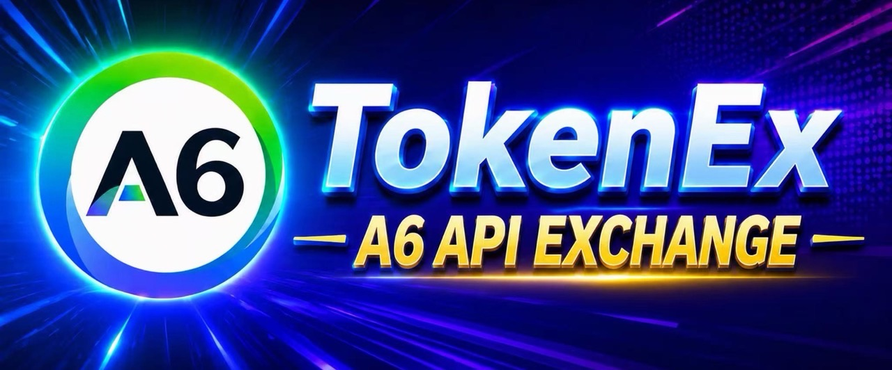</a></td>
<td>Bu projeye sponsor olduğu için <a href="https://a6api.vip/register?aff=AqNr">A6API</a>'ye teşekkürler! A6API; Claude, GPT, Gemini, Codex ve diğer ana akım modelleri kapsayan, tek durak bir yapay zeka model API toplama platformudur. Platformda birden fazla tedarikçi arzını listeleyebilir; böylece aynı model, birden fazla yukarı akış sağlayıcısı tarafından rekabetçi biçimde fiyatlandırılabilir. Akıllı yönlendirme, kullanılabilir olan daha kararlı ve daha ucuz rotayı otomatik seçer ve otomatik yük devri yapar; başarısız istekleri azaltmanıza, maliyetleri düşürmenize ve kararlılığı artırmanıza yardımcı olur. İster bireysel geliştirici, ister yapay zeka ürün ekibi, ister stüdyo olun, birleşik bir arayüzle hızla entegre olabilirsiniz — tüm formatlarla uyumlu, düşük geçiş maliyetli. <a href="https://a6api.vip/register?aff=AqNr">Bu bağlantıdan</a> kayıt olan yeni kullanıcılar ücretsiz deneme kredisi alır: önce deneyin, sonra düşük fiyata kullanın.</td>
</tr>

<tr>
<td width="180"><a href="https://www.compshare.cn/coding-plan?ytag=GPU_YY_YX_git_cc-switch">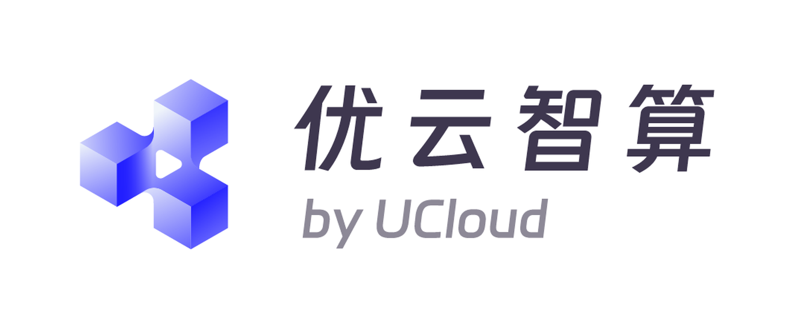</a></td>
<td>Bu projeye sponsor olduğu için Compshare'e teşekkürler! Compshare, UCloud'un yapay zeka bulut platformudur; yalnızca tek bir anahtarla kararlı ve kapsamlı yerli ve yabancı model API'leri sağlar. Uygun maliyetli aylık ve kullanım başına ödemeli yerli model Coding Plan paketleri ile kararlı, resmi aktarmalı yurt dışı modelleri sunar. Claude Code, Codex ve API erişimini destekler. Kurumsal düzeyde yüksek eşzamanlılık, 7/24 teknik destek ve self servis fatura. <a href="https://www.compshare.cn/coding-plan?ytag=GPU_YY_YX_git_cc-switch">Bu bağlantıdan</a> kayıt olan kullanıcılar 5 CNY değerinde ücretsiz platform deneme kredisi alır!</td>
</tr>

<tr>
<td width="180"><a href="https://sssaicodeapi.com/register?ref=DCP0SM">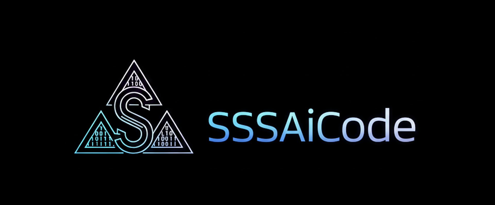</a></td>
<td>Bu projeye sponsor olduğu için SSSAiCode'a teşekkürler! SSSAiCode, kararlı, güvenilir ve uygun fiyatlı Claude ve Codex model hizmetleri sunmaya adanmış, aynı gün hızlı fatura kesen, kararlı ve güvenilir bir API aktarma hizmetidir. SSSAiCode, CC Switch kullanıcılarına özel bir fırsat sunar: <a href="https://sssaicodeapi.com/register?ref=DCP0SM">bu bağlantıdan</a> kayıt olarak her yüklemede 10 $ ek kredi kazanın!</td>
</tr>

<tr>
<td width="180"><a href="https://soleapi.com/r/ccswitch">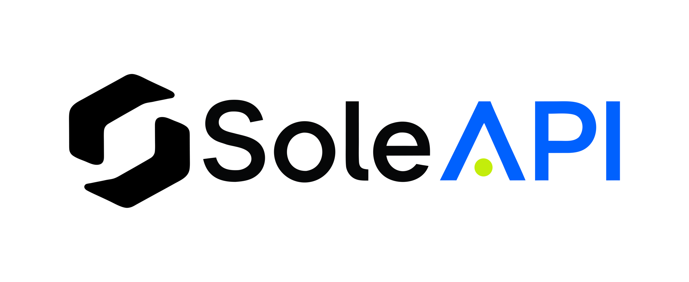</a></td>
<td>Bu projeyi desteklediği için SoleAPI'ye teşekkürler! SoleAPI, geliştiriciler ve işletmeler için bir yapay zeka model ağ geçididir: tek bir API anahtarı, Claude, GPT ve Gemini dahil 30'dan fazla önde gelen modele erişim sağlar. OpenAI ve Anthropic protokolleriyle yerel olarak uyumludur; böylece Claude Code, Codex, Cursor ve mevcut SDK'larınız yalnızca Base URL'yi değiştirerek çalışır. İstekler gecikmeye ve yukarı akış sağlığına göre gerçek zamanlı yönlendirilir; yedek kanallara milisaniye düzeyinde otomatik yük devri, %99,99 hizmet kullanılabilirliği ve 7/24 teknik destek sunulur. Her çağrı tek bir faturada toplanır ve istek başına token ile maliyet dökümlerini istediğiniz zaman inceleyebilirsiniz. Bu projenin <a href="https://soleapi.com/r/ccswitch">tavsiye bağlantısı</a> üzerinden kayıt olarak ücretsiz deneme kredisi alın ve yükleme yapan arkadaşlarınızı davet ederek sürekli geri ödeme kazanın!</td>
</tr>

<tr>
<td width="180"><a href="https://www.micuapi.ai/register?aff=aOYQ">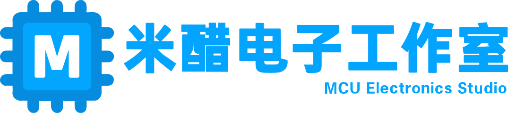</a></td>
<td>Bu projeye sponsor olduğu için Micu API'ye teşekkürler! Micu API, en iyi fiyat-performans oranını yüksek kararlılıkla sunmaya adanmış küresel bir LLM aktarma hizmeti sağlayıcısıdır. Temel güvence olarak kayıtlı bir işletme tarafından desteklenir, hizmetin sona ermesi riskini ortadan kaldırır ve hızlı resmi fatura desteği sunar! "Sıfır maliyetle deneme" ilkesini savunuruz: asgari tutar olmadan ¥1'den başlayarak yükleme yapın ve istediğiniz zaman ücretsiz iade alın! Micu API, CC Switch kullanıcılarına özel bir fırsat sunar: <a href="https://www.micuapi.ai/register?aff=aOYQ">bu bağlantıdan</a> kayıt olun ve yükleme sırasında "ccswitch" promosyon kodunu girerek <strong>%10 indirim</strong> kazanın!</td>
</tr>

<tr>
<td width="180"><a href="https://www.rightapi.ai/register?aff=CCSWITCH">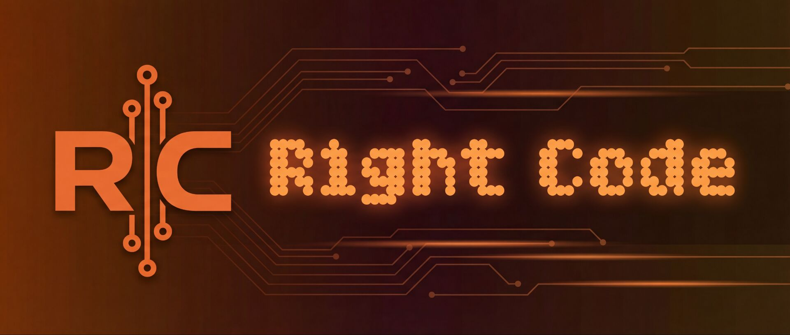</a></td>
<td>Bu projeye sponsor olduğu için Right Code'a teşekkürler! Right Code; Claude Code, Codex ve Gemini gibi modeller için güvenilir biçimde yönlendirme hizmeti sunar ve kullandıkça öde ile aylık abonelik faturalandırma seçenekleri vardır. Yükleme sonrası fatura kesilebilir; kurumsal ve ekip kullanıcıları birebir özel destek alabilir. Right Code ayrıca CC Switch kullanıcılarına özel bir indirim sunar: <a href="https://www.rightapi.ai/register?aff=CCSWITCH">bu bağlantıdan</a> kayıt olun; her yüklemede ödediğiniz tutarın %5'ine denk gelen kullandıkça öde kredisi kazanırsınız.</td>
</tr>

<tr>
<td width="180"><a href="https://cubence.com/signup?code=CCSWITCH&source=ccs">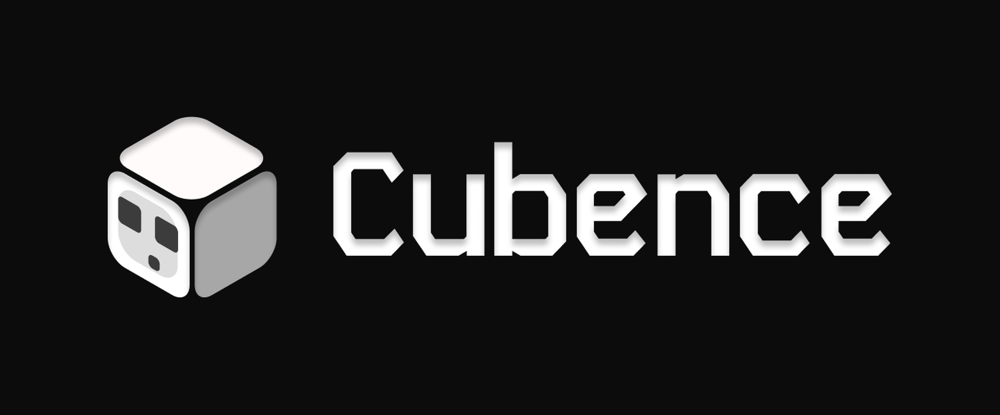</a></td>
<td>Bu projeye sponsor olduğu için Cubence'e teşekkürler! Cubence; Claude Code, Codex, Gemini ve daha fazlası için aktarma hizmeti sunan, kullandıkça öde ve aylık planlar gibi esnek faturalandırma seçenekleri bulunan güvenilir ve verimli bir API aktarma hizmeti sağlayıcısıdır. Cubence, CC Switch kullanıcılarına özel indirimler sunar: <a href="https://cubence.com/signup?code=CCSWITCH&source=ccs">bu bağlantıyı</a> kullanarak kayıt olun ve yükleme sırasında "CCSWITCH" promosyon kodunu girerek her yüklemede %10 indirim kazanın!</td>
</tr>

<tr>
<td width="180"><a href="https://crazyrouter.com/register?aff=OZcm&ref=cc-switch">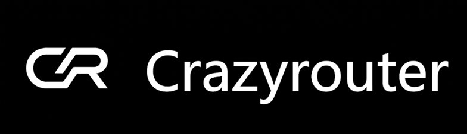</a></td>
<td>Bu projeye sponsor olduğu için Crazyrouter'a teşekkürler! Crazyrouter, yüksek performanslı bir yapay zeka API toplama platformudur — Claude Code, Codex, Gemini CLI ve daha fazlası dahil 300'den fazla model için tek API anahtarı. Tüm modeller resmi fiyatın %55'i oranında; otomatik yük devri, akıllı yönlendirme ve sınırsız eşzamanlılıkla. Crazyrouter, CC Switch kullanıcılarına özel bir fırsat sunar: <a href="https://crazyrouter.com/register?aff=OZcm&ref=cc-switch">bu bağlantıdan</a> kayıt olun ve <strong>2 $ ücretsiz kredi</strong> almak için müşteri desteğiyle iletişime geçin; ayrıca ilk yüklemenizde `CCSWITCH` promosyon kodunu girerek ekstra <strong>%30 bonus kredi</strong> kazanın! </td>
</tr>

<tr>
<td width="180"><a href="https://www.dmxapi.cn/register?aff=bUHu">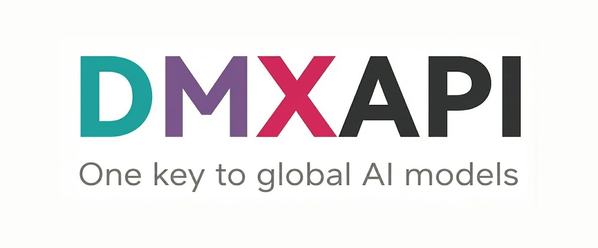</a></td>
<td>Bu projeye sponsor olduğu için DMXAPI'ye teşekkürler! DMXAPI, 200'den fazla kurumsal kullanıcıya küresel büyük model API hizmetleri sunar. Tüm küresel modeller için tek API anahtarı. Özellikler: anında fatura, sınırsız eşzamanlılık, 0,15 $'dan başlayan fiyatlar, 7/24 teknik destek. GPT/Claude/Gemini hepsinde %32 indirim, yerli modellerde %20-50 indirim, Claude Code'a özel modellerde %66 indirim! <a href="https://www.dmxapi.cn/register?aff=bUHu">Buradan kayıt olun</a></td>
</tr>

</table>

</details>

## Neden CC Switch?

Claude Code, Codex ve Gemini CLI gibi yapay zeka kodlama araçlarının her birinin kendi yapılandırma biçimi vardır. API sağlayıcısını değiştirmek JSON, TOML, YAML veya `.env` dosyalarını elle düzenlemek anlamına gelir; MCP, Skills ve istemlerin de her araçta ayrı ayrı bakımı yapılmalıdır.

**CC Switch** bunların hepsini tek bir masaüstü uygulamasında toplar: bir hazır ayar seçin, anahtarınızı girin ve tek tıkla geçin. Geçiş yalnızca bağlantı ayrıntılarını — uç nokta, anahtar ve model — değiştirir; böylece eklentileriniz, hook'larınız, MCP'leriniz ve kendi eklediğiniz yorumlar olduğu gibi kalır.

- **Tek Uygulama, On İki Araç** — Claude Code, Claude Desktop, Codex, Gemini CLI, Grok Build, OpenCode, OpenClaw, Hermes, Pi, MiniMax Code, Kimi Code ve Oh My Pi
- **Elle Düzenlemeye Son** — AWS Bedrock, NVIDIA NIM ve topluluk aktarma hizmetleri dahil 90'dan fazla sağlayıcı hazır ayarı
- **Doğrudan, Yönlendirme veya Birleştirme — Seçim Sizin** — Doğrudan, aracı doğrudan sağlayıcıya bağlar; Yönlendirme, istekleri makineniz üzerinden iletir, API biçimlerini dönüştürür ve otomatik yük devri yapar; böylece Claude Code'da GPT'yi, Codex'te Claude'u kullanabilirsiniz; Birleştirme ise birden fazla sağlayıcının modellerini Claude Code veya Codex'te tek bir model listesine koyar ve her istek seçtiğiniz modelin sağlayıcısına gider
- **Merkezi MCP, Skills ve İstemler** — MCP sunucularını ve Skills'i bir kez ekleyin, ardından hangi araçlarla eşitleneceğini seçin; istemler her araç için ayrı ayrı tutulur
- **Okunabilir Oturumlar** — Her aracın oturum günlüklerini bir okuma görünümüne dönüştürür: her turun ne yaptığı, hangi dosyaların değiştiği ve hangi adımın başarısız olduğu tek bakışta görünür
- **Kullanım ve Kotalar Bir Bakışta** — Yerel yönlendirme olmadan bile token kullanımını ve harcamayı izleyin; kalan abonelik kotası ve hesap bakiyeleri doğrudan sağlayıcı kartlarında ve tepsi menüsünde görünür
- **Çapraz Platform** — Tauri 2 ile geliştirilmiş, Windows, macOS ve Linux için yerel masaüstü uygulaması

## Ekran Görüntüleri

<table>
<tr>
<td align="center" width="50%">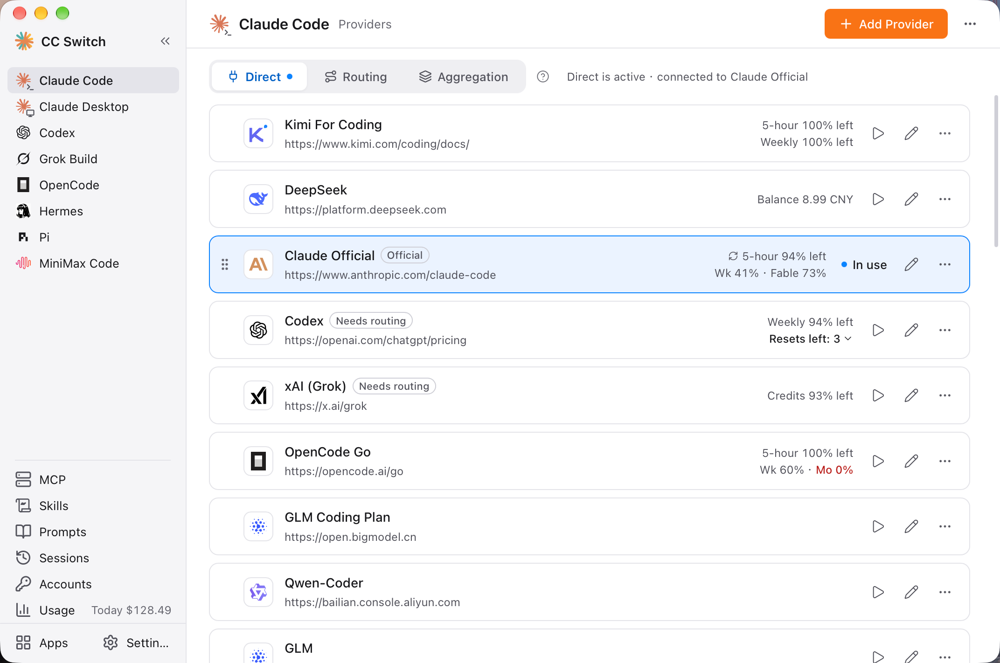<br>Ana Arayüz</td>
<td align="center" width="50%">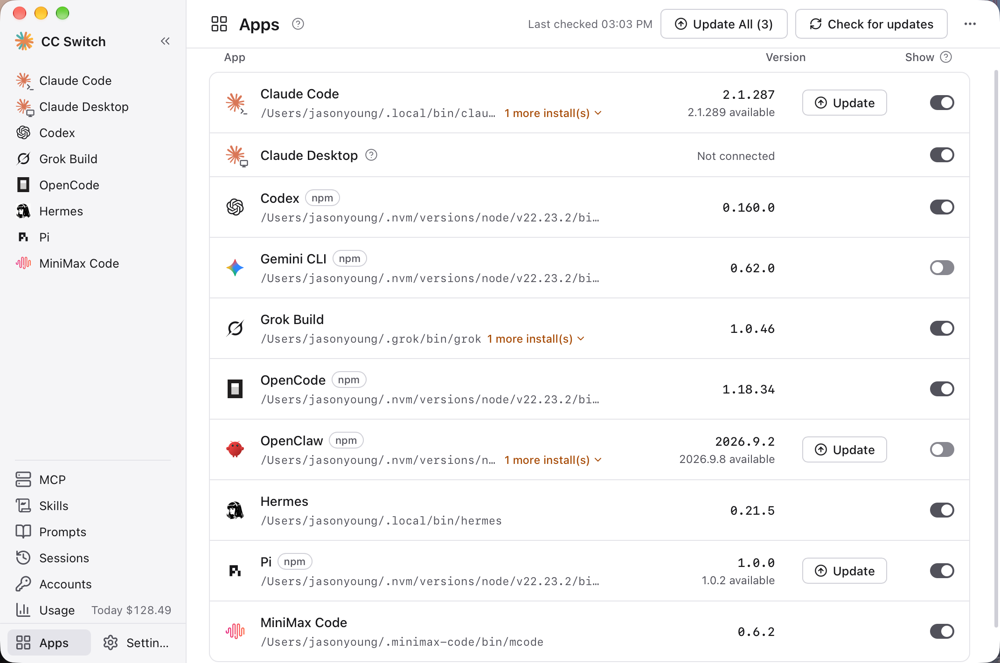<br>Uygulamalar Sayfası</td>
</tr>
<tr>
<td align="center">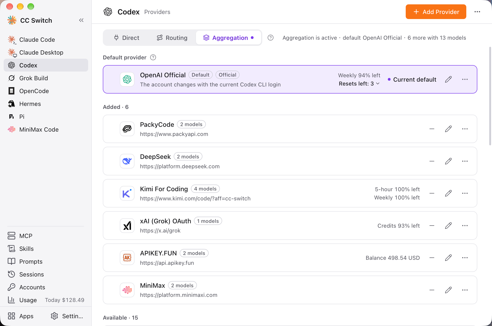<br>Birleştirme Modu</td>
<td align="center">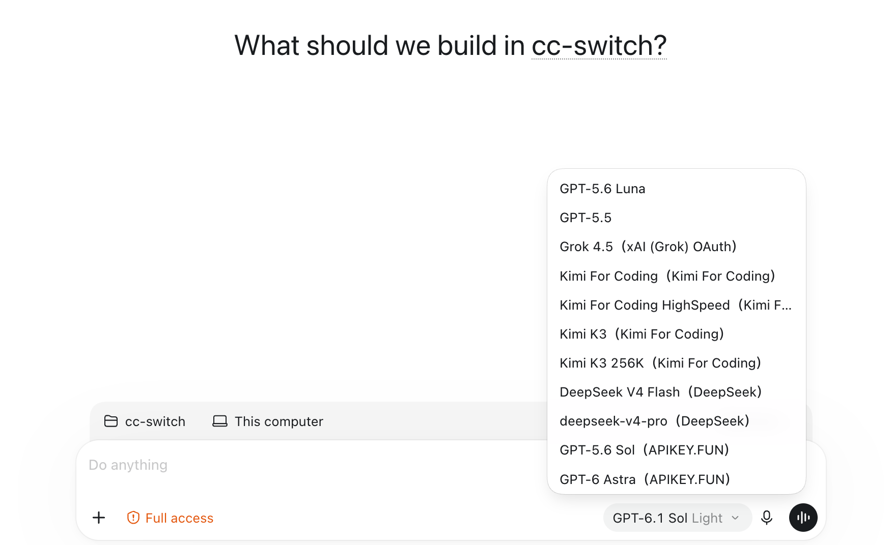<br>Codex'te Birleştirilmiş Model Listesi</td>
</tr>
<tr>
<td align="center">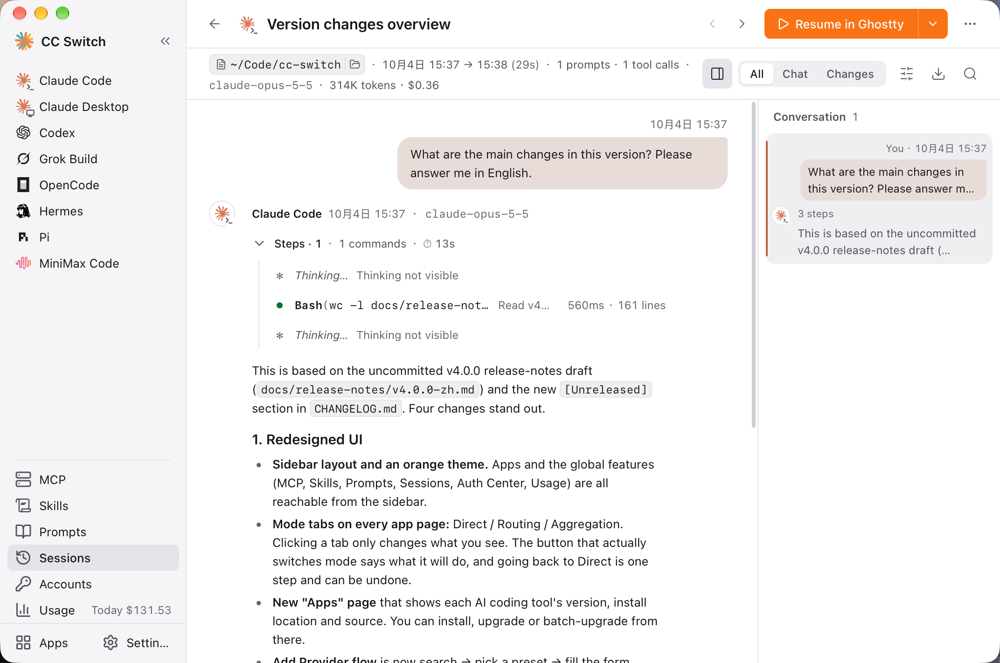<br>Oturum Okuma Görünümü</td>
<td align="center">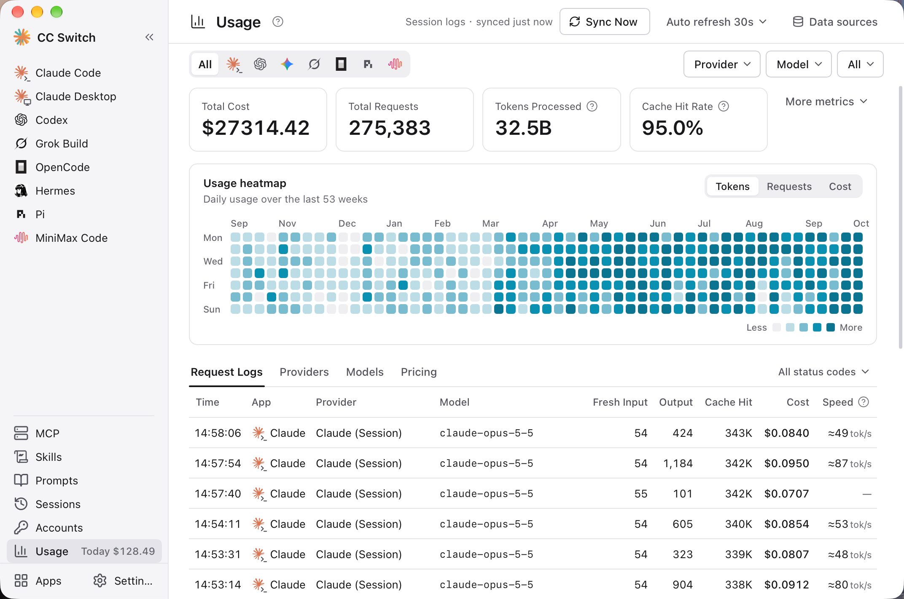<br>Kullanım</td>
</tr>
</table>

## Kurulum

### Sistem Gereksinimleri

- **Windows**: Windows 10 ve üzeri
- **macOS**: macOS 12 (Monterey) ve üzeri
- **Linux**: glibc 2.35+ ve WebKitGTK 4.1 bulunan x86_64 veya ARM64 — ör. Ubuntu 22.04+, Debian 12+ ve güncel Fedora sürümleri; RHEL / Rocky / Alma 8–9 henüz desteklenmiyor

### Windows Kullanıcıları

[Releases](../../releases) sayfasından en son `CC-Switch-v{version}-Windows.msi` yükleyicisini veya `CC-Switch-v{version}-Windows-Portable.zip` taşınabilir sürümünü indirin. Windows on ARM için `CC-Switch-v{version}-Windows-arm64.msi` veya `CC-Switch-v{version}-Windows-arm64-Portable.zip` dosyasını indirin.

### macOS Kullanıcıları

**Yöntem 1: Homebrew ile kurulum (Önerilir)**

```bash
brew install --cask cc-switch
```

Güncelleme:

```bash
brew upgrade --cask cc-switch
```

**Yöntem 2: Elle indirme**

[Releases](../../releases) sayfasından `CC-Switch-v{version}-macOS.dmg` (önerilir) veya `.zip` dosyasını indirin. Bu bir Universal derlemedir ve hem Apple Silicon hem de Intel Mac'lerde yerel olarak çalışır.

> **Not**: macOS için CC Switch, Apple tarafından kod imzalı ve noter onaylıdır. Doğrudan kurup açabilirsiniz.

### Arch Linux Kullanıcıları

**paru ile kurulum (Önerilir)**

```bash
paru -S cc-switch-bin
```

### Linux Kullanıcıları

En son Linux derlemesini [Releases](../../releases) sayfasından indirin:

- `CC-Switch-v{version}-Linux-x86_64.deb` / `-Linux-arm64.deb` (Debian/Ubuntu)
- `CC-Switch-v{version}-Linux-x86_64.rpm` / `-Linux-arm64.rpm` (Fedora ve WebKitGTK 4.1 içeren diğer RPM dağıtımları)
- `CC-Switch-v{version}-Linux-x86_64.AppImage` / `-Linux-arm64.AppImage` (yukarıdaki gereksinimleri karşılayan herhangi bir dağıtım)

> **Flatpak**: Resmi sürümlere dahil değildir. `.deb` dosyasından kendiniz derleyebilirsiniz — talimatlar için [`flatpak/README.md`](flatpak/README.md) dosyasına bakın.

## Hızlı Başlangıç

### Temel Kullanım

1. **Sağlayıcı Ekle**: Kenar çubuğundan yönetmek istediğiniz aracı seçin, ardından sayfanın sağ üst köşesindeki "+" (Sağlayıcı Ekle) düğmesine tıklayın → Bir hazır ayar seçin veya özel bir yapılandırma oluşturun
2. **Sağlayıcıyı Değiştir**:
   - Ana arayüz: Sağlayıcıyı seçin → "Etkinleştir"e tıklayın (OpenCode, OpenClaw, Hermes, MiniMax Code ve Kimi Code için düğme "Ekle", Pi ve Oh My Pi için "Etkinleştir" / "Kaldır"dır; bu yedi araç birlikte yaşama modundadır, yani aynı anda birden fazla sağlayıcı ekleyebilirsiniz)
   - Sistem Tepsisi: Her araç için "ad · mod · sağlayıcı · kota" gösteren tek bir satır; geçiş yapmak için alt menüsündeki bir sağlayıcı adına tıklayın (Claude Code, Claude Desktop, Codex, Gemini CLI ve Grok Build)
3. **Etkili Olma**: Claude Code yeniden başlatma gerektirmez; Codex, Gemini CLI ve Grok Build için terminalinizi veya CLI aracını yeniden başlatın; Claude Desktop için uygulamanın kendisini yeniden başlatın (bkz. SSS)
4. **Resmi Girişe Dönüş**: Listedeki yerleşik resmi sağlayıcıya (ör. "Claude Official") geçin, aracı yeniden başlatın, ardından giriş/OAuth akışını izleyin
5. **Yönlendirme ve Birleştirme (isteğe bağlı)**: Claude Code, Codex, Gemini CLI ve Grok Build sayfalarının üstünde "Doğrudan" / "Yönlendirme" sekmeleri, Claude Code ve Codex'te ayrıca "Birleştirme" sekmesi bulunur. Bir sekmeye tıklamak yalnızca baktığınız görünümü değiştirir, yapılandırmanıza dokunmaz; gerçekten geçmek için sayfadaki "Yönlendirmeyi başlat" veya "Birleştirme moduna geç" düğmesine, geri dönmek için "Doğrudan bağlantıya dön"e tıklayın. Claude Code'da OpenAI veya Gemini biçimli sağlayıcıları ya da Codex'te Claude'u kullanmak için Yönlendirme'yi; birden fazla sağlayıcının modellerini tek bir model listesinde karıştırmak için Birleştirme'yi kullanın
6. **Araçları Yönet**: Kenar çubuğundaki "Uygulamalar" sayfası her yapay zeka kodlama aracının sürümünü, kurulum konumunu ve kaynağını tek yerde gösterir; kurabilir, yükseltebilir veya tümünü yükseltebilir, ayrıca hangi araçların kenar çubuğunda görüneceğini seçebilirsiniz

### MCP, İstemler, Skills, Projeler ve Oturumlar

- **MCP**: Kenar çubuğunda "MCP"ye tıklayın → Şablonlarla veya özel yapılandırmayla sunucu ekleyin (veya "Mevcut Olanı İçe Aktar") → Her araç için eşitlemeyi açıp kapatın
- **İstemler**: Kenar çubuğunda "İstemler"e tıklayın → Markdown düzenleyiciyle istem oluşturun → Bir istemi etkinleştirerek o aracın istem dosyasına yazın
- **Skills**: Kenar çubuğunda "Skills"e tıklayın → "Becerileri Keşfedin" → skills.sh'de arama yapın veya GitHub depolarına göz atın → Desteklenen araçlara tek tıkla kurun
- **Projeler**: Önce "Ayarlar → Genel"de "Proje değiştiriciyi göster"i açın, ardından Claude Code, Claude Desktop veya Codex sayfasında üstteki proje değiştiriciyi açın → Mevcut yapılandırmayı kaydetmek için "Yeni proje"; daha sonra tüm kurulumu bir anda değiştirmek için değiştiriciden seçin
- **Oturumlar**: Kenar çubuğunda "Oturumlar"a tıklayın → Konuşma geçmişine göz atın ve arayın, okuma görünümünü açın veya her aracın oturumlarını geri yükleyin
- **Hesaplar**: GitHub Copilot, ChatGPT, xAI (Grok) ve Kimi Code hesaplarında oturum açmak ve aboneliklerinizi sağlayıcı olarak kullanmak için kenar çubuğunda "Hesaplar"a tıklayın. Kimi Code, her biri ayrı kimlik bilgilerine ve yerel bir sağlayıcıya sahip birden fazla resmi hesabı destekler; ilk giriş Kimi'nin yerel varsayılan kimlik bilgisi yuvasını kullanır. Oturum açma, yeniden kimlik doğrulama ve oturum kapatmayı buradan yönetin. Yerel yapılandırmada hâlâ bulunan resmi Kimi OAuth düğümleri sağlayıcı sayfasında korunur; kayıtlı profiller, yerel düğümleri kaldırıldıktan sonra silinebilir.

> **Not**: İlk açılışta CC Switch, mevcut Claude Code, Codex, Gemini CLI ve Grok Build yapılandırmanızı `default` adlı bir sağlayıcı olarak otomatik içe aktarır ve bu araçların ile Claude Desktop'ın her biri için bir resmi sağlayıcı ekler; böylece yapılandırdığınız hiçbir şey kaybolmaz.

Sağlayıcı yönetimi, MCP/İstemler/Skills, yerel yönlendirme ve yük devri ve daha fazlasını kapsayan, her özelliğe ilişkin ayrıntılı kılavuzlar için **[Kullanım Kılavuzu](docs/user-manual/en/README.md)**'na göz atın.

## Özellikler

[Tam Değişiklik Günlüğü](CHANGELOG.md) | [v4.0 Sürüm Notları](docs/release-notes/v4.0.4-en.md)

### Araç Bazında Desteklenen Özellikler

| Araç | Sağlayıcılar | Yerel Yönlendirme | Birleştirme | Tepsiden Geçiş | MCP | Skills | İstemler | Oturumlar | Kullanım İstatistikleri |
| --- | --- | :---: | :---: | :---: | :---: | :---: | --- | :---: | :---: |
| Claude Code | Geçiş | ✓ | ✓ | ✓ | ✓ | ✓ | CLAUDE.md | ✓ | ✓ |
| Claude Desktop | Geçiş | Yalnızca Model Eşleme | – | ✓ | – | – | – | – | Yalnızca Model Eşleme |
| Codex | Geçiş | ✓ | ✓ | ✓ | ✓ | ✓ | AGENTS.md | ✓ | ✓ |
| Gemini CLI | Geçiş | ✓ | – | ✓ | ✓ | ✓ | GEMINI.md | ✓ | ✓ |
| Grok Build | Geçiş | ✓ | – | ✓ | ✓ | ✓ | AGENTS.md | ✓ | ✓ |
| OpenCode | Birlikte | – | – | – | ✓ | ✓ | AGENTS.md | ✓ | ✓ |
| OpenClaw | Birlikte | – | – | – | – | – | Çalışma alanı düzenleyicisi | ✓ | – |
| Hermes | Birlikte | – | – | – | ✓ | ✓ | Bellek | ✓ | – |
| Pi | Birlikte | – | – | – | ✓ | ✓ | AGENTS.md, SYSTEM.md, istem şablonları | ✓ | ✓ |
| MiniMax Code | Birlikte | – | – | – | ✓ | ✓ | AGENTS.md | ✓ | ✓ |
| Kimi Code | Birlikte | – | – | – | ✓ | ✓ | AGENTS.md | ✓ | ✓ |
| Oh My Pi | Birlikte | – | – | – | ✓ | ✓ | AGENTS.md | ✓ | – |

- **Geçiş**: aynı anda yalnızca bir sağlayıcı etkindir; **Birlikte**: birden fazla sağlayıcı aynı anda aracın kendi yapılandırmasına yazılır ve birini aracın içinden seçersiniz.
- **Yerel Yönlendirme**: CC Switch istekleri makinenizde iletir ve API biçimlerini dönüştürür; aşağıdaki [Yerel Yönlendirme ve Yük Devretme](#yerel-yönlendirme-ve-yük-devretme) bölümüne bakın. Claude Desktop sağlayıcıları "Doğrudan" veya "Model Eşleme" kullanabilir; "Model Eşleme" ile istekler yerel yönlendirmeden geçer.
- **Birleştirme**: Birden fazla sağlayıcının modellerini tek bir model listesine koyar ve her isteği seçtiğiniz modelin sağlayıcısına gönderir; aşağıdaki [Birleştirme Modu](#birleştirme-modu) bölümüne bakın.
- **Oturumlar**: Konuşma geçmişine göz atın ve arayın, okuma görünümünü açın ve bir konuşmayı sürdürmek için devam komutunu kopyalayın (OpenClaw ve Hermes oturumlarını sürdürme henüz desteklenmiyor). Hermes yalnızca en son 500 oturumu gösterir.
- **Kullanım İstatistikleri**: Yerel yönlendirme olmadan kullanım, her aracın yerel oturum günlüklerinden toplanır; yerel yönlendirmeden geçen istekler de sayılır.
- Claude Desktop sayfasından açılan MCP, Skills, İstemler ve Oturumlar panelleri Claude Code için geçerlidir.

### Sağlayıcı Yönetimi

- **90'dan fazla sağlayıcı hazır ayarı** — Bir hazır ayar seçip anahtarınızı girerek sağlayıcı ekleyin veya özel bir yapılandırma oluşturun. Ekleme paneli ad (Çince adlar dahil) ve alan adına göre aramaya izin verir; bir sağlayıcının farklı planları ve bölgeleri tek satırda birleştirilir
- **Yalnızca anahtar alanlar** — Geçiş yalnızca uç nokta, anahtar ve model gibi bağlantı ayrıntılarını değiştirir; eklentiler, hook'lar, MCP, kendi eklediğiniz ayarlar ve yorumlar olduğu gibi kalır. Düzenleyici, geçişten sonra yapılandırma dosyasının nasıl görüneceğini gösterir ve CC Switch her yapılandırma dosyasını ilk kez yeniden yazmadan önce otomatik yedekler
- **Projeler** — Claude Code'un veya Codex'in mevcut sağlayıcı, MCP, Skills ve istem dosyalarını bir proje olarak kaydedin (Claude Desktop için yalnızca sağlayıcı kaydedilir), ardından sayfanın üstündeki proje değiştiriciden veya tepsiden tüm kurulumu tek tıkla değiştirin; başka bir projeye geçtiğinizde mevcut durum otomatik olarak önceki projeye geri kaydedilir. Proje değiştirici varsayılan olarak gizlidir; "Ayarlar → Genel"de "Proje değiştiriciyi göster"i açın
- **Hesaplar (Beta)** — Kenar çubuğundaki "Hesaplar"da birden fazla GitHub Copilot, ChatGPT ve xAI (Grok) hesabında oturum açın ve bu abonelikleri Claude Code, Claude Desktop ve Codex'te sağlayıcı olarak kullanın (Codex'in OpenAI Official'ı dışındakilerin tümü Yönlendirme modunda kullanılmalıdır). Bir aboneliği resmi istemci dışında kullanmak sağlayıcının hizmet şartlarını ihlal edebilir; riski kendiniz değerlendirin
- **Claude Desktop için üçüncü taraf sağlayıcılar** — Anthropic uyumlu uç noktalara doğrudan bağlanın; Claude olmayan modeller için "Model Eşleme"yi seçerek Sonnet, Opus ve Haiku gibi katmanları yerel yönlendirme üzerinden sağlayıcının gerçek modellerine eşleyin
- **Evrensel sağlayıcılar** — Tek bir yapılandırma Claude Code, Codex ve Gemini CLI ile eşitlenir
- Tek tıkla geçiş, sistem tepsisinden hızlı geçiş (Claude Code, Claude Desktop, Codex, Gemini CLI, Grok Build), sürükle-bırak sıralama, içe/dışa aktarma

### Yerel Yönlendirme ve Yük Devretme

- **API biçimi dönüştürme** — Yerel yönlendirme, istekleri Anthropic Messages, OpenAI Chat Completions, OpenAI Responses ve Gemini Native arasında dönüştürür: Claude Code ve Claude Desktop, OpenAI veya Gemini biçimli sağlayıcıları; Codex ve Grok Build ise Chat Completions veya Anthropic Messages sağlayıcılarını kullanabilir
- **Araç başına anahtar** — Claude Code, Codex, Gemini CLI ve Grok Build ayrı ayrı Yönlendirme moduna girebilir: sayfanın üstündeki "Yönlendirme" sekmesinde "Yönlendirmeyi başlat"a tıklayın. Yönlendirme modunda sağlayıcı değiştirmek sonraki istekler için hemen geçerli olur (geçiş modeli değiştiriyorsa Codex, Gemini CLI ve Grok Build'in yine de yeniden başlatılması gerekebilir). CC Switch'ten çıktığınızda önce doğrudan yapılandırmayı geri yazar ve bir sonraki açılışta yeniden bağlanır
- **Otomatik yük devri** — Her araç için bir yük devri kuyruğu yapılandırın; bir istek başarısız olduğunda CC Switch otomatik olarak kuyruktaki sonraki sağlayıcıya geçer; devre kesici ve sağlayıcı sağlık izleme ile desteklenir
- **Düzeltici** — Bazı yukarı akışların işleyemediği belirli istekleri otomatik düzeltir (ör. Thinking imzaları veya görseller desteklenmediğinde geri dönüş)
- Resmi sağlayıcılar (ör. Claude Official) yerel yönlendirmeden geçemez (Codex'in OpenAI Official'ı hariç)
- Yönlendirme hizmetinin durumu, dinleme adresi ve yük devri ayarlarının tümü "Ayarlar → Yerel yönlendirme"de bulunur
- Kılavuzlar: [Claude Code'da GPT Kullanımı](docs/guides/claude-codex-routing-guide-en.md) · [Codex'te Claude Kullanımı](docs/guides/codex-claude-routing-guide-en.md)

### Birleştirme Modu

- **Tek model listesi, birçok sağlayıcı** — Claude Code veya Codex sayfasında "Birleştirme"ye geçin ve birkaç sağlayıcı ekleyin; modelleri istemcinin model seçicisinde birlikte görünür. Her istek seçtiğiniz modelin sağlayıcısına gider, CC Switch'te geçiş yapmanıza gerek kalmaz
- **İstediğiniz zaman ekleyin ve kaldırın** — Bir sağlayıcı kartında "Ekle" veya "Kaldır"a tıklayın, ardından bir sağlayıcıyı varsayılan seçin; birleştirilmiş bir model belirtmeyen istekler ona gider. Codex'in OpenAI Official'ı yalnızca varsayılan sağlayıcı olabilir; Claude resmi abonelikleri şu anda Birleştirme'de desteklenmiyor
- **Notlar** — Birleştirme yük devri sağlamaz; Claude Code 2.1.243 veya üzeri sürüm gerektirir; Codex, birleştirilmiş liste değiştikten sonra yeniden başlatma gerektirir, Claude Code gerektirmez. Bir oturum içinde model değiştirdiğinizde yeni model istem önbelleğini yeniden oluşturmak zorunda kalır, bu yüzden ilk tur biraz daha pahalıya gelir
- Birleştirme modunun tasarımının büyük bölümü [opencodex](https://github.com/lidge-jun/opencodex)'ten esinlenmiştir — yazarına ve katkıda bulunanlara teşekkürler
- Belgeler: [Birleştirme modu kılavuzu](docs/user-manual/en/4-proxy/4.6-aggregation.md) · [Resimli rehber (Çince)](docs/guides/aggregation-mode-guide-zh.md)

### MCP, İstemler ve Skills

- **Birleşik MCP paneli** — Tüm MCP sunucularını tek yerden yönetin, her birinin hangi araçlarla eşitleneceğini seçin (Claude Code, Codex, Gemini CLI, Grok Build, OpenCode, Hermes, Pi, MiniMax Code, Kimi Code, Oh My Pi), her aracın mevcut yapılandırmalarını içe aktarın ve Deep Link ile içe aktarın
- **İstemler** — Markdown düzenleyicili, araç başına bir istem kitaplığı; bir istemi etkinleştirmek onu aracın istem dosyasına (CLAUDE.md / AGENTS.md / GEMINI.md) yazar ve dosyanın mevcut içeriği önce kitaplığa kaydedilir, böylece hiçbir şey kaybolmaz. Pi ayrıca SYSTEM.md, APPEND_SYSTEM.md ve istem şablonlarını düzenleyebilir
- **Skills** — skills.sh'de arayın veya GitHub depolarından ya da ZIP dosyalarından tek tıkla kurun; güncellemeleri denetleyin ve tümünü tek tıkla güncelleyin; her araca otomatik olarak, yalnızca sembolik bağlarla veya yalnızca kopyalarla eşitleyin; isteğe bağlı olarak `~/.agents/skills` içinde saklayabilirsiniz
- Her üç panel de aramayı destekler; MCP ve Skills ayrıca araç başına tek seferde etkinleştirilip devre dışı bırakılabilir; sağlayıcılar, MCP sunucuları ve istemler içerik alanında tam sayfa düzenlenir ve kaydedilmemiş değişikliklerle ayrılmadan önce uyarılırsınız

### Kullanım ve Maliyet Takibi

- **Kullanım panosu** — Yerel yönlendirme olmadan çalışır: varsayılan olarak her aracın yerel oturum günlüklerini otomatik tarar ve istekleri, token'ları, önbellek isabet oranını, çıktı hızını ve harcamayı sağlayıcı ve model bazında; trend grafikleri, tüm yılı kapsayan ısı haritası ve istek başına günlüklerle izler
- **Kotalar ve bakiyeler** — Sağlayıcı kartları ve tepsi, kalanı ve sıfırlanma geri sayımını gösterir, ör. "5h 94% left": resmi abonelik kotaları (Claude, ChatGPT, Gemini, SuperGrok), Coding Plan 5 saatlik / haftalık / aylık kotaları (Kimi, Zhipu GLM, MiniMax, Volcengine Ark vb.) ve hesap bakiyeleri (DeepSeek, OpenRouter, SiliconFlow vb.); bazıları önce sağlayıcı kartındaki "Kullanım sorgusunu yapılandırma" ile açılmalıdır, diğer sağlayıcılar için özel bir kullanım betiği yazabilirsiniz. ChatGPT abonelikleri ayrıca kalan limit sıfırlamalarını ve Codex Credits bakiyesini gösterir
- **Özel fiyatlandırma** — Model başına fiyat belirleyin veya models.dev'den içe aktarın

### Oturum Yöneticisi ve Çalışma Alanı

- **Oturum okuma görünümü** — Her aracın oturum günlüklerini yapılandırılmış içeriğe ayrıştırır: metin, düşünme, araç çağrıları, araç sonuçları ve görseller ayrı ayrı gösterilir; her çalışma turu tek satırlık bir özete daralır (kaç adım, kaç dosya değişti, kaç hata), başarısız adımlar kırmızıyla işaretlenir; sağda bir konuşma anahattı bulunur, ayrıca oturum içi arama, Markdown dışa aktarma ve tek bir turu veya tüm konuşmayı kopyalama vardır
- **Listeleme ve sürdürme** — Projeye veya zamana göre gruplayın, başlıklarda, dizinlerde, mesajlarda veya oturum kimliklerinde arayın ve toplu silin; bir konuşmayı sürdürmek için devam komutunu kopyalayın, macOS'ta tek tıkla terminalde sürdürün
- **Çalışma alanı düzenleyicisi** (OpenClaw) — Ajan dosyalarını (AGENTS.md, SOUL.md vb.) ve günlük belleği düzenleyin
- **Bellek** (Hermes) — Hermes'in MEMORY.md ve USER.md dosyalarını düzenleyin

### Sistem ve Platform

- **Bulut eşitleme** — WebDAV (Jianguoyun, Nextcloud, Synology NAS vb.) veya S3 uyumlu depolama (AWS S3, Cloudflare R2, Alibaba Cloud OSS, Tencent Cloud COS vb.) üzerinden cihazlar arasında eşitleyin; CC Switch yapılandırma dizinini Dropbox, OneDrive veya iCloud gibi bir bulut sürücü klasörüne de koyabilirsiniz
- **CLI araç yönetimi** — Kenar çubuğundaki "Uygulamalar" sayfasında Claude Code ve Codex gibi komut satırı araçlarının mevcut ve en son sürümlerini görün, tek tıkla kurun, yükseltin veya tümünü yükseltin ve yinelenen kurulumları teşhis edin; Windows'ta WSL içindeki araçları da yönetebilir (bkz. SSS)
- **Deep Link** (`ccswitch://`) — Bir bağlantıyla tek tıkta sağlayıcıları, MCP sunucularını ve istemleri içe aktarın ya da skill depoları ekleyin; bağlantıları [çevrimiçi oluşturucu](https://ccswitch.io/deplink.html) ile oluşturun; içe aktarma düğmesi isteyen site sahipleri [entegrasyon kılavuzunu](https://github.com/farion1231/cc-switch/blob/main/docs/guides/deeplink-site-integration-guide-en.md) izleyebilir
- **Yerleşik yardımcı araçlar** — Claude Code'un ilk çalıştırma onayını atlayın, yapay zeka atıfını gizleyin, VS Code Claude Code uzantısının CC Switch'in sağlayıcı geçişlerini izlemesini sağlayın ve daha fazlası
- Koyu / Açık / Sistem teması, otomatik başlatma, otomatik güncelleyici, atomik yazma, otomatik yedekler (her yedeğin nerede olduğunu ve ne kadar yer kapladığını "Ayarlar → Veri"de görün), i18n (Basitleştirilmiş Çince, Geleneksel Çince, İngilizce, Japonca, Korece, Türkçe, Rusça, Almanca)

## SSS

<details>
<summary><strong>CC Switch hangi yapay zeka araçlarını destekliyor?</strong></summary>

CC Switch on iki aracı destekler: **Claude Code**, **Claude Desktop**, **Codex**, **Gemini CLI**, **Grok Build**, **OpenCode**, **OpenClaw**, **Hermes**, **Pi**, **MiniMax Code**, **Kimi Code**, **Oh My Pi**. Her aracın kendine ait sağlayıcı hazır ayarları ve yapılandırma yönetimi vardır; her birinin neleri desteklediği için [Araç Bazında Desteklenen Özellikler](#araç-bazında-desteklenen-özellikler) bölümüne bakın.

</details>

<details>
<summary><strong>Sağlayıcı değiştirdikten sonra terminali yeniden başlatmam gerekir mi?</strong></summary>

Araca bağlıdır:

- **Claude Code**: sağlayıcı verilerinin anlık değiştirilmesini destekler — yeniden başlatma gerekmez.
- **Codex, Gemini CLI, Grok Build**: değişikliklerin etkili olması için terminalinizi veya CLI aracını yeniden başlatın (CC Switch geçişten sonra sizi hatırlatır). Yönlendirme modunda istekler hemen yeni sağlayıcıya gider, ancak geçiş modeli değiştiriyorsa üç araç da yine de yeniden başlatma gerektirebilir.
- **Birleştirme modu**: Claude Code'un birleştirilmiş modellerindeki değişiklikler hemen geçerli olur; Codex'te Birleştirme'ye girmek veya çıkmak ve birleştirilmiş model listesini değiştirmek tam yeniden başlatma gerektirir — sonraki maddeye bakın.
- **Claude Desktop**: Claude Desktop'ı tamamen kapatıp yeniden açın; "Model Eşleme" kullanırken CC Switch'i de çalışır durumda tutun.
- **OpenCode, OpenClaw, Hermes, Pi, MiniMax Code, Kimi Code, Oh My Pi**: bunlar birlikte yaşama modundaki araçlardır — "Ekle"ye (Pi ve Oh My Pi için "Etkinleştir") tıklamak sağlayıcıyı diğerlerinin yanında aracın kendi yapılandırmasına yazar; ardından istediğiniz modeli aracın içinden seçersiniz. Kimi Code ayrıca bir sağlayıcının modelini seçmek için "Geçiş yap" düğmesi sunar; birincil veya ikincil model olarak hâlâ başvurulan modeller kaldırılamaz. Yapılandırma ve hesap ayrıntıları için [Kimi Code entegrasyon kılavuzuna](docs/kimi-code-integration-zh.md) (Çince) bakın.

</details>

<details>
<summary><strong>Birleştirme modunda birleştirilmiş modeller neden Codex'in /model listesinde görünmüyor?</strong></summary>

Codex model listesini yalnızca başlangıçta okur. Birleştirme moduna girdikten veya çıktıktan, birleştirilmiş bir sağlayıcı ekleyip kaldırdıktan ya da bir sağlayıcının birleştirilmiş modellerini değiştirdikten sonra yeni listeyi görmek için Codex'i tamamen yeniden başlatın:

- **Codex CLI**: Terminali kapatıp `codex`'i yeniden çalıştırmak yetmez. Her terminaldeki her `codex` tek bir arka plan programını (daemon) paylaşır ve yeni listeyi alması için yeniden başlatılması gerekir. CC Switch, Codex'in hâlâ eski listeyi kullandığını algıladığında Codex sayfasının üstünde bir bildirim gösterir; bildirimdeki "Codex arka plan programını yeniden başlatın"a tıklayın. Yeniden başlatma, arka plan programında çalışan görevleri keser.
- **Codex masaüstü uygulaması**: Tamamen kapatıp yeniden açın (macOS'ta ⌘Q'ya basın; pencereyi kapatmak yetmez).
- **Editör uzantıları**: Editör penceresini yeniden açın.

Claude Code etkilenmez: birleştirilmiş modellerdeki değişiklikler hemen geçerli olur.

</details>

<details>
<summary><strong>Sağlayıcı değiştirmek eklentilerimi, hook'larımı veya diğer ayarlarımı değiştirir mi?</strong></summary>

Hayır. Claude Code, Codex, Gemini CLI veya Grok Build için sağlayıcı değiştirdiğinizde CC Switch yapılandırma dosyasında yalnızca **anahtar alanları** değiştirir: uç nokta, anahtar, model adı ve API protokolü (ayrıca Codex için akıl yürütme düzeyi ve Gemini CLI için kimlik doğrulama yöntemi) ile sağlayıcıya ait birkaç uyumluluk seçeneği (ör. Claude Code'un "Artifact Aracını Devre Dışı Bırak" seçeneği ve bağlam penceresi). Eklentiler, hook'lar, izinler, MCP, kendi eklediğiniz ortam değişkenleri, yorumlar ve biçimlendirme olduğu gibi kalır ve her sağlayıcı için geçerlidir.

Bu ortak ayarları aracın kendisinde veya yapılandırma dosyasını elle düzenleyerek değiştirebilirsiniz. CC Switch'te de herhangi bir sağlayıcıyı düzenleyebilirsiniz: düzenleyici "bu sağlayıcıya geçtikten sonra yapılandırma dosyasının nasıl görüneceğini" gösterir. Kaydettiğinizde anahtar alanlar o sağlayıcıda saklanır, diğer tüm değişiklikler ise yapılandırma dosyasına yazılır ve her sağlayıcı için geçerli olur.

Dolayısıyla eski "Ortak Yapılandırma Parçacığı" artık gerekmez ve düğmeleri kaldırılmıştır. Yükseltmeden önce parçacığınızda bulunan ayarlar geçiş yaptığınızda yapılandırma dosyasına zaten yazılmıştı, bu yüzden kalırlar. CC Switch ayrıca her yapılandırma dosyasını ilk kez yeniden yazmadan önce özgün hâlini `~/.cc-switch/backups/live-first-write/` dizinine yedekler.

</details>

<details>
<summary><strong>Modeli aracın içinden değiştirdim — başka bir sağlayıcıya geçip geri döndüğümde neden eski hâline dönüyor?</strong></summary>

Model bir anahtar alandır ve sağlayıcıya aittir. Aracın içinden seçtiğiniz bir model (ör. Claude Code'da `/model` ile) bir sonraki geçişe kadar geçerli kalır; geçiş yaptığınızda yapılandırma dosyasındaki model, hedef sağlayıcıda kayıtlı olanla değiştirilir ve CC Switch seçtiğiniz modeli önceki sağlayıcıya geri kaydetmez. Bir modeli uzun vadede kullanmaya devam etmek için o sağlayıcıyı CC Switch'te düzenleyin.

Eski sürümler, başka bir sağlayıcıya geçerken tüm yapılandırma dosyasını sağlayıcıya geri kaydederdi. Bu artık olmuyor: eklentileri ve diğer ortak ayarları tek bir sağlayıcıya donduruyor, başka birine geçtiğinizde kayboluyorlardı.

</details>

<details>
<summary><strong>Kullanımdaki sağlayıcıyı neden silemiyorum?</strong></summary>

CC Switch "asgari müdahale" tasarım ilkesini izler — uygulamayı kaldırsanız bile araçlarınız normal çalışmaya devam eder.

Bu nedenle aynı anda tek bir etkin sağlayıcı kullanan araçlarda (Claude Code, Claude Desktop, Codex, Gemini CLI, Grok Build) sistem her zaman kullanımda bir yapılandırma tutar, çünkü tüm yapılandırmaları silmek ilgili aracı kullanılamaz hâle getirir; silmek için önce başka bir sağlayıcıya geçin. Aynı şekilde Birleştirme modundaki varsayılan sağlayıcı da kaldırılamaz; önce başka bir sağlayıcıyı varsayılan yapın. Birlikte yaşama modundaki araçlar (OpenCode, OpenClaw, Hermes, Pi ve MiniMax Code) bu kısıtlamaya tabi değildir — herhangi bir sağlayıcıyı doğrudan silebilirsiniz. Bir aracı nadiren kullanıyorsanız "Uygulamalar" sayfasında kenar çubuğundan gizleyebilirsiniz. Resmi girişe geri dönmek için sonraki soruya bakın.

</details>

<details>
<summary><strong>Resmi girişe nasıl geri dönerim?</strong></summary>

CC Switch'te Claude Code, Claude Desktop, Codex, Gemini CLI ve Grok Build sağlayıcı listelerinin her biri yerleşik bir resmi sağlayıcı içerir (**Claude Official**, **Claude Desktop Official**, **OpenAI Official**, **Google Official**, **Grok Official**); sildiyseniz hazır ayarlardan yeniden ekleyin. Resmi sağlayıcıya geçtikten sonra aracın kendi giriş akışını izleyin (ör. Claude Code'da `/login`, Codex için `codex login`); ardından resmi sağlayıcı ile üçüncü taraf sağlayıcılar arasında serbestçe geçiş yapabilirsiniz.

Codex için ayrıca CC Switch içinde "Sign in with ChatGPT" ile birden fazla ChatGPT hesabında oturum açabilir ve her **OpenAI Official** kartı için bir "Kullanılacak hesap" seçebilirsiniz; böylece birden fazla Plus, Pro veya Team hesabı arasında geçiş tek tık sürer; "Codex girişini takip edin" olarak ayarlanan kartlar Codex CLI'nin kendi girişini kullanmaya devam eder.

Not: resmi abonelikler aracın kendi girişini kullanır ve yerel yönlendirmeden geçmez. Resmi sağlayıcılar Yönlendirme modunda seçilemez (Codex'in OpenAI Official kartları istisnadır); önce Doğrudan moda geri dönün.

</details>

<details>
<summary><strong>Yönlendirmeyi başlattıktan sonra yapılandırma dosyam neden 127.0.0.1'i gösteriyor?</strong></summary>

Yönlendirme modunda aracın istekleri önce CC Switch'in yerel yönlendirmesine (varsayılan olarak `http://127.0.0.1:15721`) gider, ardından CC Switch bunları seçtiğiniz sağlayıcıya iletir. Aracın yapılandırma dosyasında yalnızca yerel adres ve `PROXY_MANAGED` yer tutucu anahtarının bulunmasının nedeni budur; Claude Code için model adı da `claude-sonnet-5` gibi sabit bir takma ad olarak yazılır (`/model` menüsü yine gerçek model adını gösterir). Gerçek sağlayıcı adresi, anahtarı ve modeli CC Switch'te saklanır. Birleştirme modu da aynı şekilde çalışır.

Kenar çubuğundaki "Kullanım" altındaki istek günlüklerinde her istek için "istenen model → gerçek model" bilgisini görebilirsiniz.

Yönlendirme modunda geçiş yapmak, yönlendirmenin kullandığı sağlayıcıyı değiştirir; Yönlendirme'ye girmeden önce kullandığınız sağlayıcı aynı kalır ve kartında "Doğrudan" etiketiyle işaretlenir. "Doğrudan bağlantıya dön"e tıkladığınızda yapılandırma dosyası bu doğrudan sağlayıcının yapılandırmasına geri yazılır. CC Switch'ten çıkmak da önce doğrudan sağlayıcıyı geri yazar ve bir sonraki CC Switch açılışında yeniden bağlanır.

</details>

<details>
<summary><strong>Claude Code'da OpenAI uyumlu API'leri, Gemini'yi veya yerel modelleri kullanabilir miyim?</strong></summary>

Evet, ancak Yönlendirme'yi kullanmanız gerekir. Sağlayıcıyı düzenlerken "Gelişmiş Seçenekler" altındaki "Yukarı Akış Formatı"nı sağlayıcının API'sine uyacak şekilde ayarlayın: yalnızca Chat Completions uç noktası sunan hizmetler için (birçok yerel model sunucusunda olduğu gibi) "OpenAI Sohbet Tamamlamaları"nı, Responses uç noktası sunan hizmetler için "OpenAI Yanıtları API"yi, Gemini için "Gemini yerel generateContent"i seçin. Ardından Claude Code sayfasının "Yönlendirme" sekmesinde "Yönlendirmeyi başlat"a tıklayın. Yanlış biçimi seçmek veya yönlendirmeyi başlatmamak genellikle 404 veya 405 hatasıyla sonuçlanır.

Tersine, Codex veya Grok Build'de "Yukarı Akış Formatı" olarak "Anthropic Mesajlar"ı seçmek Claude biçimli sağlayıcıları kullanmanızı sağlar; bu da Yönlendirme gerektirir. Ayrıntılar için [Claude Code'da GPT Kullanımı](docs/guides/claude-codex-routing-guide-en.md) ve [Codex'te Claude Kullanımı](docs/guides/codex-claude-routing-guide-en.md) kılavuzlarına bakın.

</details>

<details>
<summary><strong>"Bağlantı kontrolü" geçti, peki istekler neden hâlâ başarısız oluyor?</strong></summary>

Sağlayıcı kartındaki "Bağlantı kontrolü" yalnızca sağlayıcı adresine ulaşılıp ulaşılamadığını denetler; gerçek bir model isteği göndermez, bu yüzden API anahtarının ve model adının doğru olup olmadığını doğrulayamaz. İstekler başarısız olduğunda anahtarı, model adını ve yukarı akış biçimini kontrol edin; Yönlendirme'den geçen istekler için kesin hatayı kenar çubuğundaki "Kullanım" altındaki istek günlüklerinde de görebilirsiniz.

</details>

<details>
<summary><strong>Verilerim nerede saklanıyor?</strong></summary>

Varsayılan olarak her şey ana dizininizdeki `.cc-switch` klasöründe saklanır (Windows'ta `C:\Users\<user>\.cc-switch`):

- **Veritabanı**: `cc-switch.db` (SQLite — sağlayıcılar, MCP, istemler, Skills, projeler, kullanım kayıtları vb.)
- **Yerel ayarlar**: `settings.json` (her aracın yapılandırma dizini, yedekleme ilkesi ve bulut eşitleme bağlantı ayrıntıları gibi cihaz düzeyi ayarlar)
- **Yedekler**: `backups/` (varsayılan olarak her 24 saatte bir otomatik yedeklenir, en son 10 yedek tutulur; "Ayarlar → Veri → Yedekleme ve Geri Yükleme"den ayarlanabilir; altındaki "Diğer Yedeklemeler" diğer tüm yedeklerin konumunu ve boyutunu listeler, bunları kategoriye göre temizleyebilirsiniz)
- **Skills**: `skills/` (Ayarlar'da `~/.agents/skills` olarak değiştirilebilir), varsayılan olarak sembolik bağlarla her araca eşitlenir, başarısız olursa kopyalamaya geri döner
- **Skill Yedekleri**: `skill-backups/` (bir skill kaldırılmadan veya güncellenmeden önce otomatik oluşturulur, en son 20 yedek tutulur)
- **OAuth giriş kimlik bilgileri**: `copilot_auth.json`, `codex_oauth_auth.json`, `xai_oauth_auth.json`
- **Günlükler**: `logs/cc-switch.log` ve `crash.log` — sorun bildirirken lütfen ekleyin
- **Cihaz durumu**: `live-state.json` (her aracın şu anda Doğrudan, Yönlendirme veya Birleştirme modunda olup olmadığı ve en son nelerin yazıldığı), `codex-login-stash.json` (üçüncü taraf bir sağlayıcıya geçtiğinizde kenara alınan resmi Codex girişi; resmi bir sağlayıcıya geri döndüğünüzde geri yüklenir)
- **Özgün yapılandırma dosyaları**: `backups/live-first-write/` (CC Switch'in ilk kez yeniden yazmasından önceki hâliyle her aracın yapılandırma dosyası)

"Ayarlar → Veri → Konum"da "CC Switch Yapılandırma Dizini"ni değiştirdikten sonra, `settings.json`, cihaz durumu ve özgün yapılandırma dosyaları dışındaki yukarıdaki tüm dosyalar yeni dizinde saklanır. CC Switch mevcut dosyaları otomatik taşımaz, bu yüzden önce elle kopyalayın. `settings.json`, cihaz durumu ve özgün yapılandırma dosyaları yalnızca bu bilgisayara aittir: her zaman varsayılan dizinde kalır ve bulut eşitlemeye dahil edilmez.

</details>

<details>
<summary><strong>Windows'ta WSL içindeki araçları nasıl yönetirim?</strong></summary>

CC Switch WSL'yi otomatik algılamaz. "Ayarlar → Uygulama yapılandırması"nda ilgili aracın yapılandırma dizinini WSL içindeki bir yola değiştirin, ör. `\\wsl.localhost\Ubuntu\home\<user>\.claude`; kaydettikten sonra CC Switch yapılandırmayı WSL içinde okur ve yazar (Claude Code, Codex, Gemini CLI, Grok Build, OpenCode, OpenClaw, Hermes ve Pi için desteklenir). Bu ayarlandıktan sonra kenar çubuğundaki "Uygulamalar" sayfası da o aracı ilgili WSL dağıtımında algılar ve yükseltir.

Not: Yönlendirme ve Birleştirme, adres olarak `127.0.0.1`'i yapılandırmaya yazar. WSL2'nin varsayılan NAT ağ modunda WSL içindeki `127.0.0.1` Windows'taki yerel yönlendirmeye ulaşamaz; bunun yerine WSL'yi yansıtmalı (mirrored) ağ moduna geçirin.

</details>

<details>
<summary><strong>Komut satırı veya başsız (headless) bir sürüm var mı?</strong></summary>

CC Switch'in kendisi yalnızca grafik arayüz gerektiren bir masaüstü uygulaması olarak sunulur (sistem gereksinimleri için [Kurulum](#kurulum) bölümüne bakın). Sunucular, SSH oturumları veya masaüstü ortamı olmayan makineler için topluluk tarafından sürdürülen **[CC Switch CLI](https://github.com/SaladDay/cc-switch-cli)**'yi öneririz: hem etkileşimli bir terminal arayüzü (TUI) hem de komut satırı modu sunar, Claude Code, Codex, Gemini CLI, OpenCode, OpenClaw, Hermes ve Pi'yi destekler ve Homebrew (`brew install cc-switch-cli`) veya bir kurulum betiği ile kurulabilir.

CC Switch CLI varsayılan olarak `~/.cc-switch` veri dizinini masaüstü uygulamasıyla paylaşır ve masaüstü uygulamasının WebDAV eşitlemesiyle uyumludur. İki proje ayrı yayımlanır ve CLI'nin desteklediği veritabanı sürümü zaman zaman masaüstü uygulamasının gerisinde kalır; "database version is too new" mesajı görürseniz CLI'yi yükseltin veya yetişmesini bekleyin.

</details>

<details>
<summary><strong>Linux (Wayland + NVIDIA): tıklamalar çalışmıyor ve pencere yeniden boyutlandırılınca ekran kararıyor</strong></summary>

AppImage, geçmişteki yerel Wayland çökmesini önlemek için `GDK_BACKEND=x11` (XWayland) değerini zorlar. Daha yeni Wayland + NVIDIA kurulumlarında bu, web içeriği alanının tıklanamaz kalmasına (başlık çubuğu düğmeleri çalışmaya devam eder) ve yeniden boyutlandırmada ekranın kararmasına yol açabilir. Yerel Wayland'e geri dönmek için isteğe bağlı kaçış yolunu kullanarak başlatın:

```bash
CC_SWITCH_GDK_BACKEND=wayland ./CC-Switch-*.AppImage
```

Bir masaüstü simgesinden başlatıyorsanız bunu `.desktop` dosyasındaki `Exec=` satırına ekleyin (ör. `env CC_SWITCH_GDK_BACKEND=wayland /path/to/AppImage`) veya oturum ortamınızda ayarlayın. Değişken geneldir: tıklamaların çalışmadığı döşemeli Wayland birleştiricilerinde (sway/Hyprland) bunun yerine `CC_SWITCH_GDK_BACKEND=x11` deneyin. Ayarlamadan bırakmak varsayılan davranışı korur.

</details>

Daha fazla soru için Kullanım Kılavuzu'ndaki [SSS](docs/user-manual/en/5-faq/5.2-questions.md) bölümüne bakın.

## Katkıda Bulunma

Sorunlar ve öneriler memnuniyetle karşılanır! Yeni bir özellik geliştirmeden önce lütfen yaklaşımı tartışmak için önce bir issue açın; projeye uygun olmayan özellik PR'ları kapatılabilir.

Geliştirme ortamı, göndermeden önceki denetimler ve mimari notlar için [CONTRIBUTING.md](CONTRIBUTING.md) dosyasına bakın; kullanım soruları için önce [SUPPORT.md](SUPPORT.md) dosyasına göz atın; güvenlik açıklarını [SECURITY.md](SECURITY.md) dosyasında açıklandığı gibi özel olarak bildirin.

**Teknoloji yığını**: Tauri 2 · Rust · React 18 · TypeScript · SQLite

## Yıldız Geçmişi

[](https://www.star-history.com/#farion1231/cc-switch&Date)

## Lisans

MIT © Jason Young
