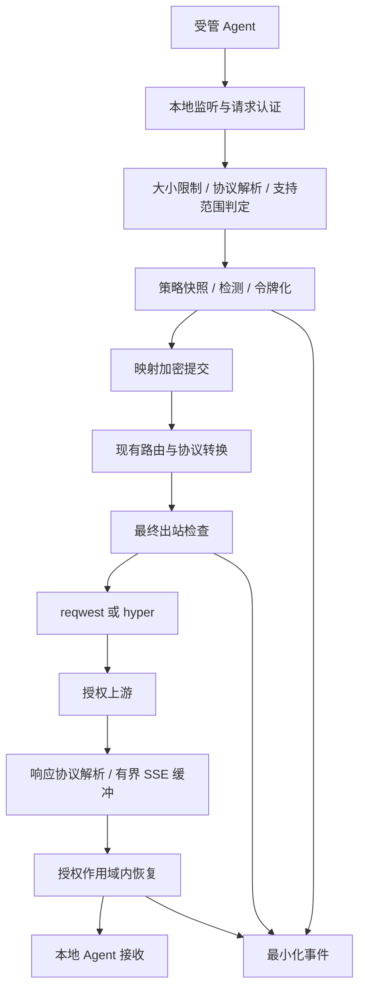

# XSEC Agent Shield 架构设计

状态：设计基线，尚未实现。日期：2026-10-19。依据：[项目总结](xsec-agent-shield-project-summary.md) 与 [实际代码地图](repository-baseline.md#关键代码地图)。

## 1. 实施边界

继续使用现有 `src/` + `src-tauri/` 工程，不预先拆分多个 crate、进程或服务。首期在 Rust 后端新增 `src-tauri/src/shield/`，桌面进程承载安全运行时，复用现有 Axum 代理。进程退出意味着代理不可用，受管 Agent 应保持指向本地代理并报错，不得自动恢复直连。

首个验证目标暂定 Claude Code + Anthropic Messages 文本协议；选择依据是本地已存在 `handle_messages` 与配套路由，不代表已验证当前 Agent 版本。P0 用合成数据探测实际请求；若包含不能安全处理的签名、加密或多模态块，明确阻断或收窄支持范围，不能临时透传。第二个目标是 Codex Responses，单独验收。

MVP 支持明确配置的秘密字面量与确定性规则，不承诺通用姓名识别、所有 PII 或任意代码语义检测。暂不建设 MCP Server、企业控制面、OCR、音视频处理或系统级网络防火墙。

## 2. 数据流与保护位置

三个执行位置缺一不可：

1. **入口与首次持久化前**：在 `handlers.rs` 解析入口限制 body 大小并判定协议；任何日志、缓存、历史或错误封装接收原始业务内容前完成保护。入口处不能把请求正文输出到 debug 日志。
2. **每一次真实发送前**：在 `forwarder.rs` 完成过滤、适配和序列化后校验最终 body、URL、query、header；两个传输实现都必须经过同一检查。重试、整流重试、备用 Provider、附加端点也要覆盖。MVP 禁止自动跟随重定向；后续支持时每一跳重验目标与请求。
3. **仅向获授权本地调用方交付时**：在响应协议转换后、发送给 Agent 前恢复已授权文本字段；统计和审计使用恢复前的元数据。普通返回、专用转换和 SSE 透传分支逐条验收，禁止只包裹通用 `process_response` 就认为全覆盖。

上游 API 认证凭据是发往指定服务商的必要控制数据，不能当作业务正文令牌化；必须绑定批准目标、拒绝跨目标转发和日志打印。正文中的凭据仍要脱敏。未允许的自定义 header、metadata 和 query 不得作为任意字符串旁路。

## 3. 最小模块与接口契约

以下路径和接口均为待实现设计，不创建空目录或空实现。

| 模块 | 职责与拟定接口 | 失败约束 |
| --- | --- | --- |
| `shield/mod.rs` | `ShieldRuntime`，保存状态、策略版本和密钥句柄 | 未就绪不能创建受保护出站请求 |
| `shield/policy.rs` | 对声明支持的协议、目标、内容类型和规则生成不可变策略快照 | 加载失败阻断；请求中途不改变策略语义 |
| `shield/redaction.rs` | `redact(scope, fields, policy) -> RedactedPayload`；重叠匹配确定性裁决 | 明确字符/字节索引，不破坏 UTF-8 与 JSON |
| `shield/store.rs` | 原子写入加密映射、按 scope 查询、到期清理 | 提交失败在任何网络发送前终止 |
| `shield/restore.rs` | `restore(scope, authorized_tokens, fields)` | 未知、过期、非授权 token 不恢复 |
| `shield/stream.rs` | 按输出块标识维护 SSE / 字符解码与 token 缓冲状态 | 超限、超时、取消时结束流，不拼接不同输出块 |
| `shield/error.rs` | 封闭错误码，例如 `SHIELD_LOCKED`、`UNSUPPORTED_CONTENT`、`STORE_UNAVAILABLE` | 展示分类与 request ID，不含原值、响应全文或凭据 |

`ProtectionContext` 至少持有本地生成的作用域标识、请求 ID、Agent 绑定、策略版本、授权目标集合与本次允许恢复的 token 集合。现有 `session.rs` 的客户端会话 ID 仅作关联提示；授权关系必须来自本地可信绑定。

出站检查只接受安全模块生成的 `RedactedPayload` 或等效受限类型，不让业务调用方用布尔值自行声称“已脱敏”。该类型不公开原文；若适配器修改 body，必须重新验证，并在发现新敏感值时令牌化及提交新增映射后才能发送。

## 4. 作用域、令牌与密钥

- 首期单操作系统用户；按本地 Agent 绑定、项目、会话隔离，另记录 request 授权集合。MVP 不宣称多租户能力。
- token 使用操作系统安全随机源，至少 128 位随机熵和明确版本前缀；不从明文、递增序号或未加密哈希直接推导。生成时检测碰撞；输入中已有保留语法按策略拒绝，避免伪造。
- 同一作用域的重复值可复用映射，不跨作用域复用。同一请求重试复用相同 token，避免不必要增长。
- 后续请求引用旧 token 时，必须证明属于同一受信会话及仍有效的授权集合；仅携带同名客户端 session header 不足以授权。
- 映射使用独立数据库，例如隔离应用目录下的 `shield-vault.db`。采用经过维护的 AEAD 实现；nonce 唯一，作用域、版本、过期信息纳入附加认证数据。具体库与版本在 P2 的依赖审查中锁定，不自研密码算法。
- 首期 macOS 数据密钥存于系统钥匙串，数据库只存密文、nonce、key ID 和最小元数据。Windows / Linux 在各自密钥后端验收前不标记支持；无后端时阻断，不能把密钥写入同目录配置兜底。
- SQLite 的 WAL、journal、备份和导出只能包含已经加密的映射；不先写明文再加密整库。会话结束/到期撤销恢复授权并清理记录；删除记录不宣称 SSD 上的物理安全擦除。
- MVP 不支持密钥恢复与会话跨重启恢复；重启默认锁定，旧作用域失效。密钥丢失可清除失效映射重新建库，不能猜测恢复。后续恢复设计需单独评审。

## 5. 运行时状态与配置恢复

| 状态 | 受管请求 | UI 含义 |
| --- | --- | --- |
| Disabled | 受保护入口拒绝 | 未启用保护 |
| Locked | 拒绝，不保留待发送明文队列 | 等待本地解锁 |
| Ready | 仍须逐请求完成策略、映射提交与出站检查 | 仅指定路径已就绪 |
| Blocked | 拒绝 | 密钥、策略、存储或检测故障 |
| Stopping | 拒绝新请求，取消或限时结束在途请求 | 正在停止 |

受管 Agent 配置接管和撤销必须事务化：备份、检测外部修改、原子写入、失败回滚。异常退出或重启恢复只能恢复到“指向本地代理但暂不可用”的安全状态；用户明确关闭保护时才允许执行退出受管模式的配置恢复。不能把上游的可用性故障转移机制直接当作安全失败策略。

本地代理绑定 loopback，增加受管客户端认证和请求额度/大小限制；loopback 本身不是身份认证。限制任意网站、未绑定本地进程获取映射恢复能力。具备同用户进程控制能力的恶意程序属于残余风险。

## 6. 文本、工具与流式语义

请求按协议字段处理 system、用户/历史消息、工具描述、工具参数、工具结果及可携带自由文本的 metadata，结构字段采用允许列表。工具调用里的 JSON 字符串先按契约解析、递归处理再编码，不能破坏类型、工具 ID 或参数结构。

MVP 默认只向本地调用方恢复普通文本；工具参数中的恢复另需目标/工具策略批准。含待恢复 token 的未批准工具调用应阻断，避免把秘密恢复到外网工具参数。即使允许，Shield 也不能保证随后工具的网络行为，因此不能把工具请求宣称为已保护。

SSE 先完成有界事件解析，再按内容块识别文本 delta，最后进行跨 delta 令牌匹配；传输 chunk、SSE event 与文本 delta 是不同层。buffer 保留可能构成 token 的后缀，并按输出块分别维护，禁止在不同 tool call 或 content block 之间拼接。对结束、未知 token、截断、非法 UTF-8、超时、压缩及取消明确失败策略。

已向客户端发出内容后发生错误，发送协议允许的失败事件或终止连接；不将不完整流标记成功，也不自动换服务商重放拼接结果。重算内容长度与相关编码 header，避免使用修改前的长度或签名。

## 7. 可观察性与产品界面

MVP 只增加保护状态、当前支持范围、严格模式、规则管理及最近阻断事件，不立即重写全部导航。事件字段限时间、随机请求 ID、规则 ID、结果码、命中数量、耗时与不含用户内容的受控目标 ID。原文、完整 prompt、映射值、认证头不进入前端状态、剪贴板、导出、日志或 panic 信息。

连接成功、健康检查成功和策略开关开启均不等同于已保护。只有对应 Agent 版本及请求类型通过 [测试矩阵](testing.md) 后才能展示已验收覆盖。全局网络出口控制、自动检测任意绕过行为仍在 MVP 范围之外。
