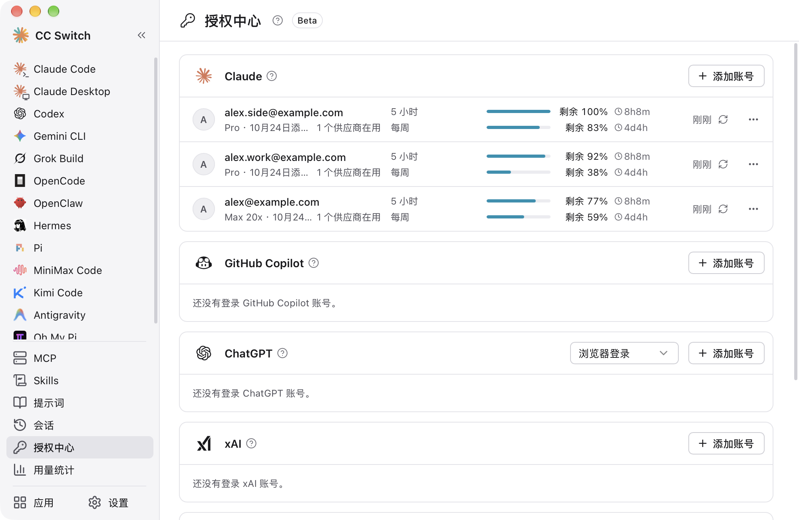
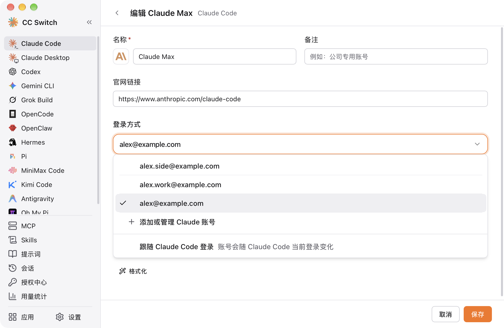
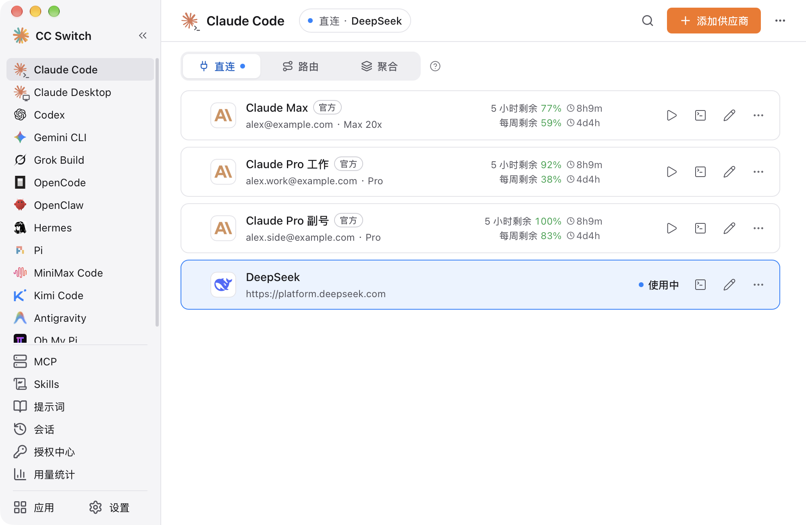
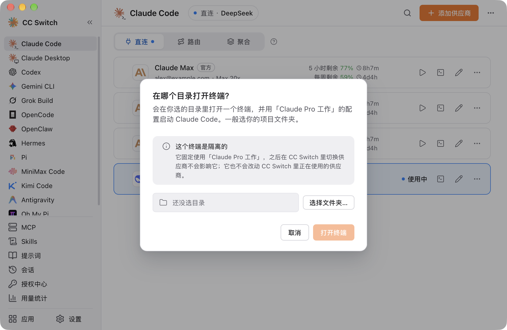

# 使用 CC Switch 切换多个 Claude 官方订阅以及合规问题

> 适用版本：CC Switch v4.0.21 及以上。截图使用去敏示例数据。

## 能做什么

很多人同时有好几个 Claude 订阅，比如公司给的工作账号和自己的个人账号。Claude Code 同一时间只认一个登录，换号只能 `/logout` 再 `/login`，很麻烦。CC Switch 提供两种用法：

- **切卡即切号**：在 Claude 官方卡上选一个账号，切到这张卡，Claude Code 的登录就实时换成这个号：正在运行的会话不用重启，接下来的请求就走新账号；新开的终端、IDE 插件、脚本里的 `claude` 也会用新的。
- **一个窗口一个号**：从卡片「打开终端」，这个终端固定用卡片上的账号，环境隔离，几个号可以同时开启，同时适用于第三方供应商。

每张绑了账号的卡片还会显示这个号的套餐和剩余额度。

> ⚠️ **只支持 Claude Code CLI 和 IDE 插件（VS Code、JetBrains 等），不支持 Claude Desktop，不支持 WSL 环境（后续会做）。** Claude Desktop 的聊天和 Code 标签页用的是它自己的登录，不读 Claude Code 的凭据。在 CC Switch 里切卡、打开终端，都不会改变 Claude Desktop 登录的账号。后续如果 Anthropic 放松相关限制，CC Switch 会跟进。

## 大家最关心的合规问题

### 官方规定

Anthropic 在 [Claude Code 法律与合规页](https://code.claude.com/docs/en/legal-and-compliance#authentication-and-credential-use) 的「Authentication and credential use」一节，对订阅登录有几条要求：

- 订阅登录只给订阅者本人，用于正常使用 Claude Code；
- 第三方不能把 Claude 登录做进自己的应用，也不能拿用户的订阅凭据替用户转发请求；
- 第三方不能收集、存储或中转会话令牌，原文要求 "sign-in to a Claude account must complete through Anthropic's own flow"；
- 这些限制不妨碍用户用自己的订阅登录未经修改的 Claude Code。

Anthropic 官方本身就支持一个人使用多个账号，[认证文档](https://code.claude.com/docs/en/authentication#log-in-with-multiple-accounts)「Log in with multiple accounts」一节写明了推荐做法：给每个账号一个独立的配置目录，启动时用 `CLAUDE_CONFIG_DIR` 指向它，也就是 CC Switch 「打开终端」功能的做法。

### CC Switch 逐条对照

| 官方要求                       | CC Switch 的做法                                                                                                                                                                                                                     |
| ------------------------------ | ------------------------------------------------------------------------------------------------------------------------------------------------------------------------------------------------------------------------------------ |
| 登录走 Anthropic 自己的流程    | 添加账号时运行的是 Claude Code 官方的 `claude auth login`，登录和授权都在 claude.ai 官方页面完成。CC Switch 只负责把登录链接显示出来。                                                                                               |
| 不把 Claude 登录做进自己的应用 | CC Switch 没有自己的 Claude 登录和 OAuth 客户端。每个账号就是一个官方推荐的 `CLAUDE_CONFIG_DIR` 目录，令牌由 Claude Code 自己保存。                                                                                                  |
| 不替用户转发请求               | CC Switch 不拿订阅令牌发模型请求，也没有服务器。对话请求都由你本机未经修改的 Claude Code 直接发给 Anthropic。                                                                                                                        |
| 不收集、存储、中转令牌         | 令牌始终以 Claude Code 自己的格式保存在本机：每个账号是一个 `CLAUDE_CONFIG_DIR` 目录（放在 CC Switch 的数据目录下），凭据由 Claude Code 写进钥匙串或该目录的 `.credentials.json`。CC Switch 的数据库、配置文件和云同步里都没有令牌。 |
| 只供本人正常使用               | 都是你自己的订阅，各用各的额度。CC Switch 不做按额度自动轮换，也不提供共享订阅的功能。                                                                                                                                               |

此外，CC Switch **不刷新令牌**，刷新始终由 Claude Code 自己完成；**不登出、不吊销**，删除账号不会让它在任何地方退出登录；**不修改 Claude Code** 程序本身。

### 边界

- **「打开终端」**：和官方文档教的 `CLAUDE_CONFIG_DIR` 方法完全一致，只是 CC Switch 替你建了目录、开了终端。
- **「切卡即切号」**：为了让 IDE 插件和脚本也能换号，切卡时会在本机 Claude Code 的存储位置之间移动登录，令牌不离开本机，官方文档没有专门讲到这种用法，目前还没有收到因此被封号的反馈。

如果只想用官方写明的方式，可以给账号建卡但不「启用」它们，只用卡片上的「打开终端」。条款可能更新，请以 Anthropic 的最新说明为准。

## 用法

### 1. 添加账号

打开左侧边栏的**授权中心**，在 Claude 组点「添加账号」，在弹出的浏览器里用 claude.ai 登录。几个号就登录几次。

浏览器授权后没有回到 CC Switch 时，点「授权后没有回到这里？」，把浏览器地址栏里的地址或页面上的代码粘贴进去即可。

Claude Code 里现在登着的号不用专门添加，第一次切换时会自动收录。

### 2. 给官方卡选账号

在 Claude Code 页面添加或编辑一张 `Claude Official` 卡，在「登录方式」下拉里选一个账号。建议一个号一张卡，卡名写用途，例如「Claude 工作」「Claude 个人」。

下拉最下面的「跟随 Claude Code 登录」表示不绑号，Claude Code 现在登着谁就用谁。

我知道这个地方稍微有点麻烦，这个是历史遗留问题，后续会优化这部分交互。

### 3. 即时切换

点卡片的「启用」，Claude Code 的登录就实时换成了这个号。正在运行的 Claude Code 不用重启，接下来的请求就会用新账号；新开的 `claude` 也一样。

注意：

- 正在运行的会话也会跟着换号，所以切号后正在使用的 Remote Control 会断开，下一条消息要重建提示缓存（会慢一点、多用一点额度）。
- 仅直连模式；在设置里覆盖了 Claude 配置目录时，切卡不会换号，请用「打开终端」。WSL 环境下两种用法都不支持。

### 4. 几个号同时用：「打开终端」

想在不同的窗口里同时用不同的号，比如左边窗口用工作账号、右边窗口用个人账号，就用卡片上的「打开终端」按钮。

点了之后先选一个目录（一般是项目文件夹，最近用过的目录会记住），再点「打开终端」。CC Switch 会在这个目录里打开一个新终端，并用这张卡的配置启动 `claude`。

对话框里写着「这个终端是隔离的」，意思是：

- 这个终端固定用这张卡，之后在 CC Switch 里切换卡片不会影响它；
- 它也不会改动 CC Switch 里正在使用的卡片，不会写 `~/.claude/settings.json`，也不会切换 Claude Code 的登录。

所以可以同时开好几个终端，每个用一个号，互不干扰。

绑了账号的官方卡，隔离的做法就是官方文档推荐的 `CLAUDE_CONFIG_DIR`：每个号有自己的配置目录，终端启动时把对应的目录放进环境变量。

某个号正在隔离终端里用着时，尽量别同时把卡片「启用」到这个号。否则那个终端下次刷新登录时，可能要重新登录。

### 不只是官方账号：第三方供应商也能这样用

顺便说下「打开终端」不是 Claude 官方卡专有的，Claude Code 页面上每张卡片都有这个按钮。第三方供应商的卡（填了地址和 API Key）打开的终端同样是隔离的：

- CC Switch 把这张卡的环境变量（地址、Key、模型等）写进一个临时配置文件，用 `claude --settings <临时文件>` 启动；
- Key 只给这个终端里的 `claude` 进程，终端退出后临时文件会删掉；
- 卡上没写的设置（MCP、权限、插件等）仍然从 `~/.claude/settings.json` 读，各个终端共用。

这样就可以一个窗口用 Claude 官方订阅，另一个窗口用 DeepSeek、Kimi 等第三方模型，同时开着，互不影响。

只有一种卡打开的终端不隔离：没选账号（「跟随 Claude Code 登录」）的官方卡。它本来就跟着 Claude Code 当前的登录走，对话框里也不会显示「隔离」的说明。

终端用哪个应用（系统终端、iTerm2、Ghostty 等），在「设置 → 通用 → 窗口与终端」里设置。

## 常见问题

**提示「需要重新登录」？**
这个号的登录过期了，到授权中心点「重新登录」。快过期时授权中心会提前提示。

**能保证不封号吗？**
不能。Anthropic 的封号检测有一系列因素，比如账号的注册、支付的渠道、网络等等。CC Switch 只能保证切换本身按官方规定的方式实现：走官方登录、令牌不出本机、不转发请求。

**可以在路由和聚合模式使用吗？**
不能。路由和聚合模式意味着请求需要在本地网关进行转发，这会给用户的账号带来封禁风险。CC Switch 不愿意把这部分风险交由用户承担。合规、稳定、原生配置优先，这是 CC Switch 的设计理念，即使这样会带来一系列的复杂度。

**Claude Desktop 能这样切号吗？**
不能。见开头的说明：Claude Desktop 用的是它自己的登录，这个功能只作用于 Claude Code CLI 和 IDE 插件。要在 Claude Desktop 里换号，请在 Claude Desktop 里退出再登录。

## 参考

- [Claude Code：Authentication](https://code.claude.com/docs/en/authentication)（Log in with multiple accounts、Credential management）
- [Claude Code：Legal and compliance](https://code.claude.com/docs/en/legal-and-compliance)（Authentication and credential use）
