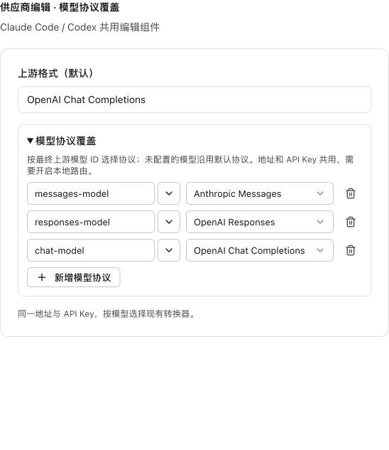

# 按模型选择上游协议

Claude Code 和 Codex 的普通第三方供应商可在编辑界面的“上游格式”下展开“模型协议覆盖”。填写最终发往上游的模型 ID，并选择 Anthropic Messages、OpenAI Responses 或 OpenAI Chat Completions。可以直接输入，也可以从已有模型列表中选择。



上图为实际共享组件的独立预览，三个模型 ID 是说明用的占位名称。

例如，同一个供应商默认使用 Chat Completions，仅让两个模型使用其他协议：

| 最终上游模型 ID | 协议 |
| --- | --- |
| `messages-model` | Anthropic Messages |
| `responses-model` | OpenAI Responses |
| 其他模型 | 供应商默认协议 |

保存到供应商元数据的配置：

```json
{
  "apiFormat": "openai_chat",
  "modelApiFormats": {
    "messages-model": "anthropic",
    "responses-model": "openai_responses"
  }
}
```

- 启用本地路由后生效。Claude Code 继续发送 Messages；Codex 继续发送 Responses，CC Switch 使用现有转换器对接各模型的上游协议。
- 地址和 API Key 共用。地址应填写供应商基础地址；完整端点 URL 模式不能与协议覆盖同时使用。
- 覆盖配置匹配模型映射、聚合路由完成后的真实模型名，区分大小写，忽略末尾 `[1M]` 标记。每个模型只允许一条配置。
- 删除覆盖后，该模型恢复供应商默认协议。完全空白的新行不会保存；缺少模型或协议的行需要补齐。
- Messages 模型使用已有认证字段设置；Chat / Responses 使用 Bearer。Codex 只要包含 Messages 覆盖，编辑界面就会显示已有的 Messages 认证字段及输出长度设置。
- Codex 自动生成的模型目录按模型协议生成工具能力；供应商发布的模型包含 Messages 时，关闭全局 hosted web search，避免客户端发送该协议不支持的工具。
- OpenCode Go 等混合协议网关可依照供应商官方文档手动填写模型协议。模型协议覆盖不探测上游支持情况，也不自动更新模型清单。[OpenCode Go 官方文档](https://opencode.ai/v2/docs/console/go/)

首版仅支持 Claude Code / Codex 普通第三方供应商，不改变官方账号、Copilot 或托管 OAuth 的协议规则。无需迁移旧配置。
