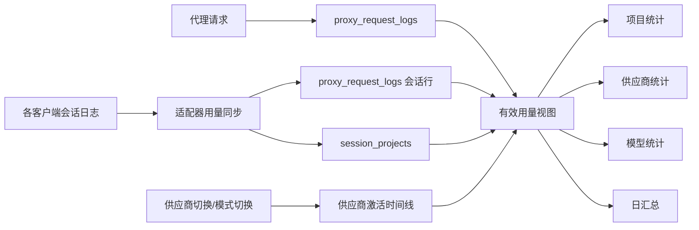

# CC Switch AI 编程客户端用量多维度归属与计费需求

## 1. 文档信息

| 项目 | 内容 |
| --- | --- |
| 状态 | 已实现（P0），实现状态见 `docs/design/usage-multidim/usage-multidim-design-zh.md` 第 10 节 |
| 范围 | 所有 AI 编程客户端的统一用量模型；当前已注册且有数据来源的客户端进入 P0，Codex 作为首个验证案例 |
| 影响模块 | 供应商切换、会话日志同步、代理请求日志、用量数据库、用量统计 API、用量面板 |
| 上游数据库版本 | `SCHEMA_VERSION = 22`（main `717172bd`） |
| 目标数据库版本 | `23`，独立执行多维用量迁移 |
| 关联文档 | `docs/review/usage-multidim/usage-multidim-review-zh.md` |
| 最后更新 | 2026-10-23；模型缓存下钻需求见第 23 节 |

本文定义所有 AI 编程客户端在直连、路由、聚合和累加模式下，用量按应用、项目和供应商拆分，并提供整体、项目、供应商及模型缓存命中率的产品与技术要求。Codex 是首个验证案例，不是唯一目标；Claude Code、Gemini CLI、OpenCode、Pi、MiniMax Code 等客户端按各自适配器接入同一套维度模型。

## 2. 背景

用量面板当前已经能展示总成本、请求数、真实消耗 Token 和整体缓存命中率，但会话日志导入的用量普遍只有一个占位供应商桶。Codex 是最典型的场景：直连模式下所有第三方供应商都归入 `Codex · 会话日志`，原因是 Codex 会话日志只记录 `model_provider`，而 CC Switch 写入的第三方供应商统一使用 `custom`：

- `src-tauri/src/codex_config.rs:19` 定义了共享的 `CC_SWITCH_CODEX_MODEL_PROVIDER_ID = "custom"`。
- `src-tauri/src/codex_history_migration.rs:283` 明确说明会话分桶只看 `model_provider`，`base_url` 不参与。
- `src-tauri/src/services/session_usage_codex.rs:2256` 在导入会话用量时硬编码 `provider_id = "_codex_session"`。
- `src-tauri/src/services/usage_stats.rs:381` 把 `_codex_session` 显示为 `Codex (Session)`。
- 数据库只保存供应商当前是否选中，没有切换时间线：`src-tauri/src/database/dao/providers.rs:475`。

同类问题也存在于其他会话日志导入路径。例如 Claude 会话用量使用 `_session` 占位桶，Gemini、OpenCode 等各有自己的占位桶。客户端不同，占位名称不同，但本质相同：会话日志没有供应商卡片身份，统计表也没有项目和供应商两个可组合维度。

这导致三个直接问题：

1. 用户无法知道某个项目消耗了哪家供应商。
2. 用户无法比较不同供应商的缓存命中率。
3. 成本只能按模型价格计算，不能可靠对应到实际供应商。

同时，项目信息本身并不缺失。Codex 会话的 `session_meta.cwd` 已经包含工作目录，会话管理器也已经解析为 `project_dir`：

- `src-tauri/src/session_manager/mod.rs:28`
- `src-tauri/src/session_manager/providers/codex.rs:1998`

但用量同步器目前没有读取这个字段，用量表也没有项目维度。Claude、Gemini、OpenCode、Grok Build、Pi、MiniMax Code 等会话管理器同样已经解析项目目录，说明项目维度可以统一建设，而不是只服务 Codex。

### 2.1 客户端能力矩阵

| 客户端 | 当前注册 | 会话用量来源 | 项目目录来源 | 供应商归属方式 |
| --- | --- | --- | --- | --- |
| Claude Code | 是 | 有 | 有 | 切换时间线；当前会话记录没有供应商卡片 ID |
| Claude Desktop | 是 | 仅代理请求 | 仅能尝试从代理 session 关联 | 代理日志 |
| Codex | 是 | 有 | 有 | 会话 `model_provider` 确定性映射（openai→官方卡、供应商键→对应卡；custom→切换时间线、本地访问→独立未识别桶） |
| Gemini CLI | 是 | 有 | 有 | 切换时间线 |
| Grok Build | 是 | 有 | 有 | 切换时间线 |
| OpenCode | 是 | 有 | 有 | 消息内含 `providerID`，当前导入器未保存，需提取并映射到供应商卡片 |
| OpenClaw | 是 | 暂无用会话用量解析器 | 有 | 先验证原生用量来源，再增加适配器 |
| Hermes | 是 | 暂无用会话用量解析器 | 有 | 先验证原生用量来源，再增加适配器 |
| Pi | 是 | 有 | 有 | 消息内含原生 `provider`，当前导入器保存为字符串，需映射到供应商卡片 |
| MiniMax Code | 是 | 有 | 有 | 模型命名空间和历史消息含供应商线索，当前导入器未保存，需提取并映射 |
| Kimi Code | 是 | 有 | 会话管理器读取 `state.json.cwd` 或 `/custom/cwd`；用量导入尚未关联 | 保留原生会话桶，明确标记 `unknown/kimi_native_session`，不继承代理精确归属 |
| Cursor | 否 | 无 | 无 | 需新增客户端接入和用量适配器 |
| 其他未注册客户端 | 否 | 未验证 | 未验证 | 先完成能力声明和数据源验证，再接入统一模型 |

矩阵的含义是：数据模型和 UI 面向所有客户端设计，但每个客户端必须先具备“用量来源 + 项目来源 + 供应商来源”中的至少一项，才能出现在多维统计里。Cursor 目前不是 CC Switch 的注册应用，不能假设它已有用量数据；要支持 Cursor，先增加客户端配置写入、会话或代理用量来源和项目识别，再接入本需求，不能只加一个 UI 页签。

## 3. 总体结论

本需求把用量明细扩展为一张统一事实表，维度包括时间、应用、供应商、项目和模型；指标包括请求数、四类 Token、成本、缓存命中率、成功率和速度。

要做到供应商可归属，不能根据当前选中的供应商反推历史，也不能仅凭模型价格猜供应商。切换式客户端必须新增“供应商激活时间线”作为归属证据；累加式客户端优先使用会话或原生配置里的供应商标识；路由和聚合模式继续以代理请求日志中的真实 `provider_id` 为准。

要做到项目可归属，各客户端适配器必须把原生项目字段写入项目索引；代理日志没有项目字段时，需要通过规范化 `session_key` 关联会话项目。无法关联的数据进入未识别项目，不允许丢弃或伪造。

本需求中的“精确计费归属”首先指每条成本记录能追溯到真实供应商卡片和应用，不指金额一定等于供应商账单。P0 仍使用现有模型价格计算成本；只有引入供应商级价格、协议返回成本或账单对账后，金额口径才能升级为供应商账单级精度。

每个客户端适配器必须显式声明三个能力：用量来源、项目来源、供应商归属策略。缺少某个能力时，对应维度显示未识别，不能借用另一个客户端或当前选中状态补齐。

## 4. 目标与非目标

### 4.1 目标

1. 已接入用量来源的 AI 编程客户端，能按实际使用的供应商卡片拆分会话用量。
2. 用量能按应用、项目、供应商、模型、时间五个维度任意组合筛选。
3. 顶部指标展示当前筛选范围的整体缓存命中率。
4. 供应商表展示每个供应商在当前范围内的请求数、Token、成本、缓存命中率。
5. 项目表展示每个项目的请求数、Token、成本、整体缓存命中率，以及该项目下各应用和供应商的使用情况。
6. 拆分后，各维度行的请求数、Token、成本之和与拆分前总量一致。
7. 无法确定供应商或项目的数据进入未识别桶，并在 UI 中说明原因。
8. 供应商改名或删除后，历史用量仍能显示当时的供应商名称。

### 4.2 非目标

1. 不改变直连模式的网络路径，不强制用户使用本地路由。
2. 不根据当前打开的目录、当前选中的供应商或当前模型价格回填无法证明的历史数据。
3. 不要求所有客户端在同一版本完成适配。统一模型和查询接口先覆盖已经有用量来源的客户端；OpenClaw、Hermes、Cursor 等缺少可用量来源或尚未注册的客户端，先完成数据源接入，再自动进入同一模型。
4. 不把 API 等价成本等同于供应商账单。供应商级单价和账单对账属于后续阶段。
5. 不重写已经汇总并裁剪掉明细的历史数据。
6. 不为未注册客户端伪造用量。Cursor 等客户端需要先完成接入，不能只凭供应商配置出现在用量统计里。

## 5. 术语与口径

### 5.1 供应商

本文的“供应商”首先指供应商卡片。供应商卡片身份是 `(app_type, providers.id)`，因为不同客户端可能使用相同字符串作为本地卡片 ID。同一上游公司配置多张卡片时，P0 分开统计，不自动合并。这样可以区分不同客户端、不同 Key、不同套餐和不同计费规则。

存储和关联始终使用原始 `app_type`。仪表盘可以保留现有展示折叠规则 `claude-desktop -> claude`，即 Claude Desktop 的网关流量按 Claude 展示；该规则只影响展示和筛选，不写入新数据，也不能让两个应用的供应商 ID 在关联阶段混用。

后续如需按上游品牌合并，可在卡片之上增加品牌维度，不能直接用 `base_url` 猜测品牌。

### 5.2 项目

“项目”指一次会话或代理请求所属的工作区。项目证据由各客户端适配器从自己的会话字段读取，例如 Codex 的 `session_meta.cwd`、Claude/Gemini/OpenClaw/Hermes 的 `cwd`、Grok Build 的会话 `cwd`、Pi 的会话头 `cwd`、OpenCode 的 `directory`、MiniMax Code 的 `workspace_dir`。适配器必须声明实际字段，不能用其他客户端的字段猜测。

- 能识别 Git 仓库根目录时，使用仓库根目录作为项目键。
- 不能识别 Git 根目录时，使用规范化后的 `cwd`。
- 同一 Git 根目录被多个客户端使用时，项目键相同，项目列表默认合并成一个项目；应用筛选可以拆分查看不同客户端的贡献。
- 支持子 agent 或续写页面的客户端，子会话和续写页归入父会话项目。
- 一个会话只取一个主项目，不因为会话内切换子目录而拆分；客户端本身以单次请求记录项目时，按该客户端原生语义处理。

项目键用于分组，项目路径用于详情展示，项目名用于列表显示。
项目名取 `cwd` 的末级目录名（比仓库根目录更贴近用户直觉），项目键仍取 Git 根目录。

### 5.3 归属置信度

| 置信度 | 含义 | 来源 |
| --- | --- | --- |
| `exact` | 请求本身带有可证明的供应商或项目 | 代理日志、会话元数据中的唯一供应商 ID |
| `high` | 时间点与激活时间线唯一对应，且没有边界歧义 | 供应商切换记录、会话项目索引 |
| `low` | 只能关联到项目或供应商中的一个，另一个未知 | 代理 session_id 无法关联到项目 |
| `unknown` | 缺少证据，不能归属 | 无激活记录、外部修改配置、请求跨切换点 |

### 5.4 缓存命中率

缓存命中率沿用现有口径：

```text
缓存命中率 = 缓存命中 Token / (新增输入 Token + 缓存写入 Token + 缓存命中 Token)
```

实现参考 `src-tauri/src/services/usage_stats.rs:49`。该值按 Token 加权汇总，不是每条请求命中率的算术平均。分母为 0 时显示 `—`，不显示 `0%`。

## 6. 现状与约束

下表以 Codex 作为首个验证案例列出具体代码事实。其他客户端遵循同一问题模型，只是日志格式、占位供应商和项目字段不同。

| 事实 | 代码位置 | 影响 |
| --- | --- | --- |
| 第三方 Codex 供应商共用 `model_provider = "custom"` | `src-tauri/src/codex_config.rs:19` | `custom` 是通用路由键，先查请求时刻的切换时间线；无时间线证据时归入独立未识别桶 |
| 会话 `model_provider` 可区分 `openai` 与供应商键 | `src-tauri/src/services/usage_attribution.rs` | `openai`→官方卡，`provider-a`/`volcengine` 等供应商键→对应卡 |
| 会话日志只按 `model_provider` 分桶，`base_url` 不参与 | `src-tauri/src/codex_history_migration.rs:283` | 不能从日志里的 base URL 反推供应商 |
| 会话用量导入硬编码 `_codex_session` | `src-tauri/src/services/session_usage_codex.rs:2256` | 供应商统计只有一行会话日志 |
| 供应商统计用占位名称显示会话行 | `src-tauri/src/services/usage_stats.rs:381` | UI 显示统一的 Codex 会话桶 |
| Claude 等会话导入同样使用 `_session` 等占位桶 | `src-tauri/src/services/session_usage.rs:1290` | 多客户端都存在供应商维度缺失 |
| 多个客户端已经解析项目目录 | `src-tauri/src/session_manager/providers/*.rs` | 项目维度可以在统一模型上建设 |
| 只有 `is_current`，没有切换历史 | `src-tauri/src/database/dao/providers.rs:475` | 无法按请求时间还原供应商 |
| 用量表没有项目字段 | `src-tauri/src/database/schema.rs:200` | 无法按项目聚合 |
| 日汇总表主键没有项目字段 | `src-tauri/src/database/schema.rs:296` | 明细裁剪后项目维度会丢失 |
| 代理日志只有 session_id，没有 cwd | `src-tauri/src/proxy/session.rs:10` | 项目需要二次关联 |
| 代理侧 session_id 未必和客户端会话 ID 一致 | `src-tauri/src/services/usage_stats.rs:1068` | 路由模式可能产生未识别项目 |
| 定价表以模型 ID 为唯一键 | `src-tauri/src/database/schema.rs:239` | 同一模型在不同供应商下共用价格 |
| 现有缓存命中率公式已统一 | `src-tauri/src/services/usage_stats.rs:49` | 新维度必须沿用同一公式 |

## 7. 总体设计

用量数据流调整为：



核心设计原则：

1. 先把供应商和项目写进统一用量事实，再做去重、汇总和展示。
2. 归属证据和统计结果分开保存，统计结果不能反向成为归属证据。
3. 切换式客户端使用激活时间线，累加式客户端使用原生供应商标识，代理模式使用代理日志，三者不能互相覆盖。
4. 代理日志和会话日志去重时，必须在写入去重判定（跳过会话行之前）就把会话日志上的项目和供应商证据写回代理行或关联记录，不能等读取时再从被跳过的会话行继承。
5. 所有未知值用明确哨兵表示，不用当前值补齐。

## 8. 功能需求

### FR-01 供应商激活时间线

新增应用无关的供应商激活记录，用于切换式客户端的直连模式归属。Claude Code、Codex、Gemini CLI、Grok Build 等支持直连/路由切换的客户端使用时间线；OpenCode、Pi、MiniMax Code 等累加式客户端优先使用原生配置或会话里的供应商标识，不强行套用时间线。

记录时机：

- 任一切换式客户端直连供应商切换成功后。
- 客户端首次导入 live 配置，或启动时识别出稳定的 live 配置时。
- 直连、路由、聚合模式发生切换时。

记录内容：

- 应用类型。
- 供应商 ID，非直连模式边界可为空。
- 模式。
- 生效时间，精确到毫秒。
- 来源：`switch`、`import`、`startup`、`mode_change`。
- 配置指纹，只保存哈希，不保存 API Key。

人工修正不是供应商激活，不能写入时间线。否则一次单条修正会改变其后所有请求的归属。人工修正属于 P1 的独立覆盖表，优先级高于自动归属，但不影响时间线。

失败处理：

- 时间线写入失败不能阻断供应商切换。
- 写入失败必须记录日志并计入数据质量指标。
- 后续请求在缺少有效时间线时归入未识别供应商，不能用当前供应商兜底。

验收：

- 供应商 A 切到 B 后产生两条可查询的记录。
- 切换失败、配置未写入成功时不产生“已生效”记录。
- 记录顺序与真实切换顺序一致。

### FR-02 会话用量的供应商归属

每个客户端适配器必须实现自己的供应商归属函数，但统一返回：供应商 ID、归属来源、置信度、未识别原因。

通用优先级：

1. 会话或原生配置里有可证明的供应商卡片 ID：直接使用。
2. 客户端提供唯一供应商元数据：映射到供应商卡片。
3. 切换式客户端且只有共享供应商桶：查请求时间点之前最后一条有效激活记录。
4. 累加式客户端有原生供应商标识：按适配器映射。
5. 以上都没有：归入该应用的会话占位桶，原因为未识别。

Codex 适配器的具体优先级：

1. `session_meta.model_provider == "openai"`：归入 Codex 官方供应商。
2. `session_meta.model_provider` 为唯一供应商 ID：直接映射。
3. `model_provider == "custom"`：查请求时间点之前最后一条有效的直连激活记录。
4. 找不到记录、配置被外部修改、请求跨切换点或时间精度不足：归入 `_codex_session`，原因为未识别。

其他客户端不能复用 Codex 的 `model_provider` 规则。例如 Claude、Gemini、OpenCode 必须由各自适配器读取自己的日志字段和配置结构，缺失时进入对应占位桶。

请求时间区间，适用于能够从会话日志恢复请求边界的客户端：

- 起点优先使用上一条 `turn_context`、用户消息或工具结果之后的时间边界。
- 终点使用对应 `token_count` 事件时间。
- 无法取得请求起点时，可以退化为 `token_count` 时间，但置信度降为 `low`；如果边界附近存在切换记录，仍归入未识别。
- 如果激活切换点落在请求区间内，不能选新供应商，必须标记为歧义。
- 如果切换时间和请求时间落在同一秒内，标记为歧义，因为当前明细 `created_at` 只保留秒级精度。

验收：

- 至少用 Codex、Claude 和 OpenCode 三类样本验证切换式与原生供应商字段两类路径，A、B 两个供应商的请求分别落到各自供应商。
- 切换期间发出的请求要么归入实际供应商，要么进入未识别，不能串到错误供应商。
- 归属结果包含来源和置信度。
- 新增客户端只增加适配器，不修改供应商和项目维度模型。

### FR-03 会话项目识别

每个会话用量适配器读取本客户端声明的主项目字段，写入会话项目索引。当前字段来源以 2.1 的客户端能力矩阵为准；新增客户端必须同时补充字段解析和样本测试。

项目规范化：

1. 去除尾部路径分隔符。
2. 能解析为存在的路径时，使用规范化路径。
3. 能解析 Git 根目录时，项目键使用 Git 根目录。
4. 无法解析的路径保留原始字符串，不丢弃会话。
5. Windows 路径按统一分隔符规则处理，避免同一项目出现两种键。
6. 原生字段是 `file://` URI 时先转换为本地路径。

会话规则：

- 一个会话对应一个主项目。
- 分页续写、恢复会话和子 agent 在客户端存在这些概念时继承父会话项目。
- 同一会话出现多个项目字段时，P0 取适配器声明的会话主项目字段，并在详情中保留原始路径。
- 会话没有可用项目字段时进入未识别项目。

验收：

- 正常 Git 仓库、非 Git 目录、符号链接、带尾斜杠路径能归到同一项目。
- 支持子 agent 的客户端不会让子 agent 单独出现在项目列表中；不支持子 agent 的客户端跳过该项。
- 路径不存在时仍保留会话和 token。

### FR-04 代理日志的项目关联

代理请求在请求发生时通常没有 cwd，项目通过规范化后的 `session_key` 关联会话项目索引。

要求：

1. 写入代理行时同时生成 `session_key`，由各客户端适配器统一代理 session_id 和会话 ID 的格式。Codex 需要处理 `codex_` 前缀差异，Claude 需要处理 `metadata.user_id` 或会话头差异，其他客户端按各自规则处理。
2. 查询时优先使用明细行上的项目；没有时通过 `session_projects` 关联。
3. 日汇总前必须完成项目关联，把结果写入汇总行。
4. session_id 为代理侧生成、无法关联时，项目为未识别；供应商仍按代理日志保留。
5. 不得因为项目缺失而丢弃代理行。

去重要求：

- 当前去重是两条路径并行：写入会话行前，`should_skip_session_insert` 先按指纹判定命中代理行并跳过插入（write-side skip）；已落库的历史会话行再由 `effective_usage_log_filter` 在读侧用 `NOT EXISTS` 过滤。二者并存，不能只按“隐藏会话行”理解。
- 因此，去重判定发生时（会话行被跳过之前），必须先把会话日志上的项目证据写回命中的代理行或写入 `session_projects` 关联记录，不能依赖读取时从“被隐藏的会话行”继承，因为该会话行可能从未落库。
- 如果代理行没有项目而会话行有项目，被保留的有效行必须已经具备会话行写回的项目。
- 如果代理行有供应商、会话行有项目，有效行必须同时具备两者。
- 不得通过修改 token 数或时间窗口来规避这个问题。

验收：

- 路由模式下，代理请求和会话日志重复时只计一次，且项目不丢失。
- 代理 session_id 无法关联时，供应商仍正确，项目显示未识别。
- 去重前后总成本、总 Token 不变。

### FR-05 缓存命中率

整体、项目、供应商、模型四个层级都必须返回缓存指标。

返回字段至少包括：

- 新增输入 Token。
- 缓存写入 Token。
- 缓存命中 Token。
- 可缓存输入 Token。
- 缓存命中率。

计算规则：

```text
可缓存输入 = 新增输入 + 缓存写入 + 缓存命中
缓存命中率 = 缓存命中 / 可缓存输入
```

- 必须使用 Token 加权聚合。
- 分母为 0 时，API 返回可缓存输入 0，UI 显示 `—`。
- OpenAI 协议不区分缓存写入时，缓存写入按 0 参与计算，并沿用现有说明。
- 纯缓存命中、没有新增输入和输出的请求仍计入请求数和缓存命中。

验收：

- 全部命中时命中率为 100%。
- 全部新增输入且无缓存时命中率为 0%。
- 没有可缓存输入时显示 `—`。
- 项目整体命中率等于各供应商按可缓存输入加权的命中率。

### FR-06 成本与定价边界

P0 解决供应商和项目归属，成本仍按现有模型价格计算。

必须明确：

- 只拆供应商不会自动修正不同供应商的单价差异。
- 现有定价表按模型唯一，同一模型经过不同供应商时仍使用同一价格。
- 若用户要求与供应商账单一致，需要供应商级定价覆盖，属于 P1。

P1 定价规则：

1. 供应商级价格优先于全局模型价格。
2. 没有供应商级价格时回落到全局模型价格。
3. 已经写入的非零成本不自动重算。
4. 只沿用现有零成本补价机制。

官方订阅：

- 官方订阅用量继续按 API 等价价格展示时，必须标注“估算”，不能称为实际账单。
- 如果产品改为 0 成本，必须单独作为口径变更，不在本需求中静默修改。

### FR-07 查询与筛选

所有用量查询增加可选 `projectKey` 过滤，并保持现有 `appType`、`providerName`、`model`、时间过滤能力。`appType`、`projectKey`、供应商和模型筛选必须可以组合使用。

受影响接口：

- 总体用量汇总。
- 每日趋势。
- 供应商统计。
- 模型统计。
- 请求日志。
- 单个会话用量（不筛选，直接使用该会话的归属）。

新增项目统计接口：

- 项目列表统计。
- 项目 × 供应商统计。
- 项目下拉选项。

筛选规则：

- 未选择项目时统计全部项目。
- 未选择应用时统计所有已接入客户端；选择应用时只统计该 `app_type`。
- Claude Desktop 继续沿用现有展示折叠规则，筛选 Claude 时包含 `claude-desktop`；底层供应商身份仍按原始 `app_type` 隔离。
- 选择具体项目时，顶部指标、趋势图、供应商表、模型表、请求日志全部同步过滤。
- 项目默认跨客户端合并；同一项目下可以继续按应用拆分，不能因为供应商 ID 相同就跨应用合并。
- 未识别项目可以被选中，不能只在列表里出现却无法筛选。

### FR-08 UI

用量面板保留现有应用筛选，并增加“项目”。时间、应用、项目及供应商/模型筛选放在同一范围栏且可组合；供应商和模型沿用上游的级联菜单，模型查询必须同时携带原始供应商 ID、应用类型和项目，不能按同名供应商合并。

页签只包含日志、项目、供应商、模型四类数据视图；显示和定价设置沿用“用量设置”抽屉。页签计数跟随对应数据范围，仅当前页签触发计数查询，不增加后台轮询。

新增“项目”页签，默认按总 Token 或总成本降序：

| 列 | 说明 |
| --- | --- |
| 项目 | 默认显示项目名，悬停显示完整路径 |
| 请求数 | 当前时间范围内请求数 |
| Tokens | 真实消耗 Token |
| 成本 | 当前定价口径下的成本 |
| 缓存命中率 | 当前项目整体命中率 |
| 客户端数 | 该项目使用过的 `app_type` 数量 |
| 供应商数 | 该项目使用过的供应商卡片数量 |
| 最后活跃 | 最后一次请求时间 |

展开项目后不再逐层缩进表格，而是显示占比视图：

- 供应商占比：环形图 + 图例，图例含供应商、数值、占比和缓存命中率；口径可在「请求数 / Token / 成本」之间切换。
- 模型占比：同一口径下的模型环形图；点击供应商图例后只看该供应商下的模型，可一键回到全部供应商。
- 超过 6 项时尾部合并为「其他」，避免图例过长。

供应商页保留应用列，增加缓存命中率列，并受当前应用和项目筛选影响；展开供应商后用环形图展示其模型占比。项目、供应商的展开区域必须继承范围栏的全部筛选，包括已选供应商和模型，不能展开到父行范围以外的数据。

请求详情增加：

- 应用类型。
- 项目名称和完整路径。
- 供应商名称。
- 归属来源。
- 归属置信度。
- 未归属原因。

空状态和异常状态：

- 没有项目数据时显示明确空状态。
- 未识别项目单独成行，不混入正常项目。
- 未识别供应商单独成行，不混入当前选中的供应商。
- 缓存命中率无法计算时显示 `—`。

### FR-09 数据质量

用量页需要展示简单的数据质量提示，例如：

- 已归属请求数。
- 未识别供应商请求数。
- 未识别项目请求数。
- 最近一次会话同步和供应商时间线写入是否成功。

详细错误不直接暴露在常规界面，但日志必须能定位：

- 激活记录写入失败。
- live 配置无法匹配任何供应商。
- session_id 无法关联项目。
- 请求跨供应商切换边界。

### FR-10 供应商生命周期

- 供应商改名后，历史请求详情显示当时的名称快照；汇总列表及筛选菜单显示当前卡片名，保持同一卡片的可识别性。
- 供应商删除后，历史用量仍可读，不显示裸 UUID。
- 历史供应商名称快照不能随当前名称变化。
- 请求详情优先使用 `provider_name_snapshot`，为空才回退实时 `providers.name`。汇总和日志列表沿用当前名称，供应商已删除时回退快照；展示名称不能替代 `(provider_id, app_type)` 身份过滤。
- 供应商删除不应级联删除用量明细。

### FR-11 客户端适配器契约

所有客户端接入统一模型前，必须提供显式能力声明和适配器实现：

```text
UsageCapabilities {
  usageSource: session | proxy | both | none
  projectSource: native_field | session_lookup | none
  providerStrategy: activation | native_provider | proxy | none
  inputTokenSemantics: fresh | total
}
```

要求：

1. 应用注册、会话管理、用量同步都能从 `AppType` 枚举和适配器注册表识别该客户端，不允许在统计 SQL 中维护另一份客户端名单。
2. `usageSource = none` 时不生成空数据页签，也不显示伪造的 0 用量；UI 说明该客户端尚未接入用量来源。
3. `projectSource = none` 时，项目维度统一进入未识别桶，不能读取当前打开目录补齐。
4. `providerStrategy = activation` 只用于切换式客户端；累加式客户端优先使用原生供应商字段。
5. 新增客户端至少要有能力声明、样本测试、项目字段解析、供应商映射和未识别原因，才能进入多维统计。
6. `inputTokenSemantics` 决定该客户端写入 `input_tokens` 的值是否已经包含缓存读/写；该声明必须同步到 Rust 的 `CACHE_INCLUSIVE_APP_TYPES` 和前端 `src/types/usage.ts` 的同名集合，否则缓存命中率会按错误的分母计算。

验收：

- 能力矩阵与代码注册表一致。
- 新增客户端的输入 Token 语义在 Rust、前端和适配器声明三处一致，`fresh_input_sql` 能正确归一化。
- 新增客户端只通过适配器接入，不修改供应商、项目、缓存指标的公共定义。
- 没有用量来源的客户端不会出现在伪造的用量结果中。

## 9. 数据模型

### 9.1 provider_activations

```sql
CREATE TABLE provider_activations (
    id INTEGER PRIMARY KEY AUTOINCREMENT,
    app_type TEXT NOT NULL,
    provider_id TEXT,
    mode TEXT NOT NULL,
    effective_at_ms INTEGER NOT NULL,
    source TEXT NOT NULL,
    config_fingerprint TEXT NOT NULL,
    created_at INTEGER NOT NULL
);

CREATE INDEX idx_provider_activations_lookup
    ON provider_activations(app_type, effective_at_ms);
```

说明：

- `provider_id` 为空表示非直连模式边界。
- `config_fingerprint` 只保存哈希，不保存 Key、Token、完整配置。
- 同一供应商连续重复激活可以合并，但不能跨模式或跨配置指纹合并。

### 9.2 session_projects

```sql
CREATE TABLE session_projects (
    app_type TEXT NOT NULL,
    session_key TEXT NOT NULL,
    project_key TEXT NOT NULL,
    project_path TEXT NOT NULL,
    project_name TEXT NOT NULL,
    source TEXT NOT NULL,
    updated_at INTEGER NOT NULL,
    PRIMARY KEY (app_type, session_key)
);

CREATE INDEX idx_session_projects_project
    ON session_projects(project_key);
```

### 9.3 proxy_request_logs 扩展

新增列：

```sql
ALTER TABLE proxy_request_logs ADD COLUMN project_key TEXT NOT NULL DEFAULT '';
ALTER TABLE proxy_request_logs ADD COLUMN project_name TEXT NOT NULL DEFAULT '';
ALTER TABLE proxy_request_logs ADD COLUMN project_path TEXT NOT NULL DEFAULT '';
ALTER TABLE proxy_request_logs ADD COLUMN session_key TEXT NOT NULL DEFAULT '';
ALTER TABLE proxy_request_logs ADD COLUMN attribution_source TEXT NOT NULL DEFAULT 'proxy';
ALTER TABLE proxy_request_logs ADD COLUMN attribution_confidence TEXT NOT NULL DEFAULT 'exact';
ALTER TABLE proxy_request_logs ADD COLUMN attribution_reason TEXT NOT NULL DEFAULT '';
ALTER TABLE proxy_request_logs ADD COLUMN provider_name_snapshot TEXT NOT NULL DEFAULT '';
```

说明：

- 代理请求原有行为视为 `proxy/exact`。
- 会话日志根据结果写 `session_meta`、`activation` 或 `unknown`。
- 新写入的代理行和会话行必须在写入时保存供应商名称快照；供应商后来改名或删除不能改写该快照。
- 项目未知时三个项目字段都为空字符串。
- 旧会话日志行必须迁移为 `unknown/unknown`，不能沿用列默认的 `proxy/exact`。
- `session_key` 是用于项目关联的规范化键，`session_id` 保留原始值，避免影响现有代理缓存身份。

新增索引：

```sql
CREATE INDEX idx_request_logs_project_time
    ON proxy_request_logs(project_key, created_at);

CREATE INDEX idx_request_logs_provider_project_time
    ON proxy_request_logs(provider_id, project_key, created_at);

CREATE INDEX idx_request_logs_session_key
    ON proxy_request_logs(app_type, session_key);
```

### 9.4 usage_daily_rollups 扩展

新增列：

- `project_key TEXT NOT NULL DEFAULT ''`
- `project_name TEXT NOT NULL DEFAULT ''`
- `project_path TEXT NOT NULL DEFAULT ''`
- `provider_name_snapshot TEXT NOT NULL DEFAULT ''`

主键调整为：

```text
(date, app_type, provider_id, model, request_model, pricing_model, project_key)
```

SQLite 不能直接修改主键，迁移时必须创建新表、复制旧数据、删除旧表并重命名。旧数据统一回填：

- `project_key = ''`
- `project_name = ''`
- `project_path = ''`
- `provider_name_snapshot = ''`

### 9.5 数据库迁移

上游 `main` 当前 `SCHEMA_VERSION` 为 23，多维用量使用独立的 v23→v24 迁移。保留上游 Antigravity、Kimi 和 Oh My Pi 的 v20→v21、v21→v22、v22→v23 能力迁移，避免已升级上游版本的用户跳过多维字段初始化。早期 PR v21/v23 的既有归属和汇总原样保留；早期 PR v23 缺少的 `mcp_servers.enabled_omp` 也须补齐，已有 MCP 开关保持不变。

迁移步骤：

1. 创建 `provider_activations`。
2. 创建 `session_projects`。
3. 给 `proxy_request_logs` 增加新列和索引。
4. 重建 `usage_daily_rollups`，扩展主键并复制存量行。
5. 为存量代理行和会话行回填 `session_key`，只做格式规范化，不改变原始 `session_id`。
6. 把存量会话日志行的 `attribution_source` 设为 `unknown`、`attribution_confidence` 设为 `unknown`，原因记为 `pre_migration_no_evidence`；不能因为列默认值被误标成代理精确归属。
7. 为每个处于直连模式且能证明当前供应商的切换式客户端写入一条迁移基线，基线时间取迁移完成时间，不回溯历史。
8. 尽力从现存会话文件构建 `session_projects`。
9. 对仍保留的代理明细，按 `(provider_id, app_type)` 尽力回填当时的当前供应商名称；找不到时保持为空，并显示未识别供应商名称。
10. 使用 `session_projects` 尽力回填仍保留在 `proxy_request_logs` 中的项目，不回填已裁剪明细和已汇总历史。
11. 旧日汇总从现存供应商表尽力回填名称快照；无法恢复的历史名称保持为空。

注意：

- 旧版本无法打开更高的 `user_version`，回滚必须使用迁移前自动备份的数据库恢复。
- 迁移不得删除已有明细或汇总行。
- 上游 v20、v21、v22 均可逐级升级；早期 PR v21 数据库已有的归属证据、项目及数据源分组必须保留，不能再次降级为未识别或合并。
- 迁移失败必须保持原数据库可恢复，不允许半迁移状态静默启动。

### 9.6 人工修正覆盖表（P1）

人工修正不能写入 `provider_activations`，否则会改变其后所有请求的自动归属。P1 新增独立覆盖表：

```sql
CREATE TABLE usage_attribution_overrides (
    id INTEGER PRIMARY KEY AUTOINCREMENT,
    app_type TEXT NOT NULL,
    scope TEXT NOT NULL,
    scope_key TEXT NOT NULL,
    scope_start_at INTEGER,
    scope_end_at INTEGER,
    provider_id TEXT,
    project_key TEXT,
    reason TEXT NOT NULL,
    created_at INTEGER NOT NULL
);
```

说明：

- `scope` 支持 `request`、`session` 和 `time_range`。`request`、`session` 用 `scope_key` 定位；`time_range` 用 `scope_start_at`、`scope_end_at` 表示闭合区间，`scope_key` 可空。
- 覆盖结果优先于自动归属，但不修改原始证据行。
- 需要在查询或汇总阶段应用，保证人工修正不会被下一次会话同步覆盖。
- P0 不提供人工修正入口，先保证自动归属和未识别状态可靠。

## 10. 归属算法

### 10.1 直连供应商

```text
输入：请求时间区间 [start, end]，应用类型，模式
如果客户端原生会话元数据有唯一供应商 ID：
    直接使用该 ID
否则如果模式不是 direct：
    不查直连时间线，使用代理结果或未识别
否则：
    查找 effective_at_ms <= start 的最后一条激活记录，按 (effective_at_ms DESC, id DESC) 取一条
    如果不存在：未识别
    如果该记录不是 direct 或 provider_id 为空：未识别
    如果在 [start, end] 内还有另一条激活记录：歧义
    如果 start 和 end 的秒级时间相同且边界秒内有激活：歧义
    否则使用该记录的供应商
```

### 10.2 路由和聚合

- 代理日志的 `provider_id` 是强证据，直接使用。
- 会话日志在去重判定时只能作为 token 和项目证据，不能覆盖代理日志的供应商。
- 由于新会话行会在命中代理行时被跳过插入，去重判定时就要把项目证据写回代理行或 `session_projects`，保证去重后有效行同时保留代理供应商和会话项目。

### 10.3 子 agent 与分页

- 支持子 agent 的客户端，子 agent 的 `session_id` 归到父线程。
- 支持分页续写或恢复会话的客户端，续写页归到所属线程。
- 一个线程的多个分段必须共享同一个项目；不适用这些概念的客户端按自身会话模型处理。
- 不允许子 agent 在项目表中单独成行。

## 11. 缓存命中率实现

### 11.1 数据来源

- 新增输入：按现有 `fresh_input_sql` 规则计算。
- 缓存写入：`cache_creation_tokens`。
- 缓存命中：`cache_read_tokens`。
- 输出：`output_tokens`。

### 11.2 聚合要求

项目、供应商、模型三个分组都要返回：

```text
freshInputTokens
cacheCreationTokens
cacheReadTokens
cacheableInputTokens
cacheHitRate
```

其中：

```text
cacheableInputTokens = freshInputTokens + cacheCreationTokens + cacheReadTokens
cacheHitRate = cacheReadTokens / cacheableInputTokens
```

### 11.3 一致性要求

- 顶部整体命中率和项目、供应商、模型命中率必须来自同一批有效行。
- 供应商行、项目行、模型行不能各自走不同去重逻辑。
- 单行命中率不得做算术平均。
- 汇总行必须保留计算所需的三类 Token，不能只保存百分比。
- 请求详情的供应商名称，以及项目名称和路径优先取快照列；供应商汇总和日志列表的名称遵循 FR-10。日汇总必须保留供应商名称快照，保证卡片删除后仍可展示。

## 12. API 变更

### 12.1 现有接口

给以下用量聚合和筛选接口增加可选 `projectKey` 参数，未传时统计全部项目；除单个会话查询外，接口继续接受可选 `appType`，未传时统计所有已接入客户端：

- `get_usage_summary`
- `get_usage_trends`（返回 `DailyStats`）
- `get_provider_stats`
- `get_model_stats`
- `get_request_logs`（通过 `LogFilters.projectKey` 传入）
- `get_usage_first_date`（用于项目下拉的空状态判断）

`get_session_usage_summary` 是单个会话的汇总，不接受项目筛选，直接使用会话本身的归属；`get_usage_summary_by_app` 仍按应用分组，不增加项目分组维度。

### 12.2 新增接口

```text
get_project_stats(startDate, endDate, appType?, providerName?, model?) -> ProjectStats[]
get_project_provider_stats(projectKey, startDate, endDate, appType?) -> ProviderStats[]
get_usage_projects(startDate?, endDate?, appType?) -> ProjectOption[]
```

`ProjectStats` 至少包含：

```text
projectKey
projectName
projectPath
requestCount
totalTokens
totalCost
freshInputTokens
cacheCreationTokens
cacheReadTokens
cacheableInputTokens
cacheHitRate
appCount
providerCount
lastActiveAt
```

`ProviderStats` 增加：

```text
freshInputTokens
cacheCreationTokens
cacheReadTokens
cacheableInputTokens
cacheHitRate
```

## 13. 迁移与历史数据

### 13.1 可以回填

- 仍保留在 `proxy_request_logs` 的明细行。
- 会话文件仍存在，且能解析出 cwd 的会话。
- 供应商切换时间线写入之后的请求。

### 13.2 不能可靠回填

- 已经裁剪明细并进入 `usage_daily_rollups` 的历史项目。
- 功能上线前的供应商切换历史。
- 被外部工具改写、且没有指纹证据的 live 配置。
- 代理侧生成、不可关联的 session_id。
- 迁移前已经删除或改名、且没有当时快照的供应商历史名称。

### 13.3 展示规则

- 历史未知项目显示“未识别项目”。
- 历史未知供应商显示“未识别供应商”。
- 不因为当前打开的项目或当前选中的供应商而修改历史行。
- 人工修正通过 P1 的 `usage_attribution_overrides` 实现，不写入供应商激活时间线，并保留原值审计。

## 14. 性能与可观测性

性能要求：

- 供应商激活时间线在一次同步中预加载，不能对每个 token 事件单独查库。
- 项目关联使用索引，不能对每条请求做全表扫描。
- 项目、供应商、缓存指标尽量在一次 SQL 聚合中完成，避免 N+1。
- 日汇总必须沿用现有批量事务，不逐行提交。

可观测性要求：

- 记录未识别供应商请求数。
- 记录未识别项目请求数。
- 记录激活时间线写入失败次数。
- 记录 live 配置指纹不匹配次数。
- 记录会话 project 解析失败次数。

这些指标只写入本地日志或本地统计，不上传远端。

## 15. 安全与隐私

- 项目路径属于本机敏感信息，只在本地界面展示，不进入遥测。
- 供应商激活记录只保存配置哈希，不保存 API Key、Token、Authorization 头。
- 项目路径默认显示项目名，完整路径只在悬停或详情中展示。
- 导出用量数据时默认不包含完整路径，用户显式选择后才包含。
- 不允许为了归属而额外记录请求正文。

## 16. 测试与验收

### 16.1 单元测试

供应商归属：

- 请求早于首条激活记录。
- 请求完全落在一条激活区间内。
- 请求跨两条激活记录。
- 切换点与请求同一秒。
- 路由模式不使用直连时间线。
- live 配置指纹不匹配。

项目识别：

- 正常路径、尾斜杠、符号链接、非 Git 目录、不存在路径。
- 子 agent 继承父项目。
- 分页续写继承项目。
- Windows 路径分隔符。

缓存命中率：

- 全部新增输入。
- 全部缓存命中。
- 只有缓存写入。
- 可缓存输入为 0。
- 多供应商按 Token 加权。

### 16.2 集成测试

- 两个供应商切换后，会话日志分别归属。
- 每个 P0 客户端至少有一条真实样本验证项目字段和供应商归属路径。
- 切换式客户端和原生供应商字段客户端分别覆盖成功、缺失字段和映射失败。
- 两个项目分别使用不同供应商，项目 × 供应商表正确。
- 同一项目由两个客户端使用时，项目行合并，应用筛选和供应商行保持隔离。
- 路由代理行与会话行去重后保留项目和供应商（含会话行在写入时被跳过前项目证据回写到代理行/关联记录的场景）。
- 会话没有 cwd 时进入未识别项目。
- 代理 session_id 无法关联时供应商仍正确。
- 日汇总后项目维度仍存在。
- 明细裁剪后项目名称和完整路径仍能从日汇总显示。
- 供应商改名或删除后历史名称仍可读。

### 16.3 迁移测试

- 上游 v20、v21、v22、v23 数据库迁移到 v24 后不丢行，早期 PR v21/v23 的归属与汇总分组保留。
- 早期 PR v21/v23 数据库的已有归属证据及项目、数据源汇总分组不变，缺少的 Oh My Pi 开关补齐；重复运行迁移不改变结果。
- `usage_daily_rollups` 新主键生效。
- 旧数据项目为空并显示未识别。
- 迁移失败后可以用迁移前备份恢复。
- 旧版本不能直接打开 v24 数据库，回滚路径明确。

### 16.4 UI 验收

- 顶部筛选增加项目后，所有卡片和表格同步变化。
- 供应商表出现缓存命中率列。
- 项目表可展开查看各供应商。
- 未识别项目和未识别供应商可筛选。
- 缓存命中率无分母时显示 `—`。
- 项目路径过长时布局不溢出。

### 16.5 性能验收

- 同步 1 万条 token 事件不产生逐条 SQL。
- 项目筛选查询使用索引。
- 供应商统计增加缓存字段后没有额外 N+1 查询。
- 日汇总在大数据量下保持现有批量事务模式。

## 17. 验收总表

| 编号 | 验收项 | 通过标准 |
| --- | --- | --- |
| A01 | 直连供应商拆分 | 两个供应商的会话用量分别成行 |
| A02 | 项目拆分 | 两个项目的用量分别成行 |
| A03 | 项目 × 供应商 | 每个项目下能看到使用的供应商和占比 |
| A04 | 总量守恒 | 各行请求数、Token、成本之和等于总计 |
| A05 | 缓存命中率 | 整体、项目、供应商三层一致 |
| A06 | 去重 | 路由代理行和会话行只计一次且项目不丢 |
| A07 | 未识别 | 无证据的数据进入未识别，不伪造 |
| A08 | 历史 | 升级前不可证明的数据保持未识别 |
| A09 | 迁移 | 上游 v20/v21/v22/v23 与早期 PR v21/v23 升级到 v24 不丢数据，MCP 开关保留，回滚路径可执行 |
| A10 | 性能 | 无逐条查库和明显查询退化 |
| A11 | 多客户端 | 每个 P0 客户端的项目与供应商证据可验证，缺证据时进入未识别 |
| A12 | 应用隔离 | 相同供应商 ID 跨应用时不串数据，项目可按应用拆分查看 |

## 18. 分期建议

### P0

- 客户端能力声明和统一适配器契约。
- 供应商激活时间线。
- 会话项目索引。
- 用量表和日汇总增加项目维度。
- 已有用量来源的客户端接入统一模型：Claude Code、Codex、Gemini CLI、Grok Build、OpenCode、Pi、MiniMax Code；Claude Desktop 先按代理日志接入。
- 已有原生供应商字段的客户端完成字段提取和卡片映射：OpenCode、Pi、MiniMax Code。
- 供应商、项目、缓存命中率统计。
- 项目筛选、项目页签、项目 × 供应商明细。
- 未识别桶和数据质量提示。

### P1

- 验证并接入 OpenClaw、Hermes 的原生用量来源；没有可靠 Token 来源时不接入。
- 供应商级定价覆盖。
- 人工修正项目和供应商归属。
- 历史明细尽力回填。
- 项目趋势图、项目级限额。

### P2

- 接入 Cursor 等尚未注册的新客户端，前提是先具备配置写入、用量来源、项目识别和供应商映射。
- 按上游品牌合并供应商卡片。
- 与供应商用量 API 对账。

## 19. 已确认决策

1. 供应商统计以供应商卡片为单位，不按 base_url 自动合并。
2. 项目优先使用 Git 根目录，无法识别时使用 cwd。
3. 历史数据没有证据时保持未识别，不根据当前状态反推。
4. 缓存命中率沿用现有 Token 加权公式。
5. 代理日志的供应商优先于会话日志的推断。
6. 去重后必须保留会话日志的项目证据。
7. 供应商级单价不进入 P0，但 P0 必须明确成本口径边界。
8. 旧版本不能直接打开新 schema，回滚以迁移前备份恢复。
9. 应用维度沿用现有 `app_type` 和 Claude Desktop 展示折叠规则，项目默认跨客户端合并，供应商身份按原始 `(app_type, provider_id)` 保持隔离。
10. 没有可靠数据源的客户端不生成伪造用量，必须先接入适配器。

## 20. 剩余风险

| 风险 | 影响 | 处理 |
| --- | --- | --- |
| 代理 session_id 由代理侧生成 | 路由模式部分请求项目未知 | 保留供应商，项目显示未识别 |
| 用户直接编辑 live 配置 | 激活时间线与实际配置不一致 | 配置指纹不匹配时归未识别 |
| 客户端日志格式变化 | 项目字段或供应商字段解析失败 | 解析失败不丢弃，进入未识别 |
| 同一仓库存在多张供应商卡片 | 供应商行较多 | P0 保留卡片粒度，P2 再做品牌合并 |
| 供应商单价不同 | 成本金额仍不等于账单 | P1 增加供应商级定价 |
| 官方订阅不是实际按 Token 付费 | 成本是估算值 | UI 标注估算，不称为账单 |
| 已裁剪历史没有项目维度 | 旧数据无法按项目查看 | 保持未识别，不伪造回填 |
| 日汇总缺少项目路径 | 明细裁剪后无法展示项目完整路径 | 日汇总同时保存项目名称和路径快照 |
| 迁移前供应商已改名或删除 | 当时的供应商名称无法恢复 | 迁移时尽力回填，缺失时显示未识别名称，不伪造历史 |
| Cursor 尚未注册且没有用量来源 | 无法提供 Cursor 用量和项目统计 | 先完成客户端与适配器接入，再进入统一统计 |
| 各客户端日志字段和供应商语义不同 | 一套通用规则可能误归因 | 能力声明加客户端专属适配器，缺证据进入未识别 |
| 同一项目跨多个客户端使用 | 直接合并可能掩盖客户端差异 | 默认按项目合并，同时保留应用筛选和应用内供应商隔离 |

## 21. 代码影响面

| 模块 | 文件 | 变更 |
| --- | --- | --- |
| 客户端注册 | `src-tauri/src/app_config.rs` | 能力声明、应用类型和适配器注册入口 |
| 供应商切换 | `src-tauri/src/services/provider/mod.rs` | 切换式客户端写入激活记录 |
| Codex 配置 | `src-tauri/src/codex_config.rs` | 提供配置指纹和官方供应商 ID；保留 Codex 专属适配逻辑 |
| 会话管理器 | `src-tauri/src/session_manager/mod.rs`、`src-tauri/src/session_manager/providers/*.rs` | 统一项目字段来源和项目规范化测试 |
| 会话用量适配器 | `src-tauri/src/services/session_usage.rs`、`src-tauri/src/services/session_usage_*.rs` | 各客户端读取项目、映射供应商、写入归属证据 |
| OpenCode/Pi/MiniMax Code 导入器 | `src-tauri/src/services/session_usage_opencode.rs`、`src-tauri/src/services/session_usage_pi.rs`、`src-tauri/src/services/session_usage_mcode.rs` | 提取并映射原生供应商线索 |
| 代理请求 | `src-tauri/src/proxy/session.rs`、`src-tauri/src/services/usage_stats.rs` | 统一 session_key、项目关联和去重时项目证据回写 |
| 用量统计 | `src-tauri/src/services/usage_stats.rs` | 项目过滤、缓存字段、项目统计 |
| 日汇总 | `src-tauri/src/database/dao/usage_rollup.rs` | 项目维度和新主键 |
| 数据库 | `src-tauri/src/database/schema.rs` | v24 迁移、新表、列和索引 |
| 前端类型 | `src/types/usage.ts` | 项目与缓存字段 |
| 前端 API | `src/lib/api/usage.ts` | 项目参数和新接口 |
| 用量面板 | `src/components/usage/UsageDashboard.tsx` | 项目筛选、项目页签 |
| 供应商表 | `src/components/usage/ProviderStatsTable.tsx` | 缓存命中率列 |
| 请求详情 | `src/components/usage/RequestDetailPanel.tsx` | 项目、归属来源、置信度 |
| 文案 | `src/i18n/locales/*.json` | 项目、未识别、缓存口径说明 |

## 22. 实施顺序

1. 数据库迁移和类型定义。
2. 客户端能力声明和适配器接口。
3. 切换式客户端的供应商激活时间线。
4. 各客户端会话项目索引和项目字段解析。
5. 各客户端供应商字段提取、映射和未识别原因。
6. 用量写入和有效视图关联。
7. 项目、应用、供应商、缓存统计查询。
8. 日汇总新主键和项目维度。
9. API 和前端筛选、页签、列。
10. 迁移测试、多客户端集成测试和 UI 验收。

## 23. 供应商到模型的缓存下钻

### 23.1 目标与入口

供应商整体命中率会掩盖不同模型的差异。用户需要在当前项目、应用和时间范围内，查清哪一个模型贡献了缓存命中、哪一个模型产生较多新增输入，以及其实际输入量，避免仅凭百分比判断缓存表现。

覆盖两个入口：

1. 项目表展开：供应商占比 → 选中供应商 → 该供应商的模型缓存。
2. 供应商表展开：直接查看该供应商在当前范围内的模型缓存。

默认保留 Token 视图，原有费用、请求口径继续可用。所有模型占比图例在请求数旁补充缓存命中率；需要分析构成时切换至新增的「缓存」视图。切换视图保留已选供应商，清除供应商选择后恢复当前项目的全部模型。

### 23.2 缓存口径

沿用第 5.4 节，界面统一使用「缓存命中率」：

```text
输入 Token = 新增输入 + 缓存写入 + 缓存命中
模型命中率 = 模型缓存命中 Token / 模型输入 Token
范围命中率 = Σ模型缓存命中 Token / Σ模型输入 Token
```

- 输出 Token 不进入分母，缓存写入不算命中。
- 汇总必须按 Token 加权，不能对各模型百分比取平均。
- 输入为零时显示 `—`；输入大于零且命中为零时显示 `0.0%`。
- 任一输入分项缺失、非有限数或负值时，该模型显示「缓存数据缺失」，不能补零；汇总排除该模型，并显式提示排除的模型数。全部缺失时汇总显示 `—`。
- 显式上报的零是有效记录；仅凭零命中不能断言模型不支持缓存。
- 此指标表示已记录用量的 Token 构成，不表示供应商账单节省、支持缓存的请求比例或缓存容量利用率；本次不推算节省金额。

例如模型甲命中 90 / 输入 100，模型乙命中 0 / 输入 900，则范围命中率是 9.0%，不是 45.0%。

### 23.3 展示与交互

「缓存」视图沿用左右联动布局，在窄屏上上下排列：

| 区域 | 内容 | 规则 |
| --- | --- | --- |
| 供应商列表 | 供应商输入占比、输入 Token、缓存命中率 | 环形图的权重使用可相加的输入 Token，不用命中率绘制占比；缓存视图保留所有供应商条目以便选择 |
| 模型区标题 | 模型缓存构成 · 供应商名称 | 未选供应商时显示当前项目全部模型；供应商身份按原始应用和卡片 ID 区分 |
| 范围摘要 | 加权缓存命中率、命中 Token / 输入 Token | 位于模型列表上方；口径说明可通过帮助按钮和键盘访问 |
| 模型行 | 完整模型名提示、请求数、命中率、三段构成条、各分项 Token | 构成顺序固定为命中 / 写入 / 新增输入；颜色与文字同时编码，不只依靠颜色 |
| 排序 | 输入量降序 | 相同输入量按模型名排序；不按高命中率优先，避免放大小样本 |
| 长列表 | 所有模型独立成行、限定高度滚动 | 不合并成「其他」，不丢弃低用量、零命中、零输入或未定价模型 |

普通 Token／费用／请求视图的图例显示「请求数 · 缓存命中率」，百分比仍只表示当前占比口径；缓存分析无需依赖悬浮提示，避免提示框遮住关键读数。

### 23.4 查询与状态

- 复用现有模型统计数据中的缓存分项，不增加数据采集或数据库迁移。
- 保留时间范围、项目键、应用、供应商身份 `(providerId, providerAppType)` 和已选模型。项目入口的供应商列表与模型列表使用相同的父级筛选；局部供应商选择只进一步收窄范围，取消局部选择时恢复父级范围。未识别桶和历史快照继续遵循既有归属规则。
- 模型名沿用现有「有效计价模型」分组规则，不能从展示名反推实际路由模型。
- 切换供应商、项目或范围时，旧查询的占位数据不能出现在新标题下；新范围未返回时显示加载状态。
- 首次加载失败时显示错误及重试入口；相同范围已有有效数据而后台刷新时可继续展示。
- 局部供应商选择在时间、应用、项目、父级供应商或模型变化后清除，避免残留失效卡片。供应商条目刷新后消失时恢复父级范围内的全部供应商。
- 无模型记录时显示空态，不能把加载、错误或缺失缓存字段解释为无用量。

### 23.5 验收

1. 两个入口均可切换缓存视图，切回 Token／费用／请求后仍保留供应商选择。
2. 选中供应商后只展示其原始应用和卡片 ID 对应的模型；同名卡片和相同 ID 的其他应用不串数据。
3. 模型行三分项之和等于输入，构成条之和为 100%，输出量变化不影响命中率。
4. 使用 90/100 和 0/900 的模型样例，汇总为 9.0%；真实零与缺失值呈现不同。
5. 超过六个模型时全部可查，未定价且有输入的模型仍在缓存列表；排序稳定。
6. 首次加载、切换范围的占位数据、失败重试、空列表均有独立状态。
7. 中文、繁体中文、英文、日文、土耳其文均提供文案；窄屏、长模型名、键盘操作和深浅主题可用。
8. 范围栏选中模型后，项目与供应商两个入口的 Token 和缓存视图均只显示该模型；选中供应商后，项目下钻不出现其他供应商。
