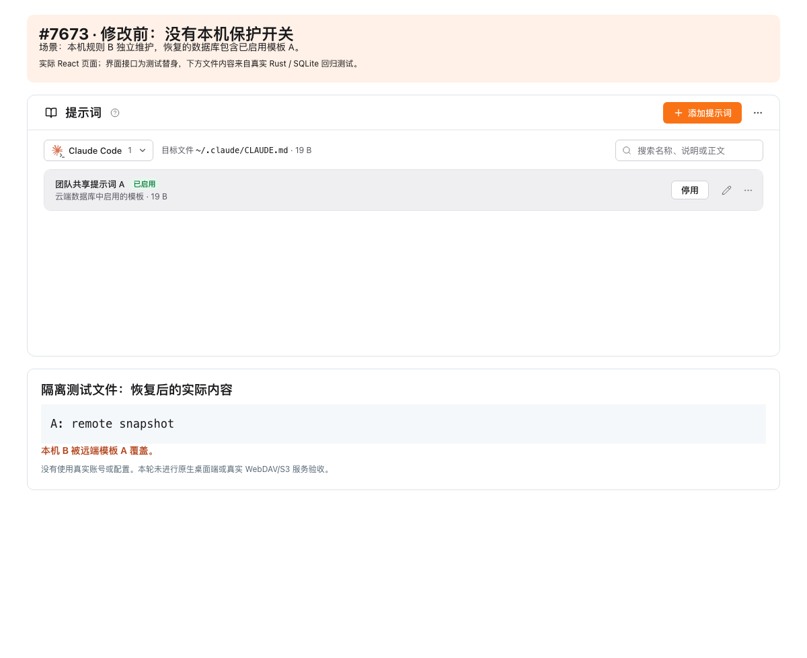
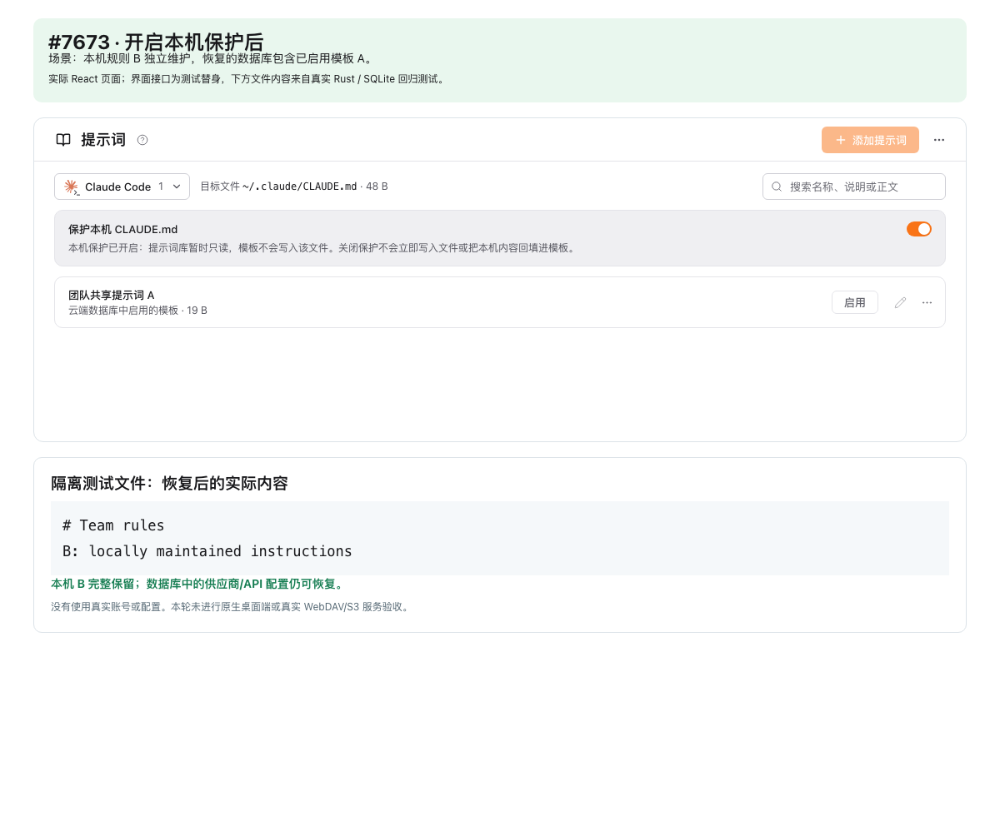
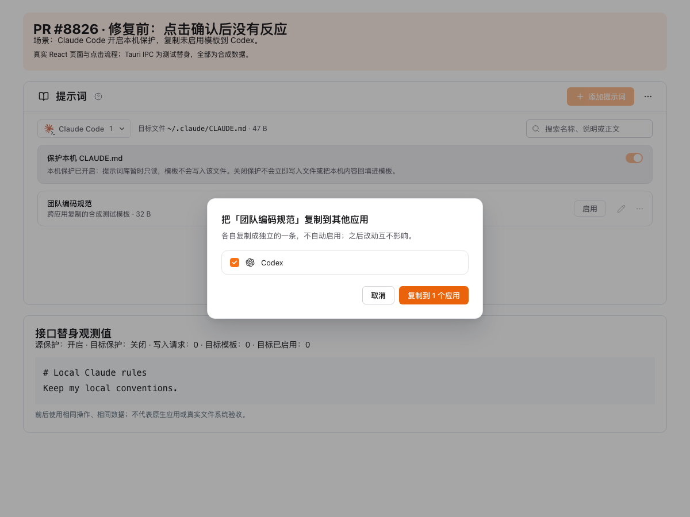
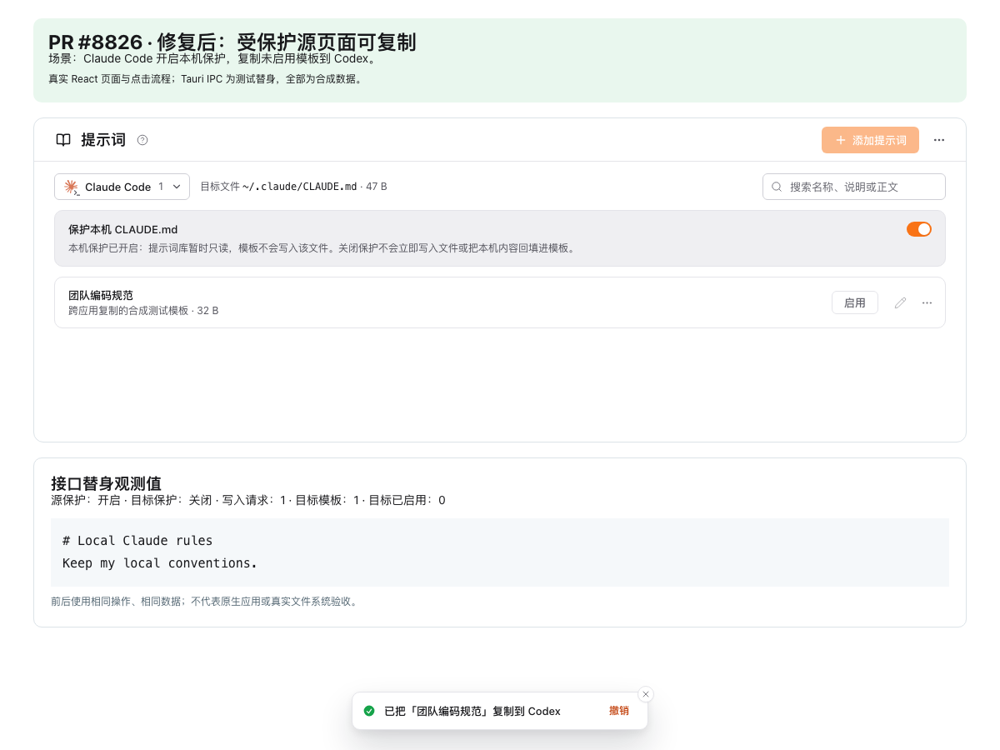

# Local prompt-file protection evidence

Refs #7673. This change implements only opt-in local rule-file protection for Claude Code and Codex. API-only synchronization remains outside this PR.

## Screenshots

| Before | Protection enabled |
|---|---|
|  |  |

[After releasing protection, before explicit adoption](released.png).

The screenshots render the actual React components with a controlled Tauri IPC fixture. The displayed rule-file contents come from real Rust/SQLite regression results. They are not packaged native-app or live WebDAV/S3 screenshots. All inputs use synthetic rules and credentials.

## Local validation (2026-10-24)

- macOS ARM64, Node 22.22.2, Rust 1.95.
- Frontend: 255 files / 3,280 tests passed; TypeScript, formatting and renderer build passed.
- Backend with `test-hooks`: 4,028 unit tests + 218 integration tests passed, 0 failed, 11 existing default ignores. Rust formatting and strict Clippy passed.
- The dedicated `prompt_file_protection` suite has 10 passing tests on this platform, including directory changes, legacy migration, release/adoption, stale edits, unreadable policies and files, exact backups, and unresolved parent paths.
- Browser checks confirmed protected controls, copying, policy toggles, and an inactive template after releasing protection, with no page errors.

```sh
cargo test --locked --features test-hooks --manifest-path src-tauri/Cargo.toml --test prompt_file_protection
```

Full backend validation used an isolated `CC_SWITCH_TEST_HOME` and `NO_PROXY=127.0.0.1,localhost,::1` for loopback fixtures. No Windows/Linux native-app or real cloud-storage validation is claimed. This policy governs these applications' prompt-management paths; it is not a filesystem-wide lock against other applications sharing a target or a user explicitly saving another file there.

## Review follow-up: copying from a protected app

The maintainer identified a silent failure on confirmation: the source page's read-only check blocked copying even though only the target receives an inactive template. Cross-app copying now acquires the same loading/reload/write lock without requiring the source to be writable. Target protection is still enforced by the existing backend call, with the existing failure notification.

| Before: confirmation leaves the dialog open | After: inactive template copied, source remains protected |
|---|---|
|  |  |

[A protected target still reports a failure](copy-protected-target.png).

The before component is from `9186fc0dc038bece5866166433b1d6b1e30ded99`. Both screenshots use the same synthetic source and target state with actual React components and clicks. The counters and file contents are observations of the controlled IPC fixture, not native filesystem evidence.

Three new component cases fail on the prior implementation and pass with the fix. They cover protected Claude-to-Codex and Codex-to-Claude copies, duplicate confirmation, queued refreshes, a protected target among multiple destinations, and undo affecting only a successfully copied target. The full `PromptPanel` suite passes all 41 tests. Browser checks reproduce the silent failure before the fix, then verify successful inactive copying and the protected-target error, with no page errors.

The follow-up frontend rerun passes all 255 files / 3,283 tests, TypeScript, formatting, and the renderer production build. This follow-up changes no Rust code; the backend results above were obtained on the preceding commit.
