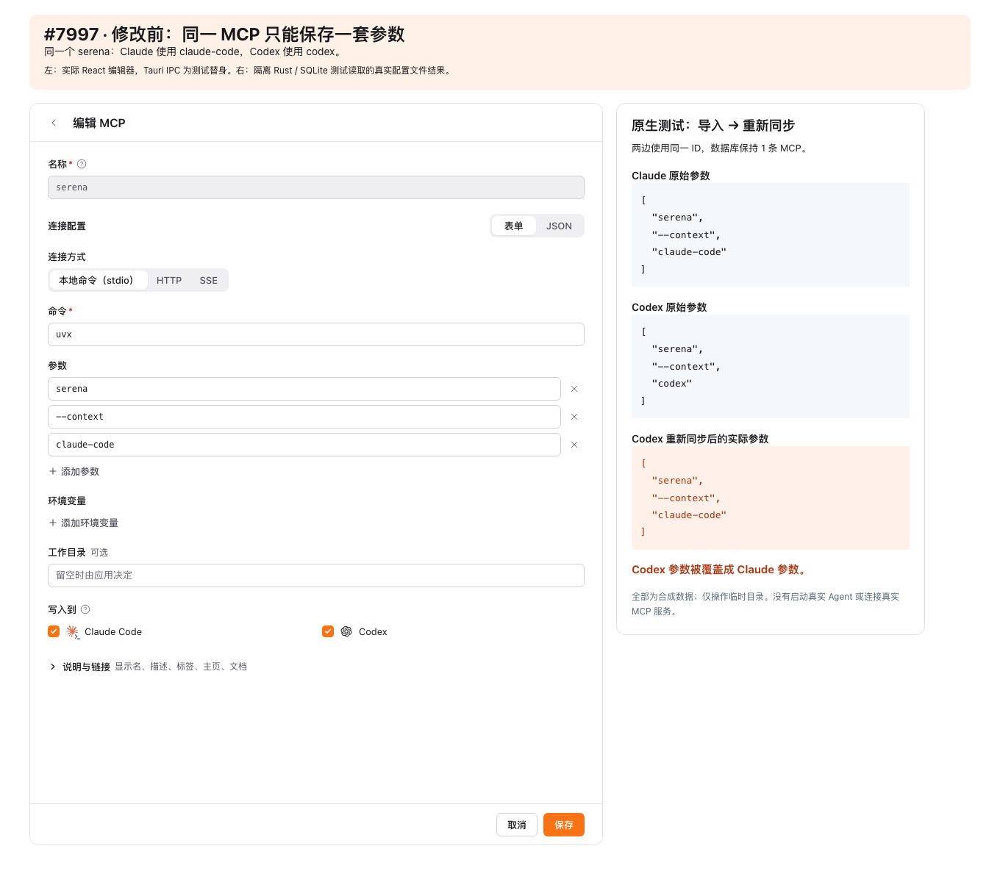
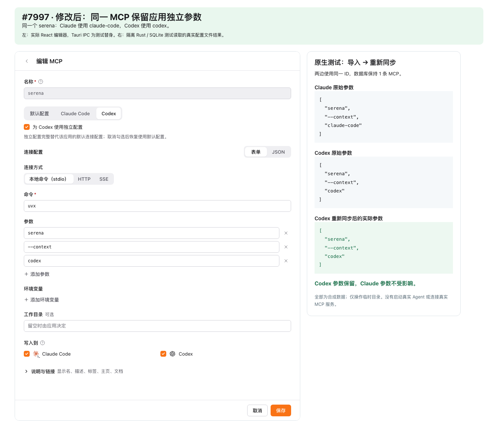

# Per-app MCP connections — evidence for #7997

One logical MCP ID can retain a shared default and complete independent connection configurations for the 11 clients currently managed by CC Switch: Claude Code, Codex, Gemini CLI, Grok Build, OpenCode, Hermes, Pi, MiniMax Code, Kimi Code, Antigravity and Oh My Pi.

## Before and after

| Before: Codex receives the Claude arguments on resync | After: each application's arguments survive |
|---|---|
|  |  |

[All 11 application scopes and their native-file samples](agents.png).

The before component comes from `c72c82cfbed609fc672dbeac2f369a81c83ff331`. The screenshots render actual React components with controlled Tauri IPC fixtures. The file results beside them come from real isolated Rust/SQLite tests. All commands, paths and values are synthetic. No actual Agent process or real MCP service was started; these are not packaged native-app or live-service screenshots.

## What the regressions cover

- Same-ID import, repeated import, save, application toggles, resync, reset to default, deletion, database reopen, JSON migration, SQL sync/restore and SQLite restore.
- Application-specific JSON/TOML/YAML projection, stdio and HTTP, empty positional arguments, literal paths, headers and environment variables.
- Native format defaults do not detach a shared connection; genuine changes to native options are adopted and survive backup/restore.
- Invalid override records are rejected in staging after all restoration writes, including trigger-induced changes, before replacing the current database.
- Pi disabled-entry updates check the previous connection, preserve disabled state, reject foreign changes and roll back on a later write failure. OMP import and ownership checks agree on empty optional collections.
- Editing or merely browsing one application cannot normalize another application's untouched configuration.

Primary tests: `src-tauri/tests/mcp_app_overrides.rs`, `src-tauri/tests/mcp_app_overrides_agents.rs`, the MCP command/schema/backup/deep-link suites, and `tests/components/McpFormModal.test.tsx`.

The implementation was assisted by AI and reviewed in separate agent passes for write/import paths and storage/restoration. Reported findings were reproduced, fixed and re-reviewed. Current test totals and the tested base are recorded in the PR description.

## Scope

An override replaces the shared connection rather than merging fields. Native-owned options retain their existing adapter rules. Claude Desktop and OpenClaw remain outside CC Switch's MCP management. Standard `mcpServers` JSON copying exports the default; database backup/sync retains independent configurations.

The database migration is v23 → v24. Older clients cannot open the new schema; retain the existing pre-migration backup for downgrade. This change does not introduce a transaction spanning all applications' files. Local validation is on macOS ARM64; Windows/Linux runtime and real Agent interoperability are not claimed.

## Local verification — 2026-10-25

Based on v4.0.20 (`85ad496`), macOS ARM64, Node 22.22.2 and Rust 1.95.

- Frontend: 255 files / 3,325 tests passed, with `TZ=UTC`, one worker and the original timeout.
- Backend with `test-hooks`: 4,060 unit + 231 integration = 4,291 passed; 11 existing ignores.
- TypeScript, formatting, renderer build and strict Clippy passed. Browser save/reopen and all 11 scope selections passed with no page errors.
- The PR records an initial midnight-sensitive session fixture and parallel UI test timeouts; isolated checks and the final full serial suite passed without changing or skipping tests.
