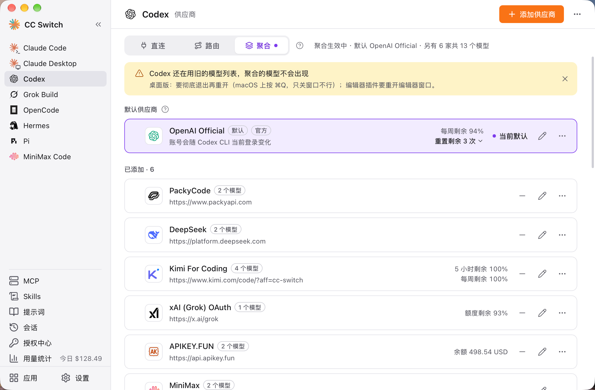
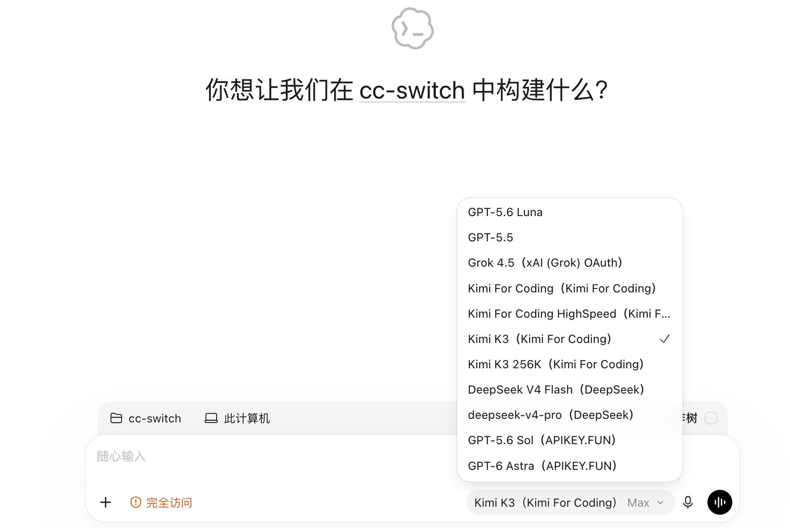

# 4.6 聚合模式

## 功能说明

聚合模式把多家供应商的模型放进 Claude Code 或 Codex 的同一个模型列表。在客户端的 `/model` 里选哪个模型，请求就发给哪一家，不用回到 CC Switch 切换供应商。

聚合模式只支持 **Claude Code** 和 **Codex**，两个应用的供应商和聚合名单需要分别配置。

完整图文步骤见 [聚合模式使用攻略](../../../guides/aggregation-mode-guide-zh.md)。

## 与路由的区别

| | 路由 | 聚合 |
|------|------|------|
| 同一时间使用的供应商 | 一家（或按故障转移队列轮换） | 多家，按所选模型分发 |
| 故障转移 | 支持 | 不支持 |
| 切换供应商的方式 | 在 CC Switch 里切换 | 在客户端 `/model` 里选模型 |
| 适用应用 | Claude Code / Codex / Gemini CLI / Grok Build | 仅 Claude Code / Codex |

两者都经过本机的路由服务，所以都需要 CC Switch 保持运行。一个应用同一时间只能处于直连、路由、聚合三种模式之一。

## 进入聚合模式

### 操作位置

侧栏选择 Claude Code 或 Codex → 页面顶部的「聚合」标签

### 操作步骤

1. 点「聚合」标签。点标签只是查看，不会改动配置
2. 配好各家的模型列表，把需要的供应商加入聚合名单，再确认默认供应商（见下文）
3. 点“切换到聚合模式”
4. 在弹出的确认框里查看默认供应商和将出现在 `/model` 里的模型，点“切换到聚合模式”确认

切换后页面会显示“聚合生效中 · 默认”，以及默认供应商和另外几家共多少个模型。回到直连点“回到直连”，改用路由点「路由」标签里的“开始路由”。

## 添加和移除供应商

### 添加

在「聚合」标签下，「可添加」列表里是还没加入的供应商。点卡片上的“添加”，这家的模型就会出现在客户端的模型列表里。

### 移除

「已添加」列表里点卡片上的“移除”。已添加的供应商会同时写进客户端的配置。

> ⚠️ 默认供应商不能移除，请先把别的供应商设为默认。

### 设置每家的模型

编辑供应商时，表单里有「模型列表」。配置模型列表和把供应商加入聚合名单是两个步骤：保存供应商后，还要在「可添加」区域点“添加”。

#### 获取模型列表

填好 API 地址、密钥或完成对应账号配置后，点击“获取模型列表”。CC Switch 会向供应商查询模型，并适配已支持的接口地址和返回格式。获取成功后，搜索并勾选需要的模型，点击“添加所选模型”批量加入；无需把返回的全部模型都加入。

#### 自动补全模型信息

以 Codex 为例，勾选模型并加入列表后，CC Switch 会自动从 models.dev 获取模型资料，补全可匹配到的上下文窗口、思考等级和文字／图片输入能力。匹配当前供应商地址的内置预设优先，其余空缺再由 models.dev 的供应商或原厂资料补充。

自动补全只填写空缺项，保留已有参数，并提示信息来源供核对。不同供应商部署的同名模型可能有不同能力，请以当前供应商实际支持的参数为准；无法匹配到的信息可以手动填写。

#### 手动添加模型

供应商未开放模型列表接口、列表暂未包含新模型，或需要填写自定义模型别名时，可以点击“手动添加”，填写供应商实际支持的模型 ID，再按需填写显示名称和能力参数。修改名称、上下文窗口等配置不会改变模型本身的能力。

#### 默认模型

- 配置的模型会出现在客户端的模型选择器里，选中后请求发给对应供应商
- ★ 表示这家供应商的默认模型。Claude Code 中它位于列表第一项，供默认供应商的启动和后台任务使用；Codex 使用配置中指定的默认模型
- Claude Code 供应商既未配置模型列表，也未配置模型映射时，加入聚合后不会新增可选模型；Codex 还可使用其已配置的默认模型
- 模型列表修改后的客户端刷新方式见下文“什么时候需要重启”

## 默认供应商

默认供应商承接所有不带前缀的请求。在供应商卡片上点“设为默认”可以更换。

使用 Codex 官方账号时，可以将 **OpenAI Official 设为默认供应商**，再添加其他供应商。OpenAI Official 只能作为默认供应商，不能作为普通聚合成员加入。

**聚合模式暂不支持 Claude 官方订阅**。需要使用该订阅时，请回到直连模式，在 Claude Code 中通过官方登录流程使用。这个限制针对 Claude 官方订阅，不影响 Claude Code 聚合其他已支持的模型供应商。

支持官方账号接入不等于承诺账号“零风险”，使用时仍需遵守平台规则。官方说明：[Codex 认证](https://learn.chatgpt.com/docs/auth#alternative-model-providers)、[Claude Code 认证与凭据使用](https://code.claude.com/docs/en/legal-and-compliance#authentication-and-credential-use)。

## `/model` 里的 `ccs-` 前缀

除默认供应商外，其他已添加的供应商，它们的模型会以 `ccs-` 前缀出现在 `/model` 里。选择带 `ccs-` 前缀的模型，请求发给对应的那一家；选择不带前缀的，请求发给默认供应商。

> 同一会话里换模型后，新模型要重新建立提示词缓存，第一轮费用会高一些。Claude Code 需要 2.1.243 或更新版本。

## 什么时候需要重启

| 应用 | 聚合模型列表变化后 |
|------|------------------|
| Claude Code | 立即生效 |
| Codex | 需要彻底重启 |

Codex 只在启动时读取模型列表。进入或退出聚合、添加或移除供应商、改动某家的模型后，页面会提示“Codex 还在用旧的模型列表，聚合的模型不会出现”，按客户端形态处理：

- **命令行**：重开 codex 不够，要点提示里的“重启 Codex 守护进程”。所有终端里的 codex 共用这个守护进程，正在运行的任务会被中断
- **桌面版**：彻底退出再重开。macOS 上按 ⌘Q，只关窗口不行
- **编辑器插件**：重开编辑器窗口

在已经加载好的模型列表里选择另一个模型，不需要每次重启。Claude Code 在 CC Switch 改写客户端配置后，如果当前选中的是聚合模型，请按提示重新选择一次。

## Codex 子 agent 用另一个模型

Codex 的子 agent 默认跟随主模型。想让主 agent 用 GPT、子 agent 用 DeepSeek 这类便宜的模型时，在「切换到聚合模式」的确认框里就可以选；聚合生效后，也能随时在聚合页签右上角点齿轮打开「聚合设置」修改：

- **子代理模型**：从聚合里已发布的模型中选一个，主 agent 派出的子 agent 默认用它；主 agent 派单时自己指定了模型的除外。选「跟随主模型」恢复默认
- **子代理推理强度**：只列所选模型支持的档位，选「模型默认」时用该模型自己的默认档
- **写在哪里**：CC Switch 写进 `~/.codex/config.toml` 的 `[agents]`（`default_subagent_model`、`default_subagent_reasoning_effort`）。不用重启 Codex：新开的对话就会用上，已经开着的对话仍按原来的设置。这是本机设置，不跟供应商走；聚合模式下供应商卡上的子代理设置不写入
- **模型不在聚合里了**：所选供应商被移出聚合或不再发布这个模型时，不写这两项，子 agent 暂时跟随主模型；加回来后自动恢复。不会留下 Codex 找不到的模型名（那样每次派子 agent 都会失败）
- **跨供应商**：子 agent 和主 agent 不在同一家时，必须打开下面的经典子 agent 工具（默认已打开），否则子 agent 读不到任务。默认那家自己的模型不在选项里，所以选出来的一定是另一家；如果你关过经典工具，选好模型时会看到提醒

## Codex 自动审批用另一个模型

Codex 开了自动审批（Approve for me，`approvals_reviewer = "auto_review"`）时，每个要越过沙箱的操作都会先交给一个审批模型判断能不能放行。审批请求和主对话发给同一家供应商；聚合模式下可以借 `ccs-` 模型把它换到另一家：在聚合页签右上角点齿轮打开「聚合设置」，选「自动审批模型」。

- **默认**：默认那家是官方时，用官方的 Auto Review（`codex-auto-review`）；是第三方时，由主模型自己审批
- **能选什么**：聚合里已发布的模型（默认那家自己的除外）。比如主 agent 用 GPT，审批交给更便宜、更快的模型
- **写在哪里**：CC Switch 写进模型目录（`cc-switch-model-catalog.json`）每一行的 `auto_review_model_override`。Codex 只在启动时读模型目录，改完要重启 Codex（见上文「什么时候需要重启」）
- **模型不在聚合里了**：所选供应商被移出聚合或不再发布这个模型时不写，审批暂时用默认模型；加回来后自动恢复
- **选听指令的模型**：审批结果要按约定的 JSON 返回。经 Chat / Anthropic 格式转换的模型只靠提示词约束，回答不合格式会算作审批失败
- **直连、路由模式**：在供应商卡的编辑页选「自动审批模型」，只能选这张卡模型列表里的模型。卡上没有模型列表时，Codex 会用官方的 `codex-auto-review`，只有部分转发 ChatGPT 账号的中转认它，不认就会报 404；在模型列表里加上模型后，默认改为主模型自己审批，也可以另选一个。聚合模式下卡上的这一项不生效

## Codex 子 agent 读不到任务

关掉了经典子 agent 工具，又让主 agent 和子 agent 用了不同供应商的模型时，子 agent 可能报 `Encrypted function output content could not be decrypted`、`stream disconnected before completion` 或 `unreadable_encrypted_agent_task`。原因是 Codex 新版的子 agent 工具会让主 agent 那家供应商加密任务，换一家就解不开。

- **解决**：在聚合页签的「聚合设置」里重新打开「聚合模式下子 agent 用经典工具」（默认打开），然后重启 Codex。聚合的所有模型改用经典子 agent 工具，任务以明文传递
- **代价**：没有 `followup_task`、`interrupt_agent` 等新版功能。只有主、子 agent 始终在同一家时才可以关掉
- **范围**：只影响聚合模式
- **开了不生效**：`~/.codex/config.toml` 的 `[features]` 里如果有 `multi_agent_v2 = true`，它优先于这个开关，需要先删掉
- **不开开关**：让子 agent 用和主 agent 同一家的模型

## 官方额度用完后第三方也发不出去

默认供应商是 OpenAI Official 时，官方 5 小时额度用完后，Codex 可能锁住发送键，或者模型选择器只剩“Luna Reserve”。这是 Codex 客户端自己的限制：它自己查询账号额度，发现用完就在请求发出前把模型换成 Luna Reserve，请求到不了 CC Switch。

- **绕开**：把一家第三方供应商「设为默认」，彻底重启 Codex，然后新开会话
- **恢复**：官方额度恢复后，把 OpenAI Official 设回默认，再重启一次 Codex
- **代价**：期间 OpenAI 官方模型不在选择器里，而它们本来就已用完额度
- **直连第三方也被锁**：检查「设置 → 应用配置 → Codex」里的「非接管切换时保留官方登录」，关掉后重新切换一次供应商并重启 Codex
- **仍然被锁**：请到 [#7962](https://github.com/farion1231/cc-switch/issues/7962) 反馈

## 限制

- **不做故障转移**：聚合模式下队列和设置会保留，回到路由模式后恢复
- **Codex 的 OpenAI Official 只能作默认供应商**，不能作为普通聚合成员加入
- **暂不支持 Claude 官方订阅**，需要回到直连模式使用
- **默认供应商不能移除**
- **需要 CC Switch 保持运行**：退出 CC Switch 会自动回到直连，下次启动再接上
- 回到路由模式时，聚合的模型会从 `/model` 撤下（名单保留），已选中的聚合模型需要改回普通模型

## 致谢

聚合模式的许多设计参考了 [opencodex](https://github.com/lidge-jun/opencodex)，感谢作者和贡献者。
